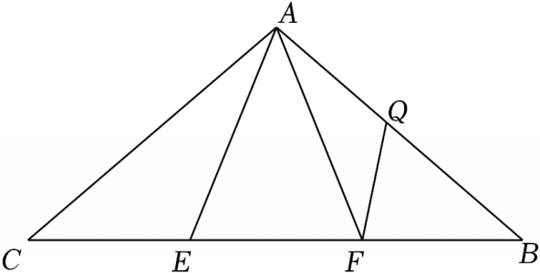

# 23 题精讲 12 · 等腰三角形中的双次相似

## 📝 题目

如图，在等腰三角形 $ABC$ 中，$AB=AC$，点 $E$、$F$ 在线段 $BC$ 上（依题图自 $C$ 到 $B$ 依次为 $C$、$E$、$F$、$B$），点 $Q$ 在线段 $AB$ 上，且 $CF=BE$，$AE^2=AQ\cdot AB$。

求证：(1) $\angle CAE=\angle BAF$；

(2) $CF\cdot FQ=AF\cdot BQ$。

## 🧭 思路导航（渐进提示）

- **提示 1（识别）**：$CF=BE$ 是"同侧等量"条件，等腰底边上两对线段的差相等 → $CE=BF$，配上 $AB=AC$、$\angle B=\angle C$ 恰好 **SAS 全等**开路；(2) 的 $AE^2=AQ\cdot AB$ 是母子型比例条件，把 $AB$ 换成 $AC$、$AE$ 换成 $AF$ 后就是第二次相似的比例式。
- **提示 2（突破）**：(1) 全等 △ACE≌△ABF 一举给出 $\angle CAE=\angle BAF$ 与 $AE=AF$ 两条信息，后者是(2)的关键储备。(2) 由 $AE^2=AQ\cdot AC$ 与 $AF=AE$ 得 $\frac{AC}{AF}=\frac{AE}{AQ}$，夹角恰是(1)证得的等角（$Q$ 在 $AB$ 上，$\angle FAQ$ 即 $\angle BAF$）→ SAS 相似；剩下的工作全部是**等腰等角 + 邻补角**的传递。
- **提示 3（路线）**：(1) $CF=BE$ → $CF-EF=BE-EF$ → $CE=BF$；$\triangle ACE\cong\triangle ABF$（$AC=AB$、$\angle C=\angle B$、$CE=BF$）→ $\angle CAE=\angle BAF$、$AE=AF$。(2) $AE^2=AQ\cdot AB$ 且 $AB=AC$ → $\frac{AC}{AF}=\frac{AE}{AQ}$，夹角 $\angle CAE=\angle FAQ$ → △ACE∽△AFQ → $\angle AEC=\angle AQF$；取邻补角得 $\angle AEF=\angle BQF$，再用 $AE=AF$ 得 $\angle AEF=\angle AFE$，而 $\angle AFE$ 与 $\angle AFC$ 是同一个角（$C$、$E$ 在 $F$ 同侧）→ $\angle AFC=\angle FQB$；配 $\angle C=\angle B$ → △CAF∽△BFQ → $\frac{CF}{BQ}=\frac{AF}{FQ}$，交叉相乘收尾。

## ✍️ 详解

**(1)** $AB=AC$（已知）→ $\angle B=\angle C$（等边对等角）。

依题图 $E$ 在 $C$、$F$ 之间、$F$ 在 $E$、$B$ 之间 → $CF=CE+EF$，$BE=BF+FE$（线段的和差）。

$CF=BE$（已知）→ $CE+EF=BF+EF$（等量代换）。

→ $CE=BF$（等式性质）。

在 $\triangle ACE$ 与 $\triangle ABF$ 中：

$AC=AB$（已知），

$\angle C=\angle B$（已证），

$CE=BF$（已证）。

→ $\triangle ACE\cong\triangle ABF$（边角边，SAS）。

→ $\angle CAE=\angle BAF$，$AE=AF$（全等三角形对应角、对应边相等）。$\blacksquare$

**(2)** $AE^2=AQ\cdot AB$（已知），$AB=AC$（已知）→ $AE^2=AQ\cdot AC$（等量代换）。

→ $\dfrac{AE}{AQ}=\dfrac{AC}{AE}$（比例性质：外项积等于内项积）。

由(1) $AE=AF$ → $\dfrac{AC}{AF}=\dfrac{AE}{AQ}$（等量代换）。

$\angle FAQ=\angle BAF$（同一个角：$Q$ 在线段 $AB$ 上，射线 $AQ$ 与射线 $AB$ 重合）。

→ $\angle CAE=\angle FAQ$（等量代换，由(1)）。

在 $\triangle ACE$ 与 $\triangle AFQ$ 中：$\dfrac{AC}{AF}=\dfrac{AE}{AQ}$（已证），$\angle CAE=\angle FAQ$（已证）。

→ $\triangle ACE\backsim\triangle AFQ$（两边对应成比例且夹角相等）。

→ $\angle AEC=\angle AQF$（相似三角形对应角相等；对应顶点 $A\leftrightarrow A$、$C\leftrightarrow F$、$E\leftrightarrow Q$）。

$E$ 在线段 $BC$ 上，$C$ 与 $F$ 在 $E$ 两侧 → $\angle AEF$ 与 $\angle AEC$ 互补（邻补角定义）。

$Q$ 在线段 $AB$ 上 → $\angle BQF$ 与 $\angle AQF$ 互补（邻补角定义）。

→ $\angle AEF=\angle BQF$（等角的补角相等）。

$AE=AF$ → $\angle AEF=\angle AFE$（等边对等角）→ $\angle AFE=\angle BQF$（等量代换）。

$\angle AFE$ 与 $\angle AFC$ 是同一个角（依题图 $C$、$E$ 都在 $F$ 的同一侧，射线 $FE$ 与射线 $FC$ 重合）。

→ $\angle AFC=\angle FQB$（等量代换）。

在 $\triangle CAF$ 与 $\triangle BFQ$ 中：$\angle ACF=\angle FBQ$（即 $\angle C=\angle B$，已证），$\angle AFC=\angle FQB$（已证）。

→ $\triangle CAF\backsim\triangle BFQ$（两角对应相等）。

→ $\dfrac{CF}{BQ}=\dfrac{AF}{FQ}$（相似三角形对应边成比例；对应顶点 $C\leftrightarrow B$、$A\leftrightarrow F$、$F\leftrightarrow Q$）。

→ $CF\cdot FQ=AF\cdot BQ$（比例性质）。$\blacksquare$

**（证后小结）**：本题是"一次全等 + 两次相似"的标准链：全等给等角与等线段，第一次相似用比例条件与等角，第二次相似把结论需要的四条线段收进同一个比例式。

**（自洽检验）**：取 $AB=AC=\sqrt{13}$、底边 $BC=4$、$CF=BE=1$ 核算：$CE=BF=3$、$AE=AF=\sqrt{10}$、$AQ=\frac{10}{\sqrt{13}}$，验证 $\frac{AC}{AF}=\frac{AE}{AQ}=\frac{\sqrt{130}}{10}$，链条闭合，无多余条件。

## ⚠️ 评分点与易错

- 图中底边顺序是 $C$、$E$、$F$、$B$：$CE=BF$ 用"$CF=CE+EF$、$BE=BF+FE$"作差；若按 $B$、$E$、$F$、$C$ 的习惯顺序写减法，与题图不符。
- $\angle AFE$ 与 $\angle AFC$ 是**同一个角**（$C$、$E$ 在 $F$ 同侧），而 $\angle AEF$ 与 $\angle AEC$ 才是互补的一对——题源解答在此处跳跃，必须分清哪对角取补、哪对角直接等同。
- 第二次相似的对应顶点顺序 $A\leftrightarrow A$、$C\leftrightarrow F$、$E\leftrightarrow Q$：比例式是 $\frac{AC}{AF}=\frac{AE}{AQ}$，写反会导致夹角对不上。
- "$\angle FAQ=\angle BAF$"的理由是 $Q$ 在线段 $AB$ 上（射线重合），要写一句，不能默认。
- 题源把"$\angle BQF=\angle AFE$"直接写出，省略了两次邻补角传递，书写时补全。

## 🔗 关联

- [[03-数学/专题/第23题-几何论证]] · [[03-数学/知识点/九年级/相似三角形]]（SAS 相似、母子型比例条件）
- 同类题：[[23-10-矩形与相似全等]]（全等开路 + 相似）、[[25-06-圆中比例中项]]（比例中项式条件的使用）、[[25-13-双角平分线与相似]]（等角传递 + 双次相似）
