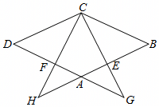

# 23 题精讲 13 · 菱形延长线上的相似

## 📝 题目

如图，在菱形 $ABCD$ 中，点 $E$、$F$ 分别在边 $AB$、$AD$ 上，$BE=DF$，$CE$ 的延长线交 $DA$ 的延长线于点 $G$，$CF$ 的延长线交 $BA$ 的延长线于点 $H$。

(1) 求证：$\triangle BEC\backsim\triangle BCH$；

(2) 如果 $BE^2=AB\cdot AE$，求证：$AG=DF$。

## 🧭 思路导航（渐进提示）

- **提示 1（识别）**：$BE=DF$ 夹在菱形的一组对角 $\angle B$、$\angle D$ 之间，是现成的 **SAS 全等**（△CDF≌△CBE）；而(1)要证的两个三角形 $\triangle BEC$、$\triangle BCH$ 有公共角 $\angle B$，只缺一组等角——从全等的对应角经平行线搬运即可。(2) 的 $BE^2=AB\cdot AE$ 是比例中项条件，指向"A 字型相似 + 等边代换"。
- **提示 2（突破）**：全等给出 $\angle DCF=\angle BCE$；$CD\parallel BH$（菱形对边 + $H$ 在 $BA$ 延长线上）把这个角以 $CH$ 为截线内错角搬到 $H$ 处，(1) 即成。(2) 优先找含 $AG$ 的"A 字型"：$AG\parallel BC$（$G$ 在 $AD$ 延长线上）给出 △AEG∽△BEC，比例式 $\frac{AG}{BC}=\frac{AE}{BE}$ 与 $BE^2=AB\cdot AE$、$BC=AB$ 三式连环。
- **提示 3（路线）**：(1) 菱形 → $CD=CB$、$\angle D=\angle B$；配 $DF=BE$ → △CDF≌△CBE（SAS）→ $\angle DCF=\angle BCE$；$CD\parallel BH$ → $\angle H=\angle DCF$（内错角）→ $\angle H=\angle BCE$，加公共角 $\angle B$ → 相似。(2) $\angle AEG$ 与 $\angle BEC$ 是对顶角、$\angle AGE=\angle BCE$（$AG\parallel BC$ 内错角）→ △AEG∽△BEC → $\frac{AG}{BC}=\frac{AE}{BE}$；由 $BE^2=AB\cdot AE$ 得 $\frac{AE}{BE}=\frac{BE}{AB}$，再用 $AB=BC$ 得 $\frac{BE}{AB}=\frac{BE}{BC}$ → $AG=BE$；由(1)全等 $DF=BE$ → $AG=DF$。

## ✍️ 详解

**(1)** 四边形 $ABCD$ 是菱形 → $CD=CB$（菱形四条边相等）。

→ $\angle D=\angle B$（菱形对角相等），$AB\parallel CD$（菱形对边平行）。

在 $\triangle CDF$ 与 $\triangle CBE$ 中：

$CD=CB$（已证），

$\angle D=\angle B$（已证），

$DF=BE$（已知）。

→ $\triangle CDF\cong\triangle CBE$（边角边，SAS）。

→ $\angle DCF=\angle BCE$（全等三角形对应角相等）。

$H$ 在 $BA$ 的延长线上 → 射线 $BH$ 与射线 $BA$ 重合 → $CD\parallel BH$（等量代换）。

$F$ 在线段 $CH$ 上（$C$、$F$、$H$ 共线）→ $\angle DCF=\angle DCH$（同一个角）。

$CD\parallel BH$，截线为 $CH$ → $\angle H=\angle DCH$（两直线平行，内错角相等）。

→ $\angle H=\angle BCE$（等量代换）。

又 $\angle EBC=\angle HBC$（同一个角：$E$ 在线段 $AB$ 上，射线 $BE$ 与射线 $BH$ 重合）。

在 $\triangle BEC$ 与 $\triangle BCH$ 中：$\angle BCE=\angle H$（已证），$\angle EBC=\angle HBC$（已证）。

→ $\triangle BEC\backsim\triangle BCH$（两角对应相等的两个三角形相似）。$\blacksquare$

**(2)** $BE^2=AB\cdot AE$（已知）→ $\dfrac{BE}{AB}=\dfrac{AE}{BE}$（比例性质：外项积等于内项积）。

$G$ 在 $DA$ 的延长线上，$AD\parallel BC$ → $AG\parallel BC$（等量代换：直线 $AG$ 即直线 $AD$）。

$AG\parallel BC$，截线为 $GC$ → $\angle AGE=\angle BCE$（两直线平行，内错角相等）。

$A$、$E$、$B$ 共线且 $G$、$E$、$C$ 共线 → $\angle AEG=\angle BEC$（对顶角相等）。

在 $\triangle AEG$ 与 $\triangle BEC$ 中：$\angle AGE=\angle BCE$（已证），$\angle AEG=\angle BEC$（已证）。

→ $\triangle AEG\backsim\triangle BEC$（两角对应相等；对应顶点 $A\leftrightarrow B$、$E\leftrightarrow E$、$G\leftrightarrow C$）。

→ $\dfrac{AG}{BC}=\dfrac{AE}{BE}$（相似三角形对应边成比例）。

→ $\dfrac{AG}{BC}=\dfrac{BE}{AB}$（等量代换）。

菱形 → $AB=BC$（四条边相等）→ $\dfrac{BE}{AB}=\dfrac{BE}{BC}$（等量代换）。

→ $AG=BE$（比例性质：等比的后项相等）。

由(1) $\triangle CDF\cong\triangle CBE$ → $DF=BE$（全等三角形对应边相等）。

→ $AG=DF$（等量代换）。$\blacksquare$

**（证后小结）**：$BE$ 是全链枢纽——(1) 用 $BE=DF$ 造全等，(2) 用 $BE^2=AB\cdot AE$ 造比例，最后经 $AG=BE=DF$ 收口。

**（自洽检验）**：题图中 $G$、$H$ 落在 $A$ 的外侧，与"延长线交点"设定一致，保证内错角、对顶角都按图存在；若 $E$、$F$ 取在 $AB$、$AD$ 中点以外位置，链条照旧成立，说明结论不依赖特殊位置。

## ⚠️ 评分点与易错

- (1) 先证全等再搬角：$\angle DCF$ 的对应角是 $\angle BCE$（不是 $\angle BCH$），对应顶点顺序 $C\leftrightarrow C$、$D\leftrightarrow B$、$F\leftrightarrow E$ 要写对。
- "$CD\parallel BH$"必须交代 $H$ 在 $BA$ 延长线上（射线 $BH$ 与 $BA$ 重合），平行线转移内错角才有落点。
- (2) 的 A 字型是 △AEG∽△BEC（$AG\parallel BC$），比例式 $\frac{AG}{BC}=\frac{AE}{BE}$ 中 $AG$ 对 $BC$、$AE$ 对 $BE$，写反则 $AG=BE$ 变成别的结论。
- $BE^2=AB\cdot AE$ 只在"变形为 $\frac{AE}{BE}=\frac{BE}{AB}$"后才能与相似比例串接；最后一步 $AB=BC$（菱形邻边相等）是消去分母的关键，不能漏。
- 题源(2)直接写"∵CB∥DG，∴△AEG∽△BEC"，省略了对顶角 $\angle AEG=\angle BEC$ 这一组，书写时补全依据。

## 🔗 关联

- [[03-数学/专题/第23题-几何论证]] · [[03-数学/知识点/九年级/相似三角形]]（A 字型、平行线分线段成比例）
- 同类题：[[23-03-等弦与菱形判定]]（菱形性质与判定）、[[23-05-半圆相交弦与菱形]]（菱形判定双条件）、[[25-12-正方形双圆与相似]]（正方形背景的相似链）
