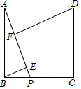

# 23 题精讲 14 · 正方形中的双垂线

## 📝 题目

如图，正方形 $ABCD$ 中，$P$ 是边 $BC$ 上一点，$BE\perp AP$，$DF\perp AP$，垂足分别是点 $E$、$F$。

(1) 求证：$EF=AE-BE$；

(2) 连接 $BF$，如果 $\dfrac{AF}{BF}=\dfrac{DF}{AD}$，求证：$EF=EP$。

## 🧭 思路导航（渐进提示）

- **提示 1（识别）**：一条斜线 $AP$、两个向它作垂线的顶点 $B$、$D$——这是经典的**"正方形双垂直"全等模型**：$AB=AD$ 加一对互余角就能造 △ABE≌△DAF。(1) 是线段和差，全等给出 $BE=AF$ 后只差"看图排序"。(2) 要 $EF=EP$，即 $E$ 平分 $FP$：配上 $BE\perp FP$，只须证 $\triangle BFP$ 等腰。
- **提示 2（突破）**：条件 $\frac{AF}{BF}=\frac{DF}{AD}$ 里没有 $E$——必须用(1)的全等把 $AF$ 换成 $BE$：$\frac{BE}{BF}=\frac{DF}{AD}$ 恰好是两个直角三角形中"对边比斜边"，即 $\sin\angle BFE=\sin\angle DAF$，这是本题最关键的一步转化（题源写作"Rt△BEF∽Rt△DFA"，实为"斜边与直角边对应成比例"的 HL 式相似）。
- **提示 3（路线）**：(1) Rt△ABE 互余 + 正方形直角互余 → $\angle ABE=\angle DAF$ → △ABE≌△DAF（AAS）→ $BE=AF$、$AE=DF$；依题图 $F$ 在线段 $AE$ 上 → $EF=AE-AF=AE-BE$。(2) 由条件与(1)得 $\sin\angle BFE=\sin\angle DAF$ → $\angle BFE=\angle DAF=\angle ABE$；另在 Rt△BEP 中用互余得 $\angle BPE=\angle ABE$ → $\angle BFP=\angle BPF$ → $BF=BP$（等角对等边）；$BE\perp FP$，等腰三角形三线合一 → $E$ 平分 $FP$ → $EF=EP$。

## ✍️ 详解

**(1)** 四边形 $ABCD$ 是正方形 → $AB=DA$，$\angle BAD=90^\circ$（正方形四条边相等、四个角是直角）。

$BE\perp AP$，$DF\perp AP$ → $\angle BEA=\angle AFD=90^\circ$（垂直定义）。

在 Rt$\triangle ABE$ 中：$\angle ABE+\angle BAE=90^\circ$（直角三角形两锐角互余）。

$E$、$F$ 都在线段 $AP$ 上 → 射线 $AE$ 与射线 $AF$ 重合 → $\angle BAF=\angle BAE$（同一个角）。

→ $\angle BAE+\angle DAF=\angle BAD=90^\circ$（等式性质）。

→ $\angle ABE=\angle DAF$（同角的余角相等）。

在 $\triangle ABE$ 与 $\triangle DAF$ 中：

$\angle BEA=\angle AFD=90^\circ$（已证），

$\angle ABE=\angle DAF$（已证），

$AB=DA$（已证）。

→ $\triangle ABE\cong\triangle DAF$（角角边，AAS）。

→ $BE=AF$，$AE=DF$（全等三角形对应边相等）。

依题图 $A$、$F$、$E$、$P$ 依次排列，$F$ 在线段 $AE$ 上 → $EF=AE-AF$（线段和差）。

→ $EF=AE-BE$（等量代换）。$\blacksquare$

**(2)** 已知 $\dfrac{AF}{BF}=\dfrac{DF}{AD}$，由(1) $AF=BE$ → $\dfrac{BE}{BF}=\dfrac{DF}{AD}$（等量代换）。

$BE\perp AP$，$F$ 在线段 $AP$ 上 → $\angle BEF=90^\circ$（垂直定义），即 $\triangle BEF$ 是直角三角形，$BF$ 是斜边。

在 Rt$\triangle BEF$ 中：$\sin\angle BFE=\dfrac{BE}{BF}$（锐角正弦定义：对边比斜边）。

$\angle DFA=90^\circ$（垂直定义），即 $\triangle DAF$ 是直角三角形，$AD$ 是斜边。

在 Rt$\triangle DAF$ 中：$\sin\angle DAF=\dfrac{DF}{AD}$（锐角正弦定义）。

→ $\sin\angle BFE=\sin\angle DAF$（等量代换）。

→ $\angle BFE=\angle DAF$（两锐角的正弦值相等，则这两锐角相等）。

由(1) $\angle DAF=\angle ABE$（已证）→ $\angle BFE=\angle ABE$（等量代换）。

$P$ 在线段 $BC$ 上 → 射线 $BP$ 与射线 $BC$ 重合 → $\angle ABP=\angle ABC=90^\circ$（同一个角、正方形性质）。

依图 $\angle ABP=\angle ABE+\angle EBP$（角的和差）→ $\angle ABE+\angle EBP=90^\circ$（等量代换）。

$BE\perp AP$，$P$ 在线段 $AP$ 上 → $\angle BEP=90^\circ$（垂直定义）。

在 Rt$\triangle BEP$ 中：$\angle BPE+\angle EBP=90^\circ$（直角三角形两锐角互余）。

→ $\angle BPE=\angle ABE$（同角的余角相等）。

射线 $FE$ 与射线 $FP$ 重合、射线 $PE$ 与射线 $PF$ 重合（$E$ 在线段 $FP$ 上）→ $\angle BFP=\angle BPF$（等量代换）。

→ $BF=BP$（等角对等边），即 $\triangle BFP$ 是以 $B$ 为顶角的等腰三角形。

$BE\perp FP$（$F$、$P$ 都在直线 $AP$ 上，而 $BE\perp AP$）→ $BE$ 是等腰 $\triangle BFP$ 底边 $FP$ 上的高。

→ $BE$ 也是底边 $FP$ 上的中线（等腰三角形三线合一）→ $E$ 平分 $FP$。

→ $EF=EP$（线段中点定义）。$\blacksquare$

**（自洽检验）**：设正方形边长为 1、$BP=x$，条件 $\frac{AF}{BF}=\frac{DF}{AD}$ 可解出 $x=\frac{\sqrt5-1}{2}$（$P$ 恰在 $BC$ 的黄金分割位置附近），此时逐段验证确有 $EF=EP$，条件与结论自洽、图形存在。

## ⚠️ 评分点与易错

- 题源写"Rt△BEF∽Rt△DFA"：这里的比例是"直角边比斜边"（$BE$ 对 $BF$、$DF$ 对 $AD$），**不是 SAS**（夹角未知），必须经"锐角正弦相等 → 锐角相等"过渡，否则判定相似缺依据，是本题最大的失分点。
- (1) 中 $EF=AE-AF$ 依赖"$F$ 在线段 $AE$ 上"这一图上事实，应指明排序 $A$、$F$、$E$、$P$，不能不交代就作减法。
- $\angle BFE=\angle DAF$ 之后还要再接(1)的 $\angle DAF=\angle ABE$ 才能跳到 $B$ 处，两次传角缺一不可。
- $\angle BPE=\angle ABE$ 的依据是"正方形直角被 $BE$ 分成两个互余角"与"Rt△BEP 两锐角互余"，两处互余都要点名。
- 最后必须落回"等腰三角形三线合一"（或等腰三角形底边上的高与中线重合），直接写"所以 $EF=EP$"不写依据会被扣分。

## 🔗 关联

- [[03-数学/专题/第23题-几何论证]] · [[03-数学/知识点/九年级/相似三角形]]（AAS 全等 + 相似传角）· [[03-数学/知识点/九年级/锐角的三角比与解直角三角形]]（用正弦作角的传递）
- 同类题：[[23-10-矩形与相似全等]]（矩形 + 对角线垂线，同族模型）、[[25-12-正方形双圆与相似]]（正方形背景）、[[21-06-直角梯形双垂线]]（双垂线图形的角与线段）
