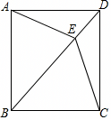

# 23 题精讲 15 · 从菱形到正方形的判定链

## 📝 题目

如图，四边形 $ABCD$ 中，$AD\parallel BC$，$AD=CD$，$E$ 是对角线 $BD$ 上一点，且 $EA=EC$。

(1) 求证：四边形 $ABCD$ 是菱形；

(2) 如果 $BE=BC$，且 $\angle CBE:\angle BCE=2:3$，求证：四边形 $ABCD$ 是正方形。

## 🧭 思路导航（渐进提示）

- **提示 1（识别）**：$AD=CD$ 与 $EA=EC$ 意味着 $D$、$E$ 都在线段 $AC$ 的垂直平分线上，$DE$ 就是这条垂直平分线——但对角线上的全等 △ADE≌△CDE（SSS）是更顺手的入口；判定特殊四边形要**倒着走定义链**：先平行四边形，再菱形。
- **提示 2（突破）**：全等把 $E$ 处的对称性翻译成 $\angle ADE=\angle CDE$，再用 $AD\parallel BC$ 把这个角搬到 $B$ 处，得 $\angle CDE=\angle CBD$ → $BC=CD$，于是 $AD$、$BC$ 平行且相等。(2) 是纯角计算：$BE=BC$ 给出等腰 △BEC，比例 $2:3$ 用**设参**列内角和方程解出，再用"菱形对角线平分内角"把直角找出来。
- **提示 3（路线）**：(1) △ADE≌△CDE（SSS：$AD=CD$、$EA=EC$、$DE$ 公共）→ $\angle ADE=\angle CDE$；$AD\parallel BC$ → $\angle ADE=\angle CBD$（内错角）→ $\angle CDE=\angle CBD$ → $BC=CD=AD$；$AD\parallel BC$ 且 $AD=BC$ → 平行四边形；邻边 $AD=CD$ → 菱形。(2) 设 $\angle CBE=2x$，则 $\angle BCE=\angle BEC=3x$（等边对等角），$2x+3x+3x=180^\circ$ → $x=22.5^\circ$ → $\angle CBE=45^\circ$；菱形对角线平分内角 → $\angle ABC=2\angle DBC=90^\circ$；有一个角是直角的菱形是正方形。

## ✍️ 详解

**(1)** 在 $\triangle ADE$ 与 $\triangle CDE$ 中：

$AD=CD$（已知），

$EA=EC$（已知），

$DE=DE$（公共边）。

→ $\triangle ADE\cong\triangle CDE$（边边边，SSS）。

→ $\angle ADE=\angle CDE$（全等三角形对应角相等）。

$AD\parallel BC$（已知），截线为 $BD$ → $\angle ADE=\angle CBD$（两直线平行，内错角相等）。

→ $\angle CDE=\angle CBD$（等量代换）。

在 $\triangle BCD$ 中，$\angle CDE$ 与 $\angle CBD$ 分别在顶点 $D$、$B$ 处 → $BC=CD$（等角对等边：对应边为 $\angle BDC$、$\angle DBC$ 的对边）。

$AD=CD$（已知）→ $AD=BC$（等量代换）。

$AD\parallel BC$ 且 $AD=BC$ → 四边形 $ABCD$ 是平行四边形（一组对边平行且相等的四边形是平行四边形）。

又 $AD=CD$（邻边相等）→ 四边形 $ABCD$ 是菱形（有一组邻边相等的平行四边形是菱形）。$\blacksquare$

**(2)** 设 $\angle CBE=2x$，则 $\angle BCE=3x$（已知比 $\angle CBE:\angle BCE=2:3$，比例设参）。

$BE=BC$（已知）→ $\angle BCE=\angle BEC$（等边对等角）→ $\angle BEC=3x$（等量代换）。

在 $\triangle BCE$ 中：$\angle CBE+\angle BCE+\angle BEC=180^\circ$（三角形内角和定理）。

→ $2x+3x+3x=180^\circ$（等量代换）。

→ $8x=180^\circ$ → $x=22.5^\circ$（等式性质；$x>0$，无舍根问题）。

→ $\angle CBE=45^\circ$（代入）。

$E$ 在线段 $BD$ 上 → 射线 $BE$ 与射线 $BD$ 重合 → $\angle DBC=\angle CBE=45^\circ$（同一个角）。

由(1) 四边形 $ABCD$ 是菱形 → $BD$ 平分 $\angle ABC$（菱形的每条对角线平分一组对角）。

→ $\angle ABD=\angle CBD=45^\circ$（角平分线定义）。

→ $\angle ABC=\angle ABD+\angle CBD=90^\circ$（角的和差）。

四边形 $ABCD$ 是菱形且 $\angle ABC=90^\circ$ → 四边形 $ABCD$ 是正方形（有一个角是直角的菱形是正方形）。

即 $\boxed{\angle ABC=90^\circ}$，四边形 $ABCD$ 是正方形。$\blacksquare$

**（证后小结）**：判定题的标准书写范式是"逐级上升"：四边形 → 平行四边形 → 菱形 → 正方形，每级都引用一条判定定理并核对它的前提。

**（自洽检验）**：$8x=180^\circ$ 的解 $x=22.5^\circ$ 使 $\angle BCE=\angle BEC=67.5^\circ$，均为合法内角；若比例给成其他值，须检验"等腰 + 内角和"方程解的唯一性——本题 $2:3$ 恰好唯一，且 $\angle CBE=45^\circ$ 保证直角能由平分产生。

## ⚠️ 评分点与易错

- 判定链不可跳步：先证"平行四边形"再证"菱形"再证"正方形"，每一步引用判定定理的名称；直接写"所以是正方形"不给过程分。
- $\angle CDE=\angle CBD$ → $BC=CD$ 用的是"等角对等边"，注意等角在 $\triangle BCD$ 的 $D$、$B$ 两顶点处，对边分别是 $BC$ 与 $CD$，别写反。
- (2) 必须显式设参（设 $\angle CBE=2x$），列内角和方程解出 $x$；"$\angle CBE=45^\circ$"是算出来的，不能由比例直接看出。
- "$BD$ 平分 $\angle ABC$"引用菱形对角线性质；如需自证：$AB=AD$ → $\angle ABD=\angle ADB$，$CB=CD$ → $\angle CBD=\angle CDB$，$AD\parallel BC$ → $\angle ADB=\angle CBD$，三式连环即得。
- $E$ 在对角线 $BD$ 上这一条件两次使用（内错角落点、$\angle DBC=\angle EBC$），每次都要写"射线重合"的说明。

## 🔗 关联

- [[03-数学/专题/第23题-几何论证]]（特殊四边形判定链）
- 同类题：[[23-03-等弦与菱形判定]]（菱形判定）、[[23-05-半圆相交弦与菱形]]（先平行四边形再菱形）、[[25-12-正方形双圆与相似]]（正方形性质综合）
