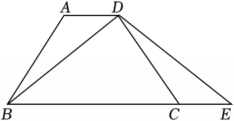

# 23 题精讲 16 · 等腰梯形延长线上的相似

## 📝 题目

如图，在等腰梯形 $ABCD$ 中，$AD\parallel BC$，$E$ 是下底 $BC$ 延长线上一点，且 $CE=AD$。

(1) 求证：$\triangle BDE$ 是等腰三角形；

(2) 如果 $P$ 是线段 $DE$ 上的点，连接 $CP$，且 $AD\cdot DE=BC\cdot PE$，求证：$CP\parallel AB$。

## 🧭 思路导航（渐进提示）

- **提示 1（识别）**：等腰梯形 + 下底延长线上取 $CE=AD$——这是"**补形全等**"套路：$\angle A$ 与 $\angle DCE$ 同为 $\angle ABC=\angle DCB$ 的补角，配上 $AB=CD$、$AD=CE$ 恰好 SAS 全等，把对角线 $BD$ 转移成 $DE$。
- **提示 2（突破）**：(1) 的全等 △ABD≌△CDE 把"等腰"从梯形搬到 △BDE。(2) 的乘积式 $AD\cdot DE=BC\cdot PE$ 要全部换成(1)的等长（$AD=CE$、$DE=BD$），化成 $\frac{CE}{BC}=\frac{PE}{BD}$——一个 **SAS 相似**的现成比例，缺的只是夹角相等。
- **提示 3（路线）**：(1) $AD\parallel BC$ → $\angle A+\angle ABC=180^\circ$；等腰梯形 → $\angle ABC=\angle DCB$；$B$、$C$、$E$ 共线 → $\angle DCB+\angle DCE=180^\circ$ → $\angle A=\angle DCE$；配 $AB=CD$、$AD=CE$ → △ABD≌△CDE（SAS）→ $BD=DE$。(2) 乘积式 → $\frac{AD}{BC}=\frac{PE}{DE}$ → $\frac{CE}{BC}=\frac{PE}{BD}$；由(1) $BD=DE$ → $\angle DEB=\angle DBE$（等腰底角），而 $\angle CEP=\angle DEB=\angle DBC$（两次"射线重合"）→ △CEP∽△CBD（两边成比例夹角相等）→ $\angle ECP=\angle BCD=\angle ABC$ → $CP\parallel AB$（同位角相等，两直线平行）。

## ✍️ 详解

**(1)** $AD\parallel BC$（已知）→ $\angle A+\angle ABC=180^\circ$（两直线平行，同旁内角互补）。

等腰梯形 $ABCD$ → $AB=CD$（两腰相等），$\angle ABC=\angle DCB$（同一底上两底角相等）。

$B$、$C$、$E$ 共线（$E$ 在 $BC$ 延长线上）→ $\angle DCB+\angle DCE=180^\circ$（邻补角定义）。

→ $\angle A=180^\circ-\angle ABC=180^\circ-\angle DCB=\angle DCE$（等式性质、等量代换）。

在 $\triangle ABD$ 与 $\triangle CDE$ 中：

$AB=CD$（已证），

$\angle A=\angle DCE$（已证），

$AD=CE$（已知）。

→ $\triangle ABD\cong\triangle CDE$（边角边，SAS）。

→ $BD=DE$（全等三角形对应边相等）。

→ $\triangle BDE$ 是等腰三角形（有两条边相等的三角形是等腰三角形）。$\blacksquare$

**(2)** $AD\cdot DE=BC\cdot PE$（已知）→ $\dfrac{AD}{BC}=\dfrac{PE}{DE}$（比例性质：外项积等于内项积）。

$AD=CE$（已知），$DE=BD$（由(1)）→ $\dfrac{CE}{BC}=\dfrac{PE}{BD}$（等量代换）。

由(1) $BD=DE$ → $\angle DBE=\angle DEB$（等边对等角：等腰 $\triangle BDE$ 的两个底角）。

$C$ 在 $B$、$E$ 之间 → 射线 $EC$ 与射线 $EB$ 重合；$P$ 在线段 $DE$ 上 → 射线 $EP$ 与射线 $ED$ 重合。

→ $\angle CEP=\angle DEB$（同一个角）。

$E$ 在 $BC$ 延长线上 → 射线 $BE$ 与射线 $BC$ 重合 → $\angle DBE=\angle DBC$（同一个角）。

→ $\angle CEP=\angle CBD$（等量代换）。

在 $\triangle CEP$ 与 $\triangle CBD$ 中：$\dfrac{CE}{CB}=\dfrac{PE}{BD}$（已证），$\angle CEP=\angle CBD$（已证）。

→ $\triangle CEP\backsim\triangle CBD$（两边对应成比例且夹角相等）。

对应顶点为 $C\leftrightarrow C$、$E\leftrightarrow B$、$P\leftrightarrow D$ → $\angle ECP=\angle BCD$（相似三角形对应角相等）。

等腰梯形 → $\angle ABC=\angle DCB$（同一底上两底角相等）。

→ $\angle ECP=\angle ABC$（等量代换）。

→ $CP\parallel AB$（同位角相等，两直线平行：直线 $CP$、$AB$ 被直线 $BCE$ 所截）。$\blacksquare$

**（证后小结）**：本题的相似是"共角共边型"——两个三角形共用顶点 $C$ 且 $C$ 自对应，比例式两侧分母 $CB$、$BD$ 恰是夹角的另一组边，识别出这一模型可以少走弯路。

**（自洽检验）**：由(1) $BD=DE$，(2) 的比例 $\frac{CE}{BC}=\frac{PE}{BD}$ 中四条线段都在题图上取得到；若把 $P$ 取在 $DE$ 延长线上，则 $\angle CEP$ 与 $\angle DEB$ 仍相同但相似变为"两角型"，比例形式会变——题设"$P$ 在线段 $DE$ 上"保证了 SAS 相似的标准形态。

## ⚠️ 评分点与易错

- (1) 的三个角步骤（同旁内角互补 → 底角相等 → 邻补角）缺一不可，"$\angle A=\angle DCE$"是两个补角消去同一角的结论，要写"同角的补角相等"层次。
- 全等对应顶点 $A\leftrightarrow C$、$B\leftrightarrow D$、$D\leftrightarrow E$：$BD$ 的对应边是 $ED$；写错则(2)中 $DE=BD$ 无从引用。
- (2) 相似的夹角 $\angle CEP=\angle CBD$ 靠两次"射线重合（同一个角）"传递，是本题书写密度最高的地方，跳步直接扣依据分。
- 乘积式化为比例式时要对准最终要用的两个三角形：目标是 $\frac{CE}{BC}=\frac{PE}{BD}$，而不是把 $\frac{AD}{BC}=\frac{PE}{DE}$ 原样不动。
- 结论用"同位角相等，两直线平行"：$\angle ECP$ 与 $\angle ABC$ 必须指明是直线 $CP$、$AB$ 被直线 $BC$ 所截的同位角，只写"角相等则平行"不给判定依据。

## 🔗 关联

- [[03-数学/专题/第23题-几何论证]] · [[03-数学/知识点/九年级/相似三角形]]（SAS 相似、补形全等）
- 同类题：[[25-11-直角梯形全等与等腰]]（梯形 + 全等开路）、[[25-09-直角梯形相似综合]]（梯形中的相似链）、[[21-13-梯形中的三角比]]（梯形背景计算）
