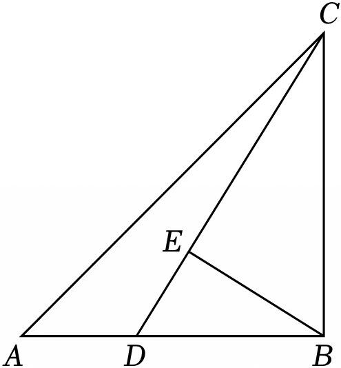

# 23 题精讲 17 · 双垂直与斜边中线

## 📝 题目

如图，在 $\triangle ABC$ 中，$\angle ABC=90^\circ$，点 $D$ 是边 $AB$ 上一点，联结 $CD$，过点 $B$ 作 $BE\perp CD$，垂足为点 $E$。

(1) 求证：$\triangle BDE\backsim\triangle CBE$；

(2) 如果 $AB=BC$，联结 $AE$ 并延长，与边 $BC$ 相交于点 $F$。当点 $F$ 是 $BC$ 的中点时，求证：$BD^2=AD\cdot AB$。

## 🧭 思路导航（渐进提示）

- **提示 1（识别）**：$\angle ABC=90^\circ$ 加上 $BE\perp CD$，是**双垂直（射影）模型**：同角 $\angle CBE$ 的两组互余角造出(1)的一对相似。(2) 要证 $BD^2=AD\cdot AB$，形状是"母子型比例中项"——需要一对以 $BD$、$AE$ 为公共量的相似链；"$F$ 是 $BC$ 中点"必须先用掉，落点是**直角三角形斜边中线**。
- **提示 2（突破）**：Rt△BEC 中 $F$ 是斜边 $BC$ 中点 → $EF=CF=\frac12BC$，△CEF 等腰 → $\angle FEC=\angle ECF$；$\angle AED$ 与 $\angle FEC$ 是对顶角，于是 $\angle AED$ 先被"折"到 $C$ 处，再由(1)折到 $B$ 处——三次传角后 $\angle AED=\angle ABE$，配上公共角 $\angle A$ 得母子相似 △AED∽△ABE。
- **提示 3（路线）**：(1) 互余得 $\angle ECB=\angle DBE$，加一对直角 → △BDE∽△CBE。(2) 由(1)又得 $\frac{ED}{BE}=\frac{BD}{BC}$；母子相似 △AED∽△ABE 给出 $\frac{AE}{AB}=\frac{ED}{BE}=\frac{AD}{AE}$；把两条链在 $\frac{ED}{BE}$ 处对接并用 $AB=BC$，得 $AE=BD$；再取母子比例首尾 $\frac{AD}{AE}=\frac{AE}{AB}$ → $AE^2=AD\cdot AB$，代入 $AE=BD$ 即证。全程无需设参。

## ✍️ 详解

**(1)** $BE\perp CD$ → $\angle CEB=\angle BED=90^\circ$（垂直定义）。

在 Rt$\triangle BCE$ 中：$\angle ECB+\angle CBE=90^\circ$（直角三角形两锐角互余）。

$\angle ABC=90^\circ$（已知），依图 $\angle ABC=\angle DBE+\angle CBE$（角的和差）。

→ $\angle DBE+\angle CBE=90^\circ$（等量代换）。

→ $\angle ECB=\angle DBE$（同角的余角相等）。

在 $\triangle BDE$ 与 $\triangle CBE$ 中：$\angle BED=\angle CEB=90^\circ$（已证），$\angle DBE=\angle ECB$（已证）。

→ $\triangle BDE\backsim\triangle CBE$（两角对应相等的两个三角形相似）。$\blacksquare$

**(2)** $BE\perp CD$，垂足为 $E$ → $\angle BEC=90^\circ$（垂直定义），即 $\triangle BEC$ 是直角三角形，$BC$ 为斜边。

$F$ 是 $BC$ 的中点（已知）→ $EF=\dfrac12BC$（直角三角形斜边上的中线等于斜边的一半）。

$BF=\dfrac12BC$（中点定义）→ $EF=CF=BF$（等量代换）。

→ $\angle FEC=\angle ECF$（等边对等角：$EF=CF$）。

$A$、$E$、$F$ 共线且 $D$、$E$、$C$ 共线，$E$ 在中间 → $\angle AED=\angle FEC$（对顶角相等）。

$F$ 在线段 $BC$ 上 → $\angle ECF$ 与 $\angle ECB$ 是同一个角 → $\angle AED=\angle ECB$（等量代换）。

由(1) $\angle ECB=\angle DBE$（已证）→ $\angle AED=\angle DBE$（等量代换）。

$D$ 在线段 $AB$ 上 → 射线 $BD$ 与射线 $BA$ 重合 → $\angle DBE=\angle ABE$（同一个角）。

→ $\angle AED=\angle ABE$（等量代换）。

又 $\angle EAD=\angle BAE$（同一个角：公共角 $\angle A$）。

→ $\triangle AED\backsim\triangle ABE$（两角对应相等）。

对应顶点 $A\leftrightarrow A$、$E\leftrightarrow B$、$D\leftrightarrow E$ → $\dfrac{AE}{AB}=\dfrac{ED}{BE}=\dfrac{AD}{AE}$（相似三角形对应边成比例）。

由(1) $\triangle BDE\backsim\triangle CBE$，对应顶点 $B\leftrightarrow C$、$D\leftrightarrow B$、$E\leftrightarrow E$ → $\dfrac{ED}{BE}=\dfrac{BD}{BC}$（相似三角形对应边成比例）。

→ $\dfrac{AE}{AB}=\dfrac{BD}{BC}$（等量代换）。

$AB=BC$（已知）→ $\dfrac{AE}{AB}=\dfrac{BD}{AB}$（等量代换）。

→ $AE=BD$（比例性质）。

由 $\dfrac{AD}{AE}=\dfrac{AE}{AB}$（比例链首尾）→ $AE^2=AD\cdot AB$（比例性质）。

$AE=BD$ → $BD^2=AD\cdot AB$（等量代换）。$\blacksquare$

**（证后小结）**：两条相似链各有分工——△AED∽△ABE 供"首尾两项"出等积式、△BDE∽△CBE 供"中间桥"出 $AE=BD$；识别"母子型比例首尾相乘"是证比例中项的通用收口方式。

**（自洽检验）**：设 $BC=2$，则 $BF=EF=CF=1$，$AF=\sqrt5$，$AE=\sqrt5-1$；由 $AE^2=AD\cdot AB$ 解得 $AD=3-\sqrt5$，$BD=AB-AD=\sqrt5-1=AE$，与主链结论一致。题源按此设参计算，其"$AF=5a$""$AD=(3-5)a$"即 $\sqrt5\,a$、$(3-\sqrt5)a$ 的 OCR 讹形；参数法可行但冗长，本讲路线无参数，两法等价。

## ⚠️ 评分点与易错

- "$EF=\frac12BC$"必须引用"直角三角形斜边上的中线等于斜边的一半"，且先说明 $\angle BEC=90^\circ$、$BC$ 是斜边；这是中点条件唯一的用武之地，跳过它后面全部落空。
- 传角链 $\angle AED=\angle FEC=\angle ECF=\angle ECB=\angle ABE$ 中，对顶角、同一个角、互余（由(1)）三种依据混杂，每换一处都要写理由，是本题的主要书写量。
- 母子相似 △AED∽△ABE 的比例式 $\frac{AE}{AB}=\frac{ED}{BE}=\frac{AD}{AE}$ 对应顶点 $E\leftrightarrow B$、$D\leftrightarrow E$，写反则得不到 $AE^2=AD\cdot AB$。
- 结论是"代入 $AE=BD$"而非直接比较：两条比例链分别在 $\frac{ED}{BE}$ 处和首尾处取用，用哪段、舍哪段要清楚。
- 题源解答先设 $FB=FC=FE=a$ 再解出 $AD$、$BD$，属可行但冗长的参数路线；本讲路线无参数，两法结论一致，阅卷均认可。

## 🔗 关联

- [[03-数学/专题/第23题-几何论证]] · [[03-数学/知识点/九年级/相似三角形]]（双垂直模型、母子型相似）
- 同类题：[[21-20-斜边中点与圆]]（斜边中点与直角背景）、[[21-15-斜边中线与正切]]（斜边中线 + 三角比）、[[25-02-梯形外接圆与比例中项]]（比例中项等积式）
