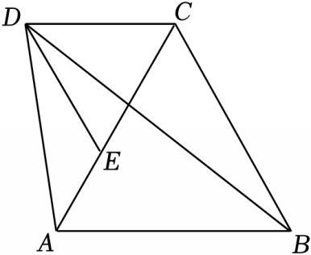

# 23 题精讲 18 · 梯形与黄金分割点

## 📝 题目

如图，在梯形 $ABCD$ 中，$AB\parallel CD$，联结 $AC$、$BD$，$\triangle ABC$ 是等边三角形，$DE\parallel BC$，$DE$ 与 $AC$ 交于点 $E$，$\angle ADB=2\angle DBC$。

(1) 求证：$\triangle ADE\backsim\triangle DBC$；

(2) 求证：点 $E$ 是线段 $AC$ 的黄金分割点。

## 🧭 思路导航（渐进提示）

- **提示 1（识别）**：梯形里"等边三角形 + 双平行（$AB\parallel CD$、$DE\parallel BC$）"，几乎是明示：两条平行线各搬一个 $60^\circ$ 角，在 $C$、$E$ 处**造出第二个等边三角形 △DEC**——这是全部角度信息的来源。(2) 的"黄金分割点"就是一句话的定义：证 $EC^2=AE\cdot AC$。
- **提示 2（突破）**：$\angle ADB=2\angle DBC$ 与 $DE\parallel BC$ 联手：内错角 $\angle EDB=\angle DBC$ 把 $\angle ADB$ 分成 $\angle ADE+\angle EDB$，立得 $\angle ADE=\angle DBC$——(1) 需要的第一组等角；第二组等角在钝角处找：$\angle AED=180^\circ-\angle DEC=120^\circ$，而 $\angle DCB=\angle DCA+\angle ACB=120^\circ$。
- **提示 3（路线）**：(1) $AB\parallel CD$ → $\angle DCA=\angle CAB=60^\circ$（内错角）；$DE\parallel BC$ → $\angle DEC=\angle ACB=60^\circ$ → △DCE 等边 → $DE=DC=EC$；$DE\parallel BC$ → $\angle EDB=\angle DBC$（内错角）→ $\angle ADE=2\angle DBC-\angle EDB=\angle DBC$；再算 $\angle AED=\angle DCB=120^\circ$ → △ADE∽△DBC（两角）。(2) 相似 → $\frac{AE}{DC}=\frac{DE}{BC}$；代 $DE=DC=EC$、$BC=AC$ → $\frac{AE}{EC}=\frac{EC}{AC}$ → $EC^2=AE\cdot AC$ → 黄金分割点定义收口。

## ✍️ 详解

**(1)** $\triangle ABC$ 是等边三角形 → $\angle BAC=\angle ACB=60^\circ$，$AC=BC$（等边三角形三个内角都是 $60^\circ$、三边相等）。

$AB\parallel CD$（梯形），截线为 $AC$ → $\angle DCA=\angle BAC=60^\circ$（两直线平行，内错角相等）。

$DE\parallel BC$（已知），截线为 $AC$ → $\angle DEC=\angle ACB=60^\circ$（两直线平行，内错角相等）。

$E$ 在线段 $AC$ 上 → 射线 $CE$ 与射线 $CA$ 重合 → $\angle DCE=\angle DCA=60^\circ$（同一个角）。

在 $\triangle DCE$ 中：$\angle EDC=180^\circ-\angle DCE-\angle DEC=60^\circ$（三角形内角和定理）。

→ $DE=DC=EC$（等角对等边），即 $\triangle DCE$ 是等边三角形（三个角都相等的三角形是等边三角形）。

$DE\parallel BC$，截线为 $BD$ → $\angle EDB=\angle DBC$（两直线平行，内错角相等）。

依图射线 $DE$ 在 $\angle ADB$ 内部 → $\angle ADB=\angle ADE+\angle EDB$（角的和差）。

$\angle ADB=2\angle DBC$（已知）→ $\angle ADE=2\angle DBC-\angle EDB=\angle DBC$（等式性质、等量代换）。

$\angle AED=180^\circ-\angle DEC=120^\circ$（邻补角定义）。

$\angle DCB=\angle DCA+\angle ACB=60^\circ+60^\circ=120^\circ$（角的和差：射线 $CA$ 在射线 $CD$ 与 $CB$ 之间）。

→ $\angle AED=\angle DCB$（等量代换）。

在 $\triangle ADE$ 与 $\triangle DBC$ 中：$\angle ADE=\angle DBC$（已证），$\angle AED=\angle DCB$（已证）。

→ $\triangle ADE\backsim\triangle DBC$（两角对应相等的两个三角形相似）。

对应顶点为 $A\leftrightarrow D$、$D\leftrightarrow B$、$E\leftrightarrow C$。$\blacksquare$

**(2)** 由(1) $\triangle ADE\backsim\triangle DBC$ → $\dfrac{AE}{DC}=\dfrac{DE}{BC}$（相似三角形对应边成比例）。

由(1) $DE=DC=EC$（已证）→ $\dfrac{AE}{EC}=\dfrac{EC}{BC}$（等量代换：$DC=EC$ 代分母、$DE=EC$ 代分子）。

$\triangle ABC$ 等边 → $BC=AC$（已证）→ $\dfrac{AE}{EC}=\dfrac{EC}{AC}$（等量代换）。

→ $EC^2=AE\cdot AC$（比例性质：外项积等于内项积）。

又 $AC=AE+EC>AE$（线段和大于部分）→ $EC^2=AE\cdot AC>AE^2$ → $EC>AE$（等式性质），即 $EC$ 是分成的两段中较长的线段。

点 $E$ 在线段 $AC$ 上，且 $\dfrac{EC}{AE}=\dfrac{AC}{EC}$（上式变形）。

→ 点 $E$ 是线段 $AC$ 的黄金分割点（黄金分割点的定义：把线段分成两条线段，其中较长线段是全线段与较短线段的比例中项）。$\blacksquare$

**（证后小结）**："双平行 + 等边"是制造第二个等边三角形的固定组合：$AB\parallel CD$ 给 $60^\circ$ 入口角，$DE\parallel BC$ 给 $60^\circ$ 出口角，内角和自动补出第三个 $60^\circ$。

**（自洽检验）**：由 $EC^2=AE\cdot AC$ 与 $AE+EC=AC$ 解得 $\frac{EC}{AC}=\frac{\sqrt5-1}{2}\approx0.618$，即 $EC$ 是较长段、$E$ 偏向 $A$ 侧，与题图"$E$ 在 $AC$ 上靠近 $A$ 一侧"一致。

## ⚠️ 评分点与易错

- 题源解答写"$\angle DCB=\angle CAB=60^\circ$"：凸梯形中 $\angle DCB$ 是内角 $120^\circ$，**这是题源笔误**，应读作 $\angle DCA=\angle CAB=60^\circ$（内错角）；本讲已按自洽版本重写。随后"$\angle AED=\angle DCB=120^\circ$"处的 $\angle DCB$ 才是内角本身——同名两义，书写时务必区分。
- $\angle ADE=\angle DBC$ 的前提是"$\angle ADB=\angle ADE+\angle EDB$"（$DE$ 在 $\angle ADB$ 内部），要依图交代角的和差，不能直接写"$2\angle DBC-\angle DBC$"。
- 两个等边三角形的判定依据不同：△ABC 是已知，△DCE 是由两个 $60^\circ$ 角推得（内角和 + 等角对等边），后者必须写出判定过程。
- 黄金分割点结论要落到定义式 $EC^2=AE\cdot AC$（或 $\frac{EC}{AE}=\frac{AC}{EC}$），只写"所以是黄金分割点"不给定义不完整。
- 相似对应顶点 $A\leftrightarrow D$、$D\leftrightarrow B$、$E\leftrightarrow C$：比例式是 $\frac{AE}{DC}=\frac{DE}{BC}$，若写 $\frac{AE}{DB}$ 会接不进 $DE=DC$ 的代换。

## 🔗 关联

- [[03-数学/专题/第23题-几何论证]] · [[03-数学/知识点/九年级/相似三角形]]（两角相似、平行线搬角）
- 同类题：[[25-17-等腰内接圆与黄金分割]]（黄金分割判定）、[[25-09-直角梯形相似综合]]（梯形 + 相似）、[[21-19-切线与等边三角形]]（等边三角形背景）
