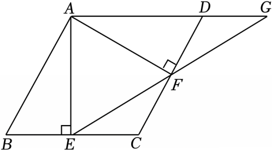

# 23 题精讲 19 · 菱形中的双高与正切

## 📝 题目

如图，在菱形 $ABCD$ 中，$AE\perp BC$，$AF\perp CD$，垂足分别为点 $E$、$F$，射线 $EF$ 交 $AD$ 的延长线于点 $G$。

(1) 求证：$CE=CF$；

(2) 如果 $FG^2=AG\cdot DG$，求证：$\dfrac{AG}{AE}=\dfrac{AF}{BE}$。

## 🧭 思路导航（渐进提示）

- **提示 1（识别）**：菱形两个相邻顶点 $B$、$D$ 向对边作双高——**AAS 全等**（△ABE≌△ADF）直接开路给 $BE=DF$、$AE=AF$；(2) 的 $FG^2=AG\cdot DG$ 是"公共边公共角"的**母子型 SAS 相似**条件（两条成比例的线段夹着公共角 $\angle G$），先把它兑现成一对相似三角形。
- **提示 2（突破）**：目标 $\frac{AG}{AE}=\frac{AF}{BE}$ 四条线段分散，破法是"**等线段集中**"：由(1) $AE=AF$、$BE=DF$，目标化为 $\frac{AG}{AF}=\frac{AF}{DF}$——恰是两个直角三角形里正切值的相等；而两个角（$\angle AEG$ 与 $\angle ADF$）的相等要靠"相似传角 + 等腰底角 + 邻补角"三次接力。
- **提示 3（路线）**：(1) 菱形 → $AB=AD$、$\angle B=\angle D$；配双垂直 → △ABE≌△ADF（AAS）→ $BE=DF$ → $BC-BE=DC-DF$ → $CE=CF$。(2) $FG^2=AG\cdot DG$ → $\frac{DG}{FG}=\frac{FG}{AG}$，公共角 $\angle DGF=\angle FGA$ → △DGF∽△FGA → $\angle GFD=\angle GAF=\angle DAF$；Rt△ADF 互余 → $\angle DAF+\angle ADF=90^\circ$；另一侧 $\angle AFE+\angle AFG=180^\circ$（邻补角）且 $\angle AFG=90^\circ+\angle GFD$（角的和差）→ $\angle AFE=90^\circ-\angle GFD=\angle ADF$；$AE=AF$ → $\angle AEF=\angle AFE$ → $\angle AEF=\angle ADF$；最后 $AE\perp AG$（$AE\perp BC$、$AD\parallel BC$）使 $\tan\angle AEG=\frac{AG}{AE}$、$\tan\angle ADF=\frac{AF}{DF}$，两角相等则正切相等，代 $DF=BE$ 收尾。

## ✍️ 详解

**(1)** 四边形 $ABCD$ 是菱形 → $AB=AD$，$BC=DC$（菱形四条边相等），$\angle B=\angle D$（菱形对角相等）。

$AE\perp BC$，$AF\perp CD$ → $\angle AEB=\angle AFD=90^\circ$（垂直定义）。

在 $\triangle ABE$ 与 $\triangle ADF$ 中：

$\angle AEB=\angle AFD=90^\circ$（已证），

$\angle B=\angle D$（已证），

$AB=AD$（已证）。

→ $\triangle ABE\cong\triangle ADF$（角角边，AAS）。

→ $BE=DF$（全等三角形对应边相等）。

→ $BC-BE=DC-DF$（等式性质）→ $CE=CF$（等量代换）。$\blacksquare$

**(2)** $FG^2=AG\cdot DG$（已知）→ $\dfrac{DG}{FG}=\dfrac{FG}{AG}$（比例性质）。

$\angle DGF=\angle FGA$（同一个角：$D$ 在线段 $AG$ 上，射线 $GD$ 与射线 $GA$ 重合）。

在 $\triangle DGF$ 与 $\triangle FGA$ 中：$\dfrac{DG}{FG}=\dfrac{FG}{AG}$（已证），$\angle DGF=\angle FGA$（已证）。

→ $\triangle DGF\backsim\triangle FGA$（两边对应成比例且夹角相等）。

对应顶点 $D\leftrightarrow F$、$G\leftrightarrow G$、$F\leftrightarrow A$ → $\angle GFD=\angle GAF$（相似三角形对应角相等）。

$G$ 在 $AD$ 的延长线上 → 射线 $AG$ 与射线 $AD$ 重合 → $\angle GAF=\angle DAF$（同一个角）。

在 Rt$\triangle ADF$ 中（$\angle AFD=90^\circ$）：$\angle DAF+\angle ADF=90^\circ$（直角三角形两锐角互余）。

→ $\angle GFD+\angle ADF=90^\circ$（等量代换）。

依题图 $E$、$F$、$G$ 共线且 $F$ 在 $E$、$G$ 之间 → $\angle AFE+\angle AFG=180^\circ$（邻补角定义）。

依图射线 $FD$ 在射线 $FA$ 与 $FG$ 之间 → $\angle AFG=\angle AFD+\angle DFG=90^\circ+\angle GFD$（角的和差）。

→ $\angle AFE=180^\circ-90^\circ-\angle GFD=90^\circ-\angle GFD=\angle ADF$（等式性质、等量代换）。

由(1) $\triangle ABE\cong\triangle ADF$ → $AE=AF$（全等三角形对应边相等）。

→ $\angle AEF=\angle AFE$（等边对等角）→ $\angle AEF=\angle ADF$（等量代换）。

$AE\perp BC$（已知），$AD\parallel BC$（菱形对边平行）→ $AE\perp AD$（一条直线垂直于两平行线之一，必垂直于另一条）。

$G$ 在直线 $AD$ 上 → $AE\perp AG$ → $\angle EAG=90^\circ$（垂直定义）。

在 Rt$\triangle AEG$ 中：$\tan\angle AEG=\dfrac{AG}{AE}$（锐角正切定义：对边比邻边）。

在 Rt$\triangle ADF$ 中：$\tan\angle ADF=\dfrac{AF}{DF}$（锐角正切定义）。

$\angle AEG=\angle AEF$（同一个角：$F$ 在线段 $EG$ 上，射线 $EF$ 与射线 $EG$ 重合）。

→ $\angle AEG=\angle ADF$（等量代换）。

→ $\dfrac{AG}{AE}=\dfrac{AF}{DF}$（锐角相等则正切值相等）。

由(1) $DF=BE$（已证）→ $\dfrac{AG}{AE}=\dfrac{AF}{BE}$（等量代换）。$\blacksquare$

**（证后小结）**：母子相似 $\triangle DGF\backsim\triangle FGA$ 在此只用来"传一个角"，比例本身即已知条件；而把结论两侧化成"同一条等长线段 $AF$"的两个正切，是分散线段问题最常用的集中手段。

**（自洽检验）**：取边长 5、$\angle DAB=120^\circ$ 的菱形逐点核算：$AE=AF=\frac{5\sqrt3}{2}$，$AG=7.5$，$DG=2.5$，$FG=\frac{5\sqrt3}{2}$，此时 $FG^2=AG\cdot DG$ 成立且 $\frac{AG}{AE}=\frac{AF}{BE}=\sqrt3$，与目标式吻合，条件与结论相容。

## ⚠️ 评分点与易错

- "$FG^2=AG\cdot DG$"必须先写成 $\frac{DG}{FG}=\frac{FG}{AG}$ 并指出公共角在 $G$ 处（射线 $GD$ 与 $GA$ 重合），才能用 SAS 判相似；只写"所以相似"缺判定依据。
- 传角三接力（相似角 → 互余角 → 等腰底角）每步都要写依据；题源直接写"$\angle AFE+\angle GFD=90^\circ$"，隐去了邻补角与角的和差两个环节。
- "$\tan\angle AEG=\frac{AG}{AE}$"的前提是 $\angle EAG=90^\circ$：由 $AE\perp BC$ 与 $AD\parallel BC$ 推 $AE\perp AG$ 这一步不能省，否则两个正切没有直角三角形可落。
- $\angle AEG$ 与 $\angle AEF$、$\angle GAF$ 与 $\angle DAF$ 这类"同一角换名"都要点名射线重合的理由。
- 目标式 $\frac{AG}{AE}=\frac{AF}{BE}$ 中的 $BE$ 要经(1)的 $DF=BE$ 兑现，最后一步等量代换别丢。

## 🔗 关联

- [[03-数学/专题/第23题-几何论证]] · [[03-数学/知识点/九年级/相似三角形]]（母子型 SAS 相似）· [[03-数学/知识点/九年级/锐角的三角比与解直角三角形]]（正切作比例桥）
- 同类题：[[23-03-等弦与菱形判定]]（菱形性质）、[[23-05-半圆相交弦与菱形]]（母子相似传比例）、[[21-16-半圆中的弧与正切]]（正切收尾）
