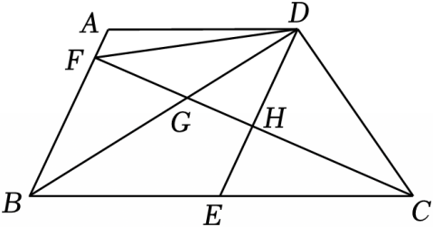

# 23 题精讲 20 · 梯形中的中位线与菱形

## 📝 题目

如图，在梯形 $ABCD$ 中，$AD\parallel BC$，联结 $BD$，$\angle BDC=90^\circ$，点 $E$ 在 $BC$ 上，联结 $DE$，使得 $\angle EDC=\angle ECD$，点 $F$ 在边 $AB$ 上，联结 $CF$，分别交 $BD$、$ED$ 于点 $G$、$H$，且 $FH=CH$，联结 $DF$。

(1) 求证：四边形 $ABED$ 为菱形；

(2) 如果 $\angle BDE=\angle DFC$，求证：$4EH\cdot BE=BG\cdot BD$。

## 🧭 思路导航（渐进提示）

- **提示 1（识别）**：$\angle EDC=\angle ECD$ 是"等角对等边"给 $ED=EC$；再用 Rt△BDC 的互余把 $\angle BDE$ 转成 $\angle DBE$，得 $ED=EB$——三个等长一拼，$E$ 恰是斜边 $BC$ 中点，$FH=CH$ 又给 $H$ 是 $FC$ 中点，**中位线** $EH$ 是(1)通向"平行四边形"的桥。(2) 的 $4EH\cdot BE$ 暗示要把 $EH$、$BE$ 还原成 $BF$、$BC$（各乘 2），最终化归为 $BF\cdot BC=BG\cdot BD$——一条"传角 + 相似"的长链。
- **提示 2（突破）**：(1) 中位线 $EH\parallel BF$ 给 $AB\parallel DE$，配上 $AD\parallel BE$ 成平行四边形，邻边 $ED=EB$ 升级为菱形。(2) 传角主线：已知 $\angle BDE=\angle DFC$ 配对顶角得 △DFG∽△CBG → $\frac{FG}{BG}=\frac{DG}{CG}$ → 换序后配对顶角得 △BFG∽△CDG → $\angle BFG=\angle BDC=90^\circ$（垂直落点！）；再由(1) $\angle BDE=\angle DBE=\angle DBC$ 与菱形对角线平分内角得 $\angle FBG=\angle GBC$ → △BFG∽△BDC → 比例式即目标。
- **提示 3（路线）**：(1) 等角对等边得 $ED=EC$；Rt△BDC 中互余 + 等角代换得 $\angle BDE=\angle DBE$ → $ED=EB$ → $BE=EC$，$E$ 为 $BC$ 中点；$FH=CH$ → $H$ 为 $FC$ 中点 → $EH$ 是 △FBC 的中位线 → $EH\parallel BF$（即 $AB\parallel DE$）且 $EH=\frac12BF$；$AD\parallel BE$ → 平行四边形 → 邻边相等 → 菱形。(2) $\angle DFG=\angle CBG$（等量代换）+ 对顶角 → △DFG∽△CBG → $\frac{FG}{BG}=\frac{DG}{CG}$ → 换序 $\frac{FG}{DG}=\frac{BG}{CG}$ 配对顶角 → △BFG∽△CDG → $\angle BFG=\angle GDC=\angle BDC=90^\circ$；菱形 → $\angle ABD=\angle EBD$，配(1)的 $\angle EBD=\angle BDE=\angle DBC$ → $\angle FBG=\angle GBC$ → △BFG∽△BDC → $\frac{BF}{BD}=\frac{BG}{BC}$ → $BF\cdot BC=BG\cdot BD$ → 代 $BF=2EH$、$BC=2BE$ 得 $4EH\cdot BE=BG\cdot BD$。

## ✍️ 详解

**(1)** $\angle EDC=\angle ECD$（已知）→ $ED=EC$（等角对等边）。

$\angle BDC=90^\circ$（已知），依图 $\angle BDC=\angle BDE+\angle EDC$（角的和差：$E$ 在线段 $BC$ 上，射线 $DE$ 在射线 $DB$ 与 $DC$ 之间）→ $\angle BDE+\angle EDC=90^\circ$。

→ $\angle BDE+\angle ECD=90^\circ$（等量代换）。

在 Rt$\triangle BDC$ 中：$\angle DBC+\angle DCB=90^\circ$（直角三角形两锐角互余）。

$\angle ECD=\angle DCB$、$\angle DBE=\angle DBC$（同一个角：$E$ 在线段 $BC$ 上）→ $\angle BDE=\angle DBE$（等式性质：$90^\circ$ 减同一个角）。

→ $BE=DE$（等角对等边）→ $BE=EC$（等量代换），即 $E$ 是 $BC$ 的中点（线段中点定义）。

$FH=CH$（已知）→ $H$ 是 $FC$ 的中点（线段中点定义；$F$、$H$、$C$ 共线）。

→ $EH$ 是 $\triangle FBC$ 的中位线（$E$、$H$ 分别为 $CB$、$CF$ 的中点）→ $EH\parallel BF$，$EH=\dfrac12BF$（三角形中位线定理）。

$F$ 在边 $AB$ 上，$H$ 在线段 $DE$ 上 → $AB\parallel DE$（直线 $BF$ 与直线 $EH$ 即直线 $AB$ 与直线 $DE$）。

$AD\parallel BC$（梯形），$E$ 在线段 $BC$ 上 → $AD\parallel BE$（等量代换）。

两组对边分别平行 → 四边形 $ABED$ 是平行四边形（平行四边形的定义）。

又 $ED=EB$（已证）→ 四边形 $ABED$ 是菱形（一组邻边相等的平行四边形是菱形）。$\blacksquare$

**(2)** 由(1) $\angle BDE=\angle DBE$，已知 $\angle BDE=\angle DFC$，且 $\angle DFC=\angle DFG$、$\angle DBE=\angle GBC$（同一个角：$G$ 在线段 $FC$、$BD$ 上）。

→ $\angle DFG=\angle CBG$（等量代换）。

又 $\angle FGD=\angle BGC$（对顶角相等）→ $\triangle DFG\backsim\triangle CBG$（两角对应相等；$F\leftrightarrow B$、$G\leftrightarrow G$、$D\leftrightarrow C$）。

→ $\dfrac{FG}{BG}=\dfrac{DG}{CG}$（相似三角形对应边成比例）→ $\dfrac{FG}{DG}=\dfrac{BG}{CG}$（比例性质）。

又 $\angle FGB=\angle DGC$（对顶角相等）→ $\triangle BFG\backsim\triangle CDG$（两边对应成比例且夹角相等）。

→ $\angle BFG=\angle GDC$（相似三角形对应角相等）；$\angle GDC=\angle BDC=90^\circ$（同一个角：$G$ 在线段 $BD$ 上）→ $\angle BFG=90^\circ$（等量代换）。

由(1) 四边形 $ABED$ 是菱形 → $BD$ 平分 $\angle ABE$（菱形每条对角线平分一组内角）→ $\angle ABD=\angle EBD$。

由(1) $\angle EBD=\angle BDE=\angle DBC$（已证与等量代换）→ $\angle FBG=\angle GBC$（等量代换：射线 $BF$ 与 $BA$、射线 $BG$ 与 $BD$ 分别重合）。

在 $\triangle BFG$ 与 $\triangle BDC$ 中：$\angle BFG=\angle BDC=90^\circ$（已证），$\angle FBG=\angle DBC$（已证）。

→ $\triangle BFG\backsim\triangle BDC$（两角对应相等）→ $\dfrac{BF}{BD}=\dfrac{BG}{BC}$（相似三角形对应边成比例）。

→ $BF\cdot BC=BG\cdot BD$（比例性质）。

$BF=2EH$、$BC=2BE$（由(1)中位线定理与 $E$ 为中点）→ $4EH\cdot BE=BG\cdot BD$（等量代换）。$\blacksquare$

**（自洽检验）**：主链两次相似（△DFG∽△CBG、△BFG∽△CDG）把"垂直"从中点 $G$ 对顶角处"搬"到 $F$ 处，再以 $\angle BFG=\angle BDC=90^\circ$ 启动第三次相似；若 $\angle BFG\neq90^\circ$ 则 $BF\cdot BC=BG\cdot BD$ 无从谈起，故(2)的关键落点是垂直，而不是比例本身。

## ⚠️ 评分点与易错

- (1) 判菱形前必须先落"平行四边形"：$AB\parallel DE$ 由中位线 $EH\parallel BF$ 而来，要交代"$H$ 在线段 $DE$ 上、$F$ 在边 $AB$ 上"这层直线重合关系，否则两条平行线对不上号。
- "$\angle BDE=\angle DBE$"由"$90^\circ$ 减同一个角 $\angle ECD=\angle DCB$"得到，两处"同一个角"（$E$ 在 $BC$ 上）都要写。
- (2) 第一次相似的角来自已知 $\angle BDE=\angle DFC$ 的换名（$\angle DFG$、$\angle CBG$），题源在此有冗余等式（"$\angle BDE=\angle DFC$ 写了两遍"），书写时按本讲的代换链走即可。
- △BFG∽△CDG 用的是"两边成比例 + 夹角（对顶角）"，与前后两个"两角相似"判定不同，要写对判定名称；比例式换序 $\frac{FG}{BG}=\frac{DG}{CG}\Rightarrow\frac{FG}{DG}=\frac{BG}{CG}$ 是进入第二次相似的钥匙。
- 最后一步 $BF=2EH$、$BC=2BE$ 来自(1)的中位线与中点，代回后别忘乘积里的系数 $4=2\times2$。

## 🔗 关联

- [[03-数学/专题/第23题-几何论证]] · [[03-数学/知识点/九年级/相似三角形]]（两角相似、SAS 相似、三次相似接力）
- 同类题：[[25-09-直角梯形相似综合]]（梯形相似综合）、[[21-20-斜边中点与圆]]（直角三角形斜边中点）、[[23-15-菱形与正方形判定]]（菱形判定与对角线性质）
