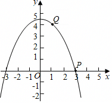

# 24 题精讲 03 · 等腰直角三角形存在性

## 📝 题目

已知抛物线 $y=ax^2+c$（$a\neq0$）经过点 $P(3,0)$、$Q(1,4)$。
(1) 求抛物线的解析式；
(2) 若点 $A$ 在直线 $PQ$ 上，过点 $A$ 作 $AB\perp x$ 轴于点 $B$，以 $AB$ 为斜边在其左侧作等腰直角三角形 $ABC$。
① 当 $Q$ 与 $A$ 重合时，求 $C$ 到抛物线对称轴的距离；
② 若 $C$ 在抛物线上，求 $C$ 的坐标。

## 🧭 思路导航（渐进提示）

- **提示 1（识别）**：抛物线只含 $a,c$ 两个参数——选最省事的设法。①② 全程绕着"以 $AB$ 为斜边、在其左侧的等腰直角三角形"转：这类三角形最锋利的性质是什么？② 中 $A$ 在直线上滑动，是存在性问题——动点该怎样设参？
- **提示 2（突破）**：(1) 两点直接代 $y=ax^2+c$（只有两个参数，比一般式快）。① **等腰直角三角形斜边上的高 = 斜边一半**，且高线同时是中线——$C$ 的位置立刻定出，不需要方程。② 万能武器：设参数表示 $A$（沿直线 $PQ$），再用等腰直角性质把 $C$ 用参数写出来——直角顶点在斜边的垂直平分线上、到斜边中点的距离为 $\frac12AB$，且在 $AB$ 左侧；记得讨论 $A$ 的位置（$AB$ 长度带绝对值，按参数范围分类），解出后回代检验。
- **提示 3（路线）**：(1) 代 $P(3,0)$、$Q(1,4)$ 解 $a,c$。① 求直线 $PQ$；$A$ 与 $Q$ 重合时得 $AB$ 长；$AB$ 中点即垂足，高 $=\frac12AB$ 且沿水平方向，$C$ 到对称轴（$y$ 轴）的距离 = 高 − 水平方向偏移。② 设 $A(m,-2m+6)$、$B(m,0)$，$AB=|-2m+6|$；斜边垂直平分线是水平线 $y=-m+3$，写出 $C$（横坐标为 $m-\frac12AB$、纵坐标 $-m+3$）；按 $-m+3$ 的正负分两类：一类代入抛物线解 $m$（舍去与 $P$ 重合的根），另一类结合 $A$ 的位置约束判退化、舍去；答 $C$ 坐标并检验在抛物线上。

## ✍️ 详解

**(1)** 代入 $P(3,0)$、$Q(1,4)$：$\begin{cases}9a+c=0\\ a+c=4\end{cases}$ 得 $a=-\dfrac12,\ c=\dfrac92$，

$$y=-\frac12x^2+\frac92$$

**(2)①** 直线 $PQ$：$y=-2x+6$。$A$ 与 $Q(1,4)$ 重合时 $AB=4$。以 $AB$ 为斜边的等腰直角三角形中，斜边上的高 $CH=\dfrac12AB=2$（$H$ 为 $AB$ 中点），且 $C$ 到 $x$ 轴方向偏移 $GH=1$（$G$ 为 $CH$ 与 $y$ 轴交点）。抛物线对称轴即 $y$ 轴，故 $C$ 到对称轴距离 $=CG=CH-GH=2-1=1$。

**(2)②** 直线 $PQ$：$y=-2x+6$。设 $A(m,-2m+6)$，则 $B(m,0)$，$AB=|-2m+6|$。$AB$ 是竖直线段，其垂直平分线是水平线 $y=-m+3$，直角顶点 $C$ 在这条水平线上、到中点 $H(m,-m+3)$ 的距离为 $\dfrac12AB=|-m+3|$，且在 $AB$ 左侧：

$$C=\left(m-|-m+3|,\;-m+3\right)$$

当 $-m+3\ge0$ 时：$C(2m-3,\,-m+3)$。代入抛物线：

$$-m+3=-\frac12(2m-3)^2+\frac92\;\Rightarrow\; m=\frac12\ \text{或}\ m=3\,(\text{与}P\text{重合，舍})$$

$m=\dfrac12$ 时 $C\left(-2,\dfrac52\right)$。

当 $-m+3<0$（即 $m>3$）时：$C(3,\,-m+3)$，结合 $A$ 在线段 $PQ$ 上的约束知退化，舍去。

$$\boxed{C\left(-2,\;\frac52\right)}$$

## ⚠️ 评分点与易错

- 等腰直角 + 斜边已知：**斜边中线 = 一半 = 高**，三线合一一口气出三条线段长，不要去设三边硬算。
- "在其左侧"只有一种朝向，但 $A$ 在直线上移动有 $-m+3$ 正负两种情形——**分类后要回代验证**（本题第二类退化）。
- 求出的 $C$ 必须写坐标并检验在抛物线上（题目已要求）。

## 🔗 关联

- [[03-数学/专题/第24题-二次函数综合]] · [[03-数学/知识点/九年级/二次函数]] · [[03-数学/知识点/00-六至八年级核心公式定理总表]]（直角三角形斜边中线）
- 同类题：课后巩固第 4 题（$\triangle PDE$ 等腰直角，含翻折）；[[24-02-面积定值与120度角]]
