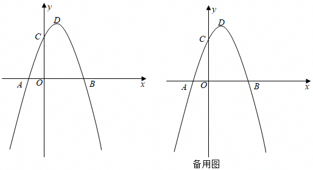

# 24 题精讲 05 · 梯形存在性与两角和的正切

## 📝 题目

抛物线 $y=ax^2+bx+3$ 与 $x$ 轴交于 $A(-1,0)$ 和 $B$，与 $y$ 轴交于 $C$，对称轴是直线 $x=1$，顶点为 $D$。
(1) 求抛物线的解析式和顶点 $D$ 的坐标；
(2) $P$ 为第三象限内抛物线上一点，当四边形 $PBDC$ 为梯形时，求 $P$ 的坐标；
(3) 在 (2) 的条件下，$E$ 为 $x$ 轴正半轴上一点，当 $\tan(\angle PBO+\angle PEO)=\dfrac52$ 时，求 $OE$ 的长。

## 🧭 思路导航（渐进提示）

- **提示 1（识别）**：(1) 一个点 + 对称轴，两个独立条件定 $a,b$。(2) "四边形 $PBDC$ 是梯形"——先按顶点顺序画出四边形 $P\!-\!B\!-\!D\!-\!C$，问自己：哪一组对边可能平行？(3) "两角和的正切"——初中没有两角和公式，直接拆的路是死的，必须另想构造。
- **提示 2（突破）**：(2) 逐组检验对边：$PD$ 与 $BC$ 显然不平行，$PB\parallel DC$ 是唯一选择；$DC$ 斜率易求 → 用"斜率相同"定直线 $PB$ → 与抛物线联立。(3) **构造一个正切恰为 $\dfrac52$ 的角**：在 $x$ 轴上取点 $F$，让一个直角三角形的两直角边之比给足 $\frac52$，把 $\angle PEO$ 转化为它的一部分，再用相似（母子型，公共角 + 等角）收尾。这是本题最精彩的一步。
- **提示 3（路线）**：(1) 联立 $\begin{cases}a-b+3=0\\ -\frac{b}{2a}=1\end{cases}$，答解析式与顶点 $D$。(2) 求 $C$、$B$ 坐标；写直线 $DC$ 的斜率 → 设平行线过 $B$ 定截距 → 联立抛物线解出两根，舍去对应点 $B$ 本身的根，检验 $P$ 在第三象限，答 $P$。(3) 由直线 $PB$ 与 $y$ 轴的交点 $G$ 得 $OB=OG$ → $\angle PBO=45°$，且 $PH=BH$（$PH\perp x$ 轴）；在 $x$ 轴上取 $F$ 使 $\frac{HF}{PH}=\frac52$，算出 $BF$；由 $PH\parallel OG$ 得 $\angle BPH=45°$，于是 $45°+\angle PEO=45°+\angle FPB$ → $\angle PEO=\angle FPB$；加公共角 $\angle PBE=\angle FBP$ → △$PBE\backsim$△$FBP$ → $BE\cdot BF=PB^2$；勾股算 $PB^2$，解 $BE$，$OE=OB+BE$ 收口。

## ✍️ 详解

**(1)** $\begin{cases}a-b+3=0\\ -\dfrac{b}{2a}=1\end{cases}$ 得 $a=-1,\ b=2$：

$$y=-x^2+2x+3,\qquad D(1,4)$$

**(2)** $C(0,3)$，$B(3,0)$。直线 $DC$：斜率 $k=\dfrac{4-3}{1-0}=1$，即 $y=x+3$。四边形 $PBDC$ 为梯形且 $PB\parallel DC$：设直线 $PB$：$y=x+m$，过 $B(3,0)$ 得 $m=-3$，即 $y=x-3$。联立

$$\begin{cases}y=x-3\\ y=-x^2+2x+3\end{cases}\Rightarrow x^2-x-6=0\Rightarrow x=3\,(\text{即}B)\ \text{或}\ x=-2$$

$$\boxed{P(-2,-5)}$$

（检验：$P$ 在第三象限 ✓）

**(3)** 由直线 $PB$：$y=x-3$ 交 $y$ 轴于 $(0,-3)$，$OB=OG=3$（$G$ 为其与 $y$ 轴交点），$PH\perp x$ 轴于 $H$ 则 $PH=BH=5$，$\angle PBO=45°$。

在 $x$ 轴上取点 $F$，使 $\dfrac{HF}{PH}=\tan\angle HPF=\dfrac52$，则 $HF=\dfrac52\times5=\dfrac{25}{2}$，$BF=HF-BH=\dfrac{25}{2}-5=\dfrac{15}{2}$。

因 $PH\parallel OG$，$\angle BPH=\angle BGO=45°=\angle PBO$。设 $\angle PEO=\alpha$，由 $\tan(\angle PBO+\angle PEO)=\dfrac52=\tan\angle HPF$ 且 $\angle HPF=45°+\angle FPB$：

$$45°+\alpha=45°+\angle FPB\ \Rightarrow\ \angle PEO=\angle FPB$$

又 $\angle PBE=\angle FBP$（公共角），所以 $\triangle PBE\backsim\triangle FBP$，得

$$BE\cdot BF=PB^2$$

$PB^2=PH^2+BH^2=50$，$BF=\dfrac{15}{2}$，所以 $BE=\dfrac{50}{15/2}=\dfrac{20}{3}$，$OE=OB+BE=3+\dfrac{20}{3}$：

$$\boxed{OE=\frac{29}{3}}$$

## ⚠️ 评分点与易错

- (2) 梯形存在性：先**论证哪组对边可能平行**再动笔（$PD$ 与 $BC$ 不平行的理由要能说出口）；联立出的 $x=3$ 是点 $B$ 本身，必须舍去。
- (3) 的关键动作是"**构造 $\tan=\dfrac52$ 的直角三角形**"——很多同学卡在想用两角和正切公式（初中没有）。这是上海卷处理"两角之和"的标准套路，值得整题背下来。
- 相似用"母子型"（公共角 + 等角）时，把 $\angle PBE=\angle FBP$ 这句公共角写出来，是步骤分。

## 🔗 关联

- [[03-数学/专题/第24题-二次函数综合]] · [[03-数学/知识点/九年级/相似三角形]] · [[03-数学/知识点/九年级/锐角的三角比与解直角三角形]]
- 同类题：课后巩固第 2 题（$\angle DCB+\angle PBC=45°$ 同款构造）
