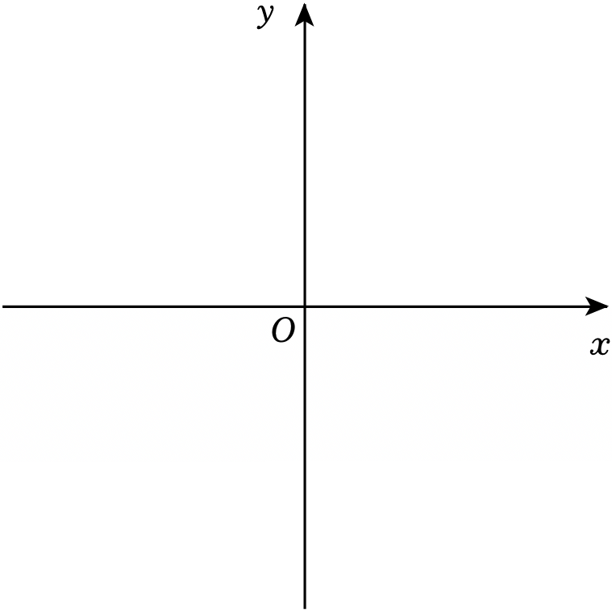

# 24 题精讲 08 · 双抛物线与直角梯形

## 📝 题目

在平面直角坐标系 $xOy$ 中，抛物线 $y=x^2+bx+c$ 经过点 $A(1,1)$ 和 $B(3,1)$，顶点为点 $P$，抛物线与 $y$ 轴交于点 $C$。

(1) 求 $b$ 和 $c$ 的值；

(2) 另一条抛物线 $y=ax^2+mx+n$（$a\neq 1$）也经过点 $A(1,1)$ 和 $B(3,1)$，顶点为点 $Q$，与 $y$ 轴交于点 $D$。

① 求 $CD:PQ$ 的值；

② 当四边形 $CDPQ$ 是直角梯形时，求其最小内角的正弦值。

## 🧭 思路导航（渐进提示）

- **提示 1（识别）**：两条抛物线经过**同样两点** $A$、$B$ —— "对称轴相同（都是 $x=2$）"是全题的钥匙；第②问是直角梯形存在性，必须分类讨论。
- **提示 2（突破）**：用对称性直接写顶点式 $y=a(x-2)^2+k$，避开解字母方程组；注意 $C$、$D$ 同在 $y$ 轴上，$P$、$Q$ 同在直线 $x=2$ 上，所以 $CD\parallel PQ$ 自动成立，"直角"只能出现在底角 $C$ 或 $D$ 处——按 $CQ\perp CD$ 与 $DP\perp CD$ 分两类。
- **提示 3（路线）**：(1) 代入两点解 $b,c$。(2)① 顶点式得 $D(0,3a+1)$、$Q(2,1-a)$，结合 $C(0,4)$、$P(2,0)$ 得 $CD=|3a-3|$、$PQ=|a-1|$，约分。② 类一：$DP\perp CD\Rightarrow D(0,0)\Rightarrow a=-\tfrac13$，最小内角 $\angle QCD$，作 $QM\perp CD$ 用勾股求 $CQ$；类二：$CQ\perp CD\Rightarrow Q(2,4)\Rightarrow a=-3$，最小内角 $\angle CDP$，作 $PN\perp CD$ 用勾股求 $PD$。

## ✍️ 详解

**(1)** 把 $A(1,1)$、$B(3,1)$ 代入 $y=x^2+bx+c$（点在图象上，坐标满足方程）：

$$\begin{cases}1=1+b+c\\ 1=9+3b+c\end{cases}$$

两式相减：$0=8+2b\Rightarrow b=-4$（加减消元）；

回代第一式：$1=1-4+c\Rightarrow c=4$。

$$\boxed{b=-4,\ c=4}\qquad\text{此时 } y=x^2-4x+4=(x-2)^2,\ \ C(0,4),\ P(2,0)$$

**(2)①** 同理把 $A$、$B$ 代入 $y=ax^2+mx+n$：

$$\begin{cases}1=a+m+n\\ 1=9a+3m+n\end{cases}\Rightarrow\ m=-4a,\qquad n=1-a-m=1+3a$$

（对称性验证：$A$、$B$ 关于直线 $x=2$ 对称，故顶点横坐标为 $2$，即 $-\dfrac{m}{2a}=2$，一致。）

配方：$y=ax^2-4ax+3a+1=a(x-2)^2+(1-a)$。

令 $x=0$：$D(0,\,3a+1)$；顶点 $Q(2,\,1-a)$。

$CD=|4-(3a+1)|=|3-3a|=3|a-1|$，$PQ=|(1-a)-0|=|a-1|$（线段长取绝对值；$a\neq1$ 保证 $PQ\neq0$）：

$$\frac{CD}{PQ}=\frac{3|a-1|}{|a-1|}=3\qquad\Rightarrow\qquad \boxed{CD:PQ=3}$$

**(2)②** $C(0,4)$、$D(0,3a+1)$ 都在 $y$ 轴上，$P(2,0)$、$Q(2,1-a)$ 都在直线 $x=2$ 上，

故 $CD\parallel PQ$（垂直于同一条直线的两直线平行）。

四边形 $CDPQ$ 是梯形 → 另一组对边 $DP$ 与 $CQ$ 不平行；直角梯形的直角只能在底角处，分两类：

**类一：$DP\perp CD$（$\angle D=90°$）。** $CD$ 竖直 → $DP$ 水平 → $y_D=y_P=0$：

$$3a+1=0\ \Rightarrow\ a=-\tfrac13\ \Rightarrow\ D(0,0),\ Q(2,\tfrac43)$$

（检验梯形：$CD=4\neq PQ=\tfrac43$；$k_{DP}=0$ 而 $k_{CQ}=\dfrac{\tfrac43-4}{2-0}=-\dfrac43$，另一组对边不平行 ✓）

$\angle D=\angle P=90°$，$\angle C$ 与 $\angle Q$ 互补且其中 $\angle QCD$ 为锐角 → 最小内角是 $\angle QCD$。

作 $QM\perp CD$ 于 $M$，则 $M(0,\tfrac43)$：$QM=2$，$CM=4-\tfrac43=\tfrac83$；

$$CQ=\sqrt{2^2+\left(\tfrac83\right)^2}=\sqrt{\tfrac{100}{9}}=\tfrac{10}{3}\ \ (\text{勾股})\ \Rightarrow\ \sin\angle QCD=\frac{QM}{CQ}=\frac{2}{10/3}\ \Rightarrow\ \boxed{\sin=\tfrac35}$$

**类二：$CQ\perp CD$（$\angle C=90°$）。** $CQ$ 水平 → $y_Q=y_C=4$：

$$1-a=4\ \Rightarrow\ a=-3\ \Rightarrow\ Q(2,4),\ D(0,-8)$$

（检验梯形：$CD=12\neq PQ=4$；$k_{DP}=\dfrac{0-(-8)}{2-0}=4\neq 0=k_{CQ}$ ✓）

$\angle C=\angle Q=90°$，最小内角是锐角 $\angle CDP$。作 $PN\perp CD$ 于 $N$，则 $N(0,0)$：$PN=2$，$DN=8$；

$$PD=\sqrt{2^2+8^2}=\sqrt{68}=2\sqrt{17}\ \ (\text{勾股})\ \Rightarrow\ \sin\angle CDP=\frac{PN}{PD}=\frac{2}{2\sqrt{17}}\ \Rightarrow\ \boxed{\sin=\tfrac{\sqrt{17}}{17}}$$

综上，最小内角的正弦值为 $\dfrac35$ 或 $\dfrac{\sqrt{17}}{17}$。

## ⚠️ 评分点与易错

- **题源讹误**：答案栏"$35$或$1717$"、中间量"$PD=217$"均为 OCR 丢失根号/分数线所致，应为 $\tfrac35$ 或 $\tfrac{\sqrt{17}}{17}$、$PD=2\sqrt{17}$。
- ①中 $CD$、$PQ$ 是线段长，$a$ 未定时**必须加绝对值**；比值恒为 3 是"两条抛物线过同样两点"的结构性结论，与 $a$ 无关。
- ②梯形判定要补一句"$DP$ 与 $CQ$ 不平行"（用斜率说明），只写"一组对边平行"不算完整判定。
- 分类完整性：直角只能在 $C$ 或 $D$，两类都要算，漏一类丢一半分。
- "最小内角"要说明理由：两个直角 $90°$、一个锐角、一个钝角（同旁内角互补），最小者即那个锐角。

## 🔗 关联

- [[03-数学/专题/第24题-二次函数综合]] · [[03-数学/知识点/九年级/锐角的三角比与解直角三角形]]
- 同类题：[[24-05-梯形存在与角度正切]]（梯形存在性）、[[24-18-面积定值与梯形存在]]（梯形存在性分类）
