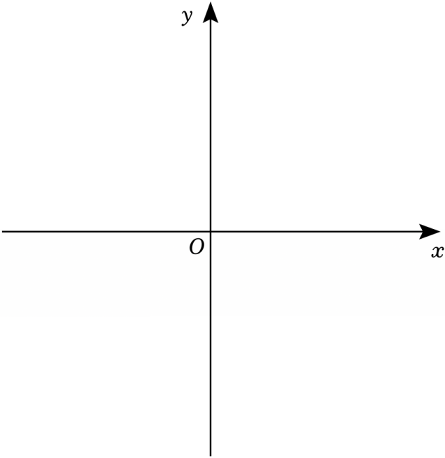

# 24 题精讲 09 · 顶点在直线上的抛物线平移

## 📝 题目

在平面直角坐标系 $xOy$ 中，已知直线 $y=\dfrac34x+6$ 与 $x$ 轴交于点 $A$，与 $y$ 轴交于点 $B$，点 $C$ 在线段 $AB$ 上。以点 $C$ 为顶点的抛物线 $M:y=ax^2+bx+c$ 经过点 $B$，点 $C$ 不与点 $B$ 重合。

(1) 求点 $A$、$B$ 的坐标；

(2) 求 $b$、$c$ 的值；

(3) 平移抛物线 $M$ 至 $N$，点 $C$、$B$ 分别平移至点 $P$、$D$，联结 $CD$，且 $CD\parallel x$ 轴。如果点 $P$ 在 $x$ 轴上，且新抛物线 $N$ 过点 $B$，求抛物线 $N$ 的函数解析式。

## 🧭 思路导航（渐进提示）

- **提示 1（识别）**："顶点在给定直线上"→ 必须设**顶点式**；第 (3) 问的钥匙是把"平移 + $CD\parallel x$ 轴 + $P$ 在 $x$ 轴上"翻译成坐标关系——平移时所有点**同加同减**同一个向量。
- **提示 2（突破）**：设 $C(m,\tfrac34m+6)$，抛物线 $y=a(x-m)^2+\tfrac34m+6$，"过 $B$"给一个方程；"$C$ 不与 $B$ 重合"$=m\neq0$，它决定了方程两边能否约去 $m$。第 (3) 问：$C\to P$ 落到 $x$ 轴，说明竖直方向下移了 $y_C$；$B$ 随之移到 $D$，而 $CD\parallel x$ 轴 $\iff y_D=y_C$。
- **提示 3（路线）**：(1) 令 $x=0$、$y=0$ 求截距。(2) 顶点式代入 $B(0,6)$ 得 $am^2=-\tfrac34m$，由 $m\neq0$ 约去 $m$ 得 $m=-\tfrac{3}{4a}$，展开比较系数得 $b=\tfrac32$、$c=6$。(3) 设 $P(p,0)$：下移量 $=y_C=\tfrac34m+6$，则 $y_D=6-(\tfrac34m+6)=-\tfrac34m$；令 $-\tfrac34m=\tfrac34m+6$ 得 $m=-4$，回代 $a=\tfrac{3}{16}$；最后 $N$ 过 $B$ 定 $p$：$y=\tfrac{3}{16}(x-p)^2$ 代 $(0,6)$ 得 $p=\pm4\sqrt2$，两个都保留。

## ✍️ 详解

**(1)** 在 $y=\dfrac34x+6$ 中：

令 $x=0$：$y=6\Rightarrow B(0,6)$；令 $y=0$：$\dfrac34x+6=0\Rightarrow x=-8\Rightarrow A(-8,0)$。

$$\boxed{A(-8,0),\quad B(0,6)}$$

**(2)** $C$ 在线段 $AB$ 上 → 设 $C\left(m,\ \tfrac34m+6\right)$，其中 $-8\le m\le 0$；

$C$ 不与 $B(0,6)$ 重合 $\Rightarrow m\neq 0$（横坐标为 0 的点只有 $B$）。

以 $C$ 为顶点，设抛物线 $M$：

$$y=a(x-m)^2+\tfrac34m+6\quad(\text{顶点式})$$

过 $B(0,6)$（点在图象上）：$am^2+\tfrac34m+6=6$，即

$$am^2=-\tfrac34m\ \Rightarrow\ m\left(am+\tfrac34\right)=0$$

由 $m\neq0$ 约去 $m$：$am=-\tfrac34$，即 $m=-\dfrac{3}{4a}$。

展开顶点式：$y=ax^2-2amx+am^2+\tfrac34m+6$，逐项化简：

- 一次项系数：$-2am=-2\times\left(-\tfrac34\right)=\tfrac32$；
- 常数项：$am^2+\tfrac34m=(am)\cdot m+\tfrac34m=-\tfrac34m+\tfrac34m=0$，故常数项为 $6$。

$$y=ax^2+\tfrac32x+6\qquad\Rightarrow\qquad \boxed{b=\tfrac32,\quad c=6}$$

**(3)** 设 $P(p,0)$（$P$ 在 $x$ 轴上，是顶点 $C$ 的像）。

平移向量为 $\left(p-m,\ -\left(\tfrac34m+6\right)\right)$：竖直方向，$C$ 与 $B$ **下移相同距离** $y_C=\tfrac34m+6$。

于是 $D=B+\text{平移向量}=\left(p-m,\ 6-\left(\tfrac34m+6\right)\right)=(p-m,\ -\tfrac34m)$。

$CD\parallel x$ 轴 $\iff y_D=y_C$（水平的两点纵坐标相等）：

$$-\tfrac34m=\tfrac34m+6\ \Rightarrow\ -\tfrac32m=6\ \Rightarrow\ m=-4$$

（检验：$-8\le-4<0$ ✓，$C(-4,3)$ 在线段 $AB$ 上且异于 $B$。）

由 (2) 的 $am=-\tfrac34$：$a\cdot(-4)=-\tfrac34\Rightarrow a=\tfrac{3}{16}$（平移不改变 $a$）。

故新抛物线 $N$ 以 $P(p,0)$ 为顶点：

$$y=\tfrac{3}{16}(x-p)^2$$

$N$ 过 $B(0,6)$：$\tfrac{3}{16}p^2=6\Rightarrow p^2=32\Rightarrow p=\pm4\sqrt2$（题目未限定 $P$ 在 $y$ 轴哪一侧，两解均合题意）。

$$\boxed{y=\tfrac{3}{16}(x-4\sqrt2)^2\quad\text{或}\quad y=\tfrac{3}{16}(x+4\sqrt2)^2}$$

## ⚠️ 评分点与易错

- "$C$ 不与 $B$ 重合"不是废话：若漏掉它，$m(am+\tfrac34)=0$ 会被解出 $m=0$ 这一退化解，$m=-\tfrac{3}{4a}$ 也无从谈起，(2) 全盘皆错。
- (3) 中 $CD\parallel x$ 轴**只约束纵坐标**，不要去解横坐标；依据是"平移中各点竖直位移相同"。
- $p=\pm4\sqrt2$ 都要保留并写出两个解析式；只写一个丢一半分。
- 设顶点式（以 $C$ 为顶点）比设一般式硬解 $b,c$ 少一半计算——"顶点在直线上"类题的第一反应。

## 🔗 关联

- [[03-数学/专题/第24题-二次函数综合]]
- 同类题：[[24-11-平移共线与相似存在]]、[[24-14-顶点射线平移与垂直]]（平移条件代数化）、[[24-20-平移与角度互补]]
