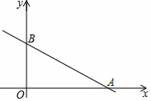

# 24 题精讲 10 · 顶点在三角形内

## 📝 题目

在平面直角坐标系 $xOy$ 中，直线 $y=-\dfrac12x+5$ 与 $x$ 轴、$y$ 轴分别交于点 $A$、$B$（如图）。抛物线 $y=ax^2+bx$（$a\neq0$）经过点 $A$。

(1) 求线段 $AB$ 的长；

(2) 如果抛物线 $y=ax^2+bx$ 经过线段 $AB$ 上的另一点 $C$，且 $BC=5$，求这条抛物线的表达式；

(3) 如果抛物线 $y=ax^2+bx$ 的顶点 $D$ 位于 $\triangle AOB$ 内，求 $a$ 的取值范围。

## 🧭 思路导航（渐进提示）

- **提示 1（识别）**：(1)(2) 是"直线上的点 + 距离条件"定位 $C$；(3) 是含参动抛物线——先用"过 $A$"把两个参数压成一个，再让**顶点坐标**落进三角形。
- **提示 2（突破）**：$C$ 在直线 $AB$ 上 → 设横坐标 $m$ 表示 $C$，$BC$ 用两点距离公式；"顶点在 $\triangle AOB$ 内"$=$ 三个不等式：$x>0$、$y>0$、在直线 $AB$ 下方。
- **提示 3（路线）**：(1) 求两个截距，勾股定理。(2) 设 $C(m,-\tfrac12m+5)$，$BC=\tfrac{\sqrt5}{2}|m|=5$ 解得 $m=\pm2$，用"在线段 $AB$ 上"舍 $m=-2$，代 $A$、$C$ 解 $a,b$。(3) 由 $A$ 在抛物线上得 $b=-10a$，配方得顶点 $D(5,-25a)$；令 $0<-25a<\tfrac52$（$\tfrac52$ 是直线在 $x=5$ 处的函数值），解出 $a$ 的范围。

## ✍️ 详解

**(1)** 在 $y=-\dfrac12x+5$ 中：令 $x=0$ 得 $B(0,5)$；令 $y=0$ 得 $x=10$，即 $A(10,0)$。

$$AB=\sqrt{10^2+5^2}=\sqrt{125}=5\sqrt5\quad(\text{两点距离/勾股})\qquad\boxed{AB=5\sqrt5}$$

（$\angle AOB=90°$，$\triangle AOB$ 是直角三角形，也可直接用勾股定理 $AB^2=OA^2+OB^2=125$，开方取正值。）

**(2)** $C$ 在直线 $AB$ 上 → 设 $C\left(m,\ -\tfrac12m+5\right)$。

由 $B(0,5)$，两点距离公式：

$$BC=\sqrt{m^2+\left(-\tfrac12m+5-5\right)^2}=\sqrt{m^2+\tfrac14m^2}=\tfrac{\sqrt5}{2}|m|$$

$BC=5$：$\tfrac{\sqrt5}{2}|m|=5\Rightarrow|m|=2\Rightarrow m=2$ 或 $m=-2$。

$C$ 在线段 $AB$ 上 → $0\le m\le 10$，且 $C$ 异于 $A$、$B$：$m=-2$（此时 $C(-2,6)$ 不在线段上）舍去。

$$C(2,4)$$

代 $A(10,0)$、$C(2,4)$ 入 $y=ax^2+bx$：

$$\begin{cases}100a+10b=0\\ 4a+2b=4\end{cases}\ \xRightarrow{\text{化简}}\ \begin{cases}10a+b=0\\ 2a+b=2\end{cases}$$

两式相减：$8a=-2\Rightarrow a=-\tfrac14$；回代：$b=-10a=\tfrac52$。

（检验：$x=0$ 时 $y=0$，抛物线过原点，与 $y=ax^2+bx$ 的形式一致 ✓；$C(2,4)$：$-\tfrac14\times4+\tfrac52\times2=-1+5=4$ ✓）

$$\boxed{y=-\tfrac14x^2+\tfrac52x}$$

**(3)** $A(10,0)$ 在抛物线上：$100a+10b=0\Rightarrow b=-10a$（消去 $b$，只留参数 $a$）。

配方：

$$y=ax^2-10ax=a\left(x^2-10x\right)=a(x-5)^2-25a$$

（展开验证：$a(x^2-10x+25)-25a=ax^2-10ax$ ✓）

故顶点 $D(5,\ -25a)$。

$\triangle AOB$ 的内部（$O(0,0)$，$A(10,0)$，$B(0,5)$）需同时满足：

- $x>0$：$D$ 的横坐标 $5\in(0,10)$ ✓ 恒成立；
- $y>0$：$-25a>0\Rightarrow a<0$（与 $a\neq0$ 相容）；
- 在直线 $AB$ 下方：$y_D<-\tfrac12\times5+5=\tfrac52$，即 $-25a<\tfrac52\Rightarrow a>-\tfrac1{10}$。

$$\boxed{-\tfrac{1}{10}<a<0}$$

（端点说明：$a=-\tfrac1{10}$ 时 $D$ 恰落在 $AB$ 上，不在三角形"内"，取不到；$a=0$ 时不是抛物线。）

## ⚠️ 评分点与易错

- (2) 距离方程解出 $m=\pm2$ 后**必须用"线段"筛根**——只看 $BC=5$ 会多出 $C(-2,6)$。
- (3) 第一步是消参：先由"过 $A$"写出 $b=-10a$，让顶点只含一个参数，范围才可能解出来。
- 三角形"内部"的三个条件一个都不能少；本题 $x$ 坐标天然合格，但这一句要写出来。
- 端点取舍要交代：$a=-\tfrac1{10}$ 使顶点落在边界上，"位于三角形内"是严格内部，开区间。
- 抛物线 $y=ax^2+bx$ 的常数项为 0 → 必过原点，这个隐含条件可用来快速检验 (2) 的结果（$x=0$ 时 $y=0$ ✓ 与表达式相符）。
- (1) 的结果 $5\sqrt5$ 同时给出 (3) 中"直线 $AB$ 下方"的参照值——直线在 $x=5$ 处的函数值 $\tfrac52$ 正是 $B$ 处纵坐标 5 的一半，可作心算检验。

## 🔗 关联

- [[03-数学/专题/第24题-二次函数综合]]
- 同类题：[[24-13-含参抛物线综合]]（含参图象特征）、[[24-16-新定义-优雅抛物线]]（顶点坐标带参）
