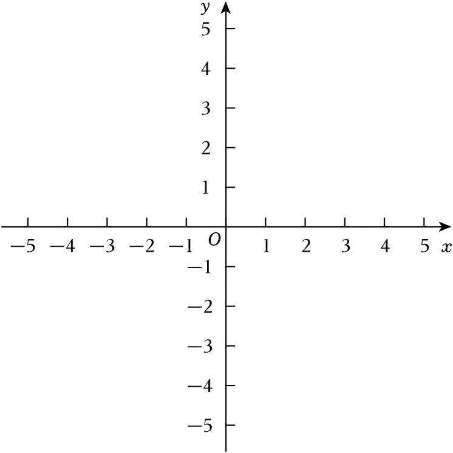

# 24 题精讲 11 · 平移共线与相似存在

## 📝 题目

在平面直角坐标系 $xOy$ 中，抛物线 $C_1:y=ax^2+2ax-3a$（$a<0$）与 $x$ 轴相交于 $A$、$B$ 两点（点 $A$ 在点 $B$ 左侧），与 $y$ 轴交于点 $C$，顶点为点 $D$。

(1) 求线段 $AB$ 的长；

(2) 把抛物线 $C_1$ 向右平移 3 个单位，再向上平移 4 个单位，得到抛物线 $C_2$，其顶点为点 $E$。如果点 $A$、$D$、$E$ 在同一直线上，求抛物线 $C_1$ 的表达式；

(3) 当四边形 $ABCD$ 的面积为 9 时，若点 $P$ 是 $x$ 轴上一点（点 $P$ 不与点 $B$ 重合），且 $\triangle ACP$ 与 $\triangle ABC$ 相似，求点 $P$ 的坐标。

## 🧭 思路导航（渐进提示）

- **提示 1（识别）**：解析式各项都含公因式 $a$ —— 提出来因式分解，交点、顶点全部"带 $a$ 走"；(2) 是"平移 + 三点共线"；(3) 是"共边三角形相似"的存在性，要枚举对应关系。
- **提示 2（突破）**：$C_1=a(x+3)(x-1)$ 一眼读出 $A$、$B$、$C(0,-3a)$、$D(-1,-4a)$；共线用直线 $AD$ 的斜率；四边形 $ABCD$ 的面积沿对角线 $AC$ 拆成两个三角形，其中 $\triangle ACD$ 用**铅垂高**（过 $D$ 作 $AC$ 的竖直线）。
- **提示 3（路线）**：(1) 因式分解读根，$AB=4$。(2) 平移得 $E(2,-4a+4)$；直线 $AD$：$y=-2a(x+3)$；代 $E$ 解 $a$。(3) 面积 $S_{\triangle ABC}=-6a$、$S_{\triangle ACD}=-3a$，$-9a=9\Rightarrow a=-1$；此时 $AC=3\sqrt2$、$\angle BAC=45°$；$P$ 在 $x$ 轴上时 $\angle CAP$ 只能是 $45°$（$P$ 在 $A$ 右侧）或 $135°$（左侧，与 $\triangle ABC$ 各角不合，舍）；$45°$ 唯一 → 对应 $A\leftrightarrow A$，两种顺序：$\triangle ACP\backsim\triangle ACB$ 给 $AP=AB$ → $P=B$ 舍；$\triangle ACP\backsim\triangle ABC$ 给 $AP=\dfrac{AC^2}{AB}$，得 $P$。

## ✍️ 详解

**(1)** 提公因式并因式分解：

$$y=a\left(x^2+2x-3\right)=a(x+3)(x-1)$$

令 $y=0$（$a\neq0$）：$x=-3$ 或 $x=1$，故 $A(-3,0)$、$B(1,0)$（$A$ 在左 ✓）。

$$\boxed{AB=1-(-3)=4}$$

（顺带记录：$C(0,-3a)$；顶点 $D$：$x=-\dfrac{2a}{2a}=-1$，$y=a(1-3)=-4a$，即 $D(-1,-4a)$。）

**(2)** 平移作用于顶点（左加右减、上加下减）：

$$D(-1,-4a)\ \xrightarrow{\ \text{右}3,\text{上}4\ }\ E(2,\ -4a+4)$$

直线 $AD$：过 $A(-3,0)$、$D(-1,-4a)$，斜率 $k=\dfrac{-4a-0}{-1-(-3)}=\dfrac{-4a}{2}=-2a$，点斜式：

$$y=-2a(x+3)$$

$E$ 在直线上（三点共线）：$-4a+4=-2a(2+3)=-10a$，即 $4=-6a$，

$$a=-\tfrac23\quad(\text{满足 } a<0\ \checkmark)$$

$$\boxed{C_1:\ y=-\tfrac23x^2-\tfrac43x+2}$$

**（注：题源答案栏"$y=-27x^2-47x+67$"为 OCR 讹误，正确即上式，与其解答过程一致。）**

**(3) 第一步：用面积定 $a$。** 沿对角线 $AC$ 分割：

$$S_{ABCD}=S_{\triangle ABC}+S_{\triangle ACD}$$

$$S_{\triangle ABC}=\tfrac12\cdot AB\cdot|y_C|=\tfrac12\times4\times(-3a)=-6a\quad(a<0,\ -3a>0)$$

$S_{\triangle ACD}$ 用铅垂高：直线 $AC$ 的斜率为 $\dfrac{-3a-0}{0-(-3)}=-a$，即 $y=-a(x+3)$；

过 $D(-1,-4a)$ 作 $DH\parallel y$ 轴交 $AC$ 于 $H$：$x=-1$ 时 $y_H=-a\cdot2=-2a$，故 $H(-1,-2a)$，

$$DH=(-2a)-(-4a)=-2a>0$$

（$A$、$D$、$C$ 的横坐标 $-3<-1<0$，铅垂线在三角形内部 ✓）：

$$S_{\triangle ACD}=\tfrac12\cdot DH\cdot(x_C-x_A)=\tfrac12\cdot(-2a)\cdot3=-3a$$

$$-6a+(-3a)=9\ \Rightarrow\ a=-1$$

此时 $C_1:y=-x^2-2x+3$，$A(-3,0)$，$B(1,0)$，$C(0,3)$，$D(-1,4)$。

**第二步：相似存在性。** 基本量：$AC=\sqrt{3^2+3^2}=3\sqrt2$，$AB=4$，$BC=\sqrt{1^2+3^2}=\sqrt{10}$。

$\angle BAC$：$AB$ 沿 $x$ 轴正向，$AC$ 方向 $(3,3)$，故 $\angle BAC=45°$；

$\triangle ABC$ 三内角为 $45°,\ \arctan3\approx71.6°,\ \arctan2\approx63.4°$（互不相等，$45°$ 唯一）。

设 $P(p,0)$，$p\neq1$（不与 $B$ 重合），$p\neq-3$（不退化）。

- 若 $p<-3$（$P$ 在 $A$ 左侧）：$\angle CAP=135°$，不在 $\triangle ABC$ 的内角集合中 → 无解，舍；
- 若 $p>-3$：$AP$ 沿 $x$ 轴正向，$\angle CAP=45°=\angle BAC$，且 $45°$ 唯一 → 对应 $A(\triangle ACP)\leftrightarrow A(\triangle ABC)$，只剩两种顺序：

**顺序一：$\triangle ACP\backsim\triangle ACB$（$C\leftrightarrow C$，$P\leftrightarrow B$）。** 相似比 $=\dfrac{AC}{AC}=1$（全等），

$AP=AB=4\Rightarrow P(1,0)=B$，与 $P\neq B$ 矛盾，舍。

**顺序二：$\triangle ACP\backsim\triangle ABC$（$C\leftrightarrow B$，$P\leftrightarrow C$）。** 夹 $45°$ 角的对应边成比例，设比 $k=\dfrac{AC}{AB}=\dfrac{3\sqrt2}{4}$：

$$AP=k\cdot AC=\frac{AC^2}{AB}=\frac{18}{4}=\tfrac92\ \Rightarrow\ P(-3+\tfrac92,\ 0)=\left(\tfrac32,\ 0\right)$$

（检验：$CP=\sqrt{\left(\tfrac32\right)^2+3^2}=\tfrac{3\sqrt5}{2}=k\cdot BC=\tfrac{3\sqrt2}{4}\cdot\sqrt{10}$ ✓）

$$\boxed{P\left(\tfrac32,\ 0\right)}$$

## ⚠️ 评分点与易错

- 含参抛物线先提 $a$ 因式分解，交点、顶点全部带 $a$ 走——这是 (2)(3) 两问共用的地基。
- (3) 面积别硬套四边形公式：沿对角线拆成两个三角形，其中一个用铅垂高 $\tfrac12\cdot DH\cdot(x_C-x_A)$。
- 相似对应顺序不是"随便写"：由 $45°$ 角唯一先锁定 $A\leftrightarrow A$，再枚举两种顺序；"$P=B$ 舍去"必须写出来。
- $p<-3$ 的情形（$\angle CAP=135°$）也要交代一句"无解"，才算分类完整。
- 题源讹误：答案栏 $y=-27x^2-47x+67$ 为 OCR 乱码，正确为 $y=-\tfrac23x^2-\tfrac43x+2$。

## 🔗 关联

- [[03-数学/专题/第24题-二次函数综合]] · [[03-数学/知识点/九年级/相似三角形]]
- 同类题：[[24-18-面积定值与梯形存在]]（铅垂高面积）、[[24-19-直角存在与重心对称]]（相似/全等构造）
