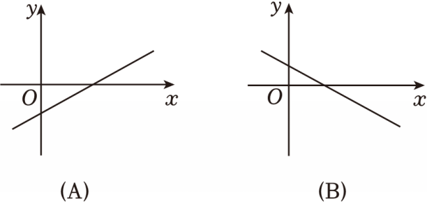

# 24 题精讲 12 · 翻折与正方形存在

## 📝 题目

已知：在直角坐标系中，直线 $y=ax+b$ 与 $x$ 轴、$y$ 轴相交于点 $A$、$B$。当 $ax+b$ 的值小于 0 时，$x$ 的值大于 4，且该直线与 $x$ 轴的夹角为 $45°$。抛物线 $y=-\dfrac12x^2+bx+c$ 经过点 $A$ 和点 $B$。

(1)【问题提出】如何求抛物线解析式？观察条件"当 $ax+b$ 的值小于 0 时，$x$ 的值大于 4"，可得当 $x$ 小于 4 时，$ax+b$ 的值＿＿0（选填"大于"或"小于"），该直线的大致图象可能是＿＿（选填"A"或"B"，其中 A 为上升直线、B 为下降直线），其中与 $x$ 轴交点 $A$ 的坐标为＿＿。继续阅读条件，"该直线与 $x$ 轴的夹角为 $45°$"告诉我们其与 $y$ 轴的交点 $B$ 的坐标是＿＿。将 $A$、$B$ 代入抛物线，列出方程组＿＿，解得 $b=$＿＿，$c=$＿＿。

(2)【综合运用】$P$ 是线段 $OA$ 上一点，过点 $P$ 作直线 $AB$ 的平行线，与 $y$ 轴相交于点 $Q$。把 $\triangle OPQ$ 沿直线 $PQ$ 翻折，点 $O$ 的对应点是点 $D$。如果点 $D$ 在抛物线上，求点 $P$ 的坐标。

## 🧭 思路导航（渐进提示）

- **提示 1（识别）**：(1) 是"不等式读图 + 夹角定斜率"的信息翻译；(2) 的钥匙是 $PQ\parallel AB$ 且 $AB$ 与坐标轴成 $45°$ → $\triangle OPQ$ 是**等腰直角三角形**。
- **提示 2（突破）**："$ax+b<0\iff x>4$"说明直线下降（$a<0$）且零点在 $x=4$；夹角 $45°$ + 下降 → 斜率 $-1$。翻折中 $P$、$Q$ 在折痕上不动，$O\to D$ 给出 $PD=PO$、$QD=QO$ → 四边形 $OPDQ$ 四边相等，再加 $\angle POQ=90°$ → 正方形，$D$ 的坐标立现。
- **提示 3（路线）**：(1) 由 $a<0$ 填"大于"、选 B；$A(4,0)$；斜率 $-1$ → $B(0,4)$；方程组 $\begin{cases}-\tfrac12\cdot16+4b+c=0\\ c=4\end{cases}$ 解得 $b=1$、$c=4$。(2) 设 $P(t,0)$（$0<t\le4$）；直线 $PQ:y=-x+t$ → $Q(0,t)$；翻折保长 → $OP=OQ=PD=QD=t$ 且 $\angle POQ=90°$ → $OPDQ$ 是正方形 → $D(t,t)$；代入 $y=-\tfrac12x^2+x+4$ 得 $t^2=8$，取 $t=2\sqrt2$。

## ✍️ 详解

**(1)** "当 $ax+b<0$ 时 $x>4$"：取 $x>4$ 函数值恒负、$x<4$ 恒正 → 直线从左向右下降，$a<0$。

故当 $x<4$ 时 $ax+b$ **大于** 0（一次函数与不等式、图象升降）。

下降图象选 **B**；与 $x$ 轴交点即零点：$A(4,0)$。

（反证：若选 A（上升直线），则 $x>4$ 时 $ax+b>0$，与"$ax+b<0$"直接矛盾。）

与 $x$ 轴夹角 $45°$ → $|a|=\tan45°=1$，结合下降取 $a=-1$ → $y=-x+4$ → $B(0,4)$。

将 $A(4,0)$、$B(0,4)$ 代入 $y=-\tfrac12x^2+bx+c$：

由 $B(0,4)$ 直接读出 $c=4$（$x=0$ 时 $y=c$）；由 $A(4,0)$：

$$-\tfrac12\times16+4b+c=0\ \Rightarrow\ -8+4b+4=0\ \Rightarrow\ 4b=4\ \Rightarrow\ b=1$$

$$\boxed{b=1,\quad c=4}\qquad\text{抛物线 } y=-\tfrac12x^2+x+4$$

**(2)** 设 $P(t,0)$。$P$ 在线段 $OA$ 上且 $\triangle OPQ$ 不退化 → $0<t\le4$（定义域先立）。

$PQ\parallel AB$，$k_{AB}=-1$ → 过 $P(t,0)$ 的直线 $PQ$：$y-0=-(x-t)$，即 $y=-x+t$；

令 $x=0$ 得 $Q(0,t)$。

$OP=t$，$OQ=t$，$\angle POQ=90°$ → $\triangle OPQ$ 是等腰直角三角形（两边相等且夹角为直角）。

（$t>0$ 保证 $P$、$Q$ 分别在 $x$ 轴、$y$ 轴正半轴上，$\triangle OPQ$ 不退化。）

翻折（轴对称）：$P$、$Q$ 在对称轴 $PQ$ 上保持不动，$O$ 的对应点为 $D$，由对应线段相等：

$$PD=PO=t,\qquad QD=QO=t$$

四边形 $OPDQ$ 中 $OP=PD=DQ=QO=t$（四边相等）→ 先是菱形（四边相等的四边形是菱形）；

又 $\angle POQ=90°$ → 

$$OPDQ\ \text{是正方形}\quad(\text{有一个角是直角的菱形是正方形})$$

故 $D(t,t)$。（验证：$D$ 是 $O(0,0)$ 关于直线 $PQ:x+y=t$ 的对称点，$(0,0)\to(t,t)$ ✓）

（另法核验：$OD$ 的中点 $\left(\tfrac t2,\tfrac t2\right)$ 满足 $x+y=t$，在折痕上；$k_{OD}=1$ 与 $k_{PQ}=-1$ 乘积为 $-1$——符合"折痕垂直平分对应点连线"。）

$D$ 在抛物线上：

$$-\tfrac12t^2+t+4=t\ \Rightarrow\ -\tfrac12t^2+4=0\ \Rightarrow\ t^2=8\ \Rightarrow\ t=\pm2\sqrt2$$

由 $0<t\le4$：$t=-2\sqrt2$ 舍去；$t=2\sqrt2\approx2.83$ 合题（且 $t>0$ 保证 $D(t,t)$ 异于 $P$、$Q$，构型有效 ✓）。

$$\boxed{P\left(2\sqrt2,\ 0\right)}$$

## ⚠️ 评分点与易错

- (1) 三个填空环环相扣：符号判断 → 图象选择 → 坐标；"夹角 $45°$"只给 $|斜率|=1$，**下降**这一信息才决定取 $-1$。
- (2) 正方形判定要写全两步：先"四边相等（菱形）"，再"一个角是直角"；只写"翻折得正方形"没有依据分。
- 翻折的不变量：对应线段相等（$PD=PO$、$QD=QO$）——四边相等的全部来源，必须写明。
- 定义域 $0<t\le4$ 一开始就要设出，$t=-2\sqrt2$ 的舍去才有落点。
- 方程 $-\tfrac12t^2+4=0$ 化简时别把 $+t$ 留在两边不敢消——两边同减 $t$ 是合法的。
- (1) 的读图规则一句话："$ax+b<0$ 的解集是 $x>4$" $\iff$ "图象在 $x$ 轴下方的部分对应 $x>4$"，下降图象与零点 $x=4$ 一拍即合。

## 🔗 关联

- [[03-数学/专题/第24题-二次函数综合]] · [[03-数学/专题/填空压轴17-18-图形运动与新定义]]
- 同类题：[[24-19-直角存在与重心对称]]（轴对称条件）、[[24-16-新定义-优雅抛物线]]（矩形存在性）
