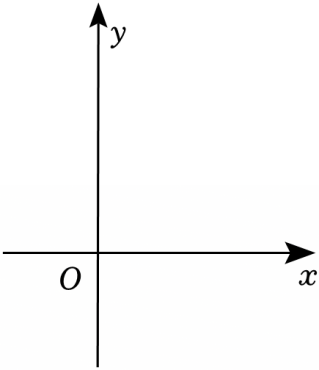

# 24 题精讲 13 · 含参抛物线综合

## 📝 题目

在平面直角坐标系 $xOy$ 中，顶点为 $A$ 的抛物线 $y=-\dfrac12x^2+mx-\dfrac12m^2+m+1$ 与 $y$ 轴交于点 $B$。

(1) 如果抛物线经过点 $(2,-1)$，且不经过第二象限，求抛物线的表达式；

(2) 如果抛物线与坐标轴共有两个公共点，且在 $y$ 轴右侧是下降的，求 $m$ 的值；

(3) 点 $A$ 在第一象限，点 $B$ 关于抛物线对称轴的对称点为点 $C$。将抛物线沿射线 $CA$ 方向平移，点 $A$、$B$、$C$ 的对应点分别为点 $A'$、$B'$、$C'$，线段 $B'C'$ 与线段 $AB$ 交于点 $D$。如果 $\tan\angle A'DB'=4$，且 $\dfrac{S_{\triangle ADC'}}{S_{\triangle ABC}}=\dfrac19$，求点 $A$ 的坐标。

## 🧭 思路导航（渐进提示）

- **提示 1（识别）**：解析式是"半成品顶点式"——先配方看清 $A(m,m+1)$；(1)(2) 都是"图象特征 ⇌ 参数方程"；(3) 是平移 + 相似 + 正切的组合。
- **提示 2（突破）**："不经过第二象限"$\iff x<0$ 时 $y<0$；"与坐标轴两个公共点"$\iff$ 过原点**或**与 $x$ 轴相切（$y$ 轴交点必有）。(3) 中 $B'C'$ 是 $BC$ 的平移像：$B'C'\parallel BC$ 且 $B'C'=BC$ → $DC'\parallel BC$ 使 $\triangle ADC'$ 与 $\triangle ABC$ **天然相似**，面积比开方得线段比；顶点到 $B'C'$ 的铅垂距离 $A'M=m+1-y_B$ 与平移量无关——平移这个未知量被结构自动消去。
- **提示 3（路线）**：(1) 代 $(2,-1)$ 得 $m=0$ 或 $6$，用"第二象限"舍 $0$。(2) 分两类：过原点解出 $m=1\pm\sqrt3$，用 $m\le0$ 留 $1-\sqrt3$；相切用判别式 $\Delta=2m+2=0$ 得 $m=-1$。(3) $BC=2m$；相似比 $\tfrac13$ → $C'D=\tfrac23m$；设 $M$ 为 $B'C'$ 中点，$MD=m-\tfrac23m=\tfrac13m$，$A'M=\tfrac12m^2$；$\tan\angle A'DB'=\dfrac{A'M}{DM}=\dfrac32m=4$ → $m=\tfrac83$。

## ✍️ 详解

**配方**：$y=-\tfrac12\left(x^2-2mx\right)-\tfrac12m^2+m+1=-\tfrac12(x-m)^2+\tfrac12m^2-\tfrac12m^2+m+1$

$$y=-\tfrac12(x-m)^2+m+1\qquad\Rightarrow\ A(m,\ m+1),\ \text{对称轴 } x=m\ (a=-\tfrac12<0)$$

**(1)** 代 $(2,-1)$：$-1=-2+2m-\tfrac12m^2+m+1$，即 $-1=-\tfrac12m^2+3m-1$，

$$\tfrac12m^2=3m\ \Rightarrow\ m\left(\tfrac12m-3\right)=0\ \Rightarrow\ m=0\ \text{或}\ m=6$$

$m=0$：$y=-\tfrac12x^2+1$，取 $x=-1$ 得 $y=\tfrac12>0$，点 $(-1,\tfrac12)$ 在第二象限 → 舍；

$m=6$：$y=-\tfrac12x^2+6x-11$，当 $x<0$ 时三项 $-\tfrac12x^2<0$、$6x<0$、$-11<0$ → $y<0$ 恒成立 → 不经过第二象限 ✓。

$$\boxed{y=-\tfrac12x^2+6x-11}$$

**(2)** 与 $y$ 轴必有交点 $B\left(0,-\tfrac12m^2+m+1\right)$，故分两类：

**① $B$ 恰为原点（抛物线过原点）：** $-\tfrac12m^2+m+1=0\Rightarrow m^2-2m-2=0$，

$$m=1\pm\sqrt3\quad(\text{求根公式})$$

此时 $y=x\left(-\tfrac12x+m\right)$，与 $x$ 轴交于 $(0,0)$ 和 $(2m,0)$，且 $2m=2\pm2\sqrt3\neq0$ → 公共点恰 2 个 ✓。

"$y$ 轴右侧下降"$\Rightarrow$ 对称轴不能在 $y$ 轴右侧，即 $m\le0$：$m=1+\sqrt3>0$ 舍；$m=1-\sqrt3<0$ ✓。

**② $B$ 不是原点，则与 $x$ 轴恰有一个公共点（相切）：**

$$\Delta=m^2-4\left(-\tfrac12\right)\left(-\tfrac12m^2+m+1\right)=m^2+2\left(-\tfrac12m^2+m+1\right)=2m+2=0\ \Rightarrow\ m=-1$$

此时 $y=-\tfrac12(x+1)^2$，切点 $(-1,0)$ 与 $B(0,-\tfrac12)$ 是两个不同公共点 ✓，且 $m<0$ ✓。

（不可能"切点在 $y$ 轴上"：切点即顶点 $(m,m+1)$，在 $y$ 轴上需 $m=0$，与 $\Delta=0$ 矛盾。）

$$\boxed{m=-1\ \text{或}\ m=1-\sqrt3}\qquad(\text{题源}"m=1-3"\text{为 OCR 丢根号，应为 } 1-\sqrt3)$$

**(3)** $A$ 在第一象限 → $m>0$（$m+1>0$ 自动成立）。

$y_B=-\tfrac12m^2+m+1$；$B$ 关于对称轴 $x=m$ 的对称点 $C(2m,\ y_B)$（横坐标 $2m-0$），故

$$BC=2m\quad(\text{水平线段})$$

平移像：$B'C'\parallel BC$，$B'C'=BC=2m$；$D$ 在 $AB$ 上，$C'$ 在 $B'C'$ 上，且 $DC'\parallel BC$ →

$$\triangle ADC'\backsim\triangle ABC\quad(\text{平行于三角形一边的直线截另两边，所得三角形与原三角形相似})$$

$$\frac{S_{\triangle ADC'}}{S_{\triangle ABC}}=\left(\frac{C'D}{BC}\right)^2=\frac19\ \Rightarrow\ \frac{C'D}{BC}=\frac13\ \Rightarrow\ C'D=\frac{2m}{3}\quad(\text{线段比取正})$$

记 $M$ 为 $B'C'$ 与平移后对称轴的交点（即 $B'C'$ 中点）：$MC'=m$。$D$ 在 $M$ 与 $C'$ 之间（$C'D=\tfrac23m<m=MC'$）：

$$MD=MC'-DC'=m-\tfrac23m=\tfrac13m$$

$A'M$（顶点到 $B'C'$ 的铅垂距离）：设平移量为 $(\Delta x,\Delta y)$，则 $A'(m+\Delta x,\ m+1+\Delta y)$，$M(m+\Delta x,\ y_B+\Delta y)$，

$$A'M=m+1-y_B=m+1-\left(-\tfrac12m^2+m+1\right)=\tfrac12m^2\quad(\textbf{与平移量无关！})$$

$A'M\perp B'C'$（竖直 × 水平），且 $M$ 在 $D$ 与 $B'$ 之间（沿线段排序 $C'$–$D$–$M$–$B'$）→ $\angle A'DB'=\angle A'DM$：

$$\tan\angle A'DB'=\frac{A'M}{DM}=\frac{\tfrac12m^2}{\tfrac13m}=\tfrac32m=4\ \Rightarrow\ m=\tfrac83$$

（$m=0$ 使 $DM=0$、$A$ 不在第一象限，舍。）

$$\boxed{A\left(\tfrac83,\ \tfrac{11}3\right)}$$

## ⚠️ 评分点与易错

- 题源讹误：(2) 答案"$m=1-3$"应为 $m=1-\sqrt3$；(3) 源文本"$S_{\triangle ADC'}S_{\triangle ABC}=19$"是 $\tfrac19$。
- "与坐标轴共两个公共点"的分类标准：$y$ 轴交点恒存在 → 只需讨论"过原点"与"和 $x$ 轴相切"；数点时**原点只能算一次**。
- (3) 先证相似（$DC'\parallel BC$）再开方面积比，开方取正；相似比与面积比是平方关系，方向别反。
- $A'M=\tfrac12m^2$ 与平移量无关是本题破局点——平移未知量被结构自然消去，不需要真的求出平移距离。
- $m=0$ 这类使几何量退化的根要显式舍去并给理由。

## 🔗 关联

- [[03-数学/专题/第24题-二次函数综合]] · [[03-数学/知识点/九年级/相似三角形]]
- 同类题：[[24-11-平移共线与相似存在]]（相似存在性）、[[24-10-顶点在三角形内]]（含参范围）、[[24-14-顶点射线平移与垂直]]（平移）
