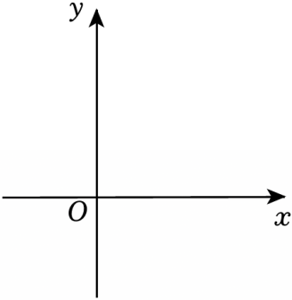

# 24 题精讲 14 · 顶点射线平移与垂直

## 📝 题目

在平面直角坐标系 $xOy$ 中，已知抛物线 $y=-x^2+4x+c$（$c>0$）与 $x$ 轴交于 $A$、$B$ 两点（点 $A$ 在点 $B$ 的右侧），与 $y$ 轴交于点 $C$，顶点为 $P$，直线 $PC$ 与 $x$ 轴交于点 $D$。

(1) 用含 $c$ 的代数式表示点 $P$ 及点 $D$ 的坐标；

(2) 将该抛物线进行上下、左右两次平移，所得新抛物线的顶点 $P'$ 落在线段 $PC$ 的延长线上，新抛物线与 $y$ 轴交于点 $E$，且 $P'E\perp PP'$。

① 求该抛物线两次平移的方向和距离；

② 点 $A$ 在新抛物线上的对应点为 $A'$，如果 $DA'$ 被 $y$ 轴平分，求原抛物线的表达式。

## 🧭 思路导航（渐进提示）

- **提示 1（识别）**：全题围绕"顶点 $P$ 与直线 $PC$"转——先配方把 $P$、直线 $PC$、$D$ 全用 $c$ 表达；(2) 把平移量设为"向右 $m$、向上 $n$"，让字母覆盖四个方向。
- **提示 2（突破）**：$P'$ 在 $PC$ 的**延长线**上有两层信息：共线（$P',P,C$ 同在直线 $y=2x+c$ 上 → $n=2m$）+ 位置（$P'$ 在 $C$ 外侧 → $m<-2$）。$P'E\perp PP'$ 且 $C,P,P'$ 共线 → 在 $\triangle CP'E$ 中以 $CE$ 为斜边用勾股。
- **提示 3（路线）**：(1) $y=-(x-2)^2+4+c$ → $P(2,4+c)$；直线 $PC:y=2x+c$ → $D(-\tfrac c2,0)$。(2)① $E(0,-m^2-2m+c)$，勾股 $CP'^2+EP'^2=CE^2$ 化为 $(m+2)^2(4m+10)=0$，取 $m=-\tfrac52$、$n=-5$ → 向左 $\tfrac52$、向下 $5$。② $A(2+\sqrt{4+c},0)$ → $A'(\sqrt{4+c}-\tfrac12,\ -5)$；"$DA'$ 被 $y$ 轴平分"$\iff x_D+x_{A'}=0$ → $\sqrt{4+c}=\tfrac{c+1}{2}$，平方解得 $c=5$。

## ✍️ 详解

**(1)** 配方：$y=-x^2+4x+c=-(x-2)^2+4+c$（顶点式），故顶点

$$P(2,\ 4+c)$$

令 $x=0$：$C(0,c)$。设直线 $PC:y=kx+c$（过 $C$），代 $P$：$2k+c=4+c\Rightarrow k=2$，故

$$\text{直线 } PC:\ y=2x+c$$

令 $y=0$：$x=-\dfrac c2$，故

$$\boxed{P(2,\ 4+c),\qquad D\left(-\tfrac c2,\ 0\right)}$$

**(2)①** 设向右平移 $m$、向上平移 $n$（$m,n$ 可负，覆盖四个方向）。新抛物线：

$$y'=-\left(x-2-m\right)^2+4+c+n,\qquad P'(2+m,\ 4+c+n)$$

$P'$ 在直线 $PC$ 上（共线）：$4+c+n=2(2+m)+c$，得

$$n=2m\qquad(m\neq0,\ \text{否则没有平移})$$

"线段 $PC$ 的延长线"还要求 $P'$ 在 $C$ 外侧：$C$ 的横坐标为 $0$，故 $x_{P'}=2+m<0$，即 $m<-2$。

$E$：令 $x=0$，$y'=-\left(2+m\right)^2+4+c+n=-m^2-4m-4+4+c+2m=-m^2-2m+c$，即 $E\left(0,\ -m^2-2m+c\right)$。

$P'E\perp PP'$ 且 $C,P,P'$ 共线 → $\angle CP'E=90°$。在 Rt$\triangle CP'E$ 中（$\angle P'$ 为直角，斜边 $CE$），勾股定理：

$$CP'^2+EP'^2=CE^2$$

$$CP'^2=(2+m)^2+(4+c+2m-c)^2=(m+2)^2+(2m+4)^2=(m+2)^2+4(m+2)^2$$

$$EP'^2=(2+m)^2+\left(4+c+2m+m^2+2m-c\right)^2=(m+2)^2+\left(m^2+4m+4\right)^2=(m+2)^2+(m+2)^4$$

$$CE^2=\left(m^2+2m\right)^2=m^2(m+2)^2$$

代入并整理（左边 $=(m+2)^2\left[6+(m+2)^2\right]$）：

$$(m+2)^2\left[6+(m+2)^2\right]=m^2(m+2)^2$$

$m+2\neq0$（$m=-2$ 时 $P'=(0,c)=C$，退化为"没有平移出延长线"，已被 $m<-2$ 排除），两边约去 $(m+2)^2$：

$$6+(m+2)^2=m^2\ \Rightarrow\ 6+m^2+4m+4=m^2\ \Rightarrow\ 4m=-10\ \Rightarrow\ m=-\tfrac52\ \ (\text{满足 } m<-2\ \checkmark)$$

$$n=2m=-5$$

$$\boxed{\text{向左平移 } \tfrac52 \text{ 个单位，再向下平移 } 5 \text{ 个单位}}$$

**(2)②** 令 $y=0$：$-(x-2)^2+4+c=0\Rightarrow(x-2)^2=4+c\Rightarrow x=2\pm\sqrt{4+c}$；

$A$ 在 $B$ 右侧 → $A\left(2+\sqrt{4+c},\ 0\right)$。

平移 $(-\tfrac52,-5)$ 后：

$$A'\left(2+\sqrt{4+c}-\tfrac52,\ -5\right)=\left(\sqrt{4+c}-\tfrac12,\ -5\right)$$

$DA'$ 被 $y$ 轴平分 $\iff$ 线段 $DA'$ 的中点在 $y$ 轴上 $\iff x_D+x_{A'}=0$：

$$-\frac c2+\sqrt{4+c}-\frac12=0\ \Rightarrow\ \sqrt{4+c}=\frac{c+1}{2}$$

平方（$c>0$ 保证右边 $\tfrac{c+1}2>0$，不会增根）：

$$4(4+c)=(c+1)^2\ \Rightarrow\ 16+4c=c^2+2c+1\ \Rightarrow\ c^2-2c-15=0\ \Rightarrow\ (c-5)(c+3)=0$$

$c=5$ 或 $c=-3$；由 $c>0$ 取 $c=5$。（检验：$\sqrt9=3=\tfrac{5+1}2$ ✓）

$$\boxed{y=-x^2+4x+5}$$

## ⚠️ 评分点与易错

- "线段 $PC$ 的延长线"有两个信息：**共线**（$n=2m$）与**位置**（$P'$ 在 $C$ 外侧，$m<-2$）。只写共线，$m=-2$ 这个退化根就没有舍去的依据。
- 勾股方程两边都含 $(m+2)^2$——先提公因式再约去，直接展开四次方极易出错；约去前必须说明 $m\neq-2$。
- 平方解方程前先确认右边非负（$c>0$），排除增根的可能。
- "被 $y$ 轴平分"翻译成 $x_D+x_{A'}=0$，是"对称/平分"类条件的标准动作。
- 检验习惯：把 $c=5$ 回代 $\sqrt{4+c}=\tfrac{c+1}2$ 验算一遍，平方变形才真正闭合。

## 🔗 关联

- [[03-数学/专题/第24题-二次函数综合]]
- 同类题：[[24-09-顶点在直线上的抛物线平移]]、[[24-13-含参抛物线综合]]（平移条件代数化）、[[24-12-翻折正方形存在]]（对称条件）
