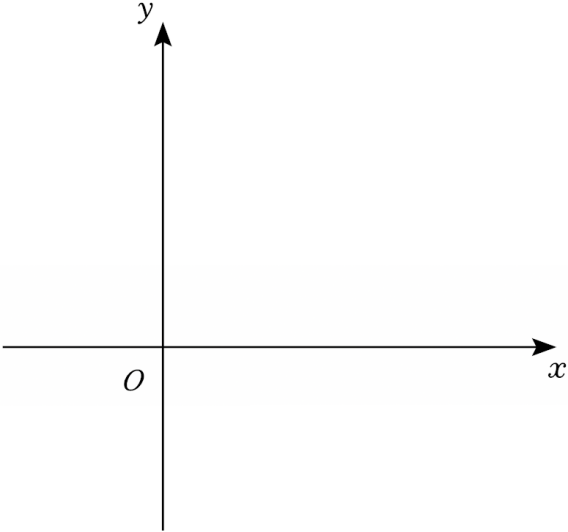

# 24 题精讲 15 · 面积定值与余切

## 📝 题目

在平面直角坐标系 $xOy$ 中，抛物线 $y=-x^2+mx+n$ 经过点 $A(5,0)$，顶点为点 $B$，对称轴为直线 $x=3$，且对称轴与 $x$ 轴交于点 $C$。直线 $y=kx+b$ 经过点 $A$，与线段 $BC$ 交于点 $E$。

(1) 求抛物线 $y=-x^2+mx+n$ 的表达式；

(2) 联结 $BO$、$EO$。当 $\triangle BOE$ 的面积为 3 时，求直线 $y=kx+b$ 的表达式；

(3) 在 (2) 的条件下，设点 $D$ 为 $y$ 轴上的一点，联结 $BD$、$AD$。当 $BD=EO$ 时，求 $\angle DAO$ 的余切值。

## 🧭 思路导航（渐进提示）

- **提示 1（识别）**：(1) "点 + 对称轴"两个独立条件定解析式；(2) 面积反求 $E$——注意 $E$ 被锁在竖直线段 $BC$ 上；(3) "$y$ 轴上的 $D$ + $BD=EO$"是一个方程两个解，解完要保留分类。
- **提示 2（突破）**：$\triangle BOE$ 以 $BE$ 为底最顺手（$BC\perp x$ 轴），高就是 $O$ 到直线 $x=3$ 的距离 $3$；(3) 设 $D(0,d)$，$BD^2=9+(4-d)^2$ 与 $EO^2=13$ 建立方程，$d$ 有两解，对应两种几何形态（平行四边形 / 等腰梯形）。
- **提示 3（路线）**：(1) $\tfrac m2=3$、代 $A$ 得 $n=-5$ → $y=-x^2+6x-5$。(2) $B(3,4)$：$\tfrac12\cdot BE\cdot3=3\Rightarrow BE=2$ → $E(3,2)$；代 $A$、$E$ 得 $y=-x+5$。(3) $EO=\sqrt{13}$：$9+(4-d)^2=13\Rightarrow d=2$ 或 $6$；$\angle AOD=90°$ 恒成立 → $\cot\angle DAO=\dfrac{AO}{DO}=\dfrac5d$ → $\tfrac52$ 或 $\tfrac56$。

## ✍️ 详解

**(1)** 对称轴 $x=-\dfrac{m}{2\times(-1)}=\dfrac m2=3$（对称轴公式）→ $m=6$；

代 $A(5,0)$：$-25+30+n=0\Rightarrow n=-5$。

$$\boxed{y=-x^2+6x-5}$$

**(2)** $x=3$ 时 $y=-9+18-5=4$ → 顶点 $B(3,4)$；对称轴与 $x$ 轴交点 $C(3,0)$。

$E$ 在线段 $BC$ 上 → $E(3,\ y_E)$，且 $0\le y_E\le4$（$BC$ 是竖直线段）。

以 $BE$ 为底（$BE=4-y_E$，在竖直线上），$\triangle BOE$ 的高为 $O$ 到直线 $x=3$ 的距离 $=3$：

$$S_{\triangle BOE}=\tfrac12\cdot BE\cdot3=3\ \Rightarrow\ BE=2$$

$BE=4-y_E=2\Rightarrow y_E=2$（$y_E=6$ 超出线段 $BC$，舍）→ $E(3,2)$。

直线过 $A(5,0)$、$E(3,2)$：

$$k=\frac{2-0}{3-5}=-1,\qquad \text{代 } A:\ 0=-5+b\ \Rightarrow\ b=5$$

（检验：$E(3,2)$ 代入 $y=-x+5$：$-3+5=2$ ✓；且 $A(5,0)$：$-5+5=0$ ✓）

$$\boxed{y=-x+5}$$

**(3)** $EO=\sqrt{3^2+2^2}=\sqrt{13}$（$E(3,2)$，两点距离）。

设 $D(0,d)$（$D$ 在 $y$ 轴上）。由 $BD=EO$：

$$BD^2=(3-0)^2+(4-d)^2=13\ \Rightarrow\ (4-d)^2=4\ \Rightarrow\ 4-d=\pm2$$

$$d=2\quad\text{或}\quad d=6\qquad(\text{两解都保留——题目只要求 } D \text{ 在 } y \text{ 轴上})$$

$\angle AOD=90°$（$AO$ 在 $x$ 轴上，$OD$ 在 $y$ 轴上），故 $\triangle AOD$ 是直角三角形，直角在 $O$。

对 $\angle DAO$（顶点 $A$）而言，邻边是 $AO$、对边是 $OD$，由余切定义（邻边比对边）：

$$\cot\angle DAO=\frac{AO}{DO}=\frac5d$$

$d=2$ 时：$\cot\angle DAO=\dfrac52$；$d=6$ 时：$\cot\angle DAO=\dfrac56$。

（数值复核：$d=2$：$BD=\sqrt{9+(4-2)^2}=\sqrt{13}=EO$ ✓；$d=6$：$BD=\sqrt{9+(4-6)^2}=\sqrt{13}=EO$ ✓，且两解均使 $D$ 在 $y$ 轴正半轴，无需再筛。）

$$\boxed{\cot\angle DAO=\tfrac52\ \text{或}\ \tfrac56}$$

（几何解读：$d=2$ 时 $k_{BD}=\dfrac{2-4}{0-3}=\dfrac23=k_{OE}$ 且 $BD=OE$ → 四边形 $OEBD$ 为平行四边形；$d=6$ 时 $OEBD'$ 为等腰梯形——两种构型分别对应两解。）

## ⚠️ 评分点与易错

- (2) 选 $BE$ 作底是唯一顺手的选择——$O$ 到直线 $x=3$ 的距离就是 $3$；去算 $OB$ 或 $OE$ 作底会把自己绕进死胡同。
- (3) 去根号产生两解，**都要保留**并各自求余切；漏解直接丢一半分。
- 余切 $=$ 邻边比对边，直角在 $O$：对 $\angle DAO$，邻边是 $AO$、对边是 $DO$——接反了会得出 $d/5$。
- 也可以按题源思路"$BD\parallel OE$ 与否"先做几何分类再计算；直接解方程完全等价，但要把两种构型都点出来。
- $y_E=6$ 这个"越界根"的舍去理由要写：$E$ 限定在线段 $BC$ 上，$y$ 超过 4 就不在了。
- (1) 也可用顶点式走：对称轴 $x=3$ → $y=-(x-3)^2+4$，展开得 $-x^2+6x-5$，与待定系数法互相印证。

## 🔗 关联

- [[03-数学/专题/第24题-二次函数综合]] · [[03-数学/知识点/九年级/锐角的三角比与解直角三角形]]
- 同类题：[[24-05-梯形存在与角度正切]]（三角比 + 特殊四边形构型）、[[24-08-双抛物线与直角梯形]]
