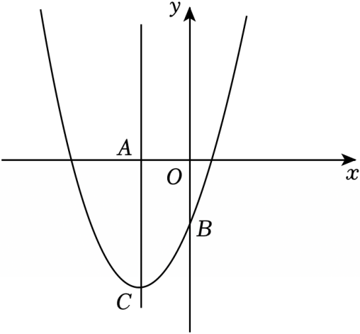

# 24 题精讲 16 · 新定义：优雅抛物线

## 📝 题目

定义：如果一条抛物线 $y=ax^2+bx+c$（$a>0$）的顶点坐标满足条件 $(t,\ at^2)$，那么称该抛物线为"优雅"抛物线。例如：抛物线 $y=2x^2-4x+4$ 的顶点坐标为 $(1,2)$，此时 $t=1$，$a=2$，顶点纵坐标 $=a\cdot t^2=2$，符合定义。

(1) 如果抛物线 $C_1:y=x^2+4x+m$ 是"优雅"抛物线，求 $m$ 的值。

(2) 如图，把 (1) 中的抛物线 $C_1$ 向下平移得到抛物线 $C_2$，抛物线 $C_2$ 与 $y$ 轴负半轴交于点 $B$，顶点为点 $C$，对称轴与 $x$ 轴交于点 $A$。

① 点 $E$ 在 $CB$ 的延长线上，点 $D$ 是 $x$ 轴上一点，且四边形 $ABDE$ 是矩形，求点 $E$ 的坐标；

② 如果抛物线 $C_3:y=2x^2+px+q$ 为"优雅"抛物线，它的顶点 $G$ 在 $x$ 轴上，抛物线 $C_2$ 与 $C_3$ 交于点 $M$，且 $AM\parallel BC$，求抛物线 $C_2$ 的解析式。

## 🧭 思路导航（渐进提示）

- **提示 1（识别）**：新定义 → 第一步永远是"把定义翻译成关于参数的方程"：顶点纵坐标 $=a\cdot t^2$；(2)① 是矩形顶点存在性，② 是"平行定直线 + 双抛物线交点"。
- **提示 2（突破）**：① 设 $C_2:y=(x+2)^2+k$，所有点带 $k$ 走；矩形 = 平行四边形（对角线 $AD$、$BE$ **互相平分** → 先定 $E$ 的纵坐标）+ 一个直角（$AB\perp AE$ → 定 $k$）。② $C_3$ 的顶点在 $x$ 轴上：$2t^2=0$ → 顶点 $(0,0)$ → $C_3:y=2x^2$；$AM\parallel BC$ 只给直线，与 $C_3$ 联立定 $M$，再回代 $C_2$ 定 $k$。
- **提示 3（路线）**：(1) 顶点 $(-2,m-4)$，$m-4=1\times(-2)^2=4$ → $m=8$。(2)① $B(0,4+k)$（$4+k<0$），直线 $BC:y=2x+4+k$；对角线互平分 → $y_E=-(4+k)$，代入直线得 $E(-4-k,-4-k)$；$k_{AB}\cdot k_{AE}=-1$ 得 $k^2+10k+20=0$，$k=-5\pm\sqrt5$，由 $4+k<0$ 留 $k=-5-\sqrt5$ → $E(1+\sqrt5,\,1+\sqrt5)$。② $AM:y=2(x+2)$ 与 $y=2x^2$ 联立得 $x=2$ 或 $-1$；$x=-1$ 给 $k=1$ 违背"负半轴"舍；$x=2$ 给 $M(2,8)$、$k=-8$ → $y=(x+2)^2-8$。

## ✍️ 详解

**(1)** 对称轴 $x=-\dfrac{4}{2}=-2$；顶点纵坐标 $y=4-8+m=m-4$，即顶点 $(-2,\ m-4)$。

按定义（$a=1$，$t=-2$）：

$$m-4=a\cdot t^2=1\times(-2)^2=4\ \Rightarrow\ \boxed{m=8}\qquad(C_1:y=(x+2)^2+4)$$

**(2)** 向下平移，设 $C_2:y=(x+2)^2+k$（$k<4$），则 $A(-2,0)$，$C(-2,k)$，$B(0,4+k)$。

$B$ 在 $y$ 轴**负半轴** → $4+k<0$，即 $k<-4$ ……（※全题的"裁判"条件）

**①** $E$ 在 $CB$ 延长线上 → $E$ 在直线 $BC$ 上。由 $B$、$C$ 坐标：

$$k_{BC}=\frac{(4+k)-k}{0-(-2)}=2\ \Rightarrow\ \text{直线 } BC:\ y=2x+4+k$$

四边形 $ABDE$ 是矩形 → 先是平行四边形 → 对角线 $AD$、$BE$ 互相平分（平行四边形性质）。

设 $D(d,0)$：$AD$ 中点纵坐标为 $0$ → $BE$ 中点纵坐标 $\dfrac{4+k+y_E}{2}=0$ → $y_E=-4-k$。

$E$ 在直线 $BC$ 上：$-4-k=2x_E+4+k\Rightarrow x_E=-4-k$，故 $E(-4-k,\ -4-k)$。

矩形还差直角条件：$\angle BAE=90°$，即 $AB\perp AE$（矩形四角皆直角）。

$$k_{AB}=\frac{(4+k)-0}{0-(-2)}=\frac{k+4}{2},\qquad k_{AE}=\frac{-4-k}{-4-k+2}=\frac{k+4}{k+2}\quad(k\neq-2)$$

$$\frac{k+4}{2}\cdot\frac{k+4}{k+2}=-1\ \Rightarrow\ (k+4)^2=-2(k+2)\ \Rightarrow\ k^2+8k+16=-2k-4\ \Rightarrow\ k^2+10k+20=0$$

$$k=-5\pm\sqrt5\quad(\text{求根公式：}\Delta=100-80=20)$$

检验（※）：$k=-5+\sqrt5\approx-2.76$ → $4+k=\sqrt5-1>0$，$B$ 在 $y$ 轴正半轴，舍；

$k=-5-\sqrt5$ → $4+k=-1-\sqrt5<0$ ✓。此时 $E=(-4-k,\,-4-k)=(1+\sqrt5,\ 1+\sqrt5)$。

（构型验证：$A(-2,0)$，$B(0,-1-\sqrt5)$，$D(3+\sqrt5,0)$，$E(1+\sqrt5,1+\sqrt5)$；$k_{AB}\cdot k_{BD}=\dfrac{-1-\sqrt5}{2}\cdot\dfrac{1+\sqrt5}{3+\sqrt5}=-\dfrac{(1+\sqrt5)^2}{2(3+\sqrt5)}=-1$ ✓）

$$\boxed{E\left(1+\sqrt5,\ 1+\sqrt5\right)}$$

**②** $C_3:y=2x^2+px+q$ 优雅（$a=2$）→ 顶点 $(t,\ 2t^2)$；顶点在 $x$ 轴上 → $2t^2=0\Rightarrow t=0$，

顶点 $G(0,0)$ → $p=q=0$，故 $C_3:y=2x^2$。

$AM\parallel BC$ → $k_{AM}=2$，过 $A(-2,0)$：$AM:y=2(x+2)$。

$M$ 是 $C_2$ 与 $C_3$ 的公共点且在直线 $AM$ 上：

$$2x^2=2(x+2)\ \Rightarrow\ x^2-x-2=0\ \Rightarrow\ (x-2)(x+1)=0\ \Rightarrow\ x=2\ \text{或}\ x=-1$$

$x=-1$：$M(-1,2)$，代 $C_2$：$2=(-1+2)^2+k\Rightarrow k=1$，违背（※）$k<-4$，舍；

$x=2$：$M(2,8)$，代 $C_2$：$8=(2+2)^2+k\Rightarrow k=-8$ ✓（$-8<-4$）。

（此时 $(x+2)^2-8=2x^2\Rightarrow(x-2)^2=0$，两抛物线恰相切于 $M(2,8)$，与"交于点 $M$"相符。）

$$\boxed{C_2:\ y=(x+2)^2-8}$$

## ⚠️ 评分点与易错

- 新定义题第一步：按定义列方程"顶点纵坐标 $=a\cdot t^2$"；②里 $a=2$，别沿用 (1) 的 $a=1$。
- ①的套路：矩形 $=$ 平行四边形（对角线互平分 → 定 $E$ 纵坐标）$+$ 一个直角（垂直 → 定 $k$），两步缺一不可。
- 用斜率乘积 $=-1$ 判垂直前，确认两直线都不竖直（$k\neq-2$ 的说明）。
- "$B$ 在 $y$ 负半轴"$\Rightarrow k<-4$ 是全题筛根的裁判：①的两个 $k$、②的两个 $x$ 都靠它取舍。
- $E$ 的纵坐标来自对角线互平分，不是来自"对称性"的直觉——答题时写出"平行四边形对角线互相平分"这句依据。

## 🔗 关联

- [[03-数学/专题/第24题-二次函数综合]]
- 同类题：[[24-06-新定义-不动点]]、[[24-07-新定义-回归抛物线]]（新定义）；[[24-12-翻折正方形存在]]（特殊四边形存在性）
