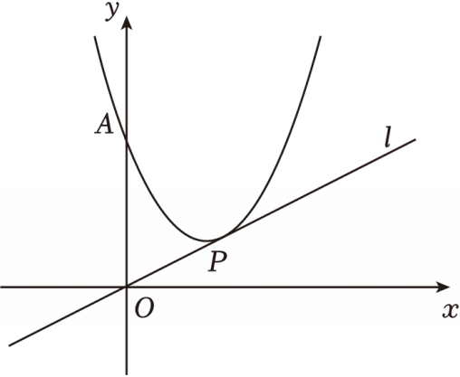

# 24 题精讲 17 · 双抛物线交点与垂直

## 📝 题目

如图，在平面直角坐标系 $xOy$ 中，已知抛物线 $y=x^2+bx+c$ 与 $y$ 轴交于点 $A(0,5)$，抛物线顶点 $P$ 在第一象限且在直线 $l:y=\dfrac12x$ 上。

(1) 求抛物线的表达式；

(2) 向上平移直线 $l$，交抛物线于 $C$、$D$ 两点（$C$ 在 $D$ 左侧），当 $CD=OP$ 时，求 $C$ 点坐标；

(3) 将抛物线向右平移 $m$ 个单位，平移后的抛物线与原抛物线交于点 $M$，顶点为 $N$。如果 $MN\perp l$，求 $m$ 的值。

## 🧭 思路导航（渐进提示）

- **提示 1（识别）**：顶点在直线 $l$ 上 → 设 $P(s,\tfrac s2)$ 直接写顶点式；(2) 的弦**平行于定直线**——弦长与水平投影的比值由斜率决定；(3) 平移抛物线与原抛物线的交点横坐标有现成规律。
- **提示 2（突破）**：斜率 $\tfrac12$ 的弦：$\Delta y=\tfrac12\Delta x$，弦长 $=\sqrt{\Delta x^2+\Delta y^2}=\tfrac{\sqrt5}{2}\Delta x$——与 $OP=\sqrt5$ 比对即得 $\Delta x=2$。平移后两抛物线同开口同形状：$(x-2)^2+1=(x-2-m)^2+1$ → 交点横坐标 $x_M=2+\tfrac m2$，恰在两顶点正中间。
- **提示 3（路线）**：(1) 顶点式代 $A(0,5)$ 解 $s$，第一象限留 $s=2$ → $y=(x-2)^2+1$。(2) 设 $C(m,\,m^2-4m+5)$，$D(m+2,\,$同高 $+1)$；$D$ 在抛物线上解 $m=\tfrac54$ → $C(\tfrac54,\tfrac{25}{16})$。(3) 平移后 $N(2+m,1)$；联立得 $M(2+\tfrac m2,\tfrac{m^2}4+1)$；$k_{MN}=-\tfrac m2$；$MN\perp l$ → $\left(-\tfrac m2\right)\times\tfrac12=-1$ → $m=4$。

## ✍️ 详解

**(1)** 顶点 $P$ 在 $l$ 上 → 设 $P\left(s,\ \tfrac s2\right)$（$s>0$，第一象限），顶点式：

$$y=(x-s)^2+\tfrac s2\qquad(a=1)$$

过 $A(0,5)$：$5=s^2+\tfrac s2$，即 $2s^2+s-10=0$，

$$(2s+5)(s-2)=0\ \Rightarrow\ s=2\ \text{或}\ s=-\tfrac52$$

第一象限 → $s>0$ → $s=2$，$P(2,1)$（检验：$1=\tfrac12\times2$ ✓ 在 $l$ 上）。

$$\boxed{y=(x-2)^2+1=x^2-4x+5}$$

**(2)** $OP=\sqrt{2^2+1^2}=\sqrt5$（两点距离），故 $CD=\sqrt5$。

平移后直线斜率仍为 $\tfrac12$；弦 $CD$ 两端都在抛物线上，记 $\Delta x=x_D-x_C$（$C$ 在 $D$ 左侧 → $\Delta x>0$）：

$$\Delta y=\tfrac12\Delta x\ (\text{斜率}),\qquad CD^2=\Delta x^2+\Delta y^2=\tfrac54\,\Delta x^2$$

$CD^2=5$：$\tfrac54\Delta x^2=5\Rightarrow\Delta x^2=4\Rightarrow\Delta x=2$，$\Delta y=1$。

设 $C\left(m,\ m^2-4m+5\right)$，则 $D\left(m+2,\ m^2-4m+6\right)$。

$D$ 在抛物线上：$m^2-4m+6=(m+2)^2-4(m+2)+5=m^2+1$，

$$-4m+6=1\ \Rightarrow\ m=\tfrac54$$

$y_C=m^2-4m+5=\tfrac{25}{16}-5+5=\tfrac{25}{16}$。

$$\boxed{C\left(\tfrac54,\ \tfrac{25}{16}\right)}$$

（检验：$D\left(\tfrac{13}4,\ \tfrac{41}{16}\right)$：$\left(\tfrac{13}4\right)^2-4\times\tfrac{13}4+5=\tfrac{169}{16}-\tfrac{208}{16}+\tfrac{80}{16}=\tfrac{41}{16}$ ✓）

**(3)** 向右平移 $m$：新抛物线 $y=(x-2-m)^2+1$，顶点 $N(2+m,\ 1)$。

交点 $M$：$(x-2)^2+1=(x-2-m)^2+1$，即

$$(x-2)^2=(x-2-m)^2\ \Rightarrow\ x-2=\pm(x-2-m)$$

取"$+$"：$m=0$（没有平移，舍）；取"$-$"：$2(x-2)=m\Rightarrow x=2+\tfrac m2$。

$$M\left(2+\tfrac m2,\ \tfrac{m^2}4+1\right)$$

（结构验证：$x_M=2+\tfrac m2$ 恰为两顶点横坐标 $2$ 与 $2+m$ 的平均值。）

$$k_{MN}=\frac{\tfrac{m^2}4+1-1}{2+\tfrac m2-(2+m)}=\frac{m^2/4}{-m/2}=-\frac m2\quad(m>0)$$

$MN\perp l$（斜率乘积为 $-1$）：

$$\left(-\frac m2\right)\times\frac12=-1\ \Rightarrow\ m=4$$

检验：$N(6,1)$，$M(4,5)$，$k_{MN}=\dfrac{5-1}{4-6}=-2$，$-2\times\tfrac12=-1$ ✓。

$$\boxed{m=4}$$

## ⚠️ 评分点与易错

- (2) 千万别把 $CD$ 当水平弦——它平行于 $l$，斜率 $\tfrac12$；"弦长 $=\tfrac{\sqrt5}2\times$ 水平投影"是全问的支点。
- (3) 联立后开平方必须写"$\pm$"两种并分别讨论：一种推出 $m=0$ 舍去，一种给出交点。
- $k_{MN}$ 用"纵差 ÷ 横差"逐步算，别跳步；垂直即斜率乘积 $-1$。
- 检验习惯：把 $m=4$ 回代验证 $MN\perp l$；$M$ 的横坐标是两顶点横坐标的平均值，可作快速核查。
- (2) 中 $\Delta x=2$ 取正的依据是"$C$ 在 $D$ 左侧"，这句要写。

## 🔗 关联

- [[03-数学/专题/第24题-二次函数综合]]
- 同类题：[[24-14-顶点射线平移与垂直]]（平移 + 垂直）、[[24-20-平移与角度互补]]（平移 + 角）
