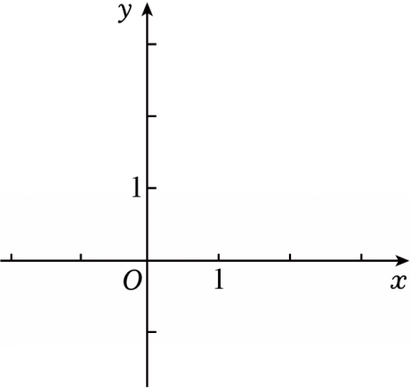

# 24 题精讲 18 · 面积定值与梯形存在

## 📝 题目

如图，在平面直角坐标系 $xOy$ 中，点 $C(m,-1)$ 在直线 $y=-x+2$ 上。已知抛物线 $y=x^2-2kx+k^2-1$（$k$ 为常数），抛物线与 $x$ 轴的两个交点为点 $E$、点 $F$（其中点 $E$ 在点 $F$ 左侧），顶点为 $D$。

(1) 若抛物线经过点 $C$，求抛物线的表达式；

(2) 求证：$\triangle DEF$ 的面积是一个定值，并求出这个值；

(3) 已知点 $N\left(\tfrac35,0\right)$，抛物线的顶点 $D$ 恰好落在 $\angle CNO$ 的平分线上，点 $G$ 在抛物线上。若四边形 $DEGF$ 为梯形，求点 $G$ 的坐标。

## 🧭 思路导航（渐进提示）

- **提示 1（识别）**：$y=x^2-2kx+k^2-1$ 一眼看出 $(x-k)^2-1$——顶点 $D(k,-1)$ 与 $x$ 轴交点全部带 $k$；"定值"证明 $=$ 把面积算成与 $k$ 无关的数。
- **提示 2（突破）**：(3) 角平分线 + $CD\parallel x$ 轴（$C$、$D$ 纵坐标都是 $-1$）→ 用**内错角**把"平分"翻译成"$\triangle CDN$ 等腰"；梯形 $DEGF$（按 $D\to E\to G\to F$ 顺序）的平行对边只有 $DE\parallel GF$ 或 $EG\parallel DF$ 两种——"过一点作已知直线的平行线交抛物线"。
- **提示 3（路线）**：(1) $(3-k)^2=0$ → $k=3$ → $y=x^2-6x+8$。(2) $E(k-1,0)$、$F(k+1,0)$，$EF=2$、高 $1$ → $S=1$。(3) $D$ 在 $C$ 左侧时 $\angle CDN=\angle DNO$（内错角）+ 平分 → $CD=CN=\tfrac{13}5$ → $k=\tfrac25$；$D$ 在 $C$ 右侧时用内角和导出矛盾（无解）；得 $E(-\tfrac35,0)$、$F(\tfrac75,0)$、$D(\tfrac25,-1)$；梯形两类：过 $E$ 作 $y=x+\tfrac35$ 交抛物线得 $G(\tfrac{12}5,3)$；过 $F$ 作 $y=-x+\tfrac75$ 交抛物线得 $G(-\tfrac85,3)$。

## ✍️ 详解

**(1)** $C$ 在 $y=-x+2$ 上：$-1=-m+2\Rightarrow m=3$，故 $C(3,-1)$。

代入抛物线（用 $(x-k)^2-1$ 形式）：

$$(3-k)^2-1=-1\ \Rightarrow\ (3-k)^2=0\ \Rightarrow\ k=3\quad(\text{完全平方式，唯一解})$$

$$\boxed{y=(x-3)^2-1=x^2-6x+8}$$

**(2)** 配方：$y=(x-k)^2-1$。令 $y=0$：$(x-k)^2=1\Rightarrow x=k\pm1$，

$$E(k-1,\,0),\qquad F(k+1,\,0)\quad(E\text{ 在左}\ \checkmark),\qquad D(k,\,-1)$$

$$EF=(k+1)-(k-1)=2\quad(\text{与 } k \text{ 无关}),\qquad D\text{ 到 } x \text{ 轴距离}=|-1|=1\quad(\text{与 } k \text{ 无关})$$

$$S_{\triangle DEF}=\tfrac12\times EF\times\text{高}=\tfrac12\times2\times1=1\qquad\boxed{\text{定值 } 1}\qquad\blacksquare$$

**(3)** $C(3,-1)$，$D(k,-1)$ → $CD\parallel x$ 轴；$N(\tfrac35,0)$。

**情形一：$D$ 在 $C$ 左侧（$k<3$）**——射线 $DC$ 沿 $x$ 轴正方向。

由 $CD\parallel x$ 轴（截线 $DN$）：$\angle CDN=\angle DNO$（两直线平行，内错角相等；$NO$ 沿 $x$ 轴负方向）。

$D$ 在 $\angle CNO$ 的平分线上：$\angle CND=\angle DNO$ → $\angle CND=\angle CDN$ →

$$CD=CN\quad(\text{等角对等边})$$

$$CN=\sqrt{\left(3-\tfrac35\right)^2+(-1)^2}=\sqrt{\tfrac{144}{25}+1}=\tfrac{13}5\ \Rightarrow\ 3-k=\tfrac{13}5\ \Rightarrow\ k=\tfrac25\ \ (\text{满足 } k<3\ \checkmark)$$

**情形二：$D$ 在 $C$ 右侧（$k>3$）**——射线 $DC$ 沿 $x$ 负方向。此时 $\angle CDN=\angle DNF'$（$F'$ 为 $N$ 右侧方向，内错角换向），而 $\angle DNO=180°-\angle DNF'$（邻补角）。若 $D$ 在平分线上：$\angle CND=\angle DNO=180°-\angle CDN$；代入三角形内角和 $\angle CND+\angle CDN+\angle DCN=180°$，得 $\angle DCN=0°$，即 $N$、$C$、$D$ 共线——但 $C$、$D$ 在 $y=-1$ 上而 $N$ 在 $x$ 轴上，矛盾，无解。

∴ $k=\tfrac25$。抛物线：$y=\left(x-\tfrac25\right)^2-1=x^2-\tfrac45x-\tfrac{21}{25}$，

$$E\left(-\tfrac35,0\right),\quad F\left(\tfrac75,0\right),\quad D\left(\tfrac25,-1\right)$$

（检验 $k=\tfrac25$：$CD=3-\tfrac25=\tfrac{13}5=CN$ ✓ 等腰成立，平分线条件闭合。）

四边形 $DEGF$ 的两组对边：$(DE,\ GF)$ 与 $(EG,\ DF)$，分两类：

**类一：$EG\parallel DF$。** $k_{DF}=\dfrac{0-(-1)}{\tfrac75-\tfrac25}=1$ → 过 $E\left(-\tfrac35,0\right)$：$y=x+\tfrac35$。联立：

$$x^2-\tfrac45x-\tfrac{21}{25}=x+\tfrac35\ \Rightarrow\ 25x^2-45x-36=0\ \Rightarrow\ (5x-12)(5x+3)=0$$

$x=\tfrac{12}5$ 或 $x=-\tfrac35$（即点 $E$ 本身，舍）→ $G\left(\tfrac{12}5,\ \tfrac{12}5+\tfrac35\right)=\left(\tfrac{12}5,\ 3\right)$。

（梯形收口：$k_{DE}=\dfrac{0+1}{-\tfrac35-\tfrac25}=-1\neq k_{GF}=\dfrac{3-0}{\tfrac{12}5-\tfrac75}=3$ ✓）

**类二：$DE\parallel GF$。** $k_{DE}=-1$ → 过 $F\left(\tfrac75,0\right)$：$y=-x+\tfrac75$。联立：

$$x^2-\tfrac45x-\tfrac{21}{25}=-x+\tfrac75\ \Rightarrow\ 25x^2+5x-56=0\ \Rightarrow\ (5x-7)(5x+8)=0$$

$x=\tfrac75$（即点 $F$ 本身，舍）或 $x=-\tfrac85$ → $G\left(-\tfrac85,\ \tfrac85+\tfrac75\right)=\left(-\tfrac85,\ 3\right)$。

（梯形收口：$k_{DF}=1\neq k_{EG}=\dfrac{3-0}{-\tfrac85+\tfrac35}=-3$ ✓）

$$\boxed{G\left(\tfrac{12}5,\ 3\right)\ \text{或}\ G\left(-\tfrac85,\ 3\right)}$$

## ⚠️ 评分点与易错

- 配方 $y=(x-k)^2-1$ 是全题钥匙——交点、顶点、定值瞬间可见；用韦达定理硬算 $(m-n)^2$ 是弯路。
- (3) 角平分线的翻译链：$CD\parallel x$ 轴 → 内错角 → 等腰三角形；"D 在 C 左/右"两种几何位置必须分开，右侧情形用内角和推出矛盾才算闭环。
- 梯形存在性按"哪组对边平行"分两类；每类联立出的两根中，**已知顶点（$E$ 或 $F$）必须舍去**。
- 梯形判定要收口：用"另一组对边斜率不等"说明不是平行四边形，这是步骤分。
- (1) 中 $(3-k)^2=0$ 的解唯一（二重根），别写成 $k=\pm3$。

## 🔗 关联

- [[03-数学/专题/第24题-二次函数综合]]
- 同类题：[[24-05-梯形存在与角度正切]]、[[24-08-双抛物线与直角梯形]]（梯形/直角梯形存在性）、[[24-15-面积定值与余切]]（面积定值）
