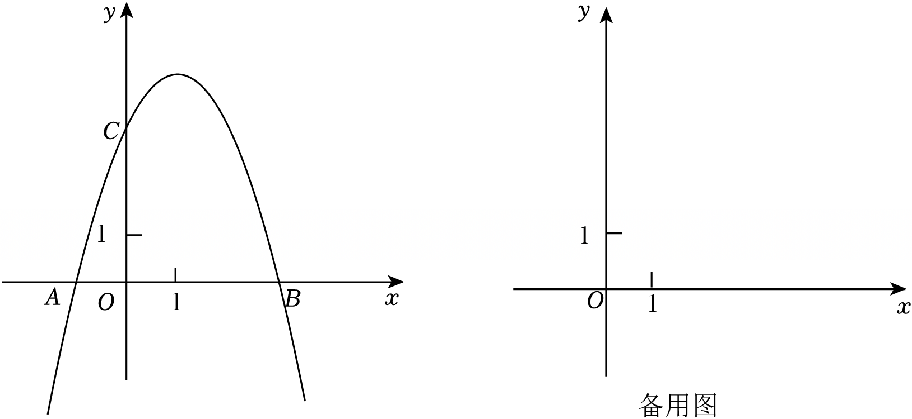

# 24 题精讲 19 · 直角存在与重心对称

## 📝 题目

在平面直角坐标系 $xOy$ 中，已知抛物线 $y=ax^2+bx+3$（$a\neq0$）的开口向下，与 $x$ 轴交于点 $A$ 和点 $B(3,0)$，与 $y$ 轴交于点 $C$。直线 $x=m$（$0<m<3$）交抛物线于点 $P$。

(1) 如图，抛物线的对称轴是直线 $x=1$。

① 求此时抛物线的表达式；

② 如果 $\angle CPB=90°$，求点 $P$ 的横坐标；

(2) 如果点 $P$ 关于直线 $BC$ 的对称点恰好是 $\triangle AOC$ 的重心 $G$，求 $a$ 的值。

## 🧭 思路导航（渐进提示）

- **提示 1（识别）**：②是"直角存在性"——$C$、$B$ 是定点，$P$ 在抛物线上动：首选**一线三垂直**（K 字形相似）；(2) 的钥匙是把"轴对称"与"重心"都翻译成坐标方程。
- **提示 2（突破）**：过 $P$ 作水平线 $MN$，构造 $\triangle PMC\backsim\triangle BNP$；比例式交叉相乘后**必须因式分解约简**（$-m^2+2m+3=(3-m)(m+1)$），才能得到干净的二次方程。(2) 中 $BC:x+y=3$，对称 → $PG$ 的中点在 $BC$ 上**且** $PG\perp BC$，两条各给一个方程；重心坐标 $=$ 三顶点坐标的平均值。
- **提示 3（路线）**：(1)① 对称轴 + 点 $B$ 定 $a=-1,b=2$。② $P(m,-m^2+2m+3)$；相似给 $m(3-m)=(-m^2+2m)(-m^2+2m+3)$，约去 $m(3-m)$ 得 $m^2-m-1=0$ → $m=\tfrac{1+\sqrt5}{2}$（$0<m<3$；$m\ge2$ 的构型可证无解）。(2) 过 $B$ 得 $b=-3a-1$ → $y=(ax-1)(x-3)$ → $A(\tfrac1a,0)$；重心 $G(\tfrac1{3a},1)$；中点在 $BC$ 上 + $PG$ 斜率 $1$ → $x_P=2$、$y_P=3-\tfrac1{3a}$；又 $y_P=1-2a$，联立得 $6a^2+6a-1=0$ → $a=\tfrac{-3-\sqrt{15}}6$。

## ✍️ 详解

**(1)①** $\begin{cases}-\dfrac b{2a}=1\\ 9a+3b+3=0\end{cases}$，由 $b=-2a$ 代入第二式：$3a-2a+1=0\Rightarrow a=-1$，$b=2$（$a<0$ 开口向下 ✓）。

$$\boxed{y=-x^2+2x+3}$$

**(1)②** $C(0,3)$（$x=0$），$B(3,0)$；$P\left(m,\ -m^2+2m+3\right)$，其中 $0<m<3$。

过 $P$ 作水平线 $MN$：$M(0,\ y_P)$，$N(3,\ y_P)$，则 $PM=m$，$PN=3-m$，$BN=y_P=-m^2+2m+3$。

（构型说明：$0<m<2$ 时 $y_P>3$，$C$ 在 $MN$ 下方，此时 $\angle CPB=\angle CPM+\angle BPN$；$2\le m<3$ 时 $C$ 在 $MN$ 上方或线上，可证无解——见末尾备注。）

在 $0<m<2$ 的构型下：$CM=y_P-3=-m^2+2m=m(2-m)$；且 $-m^2+2m+3=(3-m)(m+1)$（十字相乘）。

$\angle CPB=90°$，$M$、$P$、$N$ 共线（平角 $180°$）→ $\angle CPM+\angle BPN=90°$；

Rt$\triangle BNP$ 中 $\angle BPN+\angle PBN=90°$（直角三角形两锐角互余）→ $\angle CPM=\angle PBN$；

又 $\angle PMC=\angle BNP=90°$ → $\triangle PMC\backsim\triangle BNP$（两角对应相等）：

$$\frac{PM}{BN}=\frac{CM}{PN}\ \Rightarrow\ \frac{m}{(3-m)(m+1)}=\frac{m(2-m)}{3-m}$$

$m>0$、$3-m>0$，两边同除 $\dfrac{m}{3-m}$：$\dfrac{1}{m+1}=2-m$，即

$$1=(2-m)(m+1)=-m^2+m+2\ \Rightarrow\ m^2-m-1=0\ \Rightarrow\ m=\frac{1\pm\sqrt5}{2}$$

$0<m<3$ → $m=\dfrac{1+\sqrt5}{2}$（负根舍；$\tfrac{1+\sqrt5}2\approx1.62\in(0,2)$，与构型一致 ✓）。

（备注：$2\le m<3$ 时 $y_P\le3$，$PC$ 在水平线上方成角 $\alpha\ge0$、$PB$ 在下方成角 $\beta<90°$，方向角计算给出 $\angle CPB=180°+\alpha-\beta>90°$，不可能等于 $90°$，故无解；$m=2$ 时 $PC$ 水平，$\vec{PC}\cdot\vec{PB}=-2\neq0$ 直接排除。）

$$\boxed{P\ \text{的横坐标}=\frac{1+\sqrt5}{2}}$$

**(2)** $B(3,0)$ 在抛物线上：$9a+3b+3=0\Rightarrow b=-3a-1$。因式分解：

$$y=ax^2-(3a+1)x+3=(ax-1)(x-3)\quad(\text{验证：}ax\cdot(-3)+(-1)\cdot x=-(3a+1)x\ \checkmark)$$

→ $A\left(\dfrac1a,\ 0\right)$（$a<0$，$A$ 在 $x$ 轴负半轴）。

$\triangle AOC$ 的重心（重心坐标 = 三顶点坐标平均）：

$$G=\left(\frac{\tfrac1a+0+0}{3},\ \frac{0+0+3}{3}\right)=\left(\frac{1}{3a},\ 1\right)$$

直线 $BC$：过 $B(3,0)$、$C(0,3)$ → $y=-x+3$，即 $x+y=3$，斜率 $-1$。

设 $P(x_P,\ y_P)$。$P$ 与 $G$ 关于直线 $BC$ 对称 → 线段 $PG$ 被 $BC$ **垂直平分**，两个条件两个方程：

- 中点在 $BC$ 上：$\dfrac{x_P+\tfrac1{3a}}2+\dfrac{y_P+1}2=3$，即 $x_P+y_P=5-\dfrac1{3a}$ ……（I）
- $PG\perp BC$ → $k_{PG}=1$：$\dfrac{1-y_P}{\tfrac1{3a}-x_P}=1$，即 $y_P=1+x_P-\dfrac1{3a}$ ……（II）

(I)(II) 联立：$x_P+\left(1+x_P-\dfrac1{3a}\right)=5-\dfrac1{3a}$ → $2x_P=4$ → $x_P=2$（满足 $0<2<3$ ✓）。

代回 (II)：$y_P=3-\dfrac1{3a}$。

又 $P$ 在抛物线上（$x_P=2$，$b=-3a-1$）：

$$y_P=4a+2b+3=4a+2(-3a-1)+3=1-2a$$

$$1-2a=3-\frac1{3a}\ \xrightarrow{\ \times 3a\ }\ 3a-6a^2=9a-1\ \Rightarrow\ 6a^2+6a-1=0$$

$$a=\frac{-6\pm\sqrt{36+24}}{12}=\frac{-6\pm2\sqrt{15}}{12}=\frac{-3\pm\sqrt{15}}{6}$$

开口向下 → $a<0$ → 取 $a=\dfrac{-3-\sqrt{15}}6$（$\dfrac{-3+\sqrt{15}}6>0$ 舍）。

（检验：$a\approx-1.145$，$G\approx(-0.291,\,1)$；$P\approx(2,\ 3.291)$ 关于 $x+y=3$ 的对称点 $=(3-y_P,\ 3-2)=\left(\tfrac{3-\sqrt{15}}3,\ 1\right)=G$ ✓）

$$\boxed{a=\frac{-3-\sqrt{15}}{6}}\qquad(\text{题源}"a=-3-156"\text{为 OCR 讹误})$$

## ⚠️ 评分点与易错

- 一线三垂直的比例式要写对对应关系（$PM\leftrightarrow BN$，$CM\leftrightarrow PN$）；交叉相乘后务必用 $(3-m)(m+1)$ 因式分解约简，否则会面对三次方程。
- 相似成立的前提是 $C$、$B$ 在过 $P$ 的水平线同侧（$0<m<2$）；$2\le m<3$ 的构型要交代"无解"，分类才完整。
- (2) 的对称翻译是两条：**中点在对称轴上** + **连线垂直于对称轴**，缺一不可；重心坐标 = 三顶点平均，别漏 $y$ 方向。
- 解出的 $x_P=2$ 要回归题设范围 $0<m<3$ 检验。
- 题源讹误：$a=-3-156$ 应为 $a=\tfrac{-3-\sqrt{15}}6$；同理源文中 $1\pm\sqrt5$、$m^2-m-1$ 等处都有丢根号现象，以本文推导为准。

## 🔗 关联

- [[03-数学/专题/第24题-二次函数综合]] · [[03-数学/知识点/九年级/相似三角形]] · [[03-数学/知识点/九年级/锐角的三角比与解直角三角形]]
- 同类题：[[24-12-翻折正方形存在]]（轴对称）、[[24-11-平移共线与相似存在]]（相似存在性）
