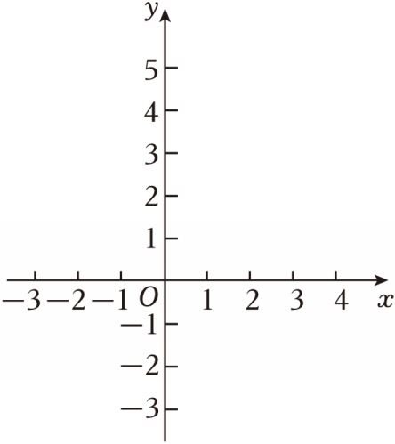

# 24 题精讲 20 · 平移与角度互补

## 📝 题目

已知平面直角坐标系 $xOy$，抛物线 $M_1:y=ax^2+x+c$ 与 $x$ 轴交于点 $A(-2,0)$ 和点 $B$，与 $y$ 轴交于点 $C(0,4)$。把抛物线 $M_1$ 向下平移得到抛物线 $M_2$，设抛物线 $M_2$ 的顶点为 $D$，与 $y$ 轴交于点 $E$，直线 $DE$ 与 $x$ 轴交于点 $P$。

(1) 求抛物线 $M_1$ 的表达式；

(2) 当点 $P$ 与点 $A$ 重合时，求平移的距离；

(3) 联结 $AD$。如果 $\angle ADP$ 与 $\angle ACB$ 互补，求点 $D$ 的坐标。

## 🧭 思路导航（渐进提示）

- **提示 1（识别）**：(2) 把"$P$ 与 $A$ 重合"翻译成**直线 $DE$ 的横截距**；(3) 的互补条件 → 在 $BC$ 的延长线上造一个现成的 $180°-\angle ACB$，把"互补"转成相似。
- **提示 2（突破）**：$M_2=M_1$ 下移 $d$ → $D(1,\tfrac92-d)$、$E(0,4-d)$，直线 $DE$ 的斜率恒为 $\tfrac12$（与 $d$ 无关！）→ $P(2d-8,0)$。(3) 中 $CEDF$（$F$ 为 $M_1$ 顶点）恒为平行四边形 → $\angle OEP=\angle CFD=\arctan2$ 恒成立 → $OP=2OE$ → $\tan\angle OPE=\tfrac12=\tan\angle OCA$——用"不变的角"搭桥。
- **提示 3（路线）**：(1) 代两点解 $a,c$。(2) 直线 $DE:y=\tfrac12x+4-d$，令 $y=0$ 得 $x_P=2d-8=-2$ → $d=3$。(3) $B(4,0)$ → $OB=OC$ → $\angle OCB=45°$；$K(1,4)$：$\tan\angle CFD=\dfrac{CK}{KF}=\dfrac{1}{1/2}=2$；平行四边形 $CEDF$ → $OP=2OE$ → $\tan\angle OPE=\tfrac12$；作 $AG\perp x$ 轴交 $BC$ 延长线于 $G(-2,6)$：$\angle CAG=\angle OCA=\angle DPA$，$\angle GCA=180°-\angle ACB=\angle ADP$ → $\triangle GCA\backsim\triangle ADP$ → $\angle DAP=\angle AGC=45°$ → Rt$\triangle ADH$ 中 $DH=AH=3$ → $D(1,-3)$（$h=3$ 的"镜像解"经构型检验舍去）。

## ✍️ 详解

**(1)** 代 $A(-2,0)$、$C(0,4)$ 入 $y=ax^2+x+c$：

$$\begin{cases}4a-2+c=0\\ c=4\end{cases}\ \Rightarrow\ 4a-2+4=0\ \Rightarrow\ a=-\tfrac12$$

$$\boxed{M_1:\ y=-\tfrac12x^2+x+4}$$

**(2)** 配方：$y=-\tfrac12(x-1)^2+\tfrac92$ → $M_1$ 顶点 $F\left(1,\tfrac92\right)$，对称轴 $x=1$。

$M_2$：$M_1$ 向下平移 $d$（$d>0$）：

$$y=-\tfrac12(x-1)^2+\tfrac92-d\ \Rightarrow\ D\left(1,\ \tfrac92-d\right),\qquad E(0,\ 4-d)\ (x=0)$$

直线 $DE$：过 $(0,4-d)$ 与 $(1,\tfrac92-d)$，斜率 $=\dfrac{(\tfrac92-d)-(4-d)}{1}=\dfrac12$（**与 $d$ 无关**），

$$y=\tfrac12x+4-d$$

令 $y=0$：$x=2d-8$，即 $P(2d-8,\ 0)$。

$P$ 与 $A(-2,0)$ 重合：$2d-8=-2\Rightarrow d=3$。

$$\boxed{\text{平移距离为 } 3}$$

**(3)** 令 $M_1$ 中 $y=0$：$-\tfrac12x^2+x+4=0\Rightarrow x^2-2x-8=0\Rightarrow(x-4)(x+2)=0$ → $B(4,0)$。

$OB=OC=4$ → $\angle OCB=\angle OBC=45°$（等边对等角）。

记 $K(1,4)$（$C$ 向对称轴作垂线的垂足）：$CK=1$，$KF=\tfrac92-4=\tfrac12$，故

$$\tan\angle CFD=\frac{CK}{KF}=\frac{1}{\tfrac12}=2\quad(\text{Rt}\triangle CKF,\ \text{直角在 } K)$$

$CE=4-(4-d)=d$，$DF=\tfrac92-(\tfrac92-d)=d$，且 $CE\parallel DF$（都竖直）→ 四边形 $CEDF$ 是平行四边形（一组对边平行且相等）→ $\angle CED=\angle CFD$（对角相等）。

在最终构型中（$D$ 在 $x$ 轴下方、$E$ 在 $O$ 下方），$O$ 在线段 $EC$ 上、$D$ 在线段 $EP$ 上，故 $\angle OEP=\angle CED$，从而

$$\tan\angle OEP=2\ \xrightarrow{\ \text{Rt}\triangle OEP\ (\text{直角在 }O)\ }\ \frac{OP}{OE}=2\ \Rightarrow\ OP=2OE\ \Rightarrow\ \tan\angle OPE=\frac{OE}{OP}=\frac12$$

Rt$\triangle OCA$（直角在 $O$）：$\tan\angle OCA=\dfrac{OA}{OC}=\dfrac24=\dfrac12$ → $\angle OCA=\angle OPE$（相等的锐角的正切相等 / 正切相等定锐角）。

作 $AG\perp x$ 轴于 $A$，交直线 $BC$ 的延长线于 $G$（直线 $BC:y=-x+4$，$x=-2$ → $G(-2,6)$）。

$AG\parallel OC$ → $\angle CAG=\angle OCA$（两直线平行，内错角相等）$=\angle OPE$；

最终构型中 $P(7,0)$ 在 $A$ 右侧且 $O$ 在 $P$、$A$ 之间 → 射线 $PA$ 与 $PO$ 重合、射线 $PD$ 与 $PE$ 重合 → $\angle DPA=\angle OPE$，故

$$\angle CAG=\angle DPA$$

$G$ 在 $CB$ 延长线上（$C$ 介于 $G$、$B$）→ $\angle GCA=180°-\angle ACB=\angle ADP$（已知互补）。

$\triangle GCA\backsim\triangle ADP$（两角对应相等）→ $\angle DAP=\angle AGC$；

$AG\parallel y$ 轴，$GC$ 沿斜率 $-1$ 的直线 → $\angle AGC=\angle OBC=45°$ → $\angle DAP=45°$。

设 $D(1,h)$（$h=\tfrac92-d$）。$\angle DAP=45°$ 且 $P$ 在 $A$ 右侧（$x_P=2d-8=1-2h>-2\iff h<\tfrac32$）：

射线 $AP$ 沿 $x$ 轴正向，$\vec{AD}=(3,h)$ → $\tan\angle DAP=\dfrac{|h|}{3}=\tan45°=1$ → $|h|=3$ → $h=-3$ 或 $h=3$。

$h=3$：$x_P=-5<-2$，$P$ 在 $A$ 左侧，与构型矛盾（此时 $\angle DAP=135°$），舍；$h=-3$ ✓（$x_P=7$）。

$$D(1,-3),\qquad d=\tfrac92+3=\tfrac{15}2$$

回代检验：$\angle ACB=\angle OCA+\angle OCB=\arctan\tfrac12+45°\approx71.57°$；$\angle ADP$：$\vec{DA}=(-3,3)$、$\vec{DP}=(6,3)$，夹角 $\approx108.43°$；两角之和 $=180°$ ✓。

$$\boxed{D(1,\ -3)}$$

## ⚠️ 评分点与易错

- 先把两个"结构量"算出来：直线 $DE$ 斜率恒为 $\tfrac12$、$P(2d-8,0)$——(2)(3) 全靠它们。
- (3) 链条长，每一步"角相等"都要有名有姓的依据（平行四边形对角相等、内错角、正切相等定锐角）；跳步会被扣过程分。
- 构型假设（$D$ 在 $x$ 轴下方、$P$ 在 $A$ 右侧）必须在结尾**回代检验**：$h=+3$ 这个"镜像解"正是靠检验剔除的。
- 互补条件的转化是标准桥：在 $BC$ 延长线上取 $G$，使 $\angle GCA=180°-\angle ACB$，再证其等于 $\angle ADP$，把互补转成相似。
- $\tan\angle OEP=2$ 这步依赖平行四边形 $CEDF$——"一组对边平行且相等"两个条件都要写。

## 🔗 关联

- [[03-数学/专题/第24题-二次函数综合]] · [[03-数学/知识点/九年级/相似三角形]] · [[03-数学/知识点/九年级/锐角的三角比与解直角三角形]]
- 同类题：[[24-05-梯形存在与角度正切]]（构造角处理两角关系）、[[24-17-双抛物线交点与垂直]]（平移 + 垂直）
