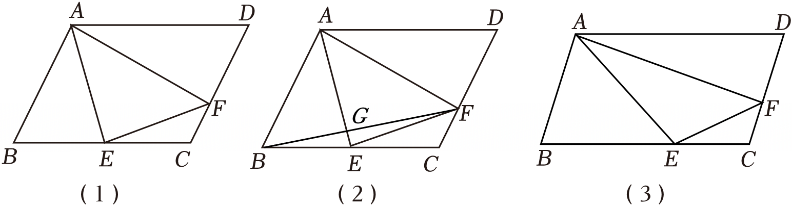

# 25 题精讲 01 · 平行四边形、多组相似与面积比

## 📝 题目

平行四边形 $ABCD$ 中，$E$、$F$ 分别在边 $BC$、$CD$ 上。
(1) $E$ 是 $BC$ 中点：
① 如图 1，若 $AE=EF$，求证：$\angle BAE=\angle EFC$；
② 若 $CF=DF$，联结 $BF$ 交 $AE$ 于 $G$，求 $S_{\triangle BEG}:S_{\triangle AEF}$ 的值；
(2) 如图 3，若 $AB=3$，$AD=5$，$CF=1$，$\angle AEB=\angle AFE=\angle EFC$，求 $AF$ 的长。

## 🧭 思路导航（渐进提示）

- **提示 1（识别）**：① 求证角相等，图形里是"中点 + 平行四边形"——这对组合的经典辅助线是什么？② 求面积比却一个长度都不给——提示你走比例与设参的路，不是硬算坐标；(2) 三个等角连环出现，是"相似链"的信号。
- **提示 2（突破）**：① 中点 + 平行四边形 → **延长构造全等**（把 $FE$ 延长交 $AB$ 延长线，出 8 字全等），把 $EF$ 转移出去再用等腰换角。② 面积比的全部秘密是**两个"共角三角形"的面积比公式**：共角时 $S_1:S_2=$ 对应边乘积比；先延长 $BF$ 交 $AD$ 延长线，用两串 8 字相似接通线段比，再把所有未知面积设成 $n$ 的倍数逐层表示。(2) 三个等角条件是"**母子型相似链条**"的信号：△AEF∽△ECF∽△MEA，用两个参数 $s,t$ 把 $AE$、$AF$、$AM$ 全部表示出来，最后解一个根式方程。
- **提示 3（路线）**：① 延长 $FE$ 交 $AB$ 延长线于 $H$；平行给两对等角 + 中点给 $BE=CE$ → AAS 全等 → $EH=EF$；由 $AE=EF$ 得 $AE=EH$ → 等腰换角 → $\angle BAE=\angle H=\angle EFC$。② 延长 $BF$、$AD$ 交于 $M$；$CF=DF$ → △BCF∽△MDF 给 $BC=DM$、$BF=MF$；设 $CE=BE=m$，得 $AM=4m$；两串 A 字相似写 $\frac{GE}{AG}$ 与 $\frac{BG}{GF}$；共角面积比逐层表示：设 $S_{\triangle BGE}=n$ 起，逐步写出 $S_{\triangle ABG}$、$S_{\triangle AFG}$、$S_{\triangle GFE}$，最后作比。(2) 延长 $AD$、$EF$ 交于 $M$；由内错角与对顶角接通两对相似（△AEF∽△MEA、△AEF∽△ECF）；设 $CE=s$、$FE=t$，由 △AEF∽△ECF 把 $AE$、$AF$ 用 $s,t$ 表出；由 △ECF∽△MDF 得 $DM=2s$、$FM=2t$，写 $AM=5+2s$、$EM=3t$；由 △AEF∽△MEA 列比例式先解 $s$（代回验证为正），回代求 $AF$（是 $t^2$，不必开方）。

## ✍️ 详解

**(1)①** 延长 $FE$ 交 $AB$ 延长线于 $H$。由 $AB\parallel CD$：$\angle EBH=\angle ECF$、$\angle EHB=\angle EFC$；$E$ 是 $BC$ 中点 → $BE=CE$，故 $\triangle BEH\cong\triangle CEF$（AAS），得 $EH=EF$。又 $AE=EF$，所以 $AE=EH$，$\angle H=\angle BAE$，而 $\angle H=\angle EFC$，

$$\angle BAE=\angle EFC\qquad\blacksquare$$

**(1)②** 延长 $BF$、$AD$ 交于 $M$。由 $AD\parallel BC$：$\triangle BEG\backsim\triangle MAG$、$\triangle BCF\backsim\triangle MDF$。由 $CF=DF$ 得 $BC=DM$、$BF=MF$。设 $CE=BE=m$，则 $BC=DM=2m$，$AM=AD+DM=4m$，故

$$\frac{GE}{AG}=\frac{BE}{AM}=\frac14,\qquad \frac{BG}{GF}=\frac{BG}{GM-BG}=…=\frac23$$

（由 $BF=MF$ 及 $\dfrac{BG}{GM}=\dfrac{BE}{AM}=\dfrac14$ 得 $BG:GF=2:3$。）

共角三角形面积比：$\dfrac{S_{\triangle BGE}}{S_{\triangle BGA}}=\dfrac{S_{\triangle GFE}}{S_{\triangle GFA}}=\dfrac{GE}{AG}=\dfrac14$；$\dfrac{S_{\triangle ABG}}{S_{\triangle AFG}}=\dfrac{BG}{FG}=\dfrac23$。

设 $S_{\triangle BGE}=n$，则 $S_{\triangle ABG}=4n$，$S_{\triangle AFG}=6n$，$S_{\triangle GFE}=\dfrac14\cdot6n=\dfrac32n$。所以

$$S_{\triangle BEG}:S_{\triangle AEF}=n:\left(6n+\tfrac32n\right)=\boxed{\dfrac{2}{15}}$$

**(2)** 延长 $AD$、$EF$ 交于 $M$。$CD=AB=3$，$DF=CD-CF=2$。由 $\angle AEB=\angle EAD$（内错角）及 $\angle AEB=\angle AFE$ 得 $\angle EFA=\angle EAD$；又 $\angle AEF=\angle MEA$（对顶），所以 $\triangle AEF\backsim\triangle MEA$；同理 $\angle AEF=\angle FCE$ 得 $\triangle AEF\backsim\triangle ECF$。

设 $CE=s$、$FE=t$。由 $\triangle AEF\backsim\triangle ECF$：$\dfrac{CF}{EF}=\dfrac{CE}{AE}=\dfrac{EF}{AF}$，即

$$AE=st,\qquad AF=t^2$$

由 $\triangle ECF\backsim\triangle MDF$：$DM=2s$、$FM=2t$，$AM=5+2s$，$EM=3t$。由 $\triangle AEF\backsim\triangle MEA$：

$$\frac{EF}{AE}=\frac{AE}{EM}=\frac{AF}{AM}\ \Rightarrow\ \frac1s=\frac{s}{3}=\frac{t^2}{5+2s}$$

由 $\dfrac1s=\dfrac s3$ 得 $s=\sqrt3$；代回 $t^2=\dfrac{5+2s}{s}=\dfrac{5\sqrt3}{3}+2=\dfrac{5\sqrt3+6}{3}$。

$$\boxed{AF=\frac{5\sqrt3+6}{3}}$$

## ⚠️ 评分点与易错

- **共角三角形面积比公式**（$S_1:S_2=\dfrac{AB\cdot AC}{DE\cdot DF}$ 型）是本题 ② 的发动机，忘了就只能硬算坐标——考前把它复习一遍。
- 设参数（$m$、$s$、$t$）后，**每一个比例式都要说清来自哪一对相似**；最后解出的 $s=\sqrt3$ 要代回验证为正。
- (2) 里 $t^2$ 直接就是 $AF$（不用开方），这是"AF 等于 $t^2$"这个比例关系的直接结果——别多此一举再开方。

## 🔗 关联

- [[03-数学/专题/第25题-压轴-相似与圆]] · [[03-数学/知识点/九年级/相似三角形]]
- 同类题：[[25-02-梯形外接圆与比例中项]]（同为多组相似链）
