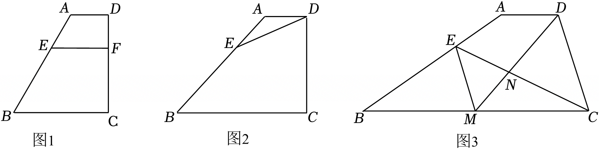

# 25 题精讲 02 · 梯形、外接圆与比例中项

## 📝 题目

梯形 $ABCD$ 中，$AD\parallel BC$，$E$ 在 $AB$ 上且 $AE=\dfrac13AB$。
(1) 如图 1，$F$ 在 $CD$ 上且 $DF=\dfrac13CD$，联结 $EF$，求证：$EF\parallel BC$；
(2) 已知 $AD=AE=1$：
① 如图 2，$\triangle ADE$ 外接圆的圆心恰在 $\angle B$ 的平分线上，求外接圆半径；
② 如图 3，$M$ 在 $BC$ 上，联结 $EM$、$DM$、$EC$，$DM$ 与 $EC$ 交于 $N$。若 $\angle DMC=\angle CEM$，$BC=4$，且 $CD^2=DM\cdot DN$，求 $CD$ 的长。

## 🧭 思路导航

- (1) 延长 $DE$ 交 $BC$ 于 $G$，把两端的 $\dfrac13$ 用**平行线分线段成比例**接起来。
- ① 圆心在角平分线上 + $AD\parallel BC$ → $\angle EAO+\angle ABO=90°$ 的对顶/互余结构 → $\angle AOB=90°$，再用**母子型相似** $AO^2=AF\cdot AB$。
- ② 的破题点：$CD^2=DM\cdot DN$ 翻译成 **△DCN∽△DMC**（母子型）→ 角等 → $EM\parallel CD$ → $M$ 成 $BC$ 中点 → 设参 $a$ 一次解出。

## ✍️ 详解

**(1)** 延长 $DE$、$CB$ 交于 $G$。由 $AD\parallel BC$：$\dfrac{AE}{BE}=\dfrac{DE}{EG}$。$AE=\dfrac13AB\Rightarrow\dfrac{AE}{BE}=\dfrac12$；同理由 $DF=\dfrac13CD$ 得 $\dfrac{DF}{FC}=\dfrac12$。所以 $\dfrac{DE}{EG}=\dfrac{DF}{FC}$，$EF\parallel BC$。$\blacksquare$

**(2)①** 设外心 $O$，作 $OF\perp AE$ 于 $F$。$OA=OE=OD$，$F$ 为 $AE$ 中点，$AF=\dfrac12$；$AB=3AE=3$。

$OE=OD$、$OA=OA$、$AE=AD$ → $\triangle AOE\cong\triangle AOD$（SSS）→ $\angle EAO=\angle DAO$。$BO$ 平分 $\angle B$ → $\angle ABO=\angle CBO$。$AD\parallel BC$ → $\angle DAB+\angle ABC=180°$，即 $2\angle EAO+2\angle ABO=180°$，

$$\angle EAO+\angle ABO=90°\ \Rightarrow\ \angle AOB=90°$$

在 $\angle FAO=\angle OAB$、$\angle AFO=\angle AOB=90°$ 下，$\triangle FAO\backsim\triangle OAB$：

$$AO^2=AF\cdot AB=\frac12\times3=\frac32\ \Rightarrow\ \boxed{AO=\frac{\sqrt6}{2}}$$

**(2)②** 延长 $BA$、$CD$ 交于 $P$。由 $AD\parallel BC$：$\dfrac{PA}{PB}=\dfrac{AD}{BC}=\dfrac14$，$AB=3$，得 $PA=1=AD=AE$，$PE=PA+AE=2=BE$（$E$ 是 $PB$ 中点）。

由 $CD^2=DM\cdot DN$：$\dfrac{CD}{DM}=\dfrac{DN}{CD}$，加公共角 $\angle CDN=\angle MDC$ → $\triangle DCN\backsim\triangle DMC$ → $\angle DCN=\angle DMC=\angle CEM$ → $EM\parallel CD$。

由 $EM\parallel CD$：$\dfrac{BE}{EP}=\dfrac{BM}{MC}=1$ → $BM=MC=2$；且 $\triangle BEM\backsim\triangle BPC$：$\dfrac{ME}{PC}=\dfrac{BM}{BC}=\dfrac12$。设 $DP=a$，则 $CD=3a$、$PC=4a$、$ME=2a$。

再由 $EM\parallel CD$ 得 $\triangle ENM\backsim\triangle CND$：$\dfrac{EN}{CN}=\dfrac{EM}{CD}=\dfrac23$。设 $EN=2b$、$CN=3b$。由 $\angle CMN=\angle CEM$、公共角 $\angle ECM=\angle MCN$：$\triangle CNM\backsim\triangle CME$ → $CM^2=CN\cdot CE$：

$$4=3b\cdot5b\ \Rightarrow\ b=\frac{2\sqrt{15}}{15},\qquad CE=5b=\frac{2\sqrt{15}}{3}$$

在 $BC$ 上作 $EQ\perp BC$ 于 $Q$：$BE^2-BQ^2=CE^2-CQ^2$（勾股两次），$4-BQ^2=\dfrac{20}{3}-(4-BQ)^2$，解得 $BQ=\dfrac53$。则 $EQ^2=4-\dfrac{25}{9}=\dfrac{11}{9}$，$QM=BM-BQ=\dfrac13$：

$$EM=\sqrt{EQ^2+QM^2}=\sqrt{\frac{11}{9}+\frac19}=\frac{2\sqrt3}{3}$$

由 $EM=\dfrac23 CD$：$CD=\dfrac32\cdot\dfrac{2\sqrt3}{3}$：

$$\boxed{CD=3}$$

**（更快的验算路径）**：由 $E$ 为 $PB$ 中点、$M$ 为 $BC$ 中点 → $BP=BC=4$ → $\angle P=\angle DCM$；又 $\angle ECP=\angle DMC$ → $\triangle ECP\backsim\triangle DMC$：$\dfrac{EP}{CD}=\dfrac{PC}{CM}$，设 $DP=a$：$\dfrac{2}{3a}=\dfrac{4a}{2}$ → $a=\dfrac{\sqrt3}{3}$ → $CD=3a=3$。两条路互为检验。

## ⚠️ 评分点与易错

- $CD^2=DM\cdot DN$ 是"**乘积式=母子相似**"的信号，第一反应就该是 △DCN∽△DMC——识别慢就全题卡死。
- 中间结论 $EM\parallel CD$ 是全题枢纽，得到后 $M$ 是中点、$E$ 是中点接踵而至。
- 解方程较多，**每设一个参数就在图上标注**；最后答案 3 是整数，若解出无理数多半某步比例写反。

## 🔗 关联

- [[03-数学/专题/第25题-压轴-相似与圆]] · [[03-数学/知识点/九年级/相似三角形]] · [[03-数学/知识点/九年级/圆与正多边形]]（外接圆）
- 同类题：[[25-01-平行四边形相似面积比]]、课后巩固同型题（题源原卷）
