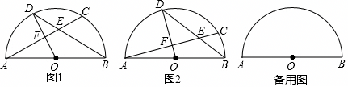

# 25 题精讲 05 · 圆中弦弦相交与内接正多边形

## 📝 题目

$\odot O$ 的直径 $AB=2$，弦 $AC$ 与弦 $BD$ 交于点 $E$，且 $OD\perp AC$，垂足为 $F$。
(1) 如图 1，若 $AC=BD$，求弦 $AC$ 的长；
(2) 如图 2，若 $E$ 为弦 $BD$ 的中点，求 $\angle ABD$ 的余切值；
(3) 联结 $BC$、$CD$、$DA$，若 $BC$ 是 $\odot O$ 内接正 $n$ 边形的一边，$CD$ 是内接正 $(n+4)$ 边形的一边，求 $\triangle ACD$ 的面积。

## 🧭 思路导航

- (1) 弦相等 ⟺ 弧相等：$AC=BD$ → $\overset{\frown}{AD}+\overset{\frown}{CD}=\overset{\frown}{CD}+\overset{\frown}{BC}$ → $\overset{\frown}{AD}=\overset{\frown}{BC}$；再由 $OD\perp AC$ → $\overset{\frown}{AD}=\overset{\frown}{CD}$，三段弧全等 → 圆心角 60° → 解直角三角形。
- (2) 中点 + 半径：$OF$ 是 △ABC 中位线 + **全等**（△DEF≌△BEC）把 $BC$ 转到 $DF$，设 $OF=t$ 一次解出。
- (3) 内接正多边形 → 圆心角 $=\dfrac{360°}{n}$；用"圆心角之和 = 180°"列方程求 $n$，剩下全是解直角三角形。

## ✍️ 详解

**(1)** $AC=BD$ → $\overset{\frown}{AC}=\overset{\frown}{BD}$，即 $\overset{\frown}{AD}+\overset{\frown}{CD}=\overset{\frown}{CD}+\overset{\frown}{BC}$ → $\overset{\frown}{AD}=\overset{\frown}{BC}$；$OD\perp AC$（$OD$ 过圆心）→ $\overset{\frown}{AD}=\overset{\frown}{CD}$。所以三段弧相等，$\angle AOD=\angle DOC=\angle BOC=60°$。

$AO=1$，$AF=AO\sin\angle AOF=\sin60°=\dfrac{\sqrt3}{2}$（$F$ 在 $AC$ 上，$\angle AOF=60°$），

$$AC=2AF=\sqrt3$$

**(2)** 连 $BC$。$AB$ 是直径 → $\angle ACB=90°$；$OD\perp AC$ → $OD\parallel BC$。$E$ 为 $BD$ 中点、$\angle DEF=\angle BEC$、$\angle D=\angle EBC$（$OD\parallel BC$ 的内错角）→ $\triangle DEF\cong\triangle BEC$（ASA）→ $BC=DF$、$EC=EF$。又 $OA=OB$、$OF\parallel BC$ → $OF$ 是 △$ABC$ 中位线。设 $OF=t$，则 $BC=DF=2t$，而 $DF=OD-OF=1-t$：

$$1-t=2t\ \Rightarrow\ t=\frac13,\qquad BC=\frac23$$

$AC=\sqrt{AB^2-BC^2}=\sqrt{4-\dfrac49}=\dfrac{4\sqrt2}{3}$，$EF=\dfrac12FC=\dfrac14AC=\dfrac{\sqrt2}{3}$，$DF=\dfrac23$。

$OB=OD$ → $\angle ABD=\angle D$（等腰三角形底角），

$$\cot\angle ABD=\cot\angle D=\frac{DF}{EF}=\frac{2/3}{\sqrt2/3}=\boxed{2}$$

**(3)** $\angle BOC=\dfrac{360°}{n}$，$\angle AOD=\angle COD=\dfrac{360°}{n+4}$（$OD\perp AC$ 平分弧 $AC$）。三者在直径 $AB$ 一侧拼成平角：

$$\frac{360°}{n}+2\cdot\frac{360°}{n+4}=180°\ \Rightarrow\ n^2-2n-8=0\ \Rightarrow\ n=4$$

所以 $\angle BOC=90°$，$\angle AOD=\angle COD=45°$：$BC=AC=\sqrt2$（正方形边长 $=\sqrt2R$）。$OF=AO\cos45°=\dfrac{\sqrt2}{2}$，$DF=1-\dfrac{\sqrt2}{2}$。$DF\perp AC$，故

$$S_{\triangle ACD}=\frac12\cdot AC\cdot DF=\frac12\cdot\sqrt2\cdot\left(1-\frac{\sqrt2}{2}\right)=\boxed{\frac{\sqrt2-1}{2}}$$

## ⚠️ 评分点与易错

- "弦相等→弧相等→做差"这条弧的运算链是 (1) 的全部；直接在弦长上硬算会绕远。
- (2) $EF=\dfrac14AC$ 的来历：$E$ 平分 $BD$、$F$ 平分 $AC$（垂径定理）→ △DEF≌△BEC → $EC=EF$，而 $FC=2EF$——每一步都要写依据。
- (3) 最后答案 $\dfrac{\sqrt2-1}{2}$：题源文本此处印作"$\sqrt2-\frac12$"，按 $\frac12\cdot AC\cdot DF$ 的算式应为 $\dfrac{\sqrt2-1}{2}$，以算式为准。
- 正多边形条件翻译成圆心角方程时，注意三段圆心角拼的是**平角**（$AB$ 是直径）。

## 🔗 关联

- [[03-数学/专题/第25题-压轴-相似与圆]] · [[03-数学/知识点/九年级/圆与正多边形]] · [[03-数学/闪卡/公式定理速记]]
- 同类题：[[25-04-等腰三角形外接圆]]、[[25-06-圆中比例中项]]
