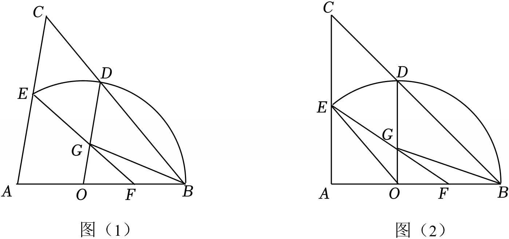

# 25 题精讲 08 · 等腰三角形与圆

## 📝 题目

在 $\triangle ABC$ 中，$AB=AC$，$O$ 在边 $AB$ 上，点 $F$ 是边 $OB$ 的中点。以 $O$ 为圆心、$BO$ 为半径的圆分别交 $CB$、$AC$ 于点 $D$、$E$，连接 $EF$ 交 $OD$ 于点 $G$。

(1) 如果 $OG=DG$，求证：四边形 $CEGD$ 是平行四边形；

(2) 连接 $OE$，如图。若 $\angle BAC=90°$，$\angle OFE=\angle DOE$，$AO=4$，求边 $OB$ 的长；

(3) 连接 $BG$。若 $\triangle OBG$ 是以 $OB$ 为腰的等腰三角形，且 $AO=OF$，求 $\dfrac{OG}{OD}$ 的值。

## 🧭 思路导航（渐进提示）

- **提示 1（识别）**：等腰 + 圆 + 两个中点。两把钥匙是 $AB=AC$ 与 $OD=OB$ 这两个等腰——等腰给等角，等角常给平行。先别急着算，问自己：这对等腰能造出哪条平行线？(3) 中"以 $OB$ 为腰"是分类信号，腰可能是 $OG$ 也可能是 $BG$。
- **提示 2（突破）**：由 $\angle ODB=\angle OBD=\angle ABC=\angle C$ 得 $OD\parallel AC$，这条平行线贯穿三问。(2) 用它把 $\angle DOE$ 转移成 $\angle AEO$，与 $\angle OFE$ 相等后拼出"公共角 + 等角"的相似，得 $AE^2=AO\cdot AF$，再用 Rt$\triangle OAE$ 的勾股换成关于 $a$ 的方程。(3) 先证一个与分类无关的枢纽结论：$O$ 是 $AF$ 中点且 $OG\parallel AE$ → $G$ 是 $EF$ 中点、$OG=\tfrac12AE$（中位线），然后再分类。
- **提示 3（路线）**：(1) $OD\parallel AC$ 给 $GD\parallel EC$；中位线 $FG\parallel BD$ 给 $GE\parallel DC$ → 两组对边分别平行。(2) 设 $OF=FB=a$，则 $OE=OB=2a$；△$AEO\backsim$△$AFE$ → $AE^2=AO\cdot AF$；Rt△$OAE$ 中 $AE^2=OE^2-AO^2$，联立 $(2a)^2-4^2=4(4+a)$ 解出 $a$（舍负），$OB=2a$。(3) ①若 $OG=OB$：则 $AE=4a$，但 $A$ 在圆内，$AE\le OA+r=3a$，矛盾舍去；②若 $BG=OB$：延长 $BG$ 交 $AC$ 于 $P$，△$BGO\backsim$△$BPA$ 设 $OG=2k,AP=3k$，由 $AE=4k$ 得 $PE=k$；设 $OE$ 交 $PG$ 于 $Q$，△$QGO\backsim$△$QPE$ 定出 $Q$ 对线段的分割比，最后 △$PQE\backsim$△$OQB$ 得 $a=2k$，代回求 $OG/OD$。

## ✍️ 详解

**(1)** $AB=AC$ → $\angle ABC=\angle C$（等边对等角）；$OD=OB$（同圆半径相等）→ $\angle ODB=\angle OBD$（等边对等角）。而 $\angle OBD$ 与 $\angle ABC$ 是同一个角，故

$$\angle ODB=\angle ABC=\angle C\ \Rightarrow\ OD\parallel AC\quad(\text{内错角相等，两直线平行})$$

$F$ 是 $OB$ 中点、$OG=DG$ 即 $G$ 是 $OD$ 中点 → $FG$ 是 △$OBD$ 的中位线 → $FG\parallel BD$，即 $GE\parallel DC$（$E,G,F$ 共线，$D,C,B$ 共线）。又 $GD\parallel EC$（由 $OD\parallel AC$）。两组对边分别平行：

$$\text{四边形 }CEGD\text{ 是平行四边形}\qquad\blacksquare$$

**(2)** 设 $\angle OFE=\angle DOE=\alpha$，$OF=FB=a$（$F$ 为 $OB$ 中点），则 $OB=OE=2a$（$E$ 在 ⊙$O$ 上，半径相等）。

由 (1)，$OD\parallel AC$（注意：这条平行只用到两个等腰，与 $OG=DG$ 无关，全题通用）。直线 $OE$ 截平行线 $OD$、$AE$：

$$\angle AEO=\angle DOE=\alpha\quad(\text{两直线平行，内错角相等})\ \Rightarrow\ \angle AEO=\angle OFE=\alpha$$

$\angle OAE$ 与 $\angle FAE$ 是同一个角（$O,F$ 都在射线 $AB$ 上），故 △$AEO\backsim$△$AFE$（两角分别相等），对应边成比例：

$$\frac{AE}{AF}=\frac{AO}{AE}\ \Rightarrow\ AE^2=AO\cdot AF$$

Rt△$OAE$ 中 $\angle OAE=90°$（$\angle BAC=90°$），由勾股定理 $AE^2=OE^2-AO^2$。代入 $AO=4$、$OE=2a$、$AF=AO+OF=4+a$：

$$(2a)^2-4^2=4(4+a)\ \Rightarrow\ 4a^2-4a-32=0\ \Rightarrow\ a^2-a-8=0$$

$$a=\frac{1\pm\sqrt{33}}{2}\quad(\text{求根公式})$$

$a$ 是线段长必须为正：$a=\dfrac{1-\sqrt{33}}{2}<0$ 舍去；取 $a=\dfrac{1+\sqrt{33}}{2}$。此时 $OE=2a\approx6.74>AO=4$，$AE^2=OE^2-AO^2>0$，图形合理。

$$\boxed{OB=2a=1+\sqrt{33}}$$

**(3)** 设 $AO=OF=FB=a$（$F$ 为 $OB$ 中点且 $AO=OF$），则 $AB=3a$，$OB=OD=OE=2a$。

先证枢纽结论：由 $OD\parallel AC$ 得 $OG\parallel AE$；$O$ 是 $AF$ 中点 → △$FOG\backsim$△$FAE$（平行于三角形一边的直线截另外两边所得三角形与原三角形相似）→ $\dfrac{FG}{FE}=\dfrac{FO}{FA}=\dfrac12$，即 $G$ 是 $EF$ 中点，且 $OG$ 是 △$AFE$ 的中位线：

$$OG=\tfrac12 AE,\qquad OG\parallel AE$$

**① 若 $OG=OB$**：则 $AE=2OG=2OB=4a$。但 $OA=a<2a=$ 半径，即 $A$ 在 ⊙$O$ 内部；圆内一点到圆上一点的距离不超过"到圆心的距离 + 半径"，故 $AE\le OA+2a=3a<4a$，矛盾，舍去。

**② 若 $BG=OB=2a$**：延长 $BG$ 交 $AC$ 于点 $P$。

$OG\parallel AP$（$OD\parallel AC$）→ △$BGO\backsim$△$BPA$ → $\dfrac{OG}{AP}=\dfrac{OB}{AB}=\dfrac{2a}{3a}=\dfrac23$。设 $OG=2k$，则 $AP=3k$；由 $OG=\tfrac12AE$ 得 $AE=4k$，于是 $PE=AE-AP=k$。

又 $\dfrac{BG}{BP}=\dfrac23$ → $BP=\dfrac32\cdot 2a=3a$ → $PG=BP-BG=3a-2a=a$。

设 $OE$ 交 $PG$ 于点 $Q$（$Q$ 在线段 $PG$、$OE$ 内部，如图）。$OG\parallel PE$ → △$QGO\backsim$△$QPE$（A 字型）：

$$\frac{QG}{QP}=\frac{QO}{QE}=\frac{GO}{PE}=\frac{2k}{k}=2$$

结合 $QG+QP=PG=a$、$QO+QE=OE=2a$ 解得：$QP=\dfrac a3$，$QG=\dfrac{2a}3$；$QE=\dfrac{2a}3$，$QO=\dfrac{4a}3$。

$\angle PQE=\angle BQO$（对顶角相等），且 $\dfrac{PQ}{QO}=\dfrac{a/3}{4a/3}=\dfrac14$，$\dfrac{QE}{QB}=\dfrac{2a/3}{2a+2a/3}=\dfrac{2a/3}{8a/3}=\dfrac14$：

△$PQE\backsim$△$OQB$（两边成比例且夹角相等）→ $\dfrac{PE}{OB}=\dfrac{PQ}{QO}=\dfrac14$ → $\dfrac{k}{2a}=\dfrac14$ → $a=2k$。

$$\boxed{\dfrac{OG}{OD}=\dfrac{2k}{2a}=\dfrac ka=\dfrac12}$$

## ⚠️ 评分点与易错

- **(2) 的相似要写全依据与对应**：△$AEO\backsim$△$AFE$ 靠"公共角 $\angle A$ + 等角 $\alpha$"，比例式 $AE/AF=AO/AE$ 别写反；要点明"$OD\parallel AC$ 由 (1) 通用、不带 $OG=DG$ 条件"——不少学生在此卡壳。
- **舍根必须给理由**：(2) 中 $a=\dfrac{1-\sqrt{33}}2<0$ 舍去（线段长为正）；(3)① 的 $OG=OB$ 也要给出矛盾理由（$AE\le OA+r=3a<4a$），只写"舍去"不给满。
- **(3) 先证 $OG=\tfrac12AE$ 再分类**：这是全问的枢纽，两个分类都要用它；"以 $OB$ 为腰"若漏掉 $OG=OB$ 这一分类会丢分。
- **题源讹误（已独立复核确认）**：题源答案栏作 "$OB=1+33$"，系根号丢失，应读作 $OB=1+\sqrt{33}$。经独立复核：方程 $(2a)^2-4^2=4(4+a)$ 即 $a^2-a-8=0$（判别式 $1+32=33$），解得 $a=\dfrac{1+\sqrt{33}}{2}$（负根舍去），$OB=2a=1+\sqrt{33}\approx6.74$，且 $OE=2a>AO=4$ 满足几何约束，结论确定。
- (2) 中 $\alpha$ 只是中间记号，最终答案与 $\alpha$ 无关；设参 $a$ 后所有量（$OE,AF,AE$）都要用 $a$ 表出再列方程，不能边设边代数值。

## 🔗 关联

- [[03-数学/专题/第25题-压轴-相似与圆]] · [[03-数学/知识点/九年级/相似三角形]]（A 字型、公共角型、中位线）· [[03-数学/知识点/九年级/圆与正多边形]]（半径相等造等腰）
- 同类题：[[25-06-圆中比例中项]]（等腰 + 圆 + 比例中项）、[[25-04-等腰三角形外接圆]]（等腰条件下的讨论）、[[25-14-动圆与切线]]（圆中设参求线段）
