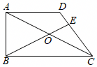

# 25 题精讲 09 · 直角梯形与相似分类

## 📝 题目

如图，在四边形 $ABCD$ 中，$AD\parallel BC$，$\angle ABC=90°$，$AD=CD$，$O$ 是对角线 $AC$ 的中点。联结 $BO$ 并延长，交边 $CD$ 或边 $AD$ 于点 $E$。

(1) 当点 $E$ 在 $CD$ 上时：

① 求证：$\triangle DAC\backsim\triangle OBC$；

② 若 $BE\perp CD$，求 $\dfrac{AD}{BC}$ 的值；

(2) 若 $DE=2$，$OE=3$，求 $CD$ 的长。

## 🧭 思路导航（渐进提示）

- **提示 1（识别）**：直角梯形 + 中点 + 等腰。两把钥匙：$AD=CD$ 给一组等角，$\angle ABC=90°$ 加"$O$ 是斜边 $AC$ 中点"给 $OB=OC$（斜边中线）——两组等腰凑在一起，通常就是一道相似。(2) 的 $DE=2,OE=3$ 是位置信号：$E$ 落在 $AD$ 还是 $CD$ 上？必须分类。
- **提示 2（突破）**：把两组等腰的等角串成一条链：$\angle DAC=\angle DCA=\angle ACB=\angle OBC$，相似即成。(2) 中 $E$ 在 $AD$ 上时，对角线 $AC,BE$ 互相平分 → 矩形 → $AC=2OE$；$E$ 在 $CD$ 上时，用"公共角 + 等角"的母子相似 △$EBC\backsim$△$ECO$ 把 $OE$ 塞进比例，再借 (1)① 的相似消元。
- **提示 3（路线）**：(1)① 等边对等角 + 平行内错角 + 斜边中线，两角相等出 AA。② 设 $AD=CD=2m$，证 $\angle OCE=\angle OCB=\angle EBC=30°$（即 $\angle DCB=60°$），作 $DH\perp BC$：$BH=AD=2m$、$CH=m$ → $AD/BC=2/3$。(2) 分类：①$E$ 在 $AD$：△$AOE\cong$△$COB$ → $OB=OE$ → $ABCE$ 是矩形 → $AC=6$，设 $AD=CD=x$，用 $CE^2$ 的两种勾股表达列方程，负根舍；②$E$ 在 $CD$：设 $OB=OC=m$，由 ①相似得 $\dfrac{OC}{BC}=\dfrac{x}{2m}$，由 △$EBC\backsim$△$ECO$ 得 $\dfrac3{x-2}=\dfrac{x-2}{m+3}$，消 $m$ 解 $x^2-6x-10=0$，取 $x=3+\sqrt{19}$。

## ✍️ 详解

**(1)①** $AD=CD$ → $\angle DAC=\angle DCA$（等边对等角）。

$AD\parallel BC$ → $\angle DAC=\angle ACB$（两直线平行，内错角相等）→ $\angle DCA=\angle ACB$。

$\angle ABC=90°$，$O$ 为斜边 $AC$ 中点 → $OB=OC=\dfrac12AC$（直角三角形斜边上的中线等于斜边的一半）→ $\angle OBC=\angle OCB$（等边对等角）$=\angle ACB$。

于是 $\angle DAC=\angle OBC$，$\angle DCA=\angle OCB$：

$$\triangle DAC\backsim\triangle OBC\quad(\text{两角分别相等的两个三角形相似})\qquad\blacksquare$$

**(1)②** $BE\perp CD$ 且 $E$ 在 $CD$ 上 → $\angle BEC=90°$。

角链：$\angle OCE=\angle DCA$（$O$ 在 $AC$ 上、$E$ 在 $CD$ 上，射线重合）$=\angle ACB=\angle OCB$；$\angle EBC=\angle OBC$（$E$ 在射线 $BO$ 上）$=\angle OCB$。故可设

$$\angle OCE=\angle OCB=\angle EBC=\varphi\ \Rightarrow\ \angle ECB=\angle OCE+\angle OCB=2\varphi$$

Rt△$BCE$ 中两锐角互余：$2\varphi+\varphi=90°$ → $\varphi=30°$，即 $\angle DCB=2\varphi=60°$。

作 $DH\perp BC$ 于 $H$，设 $AD=CD=2m$。$AB\perp BC$、$DH\perp BC$ → $AB\parallel DH$；又 $AD\parallel BH$ → 四边形 $ABHD$ 是矩形（有一个角是直角的平行四边形）→ $BH=AD=2m$。

Rt△$DCH$ 中 $\angle DCH=60°$：$CH=CD\cdot\cos 60°=2m\cdot\dfrac12=m$（锐角三角比）。

$$BC=BH+HC=2m+m=3m\ \Rightarrow\ \boxed{\dfrac{AD}{BC}=\dfrac{2m}{3m}=\dfrac23}$$

**(2)** 按 $E$ 的位置分两类（题设"交边 $CD$ 或边 $AD$ 于点 $E$"）。

**① 当点 $E$ 在边 $AD$ 上**：$AD\parallel BC$ → $\angle EAO=\angle BCO$、$\angle AEO=\angle CBO$（内错角相等）；$OA=OC$（$O$ 为 $AC$ 中点）→ △$AOE\cong$△$COB$（AAS）→ $OB=OE=3$。

$OA=OC$、$OB=OE$ → 对角线 $AC,BE$ 互相平分 → 四边形 $ABCE$ 是平行四边形；又 $\angle ABC=90°$ → $ABCE$ 是矩形。矩形对角线相等且互相平分：$AC=BE=2OE=6$。

设 $AD=CD=x$，则 $AE=AD-DE=x-2$（$E$ 在线段 $AD$ 上，需 $x>2$）。

矩形邻边垂直：$CE\perp AE$ 且 $E$ 在直线 $AD$ 上 → $CE\perp AD$。两个直角三角形各给一个 $CE^2$（勾股定理）：

$$\text{Rt}\triangle AEC:\ CE^2=AC^2-AE^2=36-(x-2)^2;\qquad \text{Rt}\triangle DEC:\ CE^2=CD^2-DE^2=x^2-4$$

$$36-(x-2)^2=x^2-4\ \Rightarrow\ 36-x^2+4x-4=x^2-4\ \Rightarrow\ x^2-2x-18=0\ \Rightarrow\ x=1\pm\sqrt{19}$$

$x=1-\sqrt{19}<0$ 舍去（线段长为正）→ $CD=1+\sqrt{19}$（此时 $x\approx5.36>2$，$E$ 在线段 $AD$ 内，合理）。

**② 当点 $E$ 在边 $CD$ 上**：设 $AD=CD=x$，则 $CE=CD-DE=x-2$（需 $x>2$）；设 $OB=OC=m$（(1)① 的斜边中线结论与 $E$ 位置无关，恒成立），则 $EB=OB+OE=m+3$。

由 △$DAC\backsim$△$OBC$（(1)① 恒成立）：$\dfrac{DC}{OC}=\dfrac{AC}{BC}$ → $\dfrac xm=\dfrac{2m}{BC}$ → $\dfrac{OC}{BC}=\dfrac m{BC}=\dfrac{x}{2m}$。

等角链：$\angle EBC=\angle OBC=\angle OCB=\angle OCE$（同 (1)② 的推理），$\angle BEC=\angle OEC$（同一角，$O$ 在线段 $BE$ 上）→ △$EBC\backsim$△$ECO$（两角分别相等）→

$$\frac{EC}{EB}=\frac{EO}{EC}=\frac{CO}{CB}\ \Rightarrow\ \frac{x-2}{m+3}=\frac3{x-2}=\frac{x}{2m}$$

由 $\dfrac3{x-2}=\dfrac{x}{2m}$：$m=\dfrac{x(x-2)}6$。代入 $\dfrac3{x-2}=\dfrac{x-2}{m+3}$，即 $3(m+3)=(x-2)^2$：

$$\frac{x^2-2x}{2}+9=x^2-4x+4\ \Rightarrow\ x^2-2x+18=2x^2-8x+8\ \Rightarrow\ x^2-6x-10=0$$

$$x=3\pm\sqrt{19}\quad(\text{求根公式})$$

$x=3-\sqrt{19}<0$ 舍去 → $CD=3+\sqrt{19}$（此时 $x\approx7.36>2$，且代回 $\dfrac3{x-2}=\dfrac{x}{2m}$、$m=\dfrac{x(x-2)}6$ 自洽）。

$$\boxed{CD=1+\sqrt{19}\ \text{或}\ 3+\sqrt{19}}$$

## ⚠️ 评分点与易错

- **$E$ 的位置分类是本题题眼**：两类都要解、都要写；只解一类最多得一半分。分类依据写"交边 $CD$ 或边 $AD$ 于点 $E$"。
- **$E$ 在 $AD$ 上时别跳步**："$OB=OE$ → 对角线互平分 → 平行四边形 → 矩形 → $AC=2OE$"这条翻译链每环都要写依据，不能直接默认 $OE$ 是 $AC$ 的一半。
- **② 的母子相似别写反**：△$EBC\backsim$△$ECO$ 给出 $\dfrac{EC}{EB}=\dfrac{EO}{EC}$（即 $EC^2=EO\cdot EB$），对应点 $B\leftrightarrow C\leftrightarrow O$；写错比例会解出假根。
- **定义域与舍根**：两类都要求 $x>2$（保证 $AE=x-2>0$ 或 $CE=x-2>0$，$E$ 在线段内部）；$1-\sqrt{19}<0$、$3-\sqrt{19}<0$ 直接舍，理由写"线段长为正"。
- 题源答案"1+19或3+19"按 $1+\sqrt{19}$、$3+\sqrt{19}$ 解码，已双路复核：$x=1+\sqrt{19}$ 时 $CE^2=x^2-4=36-(x-2)^2$；$x=3+\sqrt{19}$ 时 $m=\dfrac{x(x-2)}6$ 与 $\dfrac3{x-2}=\dfrac{x}{2m}$ 自洽。

## 🔗 关联

- [[03-数学/专题/第25题-压轴-相似与圆]] · [[03-数学/知识点/九年级/相似三角形]]（AA 判定、母子型 $EC^2=EO\cdot EB$）
- 同类题：[[25-02-梯形外接圆与比例中项]]（梯形 + 设参）、[[25-11-直角梯形全等与等腰]]（直角梯形 + 垂线构造）、[[25-10-相似平行线与函数]]（设参建方程与定义域）
