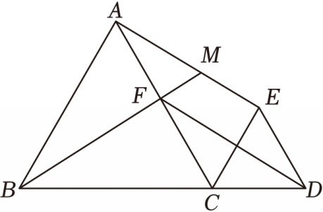

# 25 题精讲 10 · 三重平行线与函数

## 📝 题目

如图，在 $\triangle ABC$ 中，$AB=AC$，点 $D$ 在 $BC$ 的延长线上，$CE\parallel AB$，$DE\parallel AC$，点 $F$ 在边 $AC$ 上，$FD\parallel AE$，$BF$ 的延长线交线段 $AE$ 于点 $M$。

(1) 求证：$\triangle ABF\cong\triangle CAE$；

(2) 当点 $M$ 是 $AE$ 的中点时，求证：$BF^2=4BM\cdot FM$；

(3) 已知 $\cos\angle ABC=\dfrac{\sqrt5}{5}$，$BC=2$，设 $CD=x$，$EM:AM=y$（即 $y=\dfrac{EM}{AM}$），求 $y$ 关于 $x$ 的函数解析式，并写出 $x$ 的取值范围。

## 🧭 思路导航（渐进提示）

- **提示 1（识别）**：两重平行（$CE\parallel AB$、$DE\parallel AC$）加一重动平行（$FD\parallel AE$），最后要"线段比 → 函数"。"$AB=AC$" 与平行线是钥匙——先问：平行四边形藏在哪里？定义域由"$M$ 在线段 $AE$ 上"这句话决定，别只顾解出式子。
- **提示 2（突破）**：$CE\parallel AB$、$DE\parallel AC$ 先造出等腰 △$EDC$（$\angle ECD=\angle EDC=\angle ABC$）和平行四边形 $AFDE$，于是 $AF=CE$ → SAS 全等。(2) 全等给 $\angle MBA=\angle MAF$，与公共角 $\angle M$ 拼成相似 → $MA^2=BM\cdot FM$（共角比例中项），再用 $MA=\tfrac12AE=\tfrac12BF$。(3) 设参求 $CE$：等腰 △$EDC$ 底角就是 $\angle ABC$，作底边垂线用余弦；延长 $BM$ 交 $CE$ 延长线于 $N$，用 △$FNC\backsim$△$FBA$ 把 $CN$ 表出，再 △$MEN\backsim$△$MAB$ 把 $y$ 化成 $EN/AB$。
- **提示 3（路线）**：(1) 平行 → 四边形 $AFDE$ 是平行四边形 → $ED=AF$；$\angle ECD=\angle EDC$ → $ED=EC$ → $AF=CE$；加 $AB=CA$、$\angle BAF=\angle ACE$（内错角）→ SAS。(2) $MA^2=MB\cdot MF$，代 $MA=\tfrac12BF$。(3) 三线合一取 $BH=1$，$\cos\angle ABC=\dfrac{\sqrt5}5$ → $AB=AC=\sqrt5$；$CE=AF=\dfrac{\sqrt5x}{2}$、$CF=\sqrt5-\dfrac{\sqrt5x}2$；△$FNC\backsim$△$FBA$ → $CN=\dfrac{\sqrt5(2-x)}x$ → $EN=CN-CE=\dfrac{\sqrt5(4-2x-x^2)}{2x}$ → $y=\dfrac{EN}{AB}=\dfrac{4-2x-x^2}{2x}$；定义域：$x>0$ 且题设图形成立（$N$ 在 $CE$ 延长线上、$M$ 在线段 $AE$ 上）→ $4-2x-x^2\ge0$ → $0<x\le\sqrt5-1$。

## ✍️ 详解

**(1)** $AB=AC$ → $\angle ABC=\angle ACB$（等边对等角）。

$CE\parallel AB$ → $\angle ECD=\angle ABC=\angle ACB$（两直线平行，同位角相等）；$DE\parallel AC$ → $\angle EDC=\angle ACB$（两直线平行，同位角相等）。

∴ $\angle ECD=\angle EDC$ → $ED=EC$（等角对等边）。

又 $DE\parallel AC$（即 $DE\parallel AF$）、$FD\parallel AE$ → 四边形 $AFDE$ 是平行四边形（两组对边分别平行）→ $ED=AF$（平行四边形对边相等）。

∴ $AF=EC$。加 $\angle BAF=\angle ACE$（$CE\parallel AB$，内错角相等；$F$ 在 $AC$ 上）、$AB=CA$：

$$\triangle ABF\cong\triangle CAE\quad(\text{SAS：}AB=CA,\ \angle BAF=\angle ACE,\ AF=CE)\qquad\blacksquare$$

**(2)** 由 (1) 全等：$\angle ABF=\angle CAE$（对应角相等），$AE=BF$（对应边相等）。

$B,F,M$ 共线（$F$ 在 $B,M$ 之间），$M$ 在线段 $AE$ 上 → $\angle MBA=\angle ABF=\angle CAE=\angle MAF$（射线 $AM$ 即 $AE$、射线 $AF$ 即 $AC$）。又 $\angle AMB$ 与 $\angle FMA$ 是同一个角：

△$MBA\backsim$△$MAF$（两角分别相等）→ $\dfrac{MB}{MA}=\dfrac{MA}{MF}$（对应边成比例）→ $MA^2=MB\cdot MF$。

$M$ 是 $AE$ 中点 → $MA=\dfrac{AE}{2}=\dfrac{BF}{2}$。代入：

$$\left(\frac{BF}{2}\right)^2=BM\cdot FM\ \Rightarrow\ \boxed{BF^2=4BM\cdot FM}\qquad\blacksquare$$

**(3)** 作 $AH\perp BC$ 于 $H$。$AB=AC$ → $BH=\dfrac12BC=1$（等腰三角形三线合一）。

$$\cos\angle ABC=\frac{BH}{AB}\ \Rightarrow\ AB=\frac{1}{\sqrt5/5}=\sqrt5\ \Rightarrow\ AC=\sqrt5$$

$BC=2$、$CD=x$。等腰 △$EDC$ 的底角：$\angle ECD=\angle EDC=\angle ABC$（见 (1)）。作 $EH\perp CD$ 于 $H$，则 $H$ 是 $CD$ 中点（三线合一）→ $CH=\dfrac x2$，且 $\angle ECH=\angle ABC$：

$$CE=\frac{CH}{\cos\angle ABC}=\frac{x/2}{\sqrt5/5}=\frac{\sqrt5x}{2}$$

（注意：不能套 △$DCE\backsim$△$DBA$——$E$ 并不在线段 $DA$ 上，该相似不成立。）

由 (1)：$AF=CE=\dfrac{\sqrt5x}{2}$ → $CF=AC-AF=\sqrt5-\dfrac{\sqrt5x}{2}$。

延长 $BM$ 交 $CE$ 的延长线于点 $N$。$CN\parallel AB$（$N$ 在直线 $CE$ 上）：

- $\angle CFN=\angle AFB$（对顶角相等：$C,F,A$ 共线、$B,F,N$ 共线，$F$ 均在中间）；
- $\angle FCN=\angle FAB$（$CN\parallel AB$ 被直线 $AC$ 所截的内错角相等）。

∴ △$FNC\backsim$△$FBA$（两角分别相等）→ $\dfrac{CN}{AB}=\dfrac{CF}{AF}$（对应边成比例）：

$$CN=\sqrt5\cdot\frac{\sqrt5-\sqrt5x/2}{\sqrt5x/2}=\frac{\sqrt5(2-x)}{x}$$

$$EN=CN-CE=\frac{\sqrt5(2-x)}{x}-\frac{\sqrt5x}{2}=\frac{\sqrt5(4-2x-x^2)}{2x}$$

$EN\parallel AB$（同在直线 $CE$ 上）→ △$MEN\backsim$△$MAB$（$\angle M$ 公共、$\angle MEN=\angle MAB$ 同位角相等）→

$$y=\frac{EM}{AM}=\frac{EN}{AB}=\boxed{\dfrac{4-2x-x^2}{2x}}$$

**定义域**：$x>0$（$CD$ 为线段长）。题设"$BF$ 的延长线交**线段** $AE$ 于点 $M$"要求 $N$ 落在 $CE$ 的延长线上（$EN\ge0$）、$M$ 落在线段 $AE$ 上（含端点 $E$，此时 $M$ 与 $E$ 重合、$y=0$），即

$$EN\ge0\ \Leftrightarrow\ 4-2x-x^2\ge0\ \Leftrightarrow\ x^2+2x-4\le0\ \Leftrightarrow\ -1-\sqrt5\le x\le\sqrt5-1$$

结合 $x>0$（另一条件 $F$ 在边 $AC$ 上即 $x\le2$ 已被包含）：

$$\boxed{0<x\le\sqrt5-1}$$

## ⚠️ 评分点与易错

- **(1) 的链条四环相扣**：平行 → 等腰 △$EDC$ → 平行四边形 $AFDE$ → $AF=CE$ → SAS。跳掉任何一环（尤其"平行四边形给 $ED=AF$"）会被扣依据分。
- **(2) 是"共角比例中项"模型**：识别 △$MBA\backsim$△$MAF$ 是关键；代换 $MA=\tfrac12AE=\tfrac12BF$ 用的是 (1) 的 $AE=BF$——前问是后问的工具。
- **(3) 求 $CE$ 别用错相似**：△$DCE$ 与 △$DBA$ 只有公共角 $\angle D$，$E$ 不在 $DA$ 上，不相似；正确做法是等腰三角形底边垂线 + 余弦。$CF=AF\cdot\dfrac{CF}{AF}$ 型比例（△$FNC\backsim$△$FBA$）中 $CN\leftrightarrow AB$、$CF\leftrightarrow AF$ 的对应关系要写清。
- **定义域必须给理由**："$N$ 在 $CE$ 延长线上、$M$ 在线段 $AE$ 上"翻译为 $4-2x-x^2\ge0$，解出 $x\le\sqrt5-1$；只写"由图可知"不给满。$x=\sqrt5-1$ 时 $M$ 与 $E$ 重合（$y=0$），是允许的临界情形。
- 题源讹误修正：答案"$y=4-2x-x22x$（0＜x≤5−1）"应为 $y=\dfrac{4-2x-x^2}{2x}$（$0<x\le\sqrt5-1$）；条件 $\cos\angle ABC$ 源文作"$55$"，解码为 $\dfrac{\sqrt5}5$，与 $AB=\dfrac{1}{\cos\angle ABC}=\sqrt5$ 自洽。

## 🔗 关联

- [[03-数学/专题/第25题-压轴-相似与圆]] · [[03-数学/知识点/九年级/相似三角形]]（A 字型、共角比例中项）· [[03-数学/知识点/九年级/锐角的三角比与解直角三角形]]（余弦定边）
- 同类题：[[25-01-平行四边形相似面积比]]（平行线 + 线段比）、[[25-09-直角梯形相似综合]]（设参建方程）、[[25-11-直角梯形全等与等腰]]（平行线构造比例）
