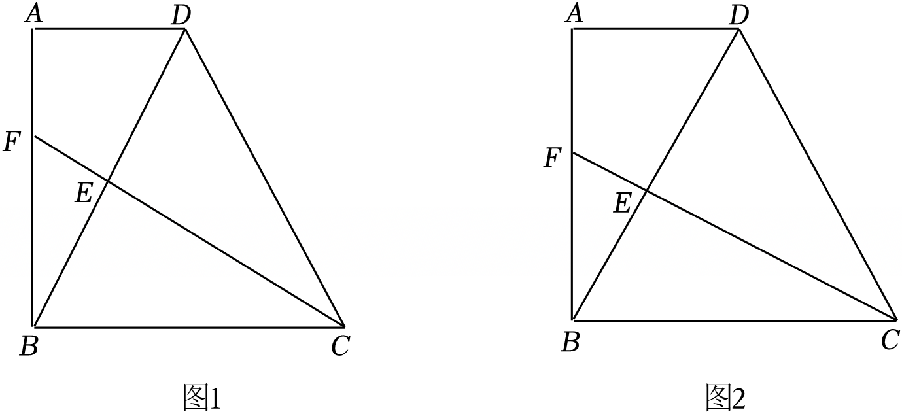

# 25 题精讲 11 · 直角梯形中的全等与等腰

## 📝 题目

在梯形 $ABCD$ 中，$AD\parallel BC$，$AD=4$，$\angle ABC=90°$，$BD=BC$。过点 $C$ 作对角线 $BD$ 的垂线，垂足为 $E$，交射线 $BA$ 于点 $F$。

(1) 如图，当点 $F$ 在边 $AB$ 上时，求证：$\triangle ABD\cong\triangle ECB$；

(2) 如果 $F$ 是 $AB$ 的中点，求 $FE:EC$ 的值；

(3) 联结 $DF$。当 $BC=8$ 时，$\triangle BFD$ 是什么三角形？（直接写出结果）

## 🧭 思路导航（渐进提示）

- **提示 1（识别）**：直角梯形 + 等腰（$BD=BC$）+ 双垂直。"$AD\parallel BC$"负责转移角，"$BD=BC$"负责提供全等的对应边——先找两个直角在哪里：$\angle A$ 与 $\angle CEB$。
- **提示 2（突破）**：平行给 $\angle A=90°$、$\angle ADB=\angle EBC$，加斜边 $BD=CB$ → AAS 全等；全等把 $AD=4$"搬运"成 $BE=4$。(2) 作 $FG\parallel AD$ 交 $BD$ 于 $G$：中点条件给出 $FG=2$、$BG=\dfrac m2$，再用 $FG\parallel BC$ 的 A 字型把 $FE:EC$ 接到 $EG:EB$ 上，$m$ 由方程解出。
- **提示 3（路线）**：(1) 平行 → 同旁内角补 $90°$、内错角相等；$BD=CB$ → AAS。(2) 设 $BC=BD=m$：△$BFG\backsim$△$BAD$ → $FG=2$、$BG=\dfrac m2$；全等给 $BE=4$；$FG\parallel BC$ → △$EFG\backsim$△$ECB$ → $\dfrac{FE}{EC}=\dfrac{EG}{EB}=\dfrac{FG}{BC}=\dfrac2m$，而 $EG=\dfrac m2-4$，解 $2\cdot4=m\left(\dfrac m2-4\right)$ 即 $m^2-8m-16=0$，取 $m=4+4\sqrt2$（另一支退化），得 $FE:EC=\dfrac{2}{4+4\sqrt2}=\dfrac{\sqrt2-1}{2}$。(3) $AD=4=\dfrac12BD$ → $\angle ABD=30°$ → $\angle DBC=60°$ 且 $BD=BC$ → △$BCD$ 等边 → $CE$ 垂直平分 $BD$ → $BF=DF$。

## ✍️ 详解

**(1)** $CF\perp BD$ → $\angle CEB=90°$（垂直定义）。

$AD\parallel BC$、$\angle ABC=90°$ → $\angle A=180°-90°=90°$（两直线平行，同旁内角互补）→ $\angle A=\angle CEB$。

$AD\parallel BC$ → $\angle ADB=\angle EBC$（两直线平行，内错角相等）。

加 $BD=CB$（已知，公共对应边）：

$$\triangle ABD\cong\triangle ECB\quad(\text{AAS：两角及其中一角的对边分别相等})\qquad\blacksquare$$

**(2)** 作 $FG\parallel AD$ 交 $BD$ 于点 $G$。设 $BC=BD=m$。

$FG\parallel AD$（即 $FG\parallel AB$ 截线 $BD$……更直接地）：$F$ 在 $AB$ 上、$G$ 在 $BD$ 上、$FG\parallel AD$ → △$BFG\backsim$△$BAD$（平行于三角形一边的直线截另外两边）→

$$\frac{BF}{BA}=\frac{BG}{BD}=\frac{FG}{AD}$$

$F$ 是 $AB$ 中点 → $\dfrac{BF}{BA}=\dfrac12$ → $FG=\dfrac{AD}{2}=2$，$BG=\dfrac m2$。

由 (1) 全等：$BE=AD=4$（对应边相等），$EC=AB$。

$FG\parallel BC$（$FG\parallel AD\parallel BC$），$E,F,C$ 共线（$E$ 在线段 $FC$ 上）、$E,G,B$ 共线 → △$EFG\backsim$△$ECB$（两角分别相等：$\angle FEG$ 与 $\angle CEB$ 的两边分别反向、$\angle EGF=\angle EBC$ 同位角相等）→

$$\frac{FE}{EC}=\frac{EG}{EB}=\frac{FG}{BC}=\frac2m$$

题图位置 $G$ 在 $E,D$ 之间（$BG=\dfrac m2>BE=4$）→ $EG=\dfrac m2-4$。由 $\dfrac{EG}{EB}=\dfrac2m$：

$$\frac{m/2-4}{4}=\frac2m\ \Rightarrow\ m\left(\frac m2-4\right)=8\ \Rightarrow\ m^2-8m-16=0\ \Rightarrow\ m=4\pm4\sqrt2$$

$m=4-4\sqrt2<0$ 舍去（线段长为正），取 $m=4+4\sqrt2\approx9.66>8$（保证 $EG=\dfrac m2-4>0$，与所设图位置一致）。

$$\boxed{FE:EC=\frac2m=\frac{2}{4+4\sqrt2}=\frac{\sqrt2-1}{2}}$$

（若改设 $G$ 在 $B,E$ 之间，即 $EG=4-\dfrac m2$，则 $m^2-8m+16=0$ → $m=4$；此时 $BD=4=AD$，Rt△$ABD$ 中 $AB^2=BD^2-AD^2=0$，$A$ 与 $B$ 重合、梯形退化，不合题意舍去。）

**(3)** $BC=8$ → $BD=8$。Rt△$ABD$ 中（$\angle A=90°$）：$AD=4=\dfrac12BD$ → $\angle ABD=30°$（直角三角形中，一条直角边等于斜边的一半，则这条直角边所对的角为 $30°$）→ $\angle ADB=60°$。

$AD\parallel BC$ → $\angle DBC=\angle ADB=60°$（内错角相等）。

$BD=BC$ 且 $\angle DBC=60°$ → △$BCD$ 是等边三角形（有一个角是 $60°$ 的等腰三角形是等边三角形）。

等边 △$BCD$ 中 $CE\perp BD$ → $CE$ 是底边 $BD$ 上的中线（三线合一）→ $BE=DE$，即 $CF$ 垂直平分 $BD$。

$F$ 在 $CF$ 上 → $BF=DF$（线段垂直平分线上的点到线段两端点距离相等）：

$$\boxed{\triangle BFD\ \text{是等腰三角形}}$$

（进一步可算得顶角：$F$ 在射线 $BA$ 上 → $\angle FBD=\angle ABD=30°$；$BF=DF$ → $\angle FDB=\angle FBD=30°$ → $\angle BFD=180°-60°=120°$，故不是等边三角形。）

## ⚠️ 评分点与易错

- **(1) 全等依据写 AAS 并配齐三个条件**（$\angle A=\angle CEB$、$\angle ADB=\angle EBC$、$BD=CB$）；不要写成"HL"——$AD=EB$ 是结论不是条件。
- **(2) 的构造是得分点**：作 $FG\parallel AD$ 把"中点"翻译成 $FG=2$、$BG=\dfrac m2$；随后 △$EFG\backsim$△$ECB$ 把 $FE:EC$ 接到已知量。构造线不写、相似不写依据，都会被扣分。
- **(2) 必须检验图形位置**：$EG=\dfrac m2-4$ 用了 $G$ 在 $E$ 外侧，解出 $m$ 后要验证 $m>8$；另一支 $m=4$ 使 $AB=0$（梯形退化），舍去理由要写。
- **(3)"直接写出结果"也要能说理**：$BF=DF$ 的依据是"垂直平分线性质"，本质是等边三角形三线合一；只答"等腰三角形"四个字、追问时说不出依据，考场同样丢分。
- (2) 与 (3) 中 $F$ 的位置不同：(2) 附加"F 是 $AB$ 中点"，(3) 是一般位置，两小问条件不通用。

## 🔗 关联

- [[03-数学/专题/第25题-压轴-相似与圆]] · [[03-数学/知识点/九年级/相似三角形]]（A 字型比例、平行线构造）
- 同类题：[[25-09-直角梯形相似综合]]（同为直角梯形、设参解方程）、[[25-08-等腰三角形与圆]]（等腰判定与分类）、[[25-01-平行四边形相似面积比]]（比例线段）
