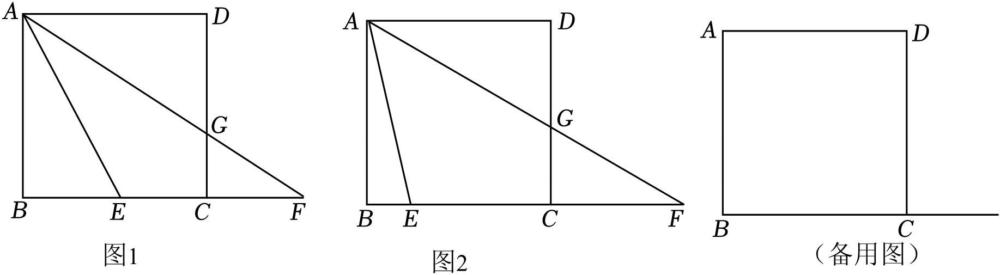

# 25 题精讲 12 · 正方形双圆与相似

## 📝 题目

已知正方形 $ABCD$，点 $E$ 在边 $BC$ 上，点 $F$ 在 $BC$ 的延长线上，$AF$ 与 $CD$ 交于点 $G$。

(1) 如图 1，如果 $CE=CG$，求证：$BC^2=BE\cdot BF$；

(2) 如图 2，如果 $\angle EAF=45°$，且 $CE=CF$，求 $\angle F$ 的正切值；

(3) 以点 $C$ 为圆心、$CE$ 为半径画 ⊙$C$；以 $AE$ 为直径画 ⊙$O$（圆心 $O$ 为 $AE$ 中点），两圆相交于点 $E$ 与点 $P$。如果 $AB=2$，$CF=2CE$，$EP=CG$，求 $EF$ 的长。

## 🧭 思路导航（渐进提示）

- **提示 1（识别）**：正方形 + 比例中项 + 双圆。三问共用一个底盘——正方形提供四个直角与两组平行；(2)(3) 都要设参列方程，先问自己：设哪个量为 $x$ 最省？(3) 的两个圆相交，马上想"连心线与公共弦"的关系。
- **提示 2（突破）**：(1) 由 $CE=CG$ 做减法得 $BE=DG$，全等 △$ADG\cong$△$ABE$ 把角搬到 $\angle BAE=\angle F$，再补公共角 $\angle B$ 出母子相似，$BA^2=BE\cdot BF$。(2) $\angle EAF=\angle ECA=45°$（对角线平分直角）→ △$ECA\backsim$△$EAF$ → $AE^2=CE\cdot EF$，与勾股 $AE^2=AB^2+BE^2$ 接力。(3) 设 $CE=x,CF=2x$：先用 △$FCG\backsim$△$FBA$ 求 $CG=EP$；连心线 $OC$ 垂直平分公共弦 $EP$ → 垂足 $L$ 平分 $EP$ → $\sin\angle ECL$ 有两种表达（Rt△$ELC$ 与 Rt△$OKC$），列方程解 $x$。
- **提示 3（路线）**：(1) $BE=DG$ → SAS 全等 → $\angle DAG=\angle BAE$；$AD\parallel BF$ → $\angle DAG=\angle F$ → △$BAE\backsim$△$BFA$ → $BA^2=BE\cdot BF$。(2) 设边长 1、$CE=CF=x$：$AE^2=x\cdot2x=2x^2$，又 $AE^2=1+(1-x)^2$ → $x^2+2x-2=0$ → $x=\sqrt3-1$（负根舍）→ $\tan\angle F=\dfrac{AB}{BF}=\dfrac1{1+x}=\dfrac{\sqrt3}3$。(3) $CG=\dfrac{2x}{1+x}=EP$；$O$ 为 $AE$ 中点，$OK\perp BC$ → $OK=1$、$EK=1-\dfrac x2$、$KC=1+\dfrac x2$ → $OC^2=1+\left(1+\dfrac x2\right)^2$；$L=OC\cap EP$ 平分 $EP$ → $EL=\dfrac{x}{1+x}$；$\sin\angle ECL=\dfrac{EL}{EC}=\dfrac{OK}{OC}$ → $(1+x)^2=1+\left(1+\dfrac x2\right)^2$ → $3x^2+4x-4=0$ → $x=\dfrac23$ → $EF=3x=2$。

## ✍️ 详解

**(1)** 正方形 → $AD=AB=BC=CD$，$\angle B=\angle D=90°$，$AD\parallel BC$（即 $AD\parallel BF$）。

$CE=CG$ → $BC-CE=CD-CG$ → $BE=DG$（等式性质）。

△$ADG$ 与 △$ABE$ 中：$DG=BE$、$\angle D=\angle B$、$AD=AB$ → △$ADG\cong$△$ABE$（SAS）→ $\angle DAG=\angle BAE$（全等对应角相等）。

$AD\parallel BF$，截线 $AF$ → $\angle DAG=\angle F$（两直线平行，内错角相等；$G$ 在 $AF$ 上）→ $\angle BAE=\angle BFA$。

△$BAE$ 与 △$BFA$ 中：$\angle ABE=\angle FBA$（公共角 $\angle B$）、$\angle BAE=\angle BFA$ → △$BAE\backsim$△$BFA$（两角分别相等）→

$$\frac{BA}{BF}=\frac{BE}{BA}\ \Rightarrow\ BA^2=BE\cdot BF\ \xrightarrow{\ BA=BC\ }\ \boxed{BC^2=BE\cdot BF}\qquad\blacksquare$$

**(2)** 连接 $AC$。设正方形边长为 $1$，$CE=x$，则 $CF=x$、$EF=EC+CF=2x$、$BE=1-x$（$0<x<1$）。

$\angle ECA=\dfrac12\angle BCD=45°$（正方形对角线平分一组对角）$=\angle EAF$（已知）。

$\angle AEC=\angle AEF$（同一角：$E$ 在 $B,C$ 之间，射线 $EC$ 与射线 $EF$ 同向）→ △$ECA\backsim$△$EAF$（两角分别相等）→ $\dfrac{EC}{EA}=\dfrac{EA}{EF}$：

$$AE^2=CE\cdot EF=x\cdot2x=2x^2$$

Rt△$ABE$ 中（$\angle B=90°$，勾股定理）：$AE^2=AB^2+BE^2=1+(1-x)^2$。

$$1+(1-x)^2=2x^2\ \Rightarrow\ x^2-2x+2=2x^2\ \Rightarrow\ x^2+2x-2=0\ \Rightarrow\ x=-1\pm\sqrt3$$

$x=-1-\sqrt3<0$ 舍去（$E$ 在边 $BC$ 上，$0<x<1$）；$x=\sqrt3-1\approx0.73\in(0,1)$ ✓。

Rt△$ABF$ 中（$\angle ABF=90°$）：$\tan\angle F=\dfrac{AB}{BF}=\dfrac{1}{BC+CF}=\dfrac{1}{1+x}=\dfrac1{\sqrt3}$：

$$\boxed{\tan\angle F=\frac{\sqrt3}{3}}$$

**(3)** 设 $CE=x$，则 $CF=2x$、$EF=3x$，正方形边长 $AB=BC=CD=2$。

$AB\parallel CD$（正方形对边平行）→ △$FCG\backsim$△$FBA$（$\angle F$ 公共、$\angle FCG=\angle FBA$ 同位角相等）→ $\dfrac{CG}{BA}=\dfrac{FC}{FB}$：

$$\frac{CG}{2}=\frac{2x}{2+2x}\ \Rightarrow\ CG=\frac{2x}{1+x}\ \Rightarrow\ EP=CG=\frac{2x}{1+x}$$

设 $O$ 为 $AE$ 中点（⊙$O$ 圆心），作 $OK\perp BC$ 于 $K$。$OK\parallel AB$，$O$ 为 $AE$ 中点 → △$EOK\backsim$△$EAB$（相似比 $\tfrac12$）：

$$OK=\frac12AB=1,\qquad EK=\frac12EB=\frac{2-x}{2}=1-\frac x2\ \Rightarrow\ KC=EK+EC=1+\frac x2$$

Rt△$OKC$ 中（$\angle OKC=90°$，勾股定理）：$OC^2=OK^2+KC^2=1+\left(1+\dfrac x2\right)^2$。

⊙$C$ 与 ⊙$O$ 相交于 $E,P$ → 连心线 $OC$ 垂直平分公共弦 $EP$（相交两圆的性质）。设 $OC$ 交 $EP$ 于 $L$，则 $EL=\dfrac12EP=\dfrac{x}{1+x}$，$\angle ELC=90°$。

Rt△$ELC$ 中：$\sin\angle ECL=\dfrac{EL}{EC}=\dfrac{x/(1+x)}{x}=\dfrac1{1+x}$。

又 $E,K$ 都在射线 $CB$ 上（射线 $CE$ 与射线 $CK$ 同向）、$L$ 在线段 $OC$ 上 → $\angle ECL=\angle KCO$（同一角），Rt△$OKC$ 中 $\sin\angle KCO=\dfrac{OK}{OC}=\dfrac1{\sqrt{1+\left(1+\frac x2\right)^2}}$。

$$\frac1{1+x}=\frac1{\sqrt{1+\left(1+\frac x2\right)^2}}\ \Rightarrow\ (1+x)^2=1+\left(1+\frac x2\right)^2\quad(\text{两边均为正，可平方})$$

$$1+2x+x^2=2+x+\frac{x^2}{4}\ \Rightarrow\ 3x^2+4x-4=0\ \Rightarrow\ x=\frac{-4\pm8}{6}\ \Rightarrow\ x=\frac23\ \text{或}\ x=-2$$

$x=-2<0$ 舍去（$E$ 在边 $BC$ 上，需 $0<x<2$）；$x=\dfrac23$ ✓（代回检验：$CG=\dfrac45=EP$，$OC=\dfrac53$，$\dfrac{EL}{EC}=\dfrac{OK}{OC}=\dfrac35$ ✓）。

$$\boxed{EF=3x=2}$$

## ⚠️ 评分点与易错

- **(1) 的两次"搬运"缺一不可**：线段搬运 $CE=CG\Rightarrow BE=DG$（正方形减法）与角度搬运 $\angle DAG=\angle F$（平行内错角）；漏掉后者，母子相似 △$BAE\backsim$△$BFA$ 就拼不出来。
- **(2) 设边长为 1 是简化运算的关键技巧**；解出 $x$ 后，$\tan\angle F=\dfrac{AB}{BF}=\dfrac1{1+x}$ 别错写成 $\dfrac1{2+x}$ 或忘记先解 $x$。
- **(3) 两个模型都要写依据**：①相交两圆 → 连心线垂直平分公共弦（$L$ 是 $EP$ 中点这步不能省）；②$\sin\angle ECL$ 的两种表达（Rt△$ELC$ 与 Rt△$OKC$）。
- **(3) 解方程后必须检验范围**：$0<x<2$（$E$ 在边 $BC$ 上、$F$ 在延长线上），负根舍去；题源解得 "$x=\dfrac23$ 或 $x=0$（舍）"，本讲方程 $3x^2+4x-4=0$ 的两根为 $\dfrac23$ 与 $-2$——有效根一致，舍根不同不影响结论，已代回数值复核。
- (1) 的结论 $BC^2=BE\cdot BF$ 是"圆幂定理式"的比例中项：正方形里 $BA=BC$ 是它成立的前提，别推广到任意图形。

## 🔗 关联

- [[03-数学/专题/第25题-压轴-相似与圆]] · [[03-数学/知识点/九年级/相似三角形]]（母子型、SAS 全等接力）· [[03-数学/知识点/九年级/圆与正多边形]]（相交两圆连心线性质）
- 同类题：[[25-03-菱形重心与相交两圆]]（相交两圆 + 公共弦）、[[25-06-圆中比例中项]]（比例中项型条件）、[[25-14-动圆与切线]]（双圆 + 三角比方程）
