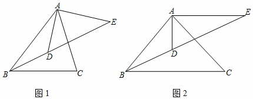

# 25 题精讲 13 · 双角平分线与相似分类

## 📝 题目

如图，$AD$、$BD$ 分别是 $\triangle ABC$ 的内角 $\angle BAC$、$\angle ABC$ 的平分线，过点 $A$ 作 $AE\perp AD$，交 $BD$ 的延长线于点 $E$。

(1) 求证：$\angle E=\dfrac12\angle C$；

(2) 如图 2，如果 $AE=AB$，且 $BD:DE=2:3$，求 $\cos\angle ABC$ 的值；

(3) 如果 $\angle ABC$ 是锐角，且 $\triangle ABC$ 与 $\triangle ADE$ 相似，求 $\angle ABC$ 的度数，并直接写出 $\dfrac{S_{\triangle ADE}}{S_{\triangle ABC}}$ 的值。

## 🧭 思路导航（渐进提示）

- **提示 1（识别）**：两把角平分线 + 一条垂直，是"半角叠加"的标志图形；$D$ 其实是 $\triangle ABC$ 的内心，$E$ 在 $\angle B$ 平分线的延长线上。
- **提示 2（突破）**：$\angle ADE$ 是 $\triangle ABD$ 的外角，用两条平分线把它写成两半角之和，(1) 即破。(2) 的钥匙是 $AE=AB$：等腰给 $\angle AEB=\angle ABE$，而 $\angle ABE$ 是半角，于是 $AE\parallel BC$——平行是转移比例 $BD:DE$ 的桥。
- **提示 3（路线）**：(1) 外角 $\angle ADE=\frac12(\angle BAC+\angle ABC)=90^\circ-\frac12\angle C$，在 $\text{Rt}\triangle ADE$ 中得 $\angle E=\frac12\angle C$。(2) 延长 $AD$ 交 $BC$ 于 $F$：由 $AE\parallel BC$ 得 $\angle AFB=\angle DAE=90^\circ$，由 $\triangle DAE\backsim\triangle DFB$ 得 $\dfrac{BF}{AE}=\dfrac{BD}{DE}=\dfrac23$，而 $\cos\angle ABC=\dfrac{BF}{AB}=\dfrac{BF}{AE}$。(3) $\triangle ADE$ 含 $90^\circ$ 角 ⟹ 相似迫使 $\triangle ABC$ 也有 $90^\circ$ 内角，$\angle ABC\ne90^\circ$，故分 $\angle BAC=90^\circ$、$\angle C=90^\circ$ 两类：都用"半角关系定角 ⟹ 在公共的 $\triangle ABE$ 中作高，把对应边之比化为 $\sin$ 半角之比 ⟹ 面积比 = 相似比平方"。

## ✍️ 详解

**(1)** $\because AE\perp AD$，$\therefore\angle DAE=90°$（垂直定义）。

$E$ 在 $BD$ 的延长线上，$\angle ADE$ 是 $\triangle ABD$ 的外角：

$$\angle ADE=\angle BAD+\angle ABD=\tfrac12\angle BAC+\tfrac12\angle ABC=\tfrac12(180°-\angle C)=90°-\tfrac12\angle C$$

在 $\text{Rt}\triangle ADE$ 中（直角三角形两锐角互余）：

$$\angle E=90°-\angle ADE=\boxed{\tfrac12\angle C}\qquad\blacksquare$$

**(2)** 延长 $AD$ 交 $BC$ 于点 $F$。

$AB=AE$ ⟹ $\angle ABE=\angle AEB$（等边对等角）；$BE$ 平分 $\angle ABC$（$E$ 在 $BD$ 延长线上）⟹ $\angle ABE=\angle EBC$；

$\therefore\angle AEB=\angle EBC$，$AE\parallel BC$（内错角相等，两直线平行）。

$\therefore\angle AFB=\angle DAE=90°$（两直线平行，同位角相等），即 $AF\perp BC$。

又 $\angle ADE=\angle FDB$（对顶角），$\angle DAE=\angle DFB=90°$ ⟹ $\triangle DAE\backsim\triangle DFB$（两角对应相等）：

$$\frac{BF}{AE}=\frac{BD}{DE}=\frac23$$

在 $\text{Rt}\triangle ABF$ 中，$\cos\angle ABC=\cos\angle ABF=\dfrac{BF}{AB}=\dfrac{BF}{AE}$（$AB=AE$）：

$$\boxed{\cos\angle ABC=\frac23}$$

**(3)** $\triangle ADE$ 中 $\angle DAE=90°$，$\triangle ABC$ 与其相似 ⟹ $\triangle ABC$ 必有一个内角为 $90°$；

$\angle ABC$ 是锐角 ⟹ $\angle ABC\ne90°$，故分两类。

**① $\angle BAC=90°$**：设 $\angle B=2t$，则 $\angle C=90°-2t$，$\angle E=\frac12\angle C=45°-t$，$\angle ADE=90°-\angle E=45°+t$。

$90°$ 角互对（$\angle BAC\leftrightarrow\angle DAE$），剩下的角配对只有两种：

- $\angle ADE=\angle B$ 且 $\angle E=\angle C$：$45°+t=2t$ ⟹ $t=45°$ ⟹ $\angle C=0°$，舍；
- $\angle ADE=\angle C$ 且 $\angle E=\angle B$：$45°+t=90°-2t$ 且 $45°-t=2t$，解得 $t=15°$，两式同时成立；

此时对应关系为 $A\leftrightarrow A$、$D\leftrightarrow C$、$E\leftrightarrow B$，即 $\triangle ADE\backsim\triangle ACB$，$k=\dfrac{AE}{AB}$。

作 $AH\perp BE$ 于 $H$（$H$ 在 $\triangle ABE$ 内部）：$AH=AB\sin15°=AE\sin30°$（锐角三角比定义）

$$k=\frac{AE}{AB}=\frac{\sin15°}{\sin30°}=2\sin15°\ \Rightarrow\ k^2=4\sin^215°=2(1-\cos30°)=2-\sqrt3$$

$$\frac{S_{\triangle ADE}}{S_{\triangle ABC}}=k^2=2-\sqrt3$$

**② $\angle C=90°$**：$\angle E=\frac12\angle C=45°$，$\angle ADE=45°$，$\triangle ADE$ 等腰直角 ⟹ $\triangle ABC$ 中 $\angle BAC=\angle ABC=45°$。

对应关系为 $A\leftrightarrow C$、$D\leftrightarrow A$、$E\leftrightarrow B$，即 $\triangle ADE\backsim\triangle CAB$，$k=\dfrac{AE}{CB}$。

作 $AH\perp BE$ 于 $H$：$AH=AB\sin22.5°=AE\sin45°$；又 $\text{Rt}\triangle ABC$ 中（$\angle C=90°$，$AB$ 为斜边）$CB=AB\cos45°$：

$$k=\frac{AE}{CB}=\frac{\sin22.5°/\sin45°}{\cos45°}=\frac{\sin22.5°}{\sin45°\cos45°}=\frac{\sin22.5°}{\tfrac12}=2\sin22.5°$$

$$k^2=4\sin^222.5°=2(1-\cos45°)=2-\sqrt2\ \Rightarrow\ \frac{S_{\triangle ADE}}{S_{\triangle ABC}}=2-\sqrt2$$

$$\boxed{\angle ABC=30°,\ \frac{S_{\triangle ADE}}{S_{\triangle ABC}}=2-\sqrt3\ \text{或}\ \angle ABC=45°,\ \frac{S_{\triangle ADE}}{S_{\triangle ABC}}=2-\sqrt2}$$

（两处 $k^2$ 都用了降幂式 $\sin^2\frac\theta2=\frac{1-\cos\theta}2$，避开 $\sin15°$、$\sin22.5°$ 的繁值。）

## ⚠️ 评分点与易错

- (2) 中 $AE\parallel BC$ 的理由链（等腰 ⟹ 等角 + 平分线 ⟹ 内错角相等）必须写全，平行是本题的"比例之桥"；$\cos\angle ABC=\dfrac{BF}{AB}$ 换成 $\dfrac{BF}{AE}$ 用了 $AB=AE$，别漏交代。
- (3) "$\triangle ABC$ 与 $\triangle ADE$ 相似"**字母顺序不对应**，必须先按 $90°$ 角重新配对再写比例式，直接写 $\triangle ABC\backsim\triangle ADE$ 会配错对应边。
- 分类完备性：$\angle ABC=90°$ 被锐角条件排除要写明理由；只答一类扣一半以上。
- 面积比 = 相似比的**平方**，且相似比要取"对应边"之比（①中 $AE$ 对 $AB$，②中 $AE$ 对 $CB$，两问不同）。
- 题源讹误：源文本"$S_{\triangle ADE}S_{\triangle ABC}=2-3$、$2-2$"应读作 $2-\sqrt3$、$2-\sqrt2$（根号丢失）；"$215$"类数字同理按根号/分数解码。

## 🔗 关联

- [[03-数学/专题/第25题-压轴-相似与圆]] · [[03-数学/知识点/九年级/相似三角形]]（相似分类与对应配对）· [[03-数学/知识点/九年级/锐角的三角比与解直角三角形]]（半角降幂）
- 同类题：[[25-16-垂线弦与两圆位置]]（同为"垂直构造 + 相似定值"）· [[25-04-等腰三角形外接圆]]（角的分类讨论）
