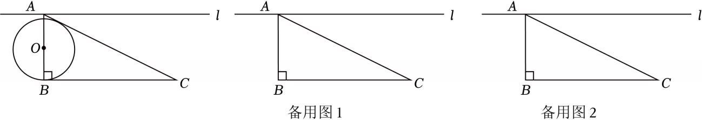

# 25 题精讲 14 · 动圆、切线与等腰分类

## 📝 题目

如图，Rt$\triangle ABC$ 中，$\angle ABC=90°$，$BC=2$，$\tan\angle ACB=\dfrac12$。过点 $A$ 的直线 $l$ 与边 $BC$ 平行，点 $O$ 在射线 $BA$ 上，⊙$O$ 是以 $O$ 为圆心、$OB$ 为半径的圆。

(1) 当直线 $AC$ 与 ⊙$O$ 相切时，求 $OB$ 的长；

(2) 当直线 $l$ 与 ⊙$O$ 相交时，交点记为点 $E$、$F$（点 $E$ 在点 $F$ 的右边）。以 $C$ 为圆心、$CE$ 为半径长作 ⊙$C$，与 ⊙$O$ 的另一个交点记为点 $G$。

① 若四边形 $ABCE$ 是矩形，求 $OB$ 的长；

② 若 $\triangle AEC$ 是以 $AE$ 为腰的等腰三角形，求 $\angle AEG$ 的正切值。

## 🧭 思路导航（渐进提示）

- **提示 1（识别）**：动圆——圆心 $O$ 在射线 $BA$ 上滑动，半径 $OB$ 也随之变。$\tan\angle ACB=\dfrac12$ 先把整个三角形"钉死"（$AB$ 是唯一的"尺子"）；此后每个条件（相切、矩形、等腰）其实都在给"$OE=r$ + Rt△$OAE$ 勾股"这一个方程，区别只是 $AE$ 是多少。
- **提示 2（突破）**：切线的翻译是"圆心到直线距离 = 半径"（作垂线，不是连半径）；矩形与等腰条件都给出 $AE$ 的长，从而 $OA^2+AE^2=r^2$。$\angle AEG$ 不能直接算，要换成 $\angle AOP$（$P=OC\cap l$）：相交两圆 → 连心线 $OC\perp$ 公共弦 $EG$，与 $OA\perp l$ 各凑一个互余角。
- **提示 3（路线）**：先解三角形：$AB=1$、$AC=\sqrt5$、$\sin\angle BAC=\dfrac{2\sqrt5}5$。(1) 作 $OH\perp AC$，$\dfrac r{OA}=\sin\angle BAC$，$O$ 在线段 $AB$ 内时 $OA=1-r$，解得 $r=2\sqrt5-4$（$O$ 越过 $A$ 时无正解）。①矩形 → $AE=BC=2$，$(r-1)^2+2^2=r^2$ → $r=\dfrac52$。②"以 $AE$ 为腰"分两类：$AE=AC=\sqrt5$ → $r=3$，$\tan\angle AEG=\tan\angle AOP=\dfrac{BC}{OB}=\dfrac23$；$AE=CE$ → 等腰三线合一 $AN=\dfrac{\sqrt5}2$，$\cos\angle EAC=\cos\angle ACB=\dfrac{2\sqrt5}5$ → $AE=\dfrac54$ → $r=\dfrac{41}{32}$，$\tan\angle AEG=\dfrac{64}{41}$。

## ✍️ 详解

先解三角形：$\tan\angle ACB=\dfrac{AB}{BC}=\dfrac12$，$BC=2$ → $AB=1$（锐角三角比定义）；$AC=\sqrt{AB^2+BC^2}=\sqrt5$（勾股定理）；$\sin\angle BAC=\dfrac{BC}{AC}=\dfrac{2\sqrt5}{5}$。

**(1)** $AC$ 与 ⊙$O$ 相切 → 圆心 $O$ 到直线 $AC$ 的距离等于半径。作 $OH\perp AC$ 于 $H$，则 $OH=OB=r$。

若 $O$ 在线段 $AB$ 上：$OA=AB-OB=1-r$。Rt△$OAH$ 中 $\angle OAH=\angle BAC$（$O$ 在射线 $AB$ 上）：

$$\sin\angle BAC=\frac{OH}{OA}=\frac{r}{1-r}=\frac{2\sqrt5}{5}$$

$$5r=2\sqrt5-2\sqrt5\,r\ \Rightarrow\ r(5+2\sqrt5)=2\sqrt5\ \Rightarrow\ r=\frac{2\sqrt5}{5+2\sqrt5}=\frac{2\sqrt5(5-2\sqrt5)}{25-20}=2\sqrt5-4$$

检验：$r=2\sqrt5-4\approx0.47\in(0,1)$，$O$ 确在线段 $AB$ 内，与所设一致。

若 $O$ 在 $A$ 外侧：$OA=r-1$，则 $\dfrac r{r-1}=\dfrac{2\sqrt5}5$ → $5r=2\sqrt5\,r-2\sqrt5$ → $r(5-2\sqrt5)=-2\sqrt5$ → $r<0$，舍去（无正解）。

$$\boxed{OB=2\sqrt5-4}$$

**(2)①** 四边形 $ABCE$ 是矩形 → $AE=BC=2$（对边相等），$\angle OAE=90°$（$OA$ 在直线 $AB$ 上，$AB\perp l$）。

$E$ 在 ⊙$O$ 上 → $OE=r$。设 $OB=OE=r$：若 $O$ 在线段 $AB$ 内则 $OA=1-r$，代入下方程得 $r=\dfrac52>1$，与 $O$ 在线段内矛盾 → $O$ 在 $A$ 外侧，$OA=r-1$。

Rt△$OAE$ 中（勾股定理）：

$$(r-1)^2+AE^2=r^2\ \Rightarrow\ (r-1)^2+4=r^2\ \Rightarrow\ r^2-2r+5=r^2\ \Rightarrow\ r=\frac52$$

检验：$OA=r-1=\dfrac32>0$ ✓，且 $OE=\sqrt{\left(\dfrac32\right)^2+2^2}=\dfrac52=OB$ ✓。

$$\boxed{OB=\frac52}$$

**(2)②** 设 $OC$ 与 $l$ 交于点 $P$。

⊙$O$ 与 ⊙$C$ 相交于 $E,G$ → 连心线 $OC\perp$ 公共弦 $EG$（相交两圆的连心线垂直于公共弦）。

角转移：$\angle AOP+\angle APO=90°$（Rt△$OAP$ 中两锐角互余，$\angle OAP=90°$）；$\angle APO=\angle EPC$（对顶角相等：$A,P,E$ 共线且 $P$ 在中间、$O,P,C$ 共线且 $P$ 在中间）；$EG\perp OC$ 且 $EA\subset l$ → $\angle AEG+\angle EPC=90°$（$\angle AEG$ 与"$OC$ 与 $l$ 的夹角"互余）。三式串联：

$$\angle AEG=\angle AOP$$

△$OAP\backsim$△$OBC$（$\angle AOP=\angle BOC$：射线 $OA$ 与 $OB$ 同向、$OP$ 与 $OC$ 同向；$\angle OAP=\angle OBC=90°$）→ $\dfrac{AP}{BC}=\dfrac{OA}{OB}$。故在 Rt△$OAP$ 中：

$$\tan\angle AEG=\tan\angle AOP=\frac{AP}{OA}=\frac{BC}{OB}=\frac{2}{r}$$

**分类（"以 $AE$ 为腰"）：**

**情形一 $AE=AC=\sqrt5$**：Rt△$OAE$ 中 $(r-1)^2+5=r^2$ → $r^2-2r+6=r^2$ → $r=3$（$OA=2>0$ ✓，$OE=\sqrt{4+5}=3$ ✓）。

$$\tan\angle AEG=\frac{2}{3}$$

**情形二 $AE=CE$**：作 $EN\perp AC$ 于 $N$ → $AN=\dfrac12AC=\dfrac{\sqrt5}{2}$（等腰三角形三线合一）。

$l\parallel BC$ → $\angle EAC=\angle ACB$（两直线平行，内错角相等）→ $\cos\angle EAC=\cos\angle ACB=\dfrac{2\sqrt5}{5}$（$\tan\angle ACB=\dfrac12$：对 1 邻 2 斜 $\sqrt5$）。

Rt△$ANE$ 中：$\cos\angle EAC=\dfrac{AN}{AE}$ → $AE=\dfrac{AN}{\cos\angle EAC}=\dfrac{\sqrt5/2}{2\sqrt5/5}=\dfrac54$。

Rt△$OAE$ 中：$(r-1)^2+\left(\dfrac54\right)^2=r^2$ → $r^2-2r+1+\dfrac{25}{16}=r^2$ → $2r=\dfrac{41}{16}$ → $r=\dfrac{41}{32}$。

检验：$OA=\dfrac{9}{32}>0$ ✓，$OE=\sqrt{\left(\dfrac{9}{32}\right)^2+\left(\dfrac54\right)^2}=\sqrt{\dfrac{1681}{1024}}=\dfrac{41}{32}=r$ ✓；此时 $CE=AE=\dfrac54$ ✓。

$$\tan\angle AEG=\frac{2}{r}=\frac{2}{41/32}=\frac{64}{41}$$

$$\boxed{\tan\angle AEG=\frac23\ \text{或}\ \frac{64}{41}}$$

## ⚠️ 评分点与易错

- **动圆先立"尺子"**：$AB=1$ 是全程参照，$OA$ 与 $r$ 的关系（$1-r$ 还是 $r-1$）必须按 $O$ 的位置讨论并**回代检验**（如 (2)① 中 $O$ 在线段内会推出 $r=\dfrac52>1$ 的矛盾）。
- **(1) 切线的正确翻译是 $d=r$**：直线与圆相切没有已知切点，作 $OH\perp AC$ 用 $\sin\angle BAC$ 列式，不要写"连接切点"。
- **(2)② "以 $AE$ 为腰"必须两分类**（$AE=AC$、$AE=CE$），漏一类丢一半；$AE=CE$ 中"三线合一取中点 + 余弦求 $AE$"是隐藏台阶。
- **$\angle AEG=\angle AOP$ 的角链要写全**：连心线⊥公共弦、对顶角、直角三角形两锐角互余，三个依据一个不能少；$\tan\angle AOP=\dfrac{BC}{OB}$ 靠 △$OAP\backsim$△$OBC$，不能直接"观察"出来。
- 数值自校：源文"$r=4132$"解码为 $\dfrac{41}{32}$，复核 $(9/32)^2+(5/4)^2=(41/32)^2$ ✓；$2\sqrt5-4\approx0.472$，代入 $\dfrac r{1-r}\approx0.894=\dfrac{2\sqrt5}5$ ✓。

## 🔗 关联

- [[03-数学/专题/第25题-压轴-相似与圆]] · [[03-数学/知识点/九年级/圆与正多边形]]（切线判定、相交两圆连心线）· [[03-数学/知识点/九年级/锐角的三角比与解直角三角形]]（正弦、余弦、正切接力）
- 同类题：[[25-12-正方形双圆与相似]]（双圆 + 三角比方程）、[[25-04-等腰三角形外接圆]]（等腰条件讨论）、[[25-08-等腰三角形与圆]]（圆中设参求线段）
