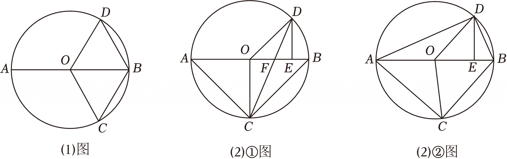

# 25 题精讲 15 · 直径、平行弦与面积方程

## 📝 题目

已知：$AB$ 为 ⊙$O$ 的直径，$AB=5$，点 $C$ 在 ⊙$O$ 上。联结 $OC$、$BC$，过点 $O$ 作 $OD\parallel BC$，交 ⊙$O$ 于点 $D$（$D$ 与 $C$ 在 $AB$ 异侧，如图）。

(1) 联结 $DB$。当 $\angle ABC=60°$ 时，求证：四边形 $OCBD$ 是菱形；

(2) 作 $DE\perp OB$，垂足为 $E$。

① 联结 $AC$、$DC$，$DC$ 交半径 $OB$ 于点 $F$。当 $\angle OCD=\dfrac12\angle CAB$ 时，求线段 $EF$ 的长；

② 联结 $AC$、$AD$、$DB$，设 △$ODE$ 的面积为 $S_1$，四边形 $ACBD$ 的面积为 $S_2$。如果 $S_2=7S_1$，求线段 $AC$ 的长。

## 🧭 思路导航（渐进提示）

- **提示 1（识别）**：直径 + 平行弦 + 面积比。两个自动到手的东西：直径 → $\angle ACB=90°$；$OD\parallel BC$ → $\angle DOE=\angle ABC$——它们拼出一对相似 △$ODE\backsim$△$BCA$，且相似比恒为 $\dfrac{OD}{AB}=\dfrac12$，这是 (2)② 面积翻译的总开关。
- **提示 2（突破）**：(1) 两个等腰各配一个 $60°$ → 双等边 → 四边相等。(2)① 角平分线的双向翻译：$\angle OCD=\dfrac12\angle CAB$ 与 $OC=OD$ 合流推出 $DC$ 平分 $\angle ODE$ → $\angle CDE=\angle OCD$ → $DE\parallel OC$ → $OC\perp AB$，一串等腰直角三角形 + 角平分线定理收尾。②$S_2=7S_1$ 拆成 $S_{\triangle ACB}+S_{\triangle ADB}$；$OA=OB$ 把 $\triangle ADB$ 对半拆，"同高三角形面积比 = 底之比"给出 $OE:OB$；剩下用两次射影定理（$DE^2=AE\cdot BE$、$CF^2=AF\cdot BF$），多余的根靠 $AC:BC=DE:OE$ 舍去。
- **提示 3（路线）**：(1) 内错角 $\angle DOB=\angle OBC=60°$ → △$ODB$ 等边；△$OBC$ 等边 → $OC=CB=BD=DO$。(2)① △$ODE\backsim$△$BCA$ → $\angle ODE=\angle CAB$；$\angle OCD=\angle ODC=\dfrac12\angle ODE$ → $\angle CDE=\angle OCD$ → $DE\parallel OC$ → $OC\perp OB$ → $OA=OB=OC=OD=\dfrac52$、$AC=BC=\dfrac{5\sqrt2}2$、$OE=DE=\dfrac{5\sqrt2}4$；$CF$ 平分 $\angle OCB$ → $\dfrac{OF}{FB}=\dfrac{OC}{CB}$ → $OF=\dfrac{5\sqrt2-5}2$ → $EF=OE-OF=\dfrac{10-5\sqrt2}4$。②$S_{\triangle ACB}=4S_1$、$S_{\triangle ADB}=3S_1$ → $S_{\triangle ODB}=\dfrac32S_1$ → $\dfrac{OB}{OE}=\dfrac32$ → $OE=\dfrac53$、$BE=\dfrac56$ → $DE^2=AE\cdot BE$ → $DE=\dfrac{5\sqrt5}6$ → $S_1=\dfrac{25\sqrt5}{36}$ → $S_{\triangle ACB}=\dfrac{25\sqrt5}9$ → $CF=\dfrac{10\sqrt5}9$ → $CF^2=AF\cdot BF$ → $AF=\dfrac{25}9$ 或 $\dfrac{20}9$ → $AC=\dfrac{5\sqrt5}3$ 或 $\dfrac{10}3$；由 $\dfrac{DE}{OE}=\dfrac{AC}{BC}=\dfrac{\sqrt5}2$ 舍去 $\dfrac{10}3$。

## ✍️ 详解

**(1)** $OD\parallel BC$，截线 $OB$ → $\angle DOB=\angle OBC=60°$（两直线平行，内错角相等；$\angle OBC$ 即 $\angle ABC$）。

$OD=OB$（同圆半径）→ △$ODB$ 是等边三角形（有一个角是 $60°$ 的等腰三角形是等边三角形）→ $BD=OD=OB$。

$OC=OB$（半径）且 $\angle OBC=60°$ → △$OBC$ 是等边三角形 → $OC=BC=OB$。

∴ $OC=CB=BD=DO$ → 四边形 $OCBD$ 是菱形（四条边都相等的四边形是菱形）$\blacksquare$

**(2)①** $OD\parallel BC$ → $\angle DOE=\angle ABC$（同 (1) 的内错角关系）；$DE\perp OB$ → $\angle DEO=90°$；$AB$ 是直径 → $\angle ACB=90°$（直径所对的圆周角是直角）。

∴ △$ODE\backsim$△$BCA$（两角分别相等）→ $\angle ODE=\angle BAC$（对应角相等）。

$\angle OCD=\dfrac12\angle CAB=\dfrac12\angle ODE$（已知）；$OC=OD$（半径）→ $\angle OCD=\angle ODC$（等边对等角）→ $\angle ODC=\dfrac12\angle ODE$。

$DC$ 在 $\angle ODE$ 内部（如图）→ $\angle ODE=\angle ODC+\angle CDE$ → $\angle CDE=\angle ODC=\angle OCD$ → $DE\parallel OC$（内错角相等，两直线平行，截线 $DC$）。

$DE\perp OB$ → $OC\perp OB$（一条直线垂直于两平行线之一，必垂直于另一条）→ $\angle BOC=90°$。

∴ $OA=OB=OC=OD=\dfrac52$，△$OAC$、△$OBC$ 均为等腰直角三角形 → $AC=BC=\sqrt2\cdot\dfrac52=\dfrac{5\sqrt2}{2}$（勾股定理）。

$\angle ODE=\angle BAC=45°$ → Rt△$ODE$（$\angle DEO=90°$）为等腰直角三角形 → $OE=DE=\dfrac{OD}{\sqrt2}=\dfrac{5\sqrt2}{4}$（勾股定理）。

$OD\parallel BC$ → $\angle BCD=\angle ODC$（两直线平行，内错角相等）→ $\angle BCD=\angle OCD$（均等于 $\angle ODC$）→ $CF$ 平分 $\triangle OCB$ 的内角 $\angle OCB$（$F$ 在 $OB$ 上）。

角平分线定理：$\dfrac{OF}{FB}=\dfrac{OC}{CB}=\dfrac{5/2}{5\sqrt2/2}=\dfrac1{\sqrt2}$。设 $OF=t$：

$$\frac{t}{5/2-t}=\frac1{\sqrt2}\ \Rightarrow\ \sqrt2\,t=\frac52-t\ \Rightarrow\ t(\sqrt2+1)=\frac52\ \Rightarrow\ OF=\frac{5(\sqrt2-1)}{2}=\frac{5\sqrt2-5}{2}$$

（分母有理化；$F$ 在线段 $OB$ 上：$OF\approx1.04<2.5$ ✓，且 $O,F,E,B$ 依次排列，$EF=OE-OF$。）

$$\boxed{EF=OE-OF=\frac{5\sqrt2}{4}-\frac{5\sqrt2-5}{2}=\frac{10-5\sqrt2}{4}}$$

**(2)②** 由 ①，△$ODE\backsim$△$BCA$（该相似只依赖 $OD\parallel BC$ 与直径条件，恒成立），相似比 $\dfrac{OD}{AB}=\dfrac{5/2}{5}=\dfrac12$ → 面积比等于相似比的平方：

$$\frac{S_1}{S_{\triangle ACB}}=\frac14\ \Rightarrow\ S_{\triangle ACB}=4S_1$$

$C,D$ 在 $AB$ 异侧 → $S_2=S_{\text{四边形}ACBD}=S_{\triangle ACB}+S_{\triangle ADB}$。由 $S_2=7S_1$：

$$S_{\triangle ADB}=7S_1-4S_1=3S_1$$

$OA=OB$，△$ODA$ 与 △$ODB$ 等底同高 → $S_{\triangle ODB}=S_{\triangle ODA}=\dfrac12S_{\triangle ADB}=\dfrac32S_1$（同高三角形面积比等于底之比）。

$DE\perp OB$ → $S_1=\dfrac12OE\cdot DE$，$S_{\triangle ODB}=\dfrac12OB\cdot DE$ → $\dfrac{S_{\triangle ODB}}{S_1}=\dfrac{OB}{OE}=\dfrac32$：

$$OE=\frac23\cdot\frac52=\frac53,\qquad BE=OB-OE=\frac52-\frac53=\frac56$$

$\angle ADB=90°$（直径所对圆周角）且 $DE\perp AB$ → △$AED\backsim$△$DEB$（直角三角形斜边上的高分出的两个三角形与原三角形相似）→ $\dfrac{DE}{EB}=\dfrac{AE}{DE}$ → $DE^2=AE\cdot BE$（射影定理）。

$AE=AB-BE=5-\dfrac56=\dfrac{25}{6}$ → $DE^2=\dfrac{25}{6}\cdot\dfrac56=\dfrac{125}{36}$ → $DE=\dfrac{5\sqrt5}{6}$（取正）。

$$S_1=\frac12\cdot OE\cdot DE=\frac12\cdot\frac53\cdot\frac{5\sqrt5}{6}=\frac{25\sqrt5}{36}\ \Rightarrow\ S_{\triangle ACB}=4S_1=\frac{25\sqrt5}{9}$$

作 $CF\perp AB$ 于 $F$ → $S_{\triangle ACB}=\dfrac12AB\cdot CF$ → $CF=\dfrac{2\cdot 25\sqrt5/9}{5}=\dfrac{10\sqrt5}{9}$。

$\angle ACB=90°$、$CF\perp AB$ → △$ACF\backsim$△$CBF$ → $\dfrac{AF}{CF}=\dfrac{CF}{BF}$ → $CF^2=AF\cdot BF$（射影定理）。设 $AF=t$：

$$\left(\frac{10\sqrt5}{9}\right)^2=t(5-t)\ \Rightarrow\ t^2-5t+\frac{500}{81}=0\ \Rightarrow\ t=\frac{5\pm\sqrt{25-\frac{2000}{81}}}{2}=\frac{5\pm\frac59}{2}$$

$$AF=\frac{25}{9}\ \text{或}\ \frac{20}{9}\quad(\text{均}>0\ \text{且}<5)$$

$AC^2=AF\cdot AB$（△$ACF\backsim$△$ABC$ 的射影定理）：$AF=\dfrac{25}9$ 时 $AC=\sqrt{\dfrac{125}{9}}=\dfrac{5\sqrt5}{3}$；$AF=\dfrac{20}9$ 时 $AC=\dfrac{10}3$。

**舍根**：由 △$ODE\backsim$△$BCA$ 还有 $\dfrac{DE}{OE}=\dfrac{AC}{BC}$（对应边成比例），而 $\dfrac{DE}{OE}=\dfrac{5\sqrt5/6}{5/3}=\dfrac{\sqrt5}{2}$，即须 $AC:BC=\sqrt5:2$。若 $AC=\dfrac{10}3$，则 $BC=\sqrt{25-\dfrac{100}{9}}=\dfrac{5\sqrt5}3$，$AC:BC=2:\sqrt5\ne\sqrt5:2$，矛盾，舍去（此时 $C$ 的位置不满足 $S_2=7S_1$ 的图形条件）；若 $AC=\dfrac{5\sqrt5}3$，则 $BC=\dfrac{10}3$，$AC:BC=\dfrac{\sqrt5}2$ ✓，且 $AF=\dfrac{AC^2}{AB}=\dfrac{25}9$ 与前一致。

$$\boxed{AC=\frac{5\sqrt5}{3}}$$

## ⚠️ 评分点与易错

- **(2)① 的角链环环相扣**：$\angle OCD=\tfrac12\angle CAB$、$\angle OCD=\angle ODC$（等腰）、$DC$ 在 $\angle ODE$ 内部——三件事合流才能得到 $DE\parallel OC$；跳步直接写平行会丢依据分。
- **两个"高频定理"要点名**：角平分线定理（$\dfrac{OF}{FB}=\dfrac{OC}{CB}$）与射影定理（$DE^2=AE\cdot BE$、$CF^2=AF\cdot BF$），引用时写清出自哪对相似。
- **② 的面积链是主线**：$S_{\triangle ACB}=4S_1$（相似平方比）→ $S_{\triangle ADB}=3S_1$（$S_2$ 拆和，依赖 $C,D$ 异侧）→ $S_{\triangle ODB}=\tfrac32S_1$（$OA=OB$ 拆半）→ $\dfrac{OB}{OE}=\dfrac32$（同高面积比 = 底之比）。
- **② 必须舍根并给理由**：$AF$ 两根本身都落在 $AB$ 内，要用 $AC:BC=DE:OE=\sqrt5:2$ 检验后舍去 $AC=\dfrac{10}3$；只写"不合题意"不给满。
- **读图注意**：$OD\parallel BC$ 与 ⊙$O$ 有两个交点，取与 $C$ 在 $AB$ 异侧的一个（如图），否则 (1) 中 $\angle DOB=120°$、四边形 $OCBD$ 不是菱形。数值自校：$EF=\dfrac{10-5\sqrt2}4\approx0.732=OE-OF$ ✓；$DE=\dfrac{5\sqrt5}6$，$S_1=\dfrac{25\sqrt5}{36}$，$S_{\triangle ADB}=\dfrac12\cdot5\cdot\dfrac{5\sqrt5}6=\dfrac{25\sqrt5}{12}=3S_1$ ✓。

## 🔗 关联

- [[03-数学/专题/第25题-压轴-相似与圆]] · [[03-数学/知识点/九年级/相似三角形]]（母子型相似、射影定理）· [[03-数学/知识点/九年级/圆与正多边形]]（直径圆周角、菱形判定）
- 同类题：[[25-02-梯形外接圆与比例中项]]（圆 + 比例中项）、[[25-06-圆中比例中项]]（面积比与方程）、[[25-09-直角梯形相似综合]]（分类与舍根）
