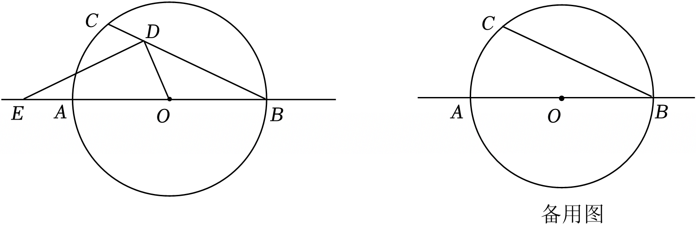

# 25 题精讲 16 · 垂线弦、相似与两圆位置

## 📝 题目

如图，在 $\odot O$ 中，直径 $AB$ 长为 $4\sqrt5$，弦 $BC$ 的长为 $8$，点 $D$ 是弦 $BC$ 上一点，过点 $D$ 作 $OD$ 的垂线交直线 $AB$ 于点 $E$。

(1) 求 $\angle CBO$ 的正切值；

(2) 当 $\triangle BOD$ 与 $\triangle BDE$ 相似时，求 $BD$ 的长；

(3) 以点 $E$ 为圆心，$ED$ 长为半径画 $\odot E$，试根据线段 $BD$ 的长度情况探究 $\odot E$ 和 $\odot O$ 的位置关系。

## 🧭 思路导航（渐进提示）

- **提示 1（识别）**：直径 + 弦长先用勾股把三角形"解出来"；$DE\perp OD$ 是构造相似直角三角形的固定动作。$E$ 落在直线 $AB$ 的不同位置是全题的分类轴。
- **提示 2（突破）**：作 $OF\perp BC$、$EG\perp BC$，把斜的事实（$DE\perp OD$）拆进两个直角三角形里；$\triangle BOD\backsim\triangle BDE$ 先翻译成 $\angle BDO=\angle BED$。第 (3) 问的关键翻译：$\odot E$ 过 $D$，圆心距 $=OE$，半径 $=ED$，而 $\text{Rt}\triangle OED$ 给出 $OE>ED$——两圆不可能"大包小"，只剩内含/内切/相交三种。
- **提示 3（路线）**：(1) 连 $AC$，直径对直角，$\tan\angle CBO=\dfrac{AC}{BC}$。(2) 由相似得 $\angle BDO=\angle BED$，按 $E$ 在 $BA$ 延长线上、$E$ 在线段 $OB$ 上两类，各证 $\triangle DFO\backsim\triangle EDO$ 与 $\triangle DOF\backsim\triangle EDG$，推出 $DF=DG=x$，用 $\dfrac{DF}{EG}=\dfrac{OF}{DG}$ 列二次方程，分别解得 $BD=5+\sqrt5$、$5-\sqrt5$（$E$ 在 $B$ 外侧时 $\angle DBE=180°-\angle ABC$ 大于 $\triangle BOD$ 任一内角，相似不可能）。(3) 先证 $|OE-ED|<OD<OB$ 恒成立；切界点有二：$ED=EB$（内切，解得 $BD=3$）与 $OD\perp AB$（$E$ 不存在，算得 $BD=5$），再按 $BD$ 分段下结论。

## ✍️ 详解

**(1)** 连结 $AC$。$AB$ 是直径 ⟹ $\angle ACB=90°$（直径所对的圆周角）。

$$AC=\sqrt{AB^2-BC^2}=\sqrt{(4\sqrt5)^2-8^2}=\sqrt{80-64}=4\quad(\text{勾股定理})$$

$O$ 在 $AB$ 上，$\angle CBO=\angle CBA$，在 $\text{Rt}\triangle ABC$ 中：

$$\boxed{\tan\angle CBO=\frac{AC}{BC}=\frac12}$$

**(2)** 记 $\angle ABC=\beta$（定角，$\tan\beta=\frac12$）。作 $OF\perp BC$ 于 $F$、$EG\perp BC$ 于 $G$。

垂径定理 ⟹ $BF=\frac12BC=4$；$\text{Rt}\triangle OBF$ 中 $OB=\frac12AB=2\sqrt5$，$OF=\sqrt{OB^2-BF^2}=2$，$\tan\angle OBF=\frac{OF}{BF}=\frac12=\tan\beta$。

由 $\triangle BOD\backsim\triangle BDE$（字母顺序即对应关系）：$\angle BDO=\angle BED$ ……（ⅰ）

**情形一：$E$ 在 $BA$ 的延长线上**（此时 $D$ 在 $F$、$C$ 之间，$BD>BF=4$）。

射线 $BE$ 与射线 $EO$ 同向 ⟹ $\angle BED=\angle DEO$；$F$ 在射线 $DB$ 上 ⟹ $\angle FDO=\angle BDO$。由（ⅰ）：

$$\angle FDO=\angle DEO$$

又 $\angle DFO=\angle EDO=90°$ ⟹ $\triangle DFO\backsim\triangle EDO$（两角对应相等）⟹ $\dfrac{DF}{DE}=\dfrac{FO}{DO}$ ……（ⅱ）

平角 $\angle FDG$ 中夹着 $\angle FDO+\angle EDO+\angle EDG=180°$，故 $\angle EDG=90°-\angle FDO$；而 $\text{Rt}\triangle DFO$ 中 $\angle DOF=90°-\angle FDO$ ⟹ $\angle EDG=\angle DOF$。结合 $\angle DGE=\angle DFO=90°$：

$$\triangle DOF\backsim\triangle EDG\ (\text{AA})\ \Rightarrow\ \frac{DG}{DE}=\frac{FO}{DO}\ ……（ⅲ）$$

（ⅱ）（ⅲ）右端相同 ⟹ $DG=DF$。设 $DF=DG=x$，则 $BG=BF+FG=4+2x$。

$\angle EBG=\angle OBF=\beta$（公共角），$\angle EGB=\angle OFB=90°$ ⟹ $\triangle BEG\backsim\triangle BFO$ ⟹ $\dfrac{EG}{BG}=\dfrac{OF}{BF}=\dfrac12$ ⟹ $EG=2+x$。

由 $\triangle DOF\backsim\triangle EDG$ 的对应边 $\dfrac{DF}{EG}=\dfrac{FO}{DG}$：

$$\frac{x}{2+x}=\frac2x\ \Rightarrow\ x^2-2x-4=0\ \Rightarrow\ x=1\pm\sqrt5$$

$x=1-\sqrt5<0$ 舍（线段长为正）；$x=1+\sqrt5$ 时 $BD=BF+DF=5+\sqrt5\approx7.24\le BC=8$，合法。

**情形二：$E$ 在线段 $OB$ 上**（此时 $D$ 在 $B$、$F$ 之间，$BD<4$）。

射线 $EB$ 与射线 $EO$ 反向、射线 $DF$ 与射线 $DB$ 反向：$\angle BED=180°-\angle DEO$，$\angle FDO=180°-\angle BDO$。由（ⅰ）仍得 $\angle FDO=\angle DEO$，于是同情形一：$\triangle DFO\backsim\triangle EDO$、$\triangle DOF\backsim\triangle EDG$，仍有 $DG=DF=x$。

此时顺序为 $B$、$G$、$D$、$F$：$BG=BD-DG=(4-x)-x=4-2x$，$EG=2-x$。代入 $\dfrac{DF}{EG}=\dfrac{FO}{DG}$：

$$\frac{x}{2-x}=\frac2x\ \Rightarrow\ x^2+2x-4=0\ \Rightarrow\ x=-1\pm\sqrt5$$

取正根 $x=\sqrt5-1$，$BD=BF-DF=4-(\sqrt5-1)=5-\sqrt5\approx2.76\in(0,4)$，合法。

**情形三（补全）**：$E$ 在 $AB$ 延长线（$B$ 外侧）时，$\angle DBE=180°-\beta$；而 $\triangle BOD$ 中 $\angle BDO=180°-\beta-\angle BOD<180°-\beta$，$\angle BOD<180°-\beta$，即 $\angle DBE$ 大于 $\triangle BOD$ 的任一内角，两三角形不可能相似。

$$\boxed{BD=5+\sqrt5\ \text{或}\ 5-\sqrt5}$$

**(3)** 圆心距 $d=OE$，$\odot E$ 半径 $r=ED$，$\odot O$ 半径 $R=OB=2\sqrt5$。

$\angle EDO=90°$ ⟹ $OE$ 是 $\text{Rt}\triangle OED$ 的斜边 ⟹ $OE>ED$，且

$$d-r=OE-ED=\frac{OE^2-ED^2}{OE+ED}=\frac{OD^2}{OE+ED}<OD<OB=R$$

（$OE+ED>OD$ 三角形不等式；$D$ 在圆内 ⟹ $OD<R$。）所以 $|d-r|<R$ **恒成立**：$\odot O$ 不可能被 $\odot E$ 包含，关系只剩"内含 / 内切 / 相交"三种，由 $d+r$ 与 $R$ 的大小决定。

**切界点一（内切）**：$E$ 在线段 $OB$ 上时（$0<BD<4$），$OB=OE+EB$，故

$$d+r<R\iff OE+ED<OB\iff ED<EB$$

大边对大角（$\triangle BDE$ 中 $ED$ 对 $\angle EBD=\beta$，$EB$ 对 $\angle BDE$）：$ED<EB\iff\beta<\angle BDE$。

由 $\angle BDE+\angle EDO+\angle FDO=180°$（$B$、$F$ 在 $D$ 两侧）得 $\angle BDE=90°-\angle FDO$，于是

$$\beta<\angle BDE\iff\angle FDO<90°-\beta\iff\angle DOF>\beta\ (\text{Rt}\triangle DFO \text{ 余角})\iff\frac{DF}{OF}>\tan\beta$$

即 $\dfrac{4-BD}{2}>\dfrac12\iff BD<3$。$BD=3$ 时 $ED=EB$，点 $B$ 在 $\odot E$ 上，而 $O$、$E$、$B$ 共线 ⟹ 两圆**内切**于点 $B$。

**切界点二（$E$ 不存在）**：当 $OD\perp AB$ 时 $DE\parallel AB$，点 $E$ 不存在。此时 $\text{Rt}\triangle BOD$ 中 $\angle BOD=90°$：

$$OD=OB\tan\beta=2\sqrt5\cdot\frac12=\sqrt5,\qquad BD=\sqrt{OB^2+OD^2}=\sqrt{20+5}=5$$

**结论**（结合 $E$ 的位置随 $D$ 从 $B$ 向 $C$ 移动：先落在线段 $OB$ 上，$BD=4$ 时 $E$ 与 $B$ 重合，$4<BD<5$ 时在 $B$ 外侧，$BD=5$ 时消失，$BD>5$ 后在 $A$ 外侧；后两种情形 $d=OE>R$，配合 $|d-r|<R$ 恒成立即相交）：

- 当 $0<BD<3$ 时，$ED<EB$，$OE+ED<OB$，$\odot E$ 与 $\odot O$ **内含**；
- 当 $BD=3$ 时，$\odot E$ 与 $\odot O$ **内切**（切点 $B$）；
- 当 $3<BD\le8$ 且 $BD\ne5$ 时，$d+r>R$ 且 $|d-r|<R$，$\odot E$ 与 $\odot O$ **相交**；
- 当 $BD=5$ 时，$DE\parallel AB$，点 $E$ 不存在，$\odot E$ **不能作出**。

## ⚠️ 评分点与易错

- (2) 的相似对应由书写顺序锁定：$\angle BDO=\angle BED$ 是全小问的引理；两类中"$E$ 与 $O$、$B$ 的同侧/异侧"决定 $\angle BED$ 是否取补角，含糊过去直接丢分。
- $DG=DF$ 由两个相似三角形的同一比例式"夹"出来，写解答时两条相似都要出现；$EG=\frac12BG$ 依赖 $\triangle BEG\backsim\triangle BFO$（或 $\tan\beta=\frac12$）。
- (2) 两个二次方程各有正负根：$x=1-\sqrt5$、$x=-1-\sqrt5$ 为负必须舍，并回代检验 $BD\le BC=8$、$BD$ 落在该情形的范围内。
- (3) "$|d-r|<R$ 恒成立"是不出现"外离/大包小"的理由，要给出 $\dfrac{OD^2}{OE+ED}<OD$ 的推导；$BD=5$ 时"$\odot E$ 不存在"是结论的一部分，漏写不完整。
- 题源讹误：源文"直径 $AB$ 长为 45"应为 $4\sqrt5$；"$BD=5\pm5$"应为 $5\pm\sqrt5$；"$OD=\frac12OB=5$"中末值应为 $\sqrt5$；"25""5"按语境为 $2\sqrt5$、$\sqrt5$。已按 $AC=4$、$\tan\angle CBO=\frac12$、$BD=\sqrt{20+5}=5$ 全部复算一致。

## 🔗 关联

- [[03-数学/专题/第25题-压轴-相似与圆]] · [[03-数学/知识点/九年级/圆与正多边形]]（垂径定理、圆与圆位置关系）· [[03-数学/知识点/九年级/相似三角形]]
- 同类题：[[25-03-菱形重心与相交两圆]]（相交两圆的圆心距不等式）· [[25-14-动圆与切线]]（动圆位置分类）
