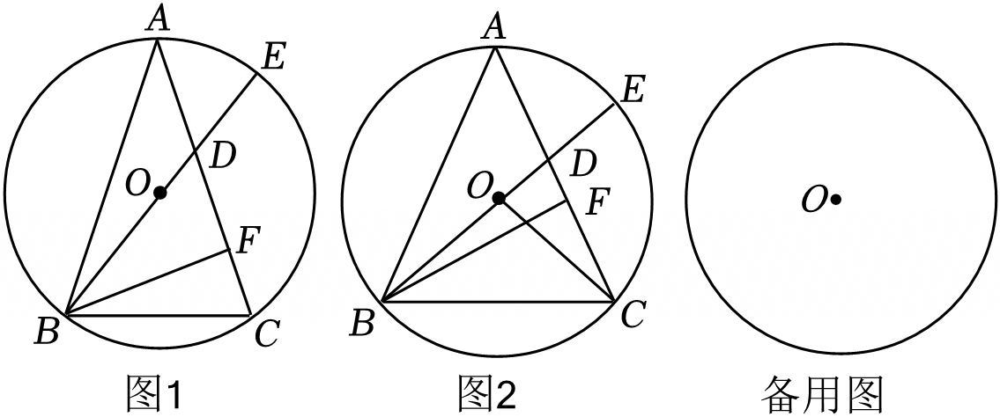

# 25 题精讲 17 · 等腰内接圆、面积函数与黄金分割

## 📝 题目

$\triangle ABC$ 为 $\odot O$ 的内接等腰三角形，$AB=AC$。联结 $BO$ 并延长，交 $AC$ 于点 $D$，交 $\odot O$ 于点 $E$；过点 $B$ 作 $BF\perp AC$，垂足为 $F$（点 $F$ 不与点 $A$ 重合）。

(1) 如图 1，如果 $\angle CBF=20°$，求 $\angle DBF$ 的大小；

(2) 如图 2，联结 $OC$，如果 $\sin\angle ACB=x$，$y=\dfrac{S_{\triangle ABF}}{S_{\triangle OBC}}$，求 $y$ 关于 $x$ 的函数解析式（不用写自变量的取值范围）；

(3) 如果点 $D$ 是线段 $OE$ 的黄金分割点，求 $\cos\angle BAC$ 的值。

## 🧭 思路导航（渐进提示）

- **提示 1（识别）**：等腰 + 外接圆，$BO$ 延长线既是"对称轴方向"又是直径的一半——$BE$ 是直径是全题暗线。$\angle CBF$ 是把底角"量出来"的尺子。
- **提示 2（突破）**：(2) 求面积比不硬算：作 $AO$ 延长线交 $BC$ 于 $G$，则 $AG$、$BF$ 同垂直，构造 $\triangle ABF$ 与 $\triangle OBG$ 相似，把面积比压成 $(BF:BG)^2$。(3) 的钥匙是发现 $\triangle CDE\backsim\triangle ADO$，把 $CE$ 与半径挂上钩，再用 $BE$ 是直径把 $\cos\angle BAC$ 化为 $CE:BE$。
- **提示 3（路线）**：(1) $\text{Rt}\triangle BFC$ 定底角 $70°$ ⟹ 顶角 $40°$ ⟹ $\triangle AOB\cong\triangle AOC$ 平分顶角 ⟹ $\angle ABO=20°$，从 $\angle ABF=50°$ 里减出来。(2) $BF=BC\cdot x$（$\text{Rt}\triangle BFC$），$BG=\frac12BC$，$\angle BAF=\angle BOG=\angle BAC$ ⟹ 相似 ⟹ 面积比 $(2x)^2$，再除以 $S_{\triangle OBC}=2S_{\triangle OBG}$。(3) 黄金分割点分"$D$ 靠近 $O$"与"$D$ 靠近 $E$"两类写 $OD:DE$；由对顶角和 $\frac12\angle BAC$ 证 $\triangle CDE\backsim\triangle ADO$ 得 $CE:AO=DE:DO$；$\cos\angle BAC=\cos\angle BEC=\dfrac{CE}{BE}=\dfrac{CE}{2AO}$，两类各得一个值。

## ✍️ 详解

**(1)** $\text{Rt}\triangle BFC$ 中 $\angle BFC=90°$，$\angle CBF=20°$ ⟹ $\angle C=70°$（直角三角形两锐角互余）。

$AB=AC$ ⟹ $\angle ABC=\angle C=70°$（等边对等角）⟹ $\angle BAC=40°$（内角和）。

联结 $OA$：$AB=AC$、$OA=OA$、$OB=OC$ ⟹ $\triangle AOB\cong\triangle AOC$（SSS）⟹ $\angle BAO=\angle CAO=\dfrac12\angle BAC=20°$；

$OA=OB$ ⟹ $\angle ABO=\angle BAO=20°$（等边对等角）。

$$\angle DBF=\angle ABF-\angle ABO=(70°-20°)-20°=\boxed{30°}$$

**(2)** 联结 $AO$ 并延长交 $BC$ 于 $G$。$AB=AC$ ⟹ $AG\perp BC$ 且 $BG=GC=\dfrac12BC$（等腰三角形三线合一）。

$\text{Rt}\triangle BFC$ 中（$\angle BFC=90°$）：$\sin\angle BCF=\dfrac{BF}{BC}$，而 $\angle BCF=\angle ACB$ ⟹ $BF=x\cdot BC$。

$\angle BOG=\dfrac12\angle BOC=\angle BAC$（$OG$ 平分顶角 $\angle BOC$ ——三线合一；圆心角等于同弧 $BC$ 上圆周角的 2 倍），

$\angle BAF=\angle BAC=2\angle BAO=\angle BOG$；又 $\angle AFB=\angle OGB=90°$：

$$\triangle ABF\backsim\triangle OBG\ (\text{AA})\ \Rightarrow\ \frac{S_{\triangle ABF}}{S_{\triangle OBG}}=\left(\frac{BF}{BG}\right)^2=\left(\frac{x\cdot BC}{\tfrac12BC}\right)^2=4x^2$$

$S_{\triangle OBC}=2S_{\triangle OBG}$（$BG=GC$，同高三角形面积比为底之比）：

$$\boxed{y=\frac{S_{\triangle ABF}}{S_{\triangle OBC}}=\frac{4x^2}{2}=2x^2}$$

（若 $F$ 落在 $CA$ 的延长线上，用 $AF=FC-AC$ 同法可得同一解析式，故题目不要求写范围。）

**(3)** 联结 $EC$。$B$、$O$、$E$ 共线且 $B$、$E$ 在圆上 ⟹ $BE$ 是 $\odot O$ 的直径 ⟹ $\angle BCE=90°$（直径所对圆周角）。

**引理：$\triangle CDE\backsim\triangle ADO$，且 $\dfrac{CE}{AO}=\dfrac{DE}{DO}$。**

- $\angle CDE=\angle ADO$（对顶角：$D$ 在 $AC$ 上、$O$、$D$、$E$ 共线，两组射线分别反向）；
- $\angle DCE=\angle ACE$（$D$ 在 $AC$ 上）$=\angle ABE$（同弧 $AE$ 上的圆周角）$=\angle BAO$（$\triangle AOB$ 等腰）$=\dfrac12\angle BAC$；$\angle DAO=\angle CAO=\dfrac12\angle BAC$，故 $\angle DCE=\angle DAO$。

由 AA 相似（$C\leftrightarrow A$、$D\leftrightarrow D$、$E\leftrightarrow O$）得 $\dfrac{CE}{AO}=\dfrac{DE}{DO}$。

$\angle BEC=\angle BAC$（同弧 $BC$ 上的圆周角，$A$、$E$ 在弦 $BC$ 同侧的弧上），$\text{Rt}\triangle BCE$ 中：

$$\cos\angle BAC=\cos\angle BEC=\frac{CE}{BE}=\frac{CE}{2AO}=\frac12\cdot\frac{DE}{DO}$$

点 $D$ 是线段 $OE$ 的黄金分割点，分两类：

**① $D$ 靠近 $O$**：$\dfrac{OD}{DE}=\dfrac{\sqrt5-1}{2}$ ⟹ $\dfrac{DE}{DO}=\dfrac{2}{\sqrt5-1}=\dfrac{\sqrt5+1}{2}$

$$\cos\angle BAC=\frac12\cdot\frac{\sqrt5+1}{2}=\frac{\sqrt5+1}{4}$$

**② $D$ 靠近 $E$**：$\dfrac{OD}{DE}=\dfrac{\sqrt5+1}{2}$ ⟹ $\dfrac{DE}{DO}=\dfrac{\sqrt5-1}{2}$

$$\cos\angle BAC=\frac12\cdot\frac{\sqrt5-1}{2}=\frac{\sqrt5-1}{4}$$

两值分别对应 $\angle BAC\approx36°$、$\angle BAC\approx72°$，均可使 $D$ 落在线段 $OE$ 内部，都保留：

$$\boxed{\cos\angle BAC=\frac{\sqrt5+1}{4}\ \text{或}\ \frac{\sqrt5-1}{4}}$$

## ⚠️ 评分点与易错

- (2) 两个"半"别混：$BG=\frac12BC$（三线合一）与 $S_{\triangle OBC}=2S_{\triangle OBG}$（同高面积比），最后 $y=2x^2$ 的系数 2 正来自这两处。
- (3) 黄金分割点有**两个位置**：$\frac{OD}{DE}=\frac{\sqrt5-1}{2}$（近 $O$）或 $\frac{OD}{OE}=\frac{\sqrt5-1}{2}$（近 $E$，即 $\frac{OD}{DE}=\frac{\sqrt5+1}{2}$），漏一类丢一半分。
- 引理中 $CE:AO=DE:DO$ 的对应必须按相似字母 $C\!-\!D\!-\!E \leftrightarrow A\!-\!D\!-\!O$ 抄对；题源解答把该比值的两个方向写混，虽最终答案集相同，过程分照扣。
- $BE$ 是直径、$\angle BCE=90°$ 是隐含条件，"由 $BO$ 延长交圆于 $E$"要翻译出来。
- 题源讹误：源文"$y=2x2$"应为 $y=2x^2$；"5−14 或 5+14"应为 $\frac{\sqrt5-1}{4}$、$\frac{\sqrt5+1}{4}$；"$\sin\angle BCF=\frac{FC}{BC}$"应为 $\sin\angle BCF=\frac{BF}{BC}$（已按 $BF=BC\sin\angle C$ 复核）。

## 🔗 关联

- [[03-数学/专题/第25题-压轴-相似与圆]] · [[03-数学/知识点/九年级/相似三角形]]（A 字型与面积比）· [[03-数学/知识点/九年级/圆与正多边形]]（圆周角、直径对直角）
- 同类题：[[25-06-圆中比例中项]]（黄金分割与比例中项同源）· [[25-04-等腰三角形外接圆]]（等腰 + 外接圆定角）
