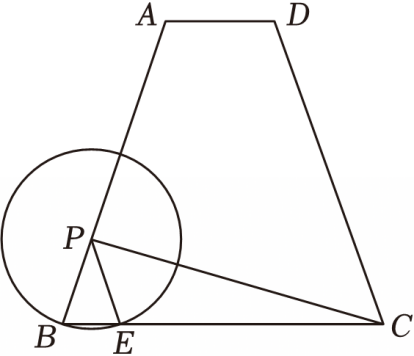

# 25 题精讲 18 · 等腰梯形、动圆与函数

## 📝 题目

已知：如图，梯形 $ABCD$ 中，$AD\parallel BC$，$AD=2$，$AB=BC=CD=6$。动点 $P$ 在射线 $BA$ 上，以 $BP$ 为半径的 $\odot P$ 交边 $BC$ 于点 $E$（点 $E$ 与点 $C$ 不重合），联结 $PE$、$PC$。设 $BP=x$，$PC=y$。

(1) 求证：$PE\parallel DC$；

(2) 求 $y$ 关于 $x$ 的函数解析式，并写出定义域；

(3) 联结 $PD$，当 $\angle PDC=\angle B$ 时，以 $D$ 为圆心、半径为 $R$ 的 $\odot D$ 与 $\odot P$ 相交，求 $R$ 的取值范围。

## 🧭 思路导航（渐进提示）

- **提示 1（识别）**：三边相等的梯形是"等腰梯形 + 底角定值"的包装；动圆 $\odot P$ 的半径就是 $PB$，于是 $\triangle PBE$ 天生等腰——平行与函数都从这里长出来。
- **提示 2（突破）**：(2) 求斜线段 $PC$ 的长度：作三条铅垂高（$P$、$A$、$D$ 到 $BC$），用 $PH\parallel AF$ 把 $PH$、$BH$ 都化成 $x$ 的分式，再上勾股。(3) 的钥匙是平移：作 $EM\parallel PD$ 交 $DC$ 于 $M$，把"斜距 $PD$"与已知线段接进同一组相似里。
- **提示 3（路线）**：(1) $\angle PEB=\angle B$（等腰）$=\angle DCB$（等腰梯形）⟹ 同位角相等。(2) $BF=FG=GC=2$、$AF=4\sqrt2$；由平行线分线段得 $PH=\frac{2\sqrt2}{3}x$、$BH=\frac{x}{3}$、$CH=6-\frac{x}{3}$，勾股得 $y=x^2-4x+36$；定义域由"$E$ 在边 $BC$ 上且 $E\ne C$"定：$BE=\frac{2x}{3}\in(0,6)$。(3) 平移后 $PDME$ 是平行四边形 ⟹ $DM=PE=x$、$PD=EM$；$\triangle PBE\backsim\triangle ECM$ 解出 $x=\frac{18}{5}$，得 $PD=\frac{18}{5}$；相交 $\iff|R-r_P|<PD<r_P+R$，两端分别舍去 $R=0$ 与 $R=\frac{36}{5}$。

## ✍️ 详解

**(1)** 梯形 $ABCD$ 中 $AB=CD$ ⟹ $\angle B=\angle DCB$（等腰梯形同一底上两角相等）。

$PB$、$PE$ 都是 $\odot P$ 的半径 ⟹ $PB=PE$ ⟹ $\angle PEB=\angle B$（等边对等角）。

$\therefore\angle PEB=\angle DCB$，故 $PE\parallel DC$（同位角相等，两直线平行）。$\blacksquare$

**(2)** 分别过 $P$、$A$、$D$ 作 $BC$ 的垂线，垂足为 $H$、$F$、$G$。

$AD\parallel BC$，$AF\perp BC$，$DG\perp BC$ ⟹ 四边形 $ADGF$ 是矩形 ⟹ $FG=AD=2$；

等腰梯形轴对称 ⟹ $BF=GC=\dfrac{BC-AD}{2}=2$。

$\text{Rt}\triangle ABF$ 中：$AF=\sqrt{AB^2-BF^2}=\sqrt{36-4}=4\sqrt2$（勾股定理）。

$PH\parallel AF$ ⟹ $\dfrac{PH}{AF}=\dfrac{BP}{BA}=\dfrac{BH}{BF}$（平行线分线段成比例），代入 $BP=x$、$BA=6$：

$$PH=\frac{2\sqrt2}{3}x,\qquad BH=\frac{x}{3}\ \Rightarrow\ CH=BC-BH=6-\frac{x}{3}$$

$\text{Rt}\triangle PHC$ 中（勾股定理）：

$$y=PC=\sqrt{PH^2+CH^2}=\sqrt{\frac{8x^2}{9}+\left(6-\frac{x}{3}\right)^2}=\sqrt{x^2-4x+36}$$

$$\boxed{y=x^2-4x+36}$$

**定义域**：$\odot P$ 与直线 $BC$ 交于 $B$（$PB$ 是半径）和 $E$ 两点。$\text{Rt}\triangle PHE$ 中 $HE=\sqrt{PE^2-PH^2}=\sqrt{x^2-\tfrac{8x^2}{9}}=\dfrac{x}{3}$，故

$$BE=BH+HE=\frac{x}{3}+\frac{x}{3}=\frac{2x}{3}$$

$E$ 在边 $BC$ 上且 $E\ne C$、$E\ne B$ ⟺ $0<\dfrac{2x}{3}<6$ ⟺ $\boxed{0<x<9}$

**(3)** 作 $EM\parallel PD$ 交 $DC$ 于 $M$。由 (1) $PE\parallel DC$，即 $PE\parallel DM$，又 $EM\parallel PD$：

四边形 $PDME$ 是平行四边形 ⟹ $DM=PE=x$，$EM=PD$ ⟹ $MC=DC-DM=6-x$。

由 (2) 同法：$BE=\dfrac{2x}{3}$，$EC=BC-BE=6-\dfrac{2x}{3}$。

$\angle EMC=\angle PDC=\angle B$（两直线平行，同位角相等；已知条件），

$\angle ECM=\angle DCB=\angle B$（等腰梯形），$\angle PEB=\angle B$（(1) 中等腰）：

$$\angle PBE=\angle ECM,\quad \angle PEB=\angle EMC\ \Rightarrow\ \triangle PBE\backsim\triangle ECM\ (\text{AA})$$

对应边成比例（$P\leftrightarrow E$、$B\leftrightarrow C$、$E\leftrightarrow M$）：

$$\frac{PB}{EC}=\frac{PE}{EM}\ \Rightarrow\ \frac{x}{6-\frac{2x}{3}}=\frac{x}{EM}$$

$x>0$，约去 $x$ 得 $EM=6-\dfrac{2x}{3}$；再由 $\dfrac{PB}{EC}=\dfrac{BE}{CM}$：

$$\frac{x}{6-\frac{2x}{3}}=\frac{\frac{2x}{3}}{6-x}\ \Rightarrow\ x\left(6-x\right)=\frac{2x}{3}\left(6-\frac{2x}{3}\right)\ \Rightarrow\ 6-x=4-\frac{4x}{9}$$

解得 $x=\dfrac{18}{5}$（约去 $x$ 时已排除 $x=0$）。此时 $PD=EM=6-\dfrac{2x}{3}=6-\dfrac{12}{5}=\dfrac{18}{5}$。

$\odot P$ 半径 $r_P=BP=\dfrac{18}{5}$，圆心距 $PD=\dfrac{18}{5}$。两圆相交 $\iff|r_P-R|<PD<r_P+R$：

- $PD<r_P+R$：$\dfrac{18}{5}<\dfrac{18}{5}+R$ ⟹ $R>0$；
- $|r_P-R|<PD$：$R=0$（外切退化，舍）或 $R=r_P+PD=\dfrac{36}{5}$（内切，舍）⟹ $0<R<\dfrac{36}{5}$。

$$\boxed{0<R<\frac{36}{5}}$$

## ⚠️ 评分点与易错

- 定义域是本题第一扣分点：来自"$E$ 在边 $BC$ 上、$E\ne C$"的几何约束（$BE=\frac{2x}{3}$），不是凭空写 $0<x<9$；$x=0$ 时 $P$ 与 $B$ 重合、$E$ 也不存在，要排除。
- (3) 中 $\triangle PBE\backsim\triangle ECM$ 的对应字母（$P\!-\!B\!-\!E\leftrightarrow E\!-\!C\!-\!M$）决定比例式，写错对应则 $x=\frac{18}{5}$ 出不来。
- 两圆位置用**双边不等式**：只写 $PD<r_P+R$ 会把 $R\ge\frac{36}{5}$ 放进来；内切 $R=\frac{36}{5}$ 与退化 $R=0$ 都要显式舍去。
- $PD=EM$ 的值经 $EM=EC$ 交叉验证（相似比 $\frac{PB}{EC}=\frac{PE}{EM}$ 且 $PB=PE$），两个来源一致才落笔。
- 题源讹误：源文"AF=AB²−BF²=62−22=42"应为 $\sqrt{6^2-2^2}=4\sqrt2$；"PH=232x"应为 $\frac{2\sqrt2}{3}x$；"R2=365"应为 $\frac{36}{5}$（根号与分数线丢失）。

## 🔗 关联

- [[03-数学/专题/第25题-压轴-相似与圆]] · [[03-数学/知识点/九年级/相似三角形]]（相似建函数）· [[03-数学/知识点/九年级/圆与正多边形]]（圆与圆位置关系）
- 同类题：[[25-14-动圆与切线]]（动圆参数化）· [[25-19-直角三角形与动圆面积]]（动圆 + 面积函数 + 定义域）
