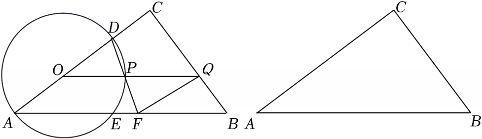

# 25 题精讲 19 · 直角三角形中的动圆与面积函数

## 📝 题目

如图，$\text{Rt}\triangle ABC$ 中，$\angle ACB=90°$，$AB=10$，$\sin\angle BAC=\dfrac35$，$O$ 是边 $AC$ 上一点，以点 $O$ 为圆心、$OA$ 为半径的 $\odot O$ 与边 $AC$ 的另一个交点是点 $D$，与边 $AB$ 的另一个交点是点 $E$；过点 $O$ 作 $AB$ 的平行线与 $\odot O$ 相交于点 $P$，与 $BC$ 相交于点 $Q$，$DP$ 的延长线交 $AB$ 于点 $F$，联结 $FQ$。

(1) 求证：$DP=EP$；

(2) 设 $OA=x$，$\triangle FPQ$ 的面积为 $y$，求 $y$ 关于 $x$ 的函数关系式，并写出定义域；

(3) 如果 $\triangle FPQ$ 是以 $FQ$ 为腰的等腰三角形，求 $AO$ 的长。

## 🧭 思路导航（渐进提示）

- **提示 1（识别）**：$\odot O$ 的圆心在直角边 $AC$ 上，$OA=OD=OE=OP$ 全是半径——"等腰三角形成串"是第一印象；$OP\parallel AB$ 把 $\odot O$ 的中心角与 $\angle A$ 挂钩。
- **提示 2（突破）**：(1) 证 $DP=EP$ 走"等圆心角对等弦"：只需 $\angle DOP=\angle POE$，两条平行线各送一个角。(2) 高 $FN$ 用矩形 $OMFN$ 从 $OM$ 平移过来，底 $PQ=OQ-OP$，而 $OQ$ 由 $\triangle COQ\backsim\triangle CAB$ 一眼读出。(3) "以 $FQ$ 为腰"分 $FQ=QP$、$FQ=FP$ 两类；先证 $P$ 是 $DF$ 中点（中位线），两类方程都落在 $OQ$ 上。
- **提示 3（路线）**：先解出 $BC=6$、$AC=8$。(1) $\angle DOP=\angle A$（同向平行）、$\angle POE=\angle OEA=\angle A$ ⟹ 等圆心角。(2) $OM=\frac35x$ ⟹ $FN=\frac35x$；$\triangle COQ\backsim\triangle CAB$ ⟹ $OQ=10-\frac54x$ ⟹ $PQ=10-\frac94x$，$y=\frac12\cdot PQ\cdot FN$；定义域由 $D$ 在边 $AC$ 上（$AD=2x\le8$）卡出 $0<x\le4$。(3) ① $FQ=QP$：等腰底角相等 ⟹ 对顶角接力证 $FQ\parallel AC$ ⟹ $AFQO$ 平行四边形 ⟹ $OQ=AF=2x$；② $FQ=FP$：三线合一，$N$ 平分 $PQ$，由 $MF=ON=\frac65x$ 得 $PN=\frac15x$、$OQ=\frac75x$；都代入 $OQ=10-\frac54x$。

## ✍️ 详解

$\text{Rt}\triangle ABC$ 中 $\sin\angle BAC=\dfrac35=\dfrac{BC}{AB}$ ⟹ $BC=6$，$AC=\sqrt{10^2-6^2}=8$（勾股定理）。

**(1)** 联结 $OE$、$OP$。$OD$ 与 $OA$ 同在直线 $AC$ 上且同向（$D$ 在 $O$ 外侧），$OP\parallel AB$：

$$\angle DOP=\angle BAC\ (\text{两边分别平行且同向})$$

$OP\parallel AB$ ⟹ $\angle POE=\angle OEA$（两直线平行，内错角相等）；$OA=OE$（半径）⟹ $\angle OEA=\angle A$（等边对等角）。

$$\angle DOP=\angle POE\ \Rightarrow\ DP=EP\ (\text{同圆中，等圆心角对等弦})\qquad\blacksquare$$

**(2)** 过 $O$ 作 $OM\perp AB$ 于 $M$，过 $F$ 作 $FN\perp PQ$ 于 $N$。

$AB\parallel PQ$ ⟹ $OM\parallel FN$；$M$、$F$ 在 $AB$ 上，$O$、$N$ 在 $PQ$ 上 ⟹ $MF\parallel ON$，故四边形 $OMFN$ 是平行四边形，又有直角，是矩形 ⟹ $FN=OM$。

$\text{Rt}\triangle AMO$ 中：$OM=OA\cdot\sin\angle BAC=\dfrac35x$ ⟹ $FN=\dfrac35x$。

$OQ\parallel AB$，$O$ 在 $CA$ 上、$Q$ 在 $CB$ 上 ⟹ $\triangle COQ\backsim\triangle CAB$（A 字型）：

$$\frac{OQ}{AB}=\frac{CO}{CA}=\frac{8-x}{8}\ \Rightarrow\ OQ=10\left(\frac{8-x}{8}\right)=10-\frac54x$$

由图 $P$ 在 $O$、$Q$ 之间（$OP=x$ 为半径）：

$$PQ=OQ-OP=10-\frac54x-x=10-\frac94x$$

$$y=\frac12\cdot PQ\cdot FN=\frac12\left(10-\frac94x\right)\cdot\frac35x$$

$$\boxed{y=-\frac{27}{40}x^2+3x}$$

**定义域**：$D$ 是 $\odot O$ 与**边** $AC$ 的交点 ⟹ $AD=2x\le AC=8$ ⟹ $x\le4$（此时 $F$ 在边 $AB$ 上需 $x\le5$、$E$ 在边 $AB$ 上需 $x\le\frac{25}{4}$，均更宽）；$x>0$（$O$ 与 $A$ 不重合）：

$$\boxed{0<x\le4}$$

**(3)** 先备一个引理：$OA=OD$ 且 $OP\parallel AF$ ⟹ $OP$ 是 $\triangle DAF$ 的中位线 ⟹ **$P$ 是 $DF$ 中点，$AF=2OP=2x$**（三角形中位线定理）。

**① 若 $FQ=QP$**：$\angle QPF=\angle QFP$（等边对等角）。

$\angle QPF=\angle OPD$（对顶角：$PQ$ 与 $PO$ 反向、$PF$ 与 $PD$ 反向）；$\angle OPD=\angle ODP$（$OD=OP$ 半径，等边对等角），且射线 $DO$ 与射线 $DA$ 同向 ⟹ $\angle ODP=\angle ADF$。

$\therefore\angle QFP=\angle ADF$，而 $P$、$D$ 在射线 $FP$ 上 ⟹ $FQ\parallel AC$（内错角相等，两直线平行）。

$AF\parallel OQ$（即 $AB\parallel OQ$）、$FQ\parallel AO$ ⟹ 四边形 $AFQO$ 是平行四边形 ⟹ $OQ=AF=2x$。

代入 $OQ=10-\dfrac54x$：

$$2x=10-\frac54x\ \Rightarrow\ \frac{13}{4}x=10\ \Rightarrow\ x=\frac{40}{13}$$

**② 若 $FQ=FP$**：等腰三角形三线合一，$N$ 是底边 $PQ$ 的中点 ⟹ $PQ=2PN$。

矩形 $OMFN$ 中 $ON=MF$；$\text{Rt}\triangle AMO$ 中 $AM=OA\cos\angle BAC=\dfrac45x$，而 $AF=2x$ ⟹ $MF=AF-AM=\dfrac65x$ ⟹ $ON=\dfrac65x$。

$ON>OP=x$ ⟹ $N$ 在 $P$ 外侧（$O$、$P$、$N$ 依次排列）：$PN=ON-OP=\dfrac15x$，于是

$$PQ=2PN=\frac25x,\qquad OQ=OP+PQ=x+\frac25x=\frac75x$$

代入 $OQ=10-\dfrac54x$：

$$\frac75x=10-\frac54x\ \Rightarrow\ 28x=200-25x\ \Rightarrow\ 53x=200\ \Rightarrow\ x=\frac{200}{53}$$

两解都在定义域 $0<x\le4$ 内（$\frac{40}{13}\approx3.1$，$\frac{200}{53}\approx3.8$），均保留：

$$\boxed{AO=\frac{40}{13}\ \text{或}\ \frac{200}{53}}$$

## ⚠️ 评分点与易错

- (1) $\angle DOP=\angle A$ 要说明"同向平行"（$OD$ 与 $AC$ 共线同向、$OP\parallel AB$），只写"两直线平行"不指明内错/同位会被扣过程分。
- (2) 定义域由 $D$ 在**边** $AC$ 上卡出 $0<x\le4$；误用 $F$、$E$ 的范围（$x\le5$、$x\le\frac{25}{4}$）或漏掉 $x>0$ 都算不完整。
- (3) 审题"以 $FQ$ 为腰"：$FP=PQ$（$FQ$ 作底）的情形**不在**讨论范围，硬算浪费时间；分类只此两类且都要回代检验定义域。
- 引理"$P$ 是 $DF$ 中点、$AF=2x$"是 (3) 两类的公共跳板，中位线定理要写明 $O$ 是 $AD$ 中点。
- 题源讹误：源文"$y=-2740x^2+3x$"应为 $-\frac{27}{40}x^2+3x$；"4013 或 20053"应为 $\frac{40}{13}$、$\frac{200}{53}$；"$OM=35x$"、"$AM=45x$"应为 $\frac35x$、$\frac45x$；"OQ=1054x"应为 $10-\frac54x$（根号/分数线丢失，均已复算）。

## 🔗 关联

- [[03-数学/专题/第25题-压轴-相似与圆]] · [[03-数学/知识点/九年级/圆与正多边形]]（圆心角与弦）· [[03-数学/知识点/九年级/锐角的三角比与解直角三角形]] · [[03-数学/知识点/九年级/相似三角形]]（A 字型求 $OQ$）
- 同类题：[[25-18-等腰梯形动圆函数]]（动圆建函数 + 两圆位置）· [[25-14-动圆与切线]]（等腰分类与三角比）
