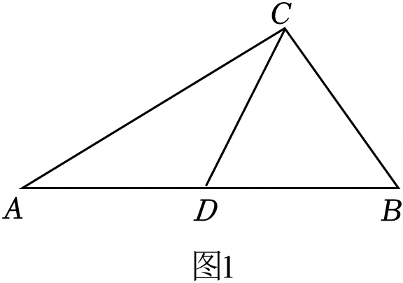
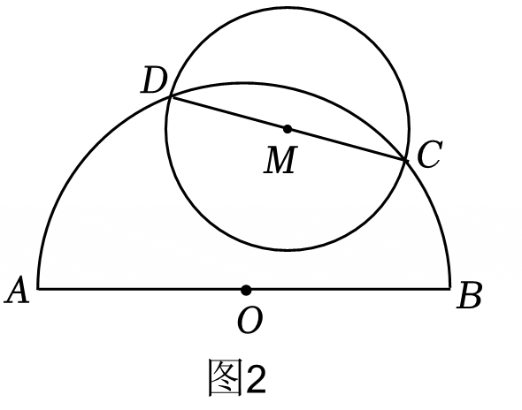
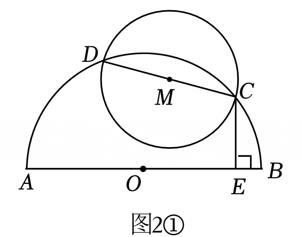
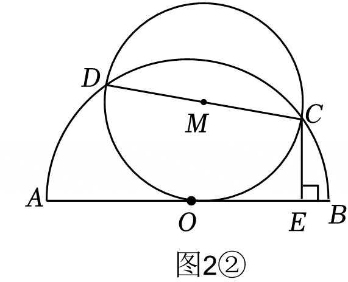

# 25 题精讲 20 · 半圆中的弦、双圆与阅读材料

> 阅读材料：直角三角形斜边上的中线等于斜边的一半；其逆命题"若三角形一边上的中线等于这条边的一半，那么这个三角形是直角三角形"也是真命题——即 $CD$ 是 $AB$ 边中线且 $CD=AD=BD$ 时，$\angle ACB=90°$（图 1）。

## 📝 题目

如图 2，$AB$ 为半圆 $O$ 的直径，$CD$ 是半圆 $O$ 的弦，以 $CD$ 为直径作 $\odot M$。

**(1)** 如图2①，过点 $C$ 作 $CE\perp AB$，垂足为 $E$。

① 求证：$CE^2=AE\cdot BE$；

② 已知 $BE=1$，$CE=3$，如果 $\odot M$ 经过点 $O$，求直线 $CD$ 与直线 $AB$ 夹角的正弦值；

**(2)** 已知 $\odot M$ 与线段 $AB$ 相交于点 $P$、$Q$，$CD=6\sqrt2$，如果 $AP:PQ:BQ=7:4:9$，求 $AB$ 的长。（动态位置可参考图2①②）

> [!tip]- 💡 思路导航（(1)①②）
> ①是"直角三角形斜边上的高"模型（射影定理现场版）：证 $\triangle ACE\backsim\triangle CBE$；②中"$\odot M$ 经过 $O$"要立刻翻译成 $MO=MC=MD$——这正是阅读材料逆定理的用武之地，逼出 $\angle DOC=90°$；夹角正弦用"竖直差 / 斜长"。

> [!success]- ✅ 详解 · 评分点 · 易错 · 关联（(1)①②）
> **详解**：
> **①** $AB$ 是直径 ⟹ $\angle ACB=90°$（直径所对圆周角）；$CE\perp AB$ ⟹ $\angle AEC=\angle CEB=90°$。$\angle A+\angle ACE=90°$，$\angle A+\angle B=90°$ ⟹ $\angle ACE=\angle B$。$\triangle ACE\backsim\triangle CBE$（AA）⟹ $\dfrac{AE}{CE}=\dfrac{CE}{BE}$ ⟹ $CE^2=AE\cdot BE$。∎
> **②** 代入 $BE=1$、$CE=3$：$AE=9$、$AB=10$ ⟹ $OA=OB=OC=5$。$\odot M$ 以 $CD$ 为直径 ⟹ $MC=MD=\dfrac12CD$；$O$ 在 $\odot M$ 上 ⟹ $MO=MC=MD$。$\triangle DOC$ 中 $CD$ 边上的中线 $MO=\dfrac12CD$ ⟹ $\angle DOC=90°$（阅读材料逆命题——**此步不点明"用逆命题"会丢分**）。
> 作 $DH\perp AB$ 于 $H$，联结 $OD$、$OC$、$OM$：$\angle HOD=\angle HOC-90°$，$\angle COE=180°-\angle HOC$ ⟹ $\angle HOD=90°-\angle COE$ ⟹ $\angle HDO=\angle COE$；又 $\angle DHO=\angle OEC=90°$、$OD=OC$ ⟹ $\triangle DHO\cong\triangle OEC$（AAS）⟹ $OH=EC=3$、$DH=OE=4$、$EH=7$。
> 过 $C$ 作 $CF\parallel AB$ 交 $DH$ 于 $F$：四边形 $CEHF$ 是矩形 ⟹ $CF=7$、$FH=CE=3$、$DF=4-3=1$；$CD=\sqrt{49+1}=5\sqrt2$。$CF\parallel AB$ ⟹ 夹角即 $\angle DCF$：$\sin\angle DCF=\dfrac{DF}{CD}=\dfrac{1}{5\sqrt2}=\dfrac{\sqrt{10}}{10}$。
>
> **评分点**：①相似判定与比例式各 1 分；②"用逆命题得 $\angle DOC=90°$"1 分、全等（或换算价论证）2 分、矩形构造与勾股 2 分、正弦值 1 分。
>
> **易错**：夹角正弦取的是 $\dfrac{DF}{CD}$（竖直差/斜长），不是 $\dfrac{CF}{CD}$；全题 $CD=6\sqrt2$ 与第①问结果 $5\sqrt2$ 外形相似，别串用。
>
> **关联**：[[03-数学/专题/第25题-压轴-相似与圆]] · [[03-数学/知识点/九年级/圆与正多边形]]（垂径定理、圆与圆位置）· [[03-数学/知识点/九年级/相似三角形]]（射影定理型相似）

> [!tip]- 💡 思路导航（(2)）
> 两条公共的勾股来源：$OM^2=R^2-18$（$OM\perp CD$，垂直平分线）；$MH^2=MP^2-PH^2=18-4k^2$（$H$ 平分 $PQ$，垂径定理）。必须按 $P$、$Q$ 左右顺序**分类**，解出 $k$ 后检验 $MH^2>0$、$P$、$Q$ 在线段 $AB$ 内。

> [!success]- ✅ 详解 · 评分点 · 易错 · 关联（(2)）
> **详解**：设 $AP=7k$、$PQ=4k$、$BQ=9k$（$k>0$）。$OC=OD=R$（大圆半径）、$MC=MD=\dfrac12CD=3\sqrt2$（小圆半径），$M$ 是 $CD$ 中点 ⟹ $OM\perp CD$ ⟹ $OM^2=R^2-18$；$H$ 为 $M$ 在 $AB$ 上的射影：$MP=MQ=3\sqrt2$ ⟹ $H$ 平分 $PQ$（垂径定理）⟹ $PH=QH=2k$，$MH^2=18-4k^2$；又 $MH^2=OM^2-OH^2$。
> **① $P$ 在 $Q$ 左侧**（顺序 $A$、$P$、$Q$、$B$）：$AB=20k$，$OA=OB=10k$。以 $O$ 为原点：$Q=k$、$H$ 在 $Q$ 左侧 $2k$ 处 ⟹ $OH=k$。$100k^2-18-k^2=18-4k^2$ ⟹ $103k^2=36$ ⟹ $k=\dfrac{6\sqrt{103}}{103}$，$AB=\dfrac{120\sqrt{103}}{103}$。
> **② $P$ 在 $Q$ 右侧**（顺序 $A$、$Q$、$P$、$B$）：$AB=12k$，$OA=OB=6k$。$P=k$、$Q=-3k$、$H=-k$ ⟹ $OH=k$。$36k^2-18-k^2=18-4k^2$ ⟹ $39k^2=36$ ⟹ $k=\dfrac{2\sqrt{39}}{13}$，$AB=\dfrac{24\sqrt{39}}{13}$。
> **检验**：两情形 $MH^2>0$、$|OH|<OA$、$P$、$Q$ 均在线段 $AB$ 内部，两解都保留：$AB=\dfrac{120\sqrt{103}}{103}$ 或 $\dfrac{24\sqrt{39}}{13}$。
>
> **评分点**：垂直平分线/垂径定理的理由要写（$OC=OD$ 且 $M$ 是 $CD$ 中点；$MP=MQ$ 且 $MH\perp PQ$）各 1 分；分类讨论 1 分、两类求解各 2 分、检验作答 1 分。
>
> **易错**：漏分类（只算一种位置）；解出 $k$ 不检验就作答。
>
> **关联**：[[03-数学/知识点/九年级/圆与正多边形]] · [[03-数学/知识点/九年级/相似三角形]] · 同类题：[[25-02-梯形外接圆与比例中项]]（$CE^2=AE\cdot BE$ 型乘积式）· [[25-07-新定义-镶嵌相似形]]（阅读材料迁移型）

## ⚠️ 题源讹误备注

源文"$CD=62$"应为 $6\sqrt2$；"210"应为 $\frac{\sqrt{10}}{10}$；"$CD=\sqrt{1+72}=52$"中 $52$ 应为 $5\sqrt2$；"120103103"应为 $\frac{120\sqrt{103}}{103}$；"243913"应为 $\frac{24\sqrt{39}}{13}$（均经勾股复算一致）。
