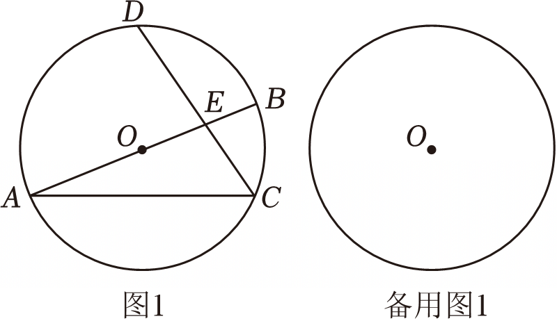

# 25 题精讲 21 · 弧中点、相交弦与正弦

## 📝 题目

已知 $AB$ 是 $\odot O$ 的直径，$AC$ 是 $\odot O$ 的弦，$D$ 是弧 $ABC$ 的中点（如图），弦 $CD$ 与 $AB$ 交于点 $E$。

(1) 当 $E$ 为 $CD$ 的中点时，求证：$AB=4BE$；

(2) 求证：$\dfrac{CE}{DE}=2\sin\angle BAC$；

(3) 当 $AE=CD$ 时，求 $\angle BAC$ 的正弦值。

## 🧭 思路导航（渐进提示）

- **提示 1（识别）**：弧 $ABC$ 的中点 $D$ ⟹ 弧 $AD=$ 弧 $DC$，这一条能同时兑现三样东西：弦 $AD=DC$、$OD\perp AC$、圆周角 $\angle ADC=\angle ABC$——全题的"等角供应站"。
- **提示 2（突破）**：$OD\perp AC$ 与 $\angle ACB=90°$（直径）推出 $OD\parallel BC$，于是"8 字型" $\triangle ODE\backsim\triangle BCE$ 出现，把 $OE:BE$、$CE:DE$、$BC:OD$ 三组比一次打包；正弦 $\sin\angle BAC$ 在 $\text{Rt}\triangle ABC$ 里就是 $\dfrac{BC}{AB}$。
- **提示 3（路线）**：(1) 相似 + $DE=CE$ ⟹ $OE=BE$ ⟹ $OB=2BE$。(2) $\dfrac{CE}{DE}=\dfrac{BC}{OD}=\dfrac{2BC}{AB}=2\sin\angle BAC$。(3) 设半径 $r$、$OE=a$：$AE=CD=r+a$ 结合 $AD=CD$ 得 $AD=AE$ ⟹ 等腰 + 对顶角接力得 $\angle BEC=\angle B$ ⟹ $CE=CB$；再由 $\angle DEO=\angle DOE$ 得 $DE=DO=r$ ⟹ $CE=a=CB$；最后相似比例 $\dfrac{DE}{OE}=\dfrac{CE}{BE}$ 化成 $a^2+ar-r^2=0$，解出 $a$ 并舍负根，$\sin\angle BAC=\dfrac{a}{2r}$。

## ✍️ 详解

**公共准备**：$D$ 是弧 $ABC$ 的中点 ⟹ 弧 $AD=$ 弧 $DC$（等弧）。

$\angle AOD=\angle DOC$（同圆中，等弧对等圆心角）；$OA=OC$ ⟹ $OD$ 平分 $\angle AOC$，等腰三角形三线合一 ⟹ $OD\perp AC$。

$AB$ 是直径 ⟹ $\angle ACB=90°$（直径所对圆周角）⟹ $BC\perp AC$，故 $OD\parallel BC$（垂直于同一条直线的两直线平行）。

**(1)** $E$ 是 $AB$ 与 $CD$ 的交点：$\angle OED=\angle BEC$（对顶角），$\angle ODE=\angle BCE$（$OD\parallel BC$，内错角）：

$$\triangle ODE\backsim\triangle BCE\ (\text{AA})\ \Rightarrow\ \frac{OE}{BE}=\frac{DE}{CE}$$

$E$ 为 $CD$ 中点 ⟹ $DE=CE$ ⟹ $OE=BE$。$O$、$E$、$B$ 共线且 $E$ 在线段 $OB$ 上（如图）⟹ $OB=OE+BE=2BE$，

$$AB=2OB=4BE\qquad\blacksquare$$

**(2)** 由 $\triangle ODE\backsim\triangle BCE$ 的对应边（$O\leftrightarrow B$、$D\leftrightarrow C$、$E\leftrightarrow E$）：

$$\frac{CE}{DE}=\frac{BC}{OD}=\frac{BC}{\tfrac12AB}=2\cdot\frac{BC}{AB}$$

$\text{Rt}\triangle ABC$ 中（$\angle ACB=90°$）：$\sin\angle BAC=\dfrac{BC}{AB}$，

$$\frac{CE}{DE}=2\sin\angle BAC\qquad\blacksquare$$

**(3)** 设 $\odot O$ 半径为 $r$，$OE=a$（$E$ 在线段 $OB$ 上，如图），则 $AE=AO+OE=r+a$，$BE=r-a$。

由条件 $AE=CD$ 及 $AD=CD$（等弧对等弦）⟹ $AD=AE=r+a$ ⟹ $\triangle ADE$ 等腰 ⟹

$$\angle ADE=\angle AED\ (\text{等边对等角})$$

- $\angle AED=\angle BEC$（对顶角）；
- $\angle ADE=\angle ADC=\angle ABC$（$E$ 在弦 $CD$ 上，射线 $DE$ 与 $DC$ 同向；$\angle ADC$ 与 $\angle ABC$ 是同弧 $AC$ 上的圆周角）。

$\therefore\angle BEC=\angle ABC=\angle EBC$（$E$ 在 $AB$ 上）⟹ $CE=CB$（等角对等边）。

又 $BC\parallel OD$ ⟹ $\angle DOE=\angle OBC=\angle ABC$（内错角相等），而 $\angle DEO=\angle AED=\angle BEC=\angle ABC$：

$$\angle DOE=\angle DEO\ \Rightarrow\ DE=DO=r\ (\text{等角对等边})$$

$$\Rightarrow\ EC=CD-DE=(r+a)-r=a\ \Rightarrow\ CB=CE=a$$

由 $\triangle ODE\backsim\triangle BCE$ 的对应边 $\dfrac{DE}{OE}=\dfrac{CE}{BE}$：

$$\frac{r}{a}=\frac{a}{r-a}\ \Rightarrow\ a^2=r(r-a)\ \Rightarrow\ a^2+ar-r^2=0$$

解关于 $a$ 的方程（$a>0$）：$a=\dfrac{-1\pm\sqrt5}{2}r$，负根舍去：

$$a=\frac{\sqrt5-1}{2}r$$

$$\boxed{\sin\angle BAC=\frac{BC}{AB}=\frac{a}{2r}=\frac{\sqrt5-1}{4}}$$

## ⚠️ 评分点与易错

- "弧 $ABC$ 的中点"要翻译成**弧相等**，再分流到三处使用（等弦 $AD=CD$、$OD\perp AC$、圆周角 $\angle ADC=\angle ABC$），只写其一后面会断链。
- 相似必须按字母顺序 $\triangle ODE\backsim\triangle BCE$ 抄对应；$\dfrac{CE}{DE}$ 与 $\dfrac{DE}{CE}$ 在 (2)(3) 两问里方向不同，别混。
- (3) 的方程 $a^2+ar-r^2=0$ 必须写"负根舍去"并保留 $a>0$；$E$ 在线段 $OB$ 上（$AE=r+a$）是图形事实，可与解出的 $a=\frac{\sqrt5-1}{2}r\in(0,r)$ 互相印证。
- (3) 中 $DE=DO$ 的链条（等腰 $\triangle ADE$ → 对顶角 → 圆周角 → $OD\parallel BC$）是全题最长一环，每一处"等角"都要有名称。
- 题源讹误：源文答案"$-1+54$"应为 $\dfrac{\sqrt5-1}{4}$；分析中"利用垂径定理得到 $DF\perp AC$、$AF=FC$"所设的点 $F$ 应为 $OD$ 与 $AC$ 的交点（源文误作"交 $BC$ 于 $F$"，此时 $OD\parallel BC$ 不可能相交），本讲已改用"三线合一"直证 $OD\perp AC$，绕开该笔误。

## 🔗 关联

- [[03-数学/专题/第25题-压轴-相似与圆]] · [[03-数学/知识点/九年级/圆与正多边形]]（圆周角、垂径、弧与弦）· [[03-数学/知识点/九年级/相似三角形]]（8 字型）
- 同类题：[[25-16-垂线弦与两圆位置]]（弦上定点 + 相似定值）· [[25-17-等腰内接圆与黄金分割]]（同现黄金比 $\frac{\sqrt5-1}{2}$）
