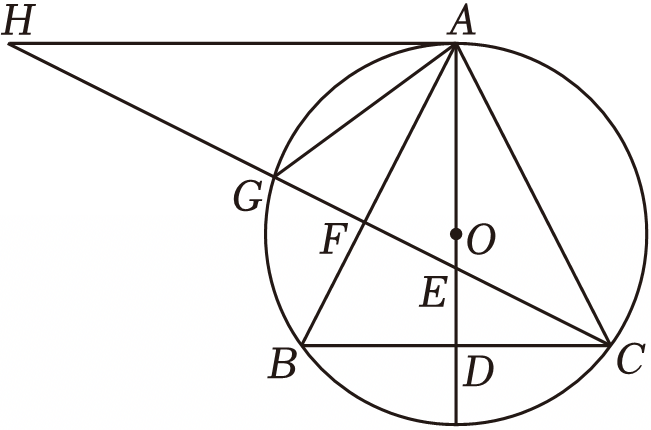

# 25 题精讲 22 · 等腰三角形外接圆与切线

## 📝 题目

如图，$\odot O$ 为等腰三角形 $ABC$ 的外接圆，$AB=AC$，延长 $AO$ 交 $BC$ 于点 $D$。过点 $C$ 作 $AB$ 的垂线，交 $AD$ 于点 $E$，交 $AB$ 于点 $F$，交 $\odot O$ 于点 $G$，交过点 $A$ 且与 $BC$ 平行的直线于点 $H$，联结 $AG$。

(1) 判断 $AH$ 与 $\odot O$ 的位置关系，并说明理由；

(2) 若 $\angle BAC=56°$，求 $\angle H$ 和 $\angle BAG$ 的大小；

(3) 若 $GF=1$，$\tan\angle ABC=2$，求 $OD$ 的长。

## 🧭 思路导航（渐进提示）

- **提示 1（识别）**：等腰三角形 + 外接圆：对称轴 $AD$ 一肩挑三职——底边中线、高线、外接圆的"直径方向"。切线判定要过"半径外端 + 垂直"两个要件。
- **提示 2（突破）**：(3) 的数字全部从"设 $BD=a$"长出来：$AD=2a$（正切）、$AB=\sqrt5a$（勾股）、$AF=2$（圆周角 $\angle AGC=\angle ABC$ 转移正切）；两条直角三角形各算一遍 $CF^2$，勾股方程解 $a$；最后在 $\text{Rt}\triangle OBD$ 中用 $OA=OB$ 收口。
- **提示 3（路线）**：(1) $AD\perp BC$（三线合一）+ $AH\parallel BC$ ⟹ $AH\perp OA$ ⟹ 切线。(2) $\angle BAD=28°$ ⟹ $\angle ABC=62°$ ⟹ $\angle BCF=28°$（余角），$\angle H$ 由内错角、$\angle BAG$ 由同弧圆周角各得 $28°$。(3) 设 $BD=a$：$BC=2a$、$AD=2a$、$AB=AC=\sqrt5a$；$AF=2GF=2$；$CF^2$ 在 $\text{Rt}\triangle BCF$ 与 $\text{Rt}\triangle ACF$ 中各算一次，联立得 $a=\frac{2\sqrt5}{3}$（$a=0$ 舍）；再设 $OD=x$，$OA=OB=AD-x$，勾股方程 $(AD-x)^2=x^2+BD^2$ 解出 $x=\frac{\sqrt5}{2}$。

## ✍️ 详解

**(1)** $AH$ 与 $\odot O$ **相切**。理由：

$AB=AC$ 且 $O$、$A$、$D$ 共线（$O$ 在等腰三角形对称轴上）⟹ $AD\perp BC$、$BD=DC$（三线合一）。

$AH\parallel BC$ ⟹ $AH\perp AD$（垂直于平行线中的一条，必垂直于另一条），即 $AH\perp OA$。

$OA$ 是 $\odot O$ 的半径，$AH$ 过半径外端 $A$ 且垂直于 $OA$ ⟹ $AH$ 是 $\odot O$ 的切线。$\blacksquare$

**(2)** $AD\perp BC$ 且平分 $\angle BAC$（三线合一）⟹ $\angle BAD=\dfrac12\angle BAC=28°$。

$\text{Rt}\triangle ABD$ 中：$\angle ABC=90°-\angle BAD=62°$（两锐角互余）。

$CF\perp AB$ ⟹ $\text{Rt}\triangle BCF$ 中 $\angle BCF=90°-\angle ABC=28°$。

$AH\parallel BC$，截线 $CH$ ⟹ $\angle H=\angle BCF=28°$（内错角相等）。

$G$ 在射线 $CF$ 上 ⟹ $\angle BCG=\angle BCF=28°$；$\angle BAG$ 与 $\angle BCG$ 是同弧 $BG$ 上的圆周角 ⟹ 相等：

$$\boxed{\angle H=28°,\qquad \angle BAG=28°}$$

**(3)** 设 $BD=a$。$D$ 是 $BC$ 中点（三线合一）⟹ $BC=2a$；$\text{Rt}\triangle ABD$ 中：

$$AD=BD\cdot\tan\angle ABC=2a,\qquad AB=\sqrt{AD^2+BD^2}=\sqrt{4a^2+a^2}=\sqrt5\,a\ (\text{勾股定理})$$

$AB=AC=\sqrt5\,a$（等腰）。$\angle AGC=\angle ABC$（同弧 $AC$ 上的圆周角），$G$、$F$、$C$ 共线且 $F$ 在 $G$、$C$ 之间 ⟹ $\angle AGF=\angle AGC$；

$\text{Rt}\triangle AFG$ 中（$GF\perp AB$）：$\tan\angle AGF=\dfrac{AF}{GF}=2$，$GF=1$ ⟹ $AF=2$。

$$BF=AB-AF=\sqrt5\,a-2$$

在两个直角三角形中各算一次 $CF^2$（勾股定理）：

$$\text{Rt}\triangle BCF:\quad CF^2=BC^2-BF^2=(2a)^2-(\sqrt5\,a-2)^2=-a^2+4\sqrt5\,a-4$$

$$\text{Rt}\triangle ACF:\quad CF^2=AC^2-AF^2=(\sqrt5\,a)^2-2^2=5a^2-4$$

联立：$-a^2+4\sqrt5\,a-4=5a^2-4$ ⟹ $6a^2-4\sqrt5\,a=0$ ⟹ $a(6a-4\sqrt5)=0$

$a=0$ 使 $B$、$C$、$D$ 重合，舍；$a=\dfrac{2\sqrt5}{3}$。（检验：$AB=\sqrt5a=\dfrac{10}{3}>2=AF$，$F$ 确在线段 $AB$ 上，图形合法。）

$AD=2a=\dfrac{4\sqrt5}{3}$。设 $OD=x$：$\tan\angle ABC=2>1$ ⟹ $\angle ABC>45°$ ⟹ 顶角 $\angle BAC=180°-2\angle ABC<90°$，$\triangle ABC$ 锐角 ⟹ 圆心 $O$ 在线段 $AD$ 上 ⟹ $OA=AD-x$。

联结 $OB$。$OA=OB$（半径），$\text{Rt}\triangle OBD$ 中（$AD\perp BC$，勾股定理）：

$$OB^2=OD^2+BD^2\ \Rightarrow\ \left(\frac{4\sqrt5}{3}-x\right)^2=x^2+\left(\frac{2\sqrt5}{3}\right)^2$$

$$\frac{80}{9}-\frac{8\sqrt5}{3}x+x^2=x^2+\frac{20}{9}\ \Rightarrow\ \frac{8\sqrt5}{3}x=\frac{60}{9}=\frac{20}{3}\ \Rightarrow\ x=\frac{20}{8\sqrt5}=\frac{\sqrt5}{2}$$

（复核：$OA=AD-OD=\dfrac{4\sqrt5}{3}-\dfrac{\sqrt5}{2}=\dfrac{8\sqrt5-3\sqrt5}{6}=\dfrac{5\sqrt5}{6}$，而 $OB=\sqrt{\dfrac54+\dfrac{20}{9}}=\sqrt{\dfrac{125}{36}}=\dfrac{5\sqrt5}{6}$，两者相等。）

$$\boxed{OD=\frac{\sqrt5}{2}}$$

## ⚠️ 评分点与易错

- (1) 切线判定必须写全两个要件："过半径**外端**"与"垂直于该半径"，只写 $AH\perp OA$ 不交代 $OA$ 是半径、$A$ 在圆上，扣分。
- (3) 设参后每个量（$BC$、$AD$、$AB$、$AF$、$BF$）都要有定理出处；$AF=2$ 来自 $\tan\angle AGF=\tan\angle ABC=2$，其中"同弧圆周角相等 + 射线 $GF$ 与 $GC$ 同向"是隐形一步。
- $a=0$ 的根必须舍并写明理由（三角形退化）；解完 $a$ 要回代检验 $F$ 在线段 $AB$ 上（$\sqrt5a>2$）。
- $O$ 在线段 $AD$ 上（$OA=AD-x>0$）依赖"顶角为锐角"，需由 $\tan\angle ABC=2>1$ 推出；解出 $x$ 后用 $OA=OB$ 复核一遍更稳。
- 题源讹误与解码：源文"AB=5a"应为 $\sqrt5\,a$、"BF=5a−2"应为 $\sqrt5\,a-2$、"−a²+45a−4"应为 $-a^2+4\sqrt5\,a-4$、"a=253"应为 $\frac{2\sqrt5}{3}$、"AD=453"应为 $\frac{4\sqrt5}{3}$；答案处"x=52"经复算应为 $\frac{\sqrt5}{2}$（由 $(\frac{4\sqrt5}{3}-x)^2=x^2+\frac{20}{9}$ 解出 $x=\frac{5}{2\sqrt5}=\frac{\sqrt5}{2}$，且 $OA=OB$ 双路验证一致；若读作 $\frac52$，则 $OA=\frac{4\sqrt5}{3}-\frac52\approx0.48$ 与 $OB=\sqrt{x^2+BD^2}\approx2.91$ 矛盾）。

## 🔗 关联

- [[03-数学/专题/第25题-压轴-相似与圆]] · [[03-数学/知识点/九年级/圆与正多边形]]（切线判定、圆周角定理）· [[03-数学/知识点/九年级/锐角的三角比与解直角三角形]]
- 同类题：[[25-04-等腰三角形外接圆]]（等腰 + 外接圆定角）· [[25-14-动圆与切线]]（切线与勾股方程）
