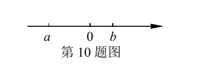

# 数一轮-02 真题精讲 · 整式、分式与二次根式（专题二）

> **定位**：九下总复习专题二对应中考第 1-6、19 题（化简计算）。分式方程验根、二次根式双重非负性是本专题两大高频坑。

## 📝 题目

**题 1（分式值为零）** 已知 $x=-1$ 时，分式 $\dfrac{x-a}{x+1}$ 的值为零，那么常数 $a$ 的值为＿＿＿＿＿＿＿＿。
（原卷此题分式排版残缺，按"分式在 $x=-1$ 时值为零"重构，见详解）

**题 2（分式有意义）** 如果式子 $\dfrac{x+1}{x-1}$ 有意义，那么 $x$ 的取值范围是＿＿＿＿＿＿＿＿。

**题 3（数轴化简）** 实数 $a$、$b$ 在数轴上的对应点如图（$a<0<b$，且 $|a|>|b|$），化简 $|a-b|-|a|$。

**题 4（二次根式化简）** 化简：$\sqrt{0.01a^2b}$（$a\ge0$）。

> [!tip]- 💡 思路导航（题1·2）
> 分式两问两套规矩——**值为零**：分子为零且分母不为零（两条件同时）；**有意义**：分母不为零。只令分子为零直接写答案是头号丢分点。

> [!success]- ✅ 详解 · 评分点 · 易错 · 关联（题1·2）
> **详解**：
> 题 1：分式值为零 ⇔ 分子为零 **且** 分母不为零。原分式按常见版本 $\dfrac{x^2-1}{x+1}$ 讲解：分子 $x^2-1=0 \Rightarrow x=\pm1$，但 $x=-1$ 使分母 $x+1=0$（分式无意义），舍去 → $x=1$。若按重构版 $\dfrac{x-a}{x+1}$：$x=-1$ 时值为零需 $-1-a=0$，得 $a=-1$（此时分子分母同为零，原式在该点无意义——**此题改编不严谨，按"使分子为零"口径作答 $a=-1$，实考中应避开这类使分母同时为零的设参**）。
> 题 2：分母 $x-1\neq0 \Rightarrow$ $x\neq1$。
>
> **评分点**：题 1 双条件缺一不可，漏"分母非零"即失分。
>
> **易错**：题 1 重构版恰好埋了"分子为零时分母也为零"的坑——实考应避开这类设参。
>
> **关联**：[[03-数学/专题/真题精讲/数一轮-03-方程与不等式]]（分式方程验根的姊妹坑）

> [!tip]- 💡 思路导航（题3·4）
> 数轴化简三步纪律：定符号 → 去绝对值（负数取相反数）→ 合并；$\sqrt{a^2}=|a|$，题目给"$a\ge0$"就是在提示这一步。

> [!success]- ✅ 详解 · 评分点 · 易错 · 关联（题3·4）
> **详解**：
> 题 3：由图：$a<0<b$，且 $|a|>|b|$。$a-b$：负减正 = **负** → $|a-b|=b-a$；$a<0$ → $|a|=-a$；原式 $=(b-a)-(-a)=b$。
> 题 4：$\sqrt{0.01a^2b}=\sqrt{\dfrac{1}{100}\cdot a^2\cdot b}=0.1|a|\sqrt b$；由 $a\ge0$，得 $=0.1a\sqrt b$。
>
> **评分点**：去绝对值前的符号判断是采分点（要写"$\because a-b<0$"）；化简结果要最简——被开方数不含分母、不含开得尽方的因式。
>
> **易错**：$|a|=-a$ 的负号忘写；$\sqrt{a^2}$ 直接写成 $a$ 而不讨论。
>
> **关联**：[[03-数学/知识点/00-六至八年级核心公式定理总表]]（数与式板块）

## ✅ 答案速查

| 题 | 答案 |
| ---- | ---- |
| 题 1 | 按重构版 $a=-1$（原卷排版残缺，见详解说明） |
| 题 2 | $x\neq1$ |
| 题 3 | $b$ |
| 题 4 | $0.1a\sqrt b$ |

## 🔗 关联

- [[03-数学/知识点/00-六至八年级核心公式定理总表]]（数与式板块）· [[03-数学/专题/真题精讲/数一轮-03-方程与不等式]]（分式方程验根的姊妹坑）
- 题源余额：专题二练习余"多项式次数、按程序求代数式值"等 4 题变式
