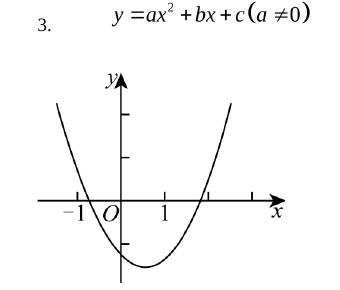
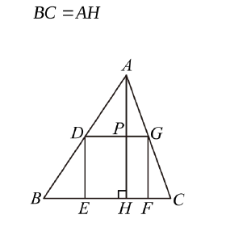
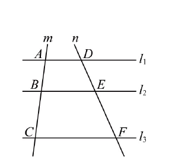
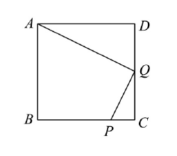
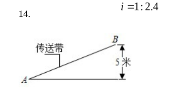
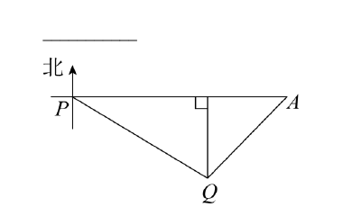
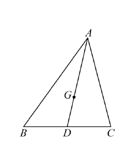
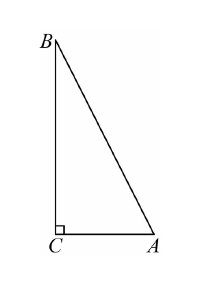

# 2026一模精讲 · 嘉定卷（上）第 1~18 题

> 题干与公式已对照卷面页图逐题核验（2026-11-01），早期按解答词元反推的读法与原卷不符处均已订正并重算，配图取自页图裁片（figs/数模26-嘉定/）；全部结果与官方参考答案互证一致。

## 一、选择题

**1.** 下列关于 x 的函数中，二次函数是（　）

**简解** A。选项 A 形如 $y=ax^2+bx+c\ (a\neq0)$，符合二次函数定义；B 化简后含分式/一次项、C 与 D 最高次项次数不为 2，均不是。

**2.** 在 Rt△ABC 中，∠C=90°，AB=4，BC=2，下列各式正确的是（　）
A. $\tan\angle A=\frac12$　B. $\cot\angle A=\frac12$　C. $\sin\angle A=\frac12$　D. $\cos\angle A=\frac12$

**简解** C。$AC=\sqrt{AB^2-BC^2}=\sqrt{16-4}=2\sqrt3$（勾股定理），$\sin\angle A=\dfrac{BC}{AB}=\dfrac24=\dfrac12$（正弦=对边比斜边）；此时 $\tan\angle A=\frac{BC}{AC}=\frac{\sqrt3}{3}$、$\cot\angle A=\sqrt3$、$\cos\angle A=\frac{AC}{AB}=\frac{\sqrt3}{2}$，仅 C 正确。

**3.** 已知抛物线 $y=ax^2+bx+c\,(a\neq0)$ 如图所示，那么下列各式中不成立的是（　）
A. $a>0$　B. $b>0$　C. $c<0$　D. $a+b+c<0$

**简解** B。开口向上 $a>0$（A 成立）；对称轴 $x=-\frac{b}{2a}>0$ 且 $a>0$ 得 $b<0$，故 B 不成立；交 y 轴负半轴 $c<0$（C 成立）；$x=1$ 时图象在 x 轴下方，$a+b+c<0$（D 成立）。

**4.** △ABC 中，点 M、N 分别在边 AB、AC 上，下列条件中**不能**推得 MN∥BC 的是（　）
A. $\dfrac{AM}{BM}=\dfrac{AN}{CN}$　B. $\dfrac{AB}{AM}=\dfrac{AC}{AN}$　C. $\dfrac{BM}{AB}=\dfrac{CN}{AC}$　D. $\dfrac{AM}{AB}=\dfrac{MN}{BC}$

**简解** D。A：设 $\frac{AM}{BM}=\frac{AN}{CN}=k$，则 $AB=(1+k)BM$、$AC=(1+k)CN$，得 $\frac{AM}{AB}=\frac{AN}{AC}$ → △AMN∽△ABC → MN∥BC；B 即平行线分线段成比例的逆用；C 变形为 $1-\frac{AM}{AB}=1-\frac{AN}{AC}$，同 A 可推；D 中 $AM:AB$ 与 $MN:BC$ 不是夹 ∠A 的两组对应边，推不出相似，选 D。

**5.** 下列说法中不正确的是（　）
A. 如果 m 是实数，$\vec a$ 是向量，那么 $m\vec a$ 与 $\vec a$ 的方向相同
B. 如果 $\vec a$ 与非零向量 $\vec b$ 平行，那么存在唯一的实数 m，使 $\vec a=m\vec b$
C. 如果 $\vec e$ 是单位向量，那么 $|\vec e|=1$
D. 如果 m、n 是实数，那么 $(m+n)\vec a=m\vec a+n\vec a$

**简解** A。当 $m<0$ 时 $m\vec a$ 与 $\vec a$ 方向**相反**，A 错；B、C、D 均为向量平行条件、单位向量定义与数乘分配律，正确。

**6.** 如图，正方形 DEFG 的边 EF 在 △ABC 的边 BC 上，顶点 D、G 分别在 AB、AC 上，作 AH⊥BC 于 H，DG 交 AH 于 P，已知 BC=AH。下列结论中不正确的是（　）
A. △ABC∽△ADG　B. $\dfrac{AD}{AB}=\dfrac{AP}{AH}$　C. $S_{\triangle ADG}=\dfrac25S_{\triangle ABC}$　D. $AP=PH$

**简解** C。DG∥BC → △ABC∽△ADG（A 成立），相似比 $k=\dfrac{AP}{AH}=\dfrac{DG}{BC}$（B 成立）；DG 与 BC 间距离等于正方形边长，即 $PH=DG=k\cdot BC$，而 $AP=AH-PH=BC-k\cdot BC$（已知 $AH=BC$），由 $AP=k\cdot AH=k\cdot BC$ 得 $k=1-k$，$k=\dfrac12$，$\therefore AP=PH$（D 成立），$S_{\triangle ADG}=k^2S_{\triangle ABC}=\dfrac14S_{\triangle ABC}\neq\dfrac25$，C 不成立。

## 二、填空题

**7.** 已知 $\dfrac{x}{y}=\dfrac52$，那么 $\dfrac{x+y}{y}$ 的值为______。

**简解** $\dfrac72$。$\dfrac{x+y}{y}=\dfrac{x}{y}+1=\dfrac52+1=\dfrac72$。

**8.** 已知抛物线 $y=(m+1)x^2+4x-4$ 有最高点，那么 m 的取值范围是______。

**简解** $m<-1$。有最高点 ⇔ 开口向下 ⇔ 二次项系数 $m+1<0$。

**9.** 二次函数 $y=3x^2-2x+1$ 的图象在其对称轴右侧的部分是______的（填"上升"或"下降"）。

**简解** 上升。$a=3>0$ 开口向上，对称轴右侧 y 随 x 增大而增大。

**10.** 已知二次函数的图象经过 $(-1,1)$ 和 $(3,1)$，那么此图象的对称轴为直线______。

**简解** $x=1$。两点纵坐标相等，是一对对称点，对称轴 $x=\dfrac{-1+3}{2}=1$。

**11.** 把一个三角形放大为与它相似的三角形，如果面积扩大为原来的 9 倍，那么周长扩大为原来的____倍。

**简解** 3。相似比 $=\sqrt9=3$，周长比等于相似比。

**12.** 如图，已知直线 $l_1\parallel l_2\parallel l_3$，分别与直线 m 交于 A、B、C，与直线 n 交于 D、E、F。如果 $3AB=2BC$，$DE=6$，那么 $DF=$______。

**简解** 15。$3AB=2BC\Rightarrow\dfrac{AB}{BC}=\dfrac23$；平行线分线段成比例：$\dfrac{DE}{EF}=\dfrac{AB}{BC}=\dfrac23$，$EF=\dfrac32\,DE=9$，$DF=DE+EF=15$。

**13.** 如图，正方形 ABCD 中，点 P 在边 BC 上，且 $BP=3\sqrt2$，$PC=\sqrt2$，点 Q 是边 CD 的中点，那么 $\dfrac{AQ}{QP}$ 的值为______。

**简解** 2。$BC=BP+PC=4\sqrt2$，故正方形边长 $AD=CD=4\sqrt2$，$CQ=DQ=2\sqrt2$（Q 为 CD 中点）。$\dfrac{CP}{DQ}=\dfrac{\sqrt2}{2\sqrt2}=\dfrac12=\dfrac{CQ}{AD}$，且 $\angle ADQ=\angle QCP=90°$，$\therefore$ Rt△ADQ∽Rt△QCP（两边成比例且夹角相等），$\therefore\dfrac{AQ}{QP}=\dfrac{AD}{QC}=\dfrac{4\sqrt2}{2\sqrt2}=2$（相似三角形对应边成比例）。

**14.** 如图，某传送带与地面所成斜坡的坡度 $i=1:2.4$，它把物品从地面送到离地 5 米高的 B 处，则物体从 A 到 B 所经过的路程为______米。

**简解** 13。过 B 作 BF⊥地面于 F，则 $BF=5$；由 $i=\dfrac{BF}{AF}=\dfrac1{2.4}$ 得 $AF=12$（坡度＝竖直∶水平），$AB=\sqrt{AF^2+BF^2}=\sqrt{12^2+5^2}=13$ 米（勾股定理）。

**15.** 如图，在港口 P 的南偏东 60° 方向有一座小岛 Q，一艘船从港口 P 出发沿正东方向行驶 24 海里后到达 A 处，在 A 处测得小岛 Q 恰在其西南方向，那么小岛与港口相距______海里（结果保留根号）。

**简解** $24(\sqrt3-1)$ 海里。过 Q 作 QB⊥PA 于 B：∠QPB=90°−60°=30°（南偏东 60° 与正东夹 30°），∠QAB=45°（西南方向），$\therefore AB=QB$、$PB=\sqrt3\,QB$（锐角三角比）；$PA=AB+PB=24\Rightarrow QB+\sqrt3\,QB=24$，$QB=12(\sqrt3-1)$；Rt△PBQ 中 ∠P=30°，$\therefore PQ=2QB=24(\sqrt3-1)$ 海里（30° 角所对直角边是斜边的一半）。

**16.** 如图，点 G 是 △ABC 的重心，连接 AG 并延长交边 BC 于点 D。如果 $\vec{AB}=\vec a$，$\vec{AC}=\vec b$，那么 $\vec{AG}=$______（用含 $\vec a,\vec b$ 的式子表示）。

**简解** $\vec{AG}=\dfrac13\vec a+\dfrac13\vec b$。D 为 BC 中点：$\vec{CB}=\vec{AB}-\vec{AC}=\vec a-\vec b$（向量减法），$\vec{DB}=\dfrac12\vec{CB}=\dfrac12\vec a-\dfrac12\vec b$，$\vec{AD}=\vec{AB}-\vec{DB}=\dfrac12\vec a+\dfrac12\vec b$；重心分中线成 2:1，$\vec{AG}=\dfrac23\vec{AD}=\dfrac13\vec a+\dfrac13\vec b$。

**17.** 在平面直角坐标系中，我们规定一种变换：将平面内任意一点 P 绕原点 O 顺时针旋转 $\alpha\,(0°<\alpha<360°)$ 得到对应点 $P_1$，点 $P_2$ 在射线 $OP_1$ 上，且 $OP_2=k\cdot OP_1\,(k>0)$，得到最终的对应点 $P_2$，称点 $P_2$ 为点 P 经过变换 $[\alpha,k]$ 后的对应点。例如，点 $A(1,1)$ 经过变换 $[45°,\sqrt2]$ 后的对应点为 $A_2(2,0)$，那么点 $A_2(2,0)$ 经过变换 $\left[30°,\dfrac{\sqrt3}{2}\right]$ 后的对应点坐标为______。

**简解** $\left(\dfrac32,-\dfrac{\sqrt3}{2}\right)$。$OA_2=2$；顺时针旋转 30° 后 $OA_3=\dfrac{\sqrt3}{2}OA_2=\sqrt3$，且 $A_3$ 落在 x 轴下方（$\angle A_3OA_2=30°$）；过 $A_3$ 作 $A_3B\perp x$ 轴于 B：$A_3B=\dfrac12OA_3=\dfrac{\sqrt3}{2}$（30° 角所对直角边等于斜边的一半），$OB=\sqrt{OA_3^2-A_3B^2}=\sqrt{3-\dfrac34}=\dfrac32$（勾股定理），$\therefore A_3\left(\dfrac32,-\dfrac{\sqrt3}{2}\right)$。

**18.** 如图，Rt△ABC 中，∠C=90°，AC=2，BC=4，将 △ABC 绕点 A 逆时针旋转 $\alpha\,(0°<\alpha<90°)$ 得到 △AB′C′（点 B、C 的对应点分别为 B′、C′），连接 B′C。如果直线 B′C 垂直于 AB，连接 B′B，那么此时 △AB′B 的面积是______。

**简解** $4\sqrt6$。$AB=\sqrt{AC^2+BC^2}=2\sqrt5$（勾股定理）；设直线 B′C 交 AB 于 D，则 $CD\perp AB$（B′、C、D 共线），即 D 是 C 在 AB 上的射影：△ACD∽△ABC（同角的余角），$AD=\dfrac{AC^2}{AB}=\dfrac{2\sqrt5}{5}$（射影定理，或由相似比）。Rt△AB′D 中 $AB'=AB=2\sqrt5$（旋转不变性），$B'D=\sqrt{AB'^2-AD^2}=\sqrt{20-\dfrac45}=\dfrac{4\sqrt{30}}{5}$（勾股定理），$\therefore S_{\triangle AB'B}=\dfrac12\cdot AB\cdot B'D=\dfrac12\times2\sqrt5\times\dfrac{4\sqrt{30}}{5}=4\sqrt6$。

## 修订记录（2026-11-01 对照页图核验）

- **修正原反推讹误**：第 2 题边长实为 $AB=4$、$BC=2$；第 3 题 D 选项实为"$a+b+c<0$"；第 4 题选项按原卷比例形式重排（结论 D 不变）；第 6 题已知条件实为 $BC=AH$、选项按原卷更正（答案 C 不变）；第 7 题实为 $\frac{x}{y}=\frac52$，答案 $\frac72$（原 $\frac52$ 有误）；第 8 题实为 $y=(m+1)x^2+4x-4$，答案 $m<-1$；第 9 题实为 $y=3x^2-2x+1$；第 12 题实为 $3AB=2BC$、$DE=6$（DF=15 不变）；第 13 题实为 $BP=3\sqrt2$、$PC=\sqrt2$、Q 是 CD 中点，求 $\frac{AQ}{QP}=2$；第 14 题字母按原卷（B 处高 5 米、A 到 B 路程）；第 15 题字母按原卷（港口 P、小岛 Q、船到 A，答案 $24(\sqrt3-1)$ 不变）；第 16 题实为 $\vec{AB}=\vec a$、$\vec{AC}=\vec b$，答案 $\frac13\vec a+\frac13\vec b$（原 $-\frac13\vec a+\frac13\vec b$ 有误）；第 17 题变换为 $[\alpha,k]$（顺时针旋转 α＋模缩放 k 倍），所求为 $A_2(2,0)$ 经 $\left[30°,\frac{\sqrt3}{2}\right]$，答案 $\left(\frac32,-\frac{\sqrt3}{2}\right)$；第 18 题实为"连接 B′C，直线 B′C⊥AB"，$S_{\triangle AB'B}=4\sqrt6$（原"BB′⊥AC、面积 8"读法与原卷不符）。
- **配图**：第 3、6、12、13、14、15、16、18 题配图取自页图裁片 `figs/数模26-嘉定/`，已逐张 Read 核验与原卷一致。
- **互证**：第 13（2）、15（$24\sqrt3-24$）、16（$\frac13\vec a+\frac13\vec b$）、17（$\frac32,-\frac{\sqrt3}{2}$）、18（$4\sqrt6$）等与官方解答页逐项核对一致；全部数值已独立重算，无遗留 ⚠️。

## 🔗 关联

- [[03-数学/知识点/九年级/相似三角形]] · [[03-数学/知识点/九年级/锐角的三角比与解直角三角形]] · [[03-数学/知识点/九年级/二次函数]] · [[03-数学/知识点/九年级/平面向量]]
- 解答题见 [[数模26-嘉定-下]]
