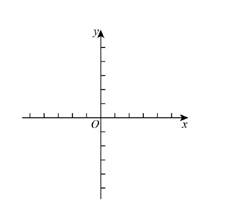
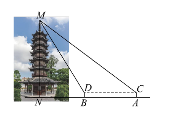
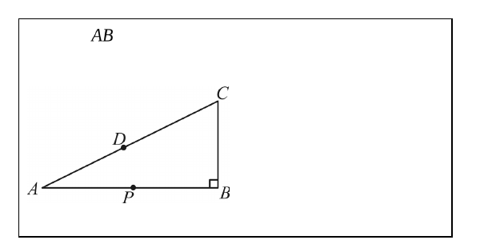
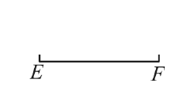
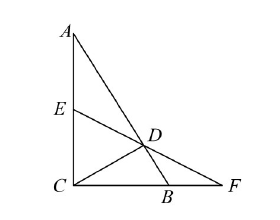
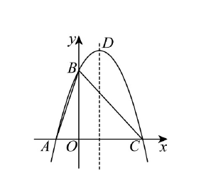
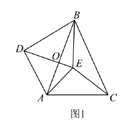
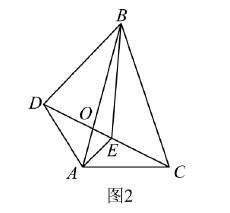

# 2026 一模精讲 · 嘉定卷（下）解答题 19-25

> 本篇覆盖第 19-25 题（共 78 分），每题"完整转录 + 渐进三段提示 + 详解 + 易错"。第 1-18 题见《数模26-嘉定-上》。题干以卷面页图为准转录（中文文本源公式缺失，已按页图 LaTeX 化），数值与卷末参考答案逐题互证。

### 19．（本题 10 分）计算：$\dfrac{\tan^260°-\cot45°}{2\sin^260°-\cos60°}$

**🧭 提示**：① 三个特殊角三角比先全部化为根号或分数；② $\tan^260°$、$\sin^260°$ 都是"先平方"再运算；③ 分子、分母各化成一个数，最后相除。

**✍️ 详解**：
$\tan60°=\sqrt3$，$\cot45°=1$，$\sin60°=\dfrac{\sqrt3}{2}$，$\cos60°=\dfrac12$（特殊角三角比）。
原式 $=\dfrac{(\sqrt3)^2-1}{2\times\left(\dfrac{\sqrt3}{2}\right)^2-\dfrac12}=\dfrac{3-1}{2\times\dfrac34-\dfrac12}=\dfrac{2}{\dfrac32-\dfrac12}=\dfrac21=\boxed{2}$。

**⚠️ 易错**：$\tan^260°=3$、$2\sin^260°=\dfrac32$，先平方再乘系数；"$-\cot45°$"的 1 别漏；结果 $\frac21$ 即 2，不必再化简。

### 20．（本题 10 分）在平面直角坐标系 xOy 中，将抛物线 y＝x² 向右平移 2 个单位，再向下平移 1 个单位后得到新抛物线 L，L 与 x 轴交于点 A 和点 B（点 A 在点 B 左侧），与 y 轴交于点 C，新抛物线的顶点为 D，连接 BC、CD。(1) 求平移后新抛物线的表达式及点 C 的坐标；(2) 求 ∠BCD 的正切值。

**🧭 提示**：① 平移法则"左加右减、上加下减"直接写出 L；② 令 y＝0 得 A、B，令 x＝0 得 C，顶点式读出 D；③ ∠BCD 没有现成直角三角形——过 B 作 BE⊥CD，按"割补法求 S△BCD → 等面积法求 BE → 勾股求 CE"三步走。

**✍️ 详解**：
**(1)** 新抛物线 $L:y=(x-2)^2-1$（平移法则：右移 2、下移 1）；令 $x=0$，$y=(0-2)^2-1=3$，$\therefore\boxed{L:y=(x-2)^2-1}$，$\boxed{C(0,3)}$。

**(2)** 顶点 $D(2,-1)$；令 $y=0$：$(x-2)^2=1$，$x_1=1$，$x_2=3$，$\because$ A 在 B 左侧，$\therefore A(1,0)$，$B(3,0)$。
连接 BD，过 $B$ 作 $BE\perp CD$ 于 $E$。割补法（外接矩形 3×4 减去三个直角三角形）：
$S_{\triangle BCD}=3\times4-\dfrac12\times2\times4-\dfrac12\times1\times1-\dfrac12\times3\times3=12-4-\dfrac12-\dfrac92=3$。
$CD=\sqrt{(0-2)^2+(3+1)^2}=2\sqrt5$，$BC=\sqrt{3^2+3^2}=3\sqrt2$（两点间距离公式）。
由 $S_{\triangle BCD}=\dfrac12\,CD\cdot BE$（等面积法）：$\dfrac12\times2\sqrt5\times BE=3$，$\therefore BE=\dfrac{3\sqrt5}{5}$。
Rt△BEC 中 $CE=\sqrt{BC^2-BE^2}=\sqrt{18-\dfrac95}=\dfrac{9\sqrt5}{5}$（勾股定理）。
$\therefore\tan\angle BCD=\dfrac{BE}{CE}=\dfrac{3\sqrt5/5}{9\sqrt5/5}=\boxed{\dfrac13}$（正切定义，E 在边 CD 上，∠BCE＝∠BCD）。

**⚠️ 易错**：平移是"右 2 下 1"，写成 $(x+2)^2-1$ 即错；A、B 按"A 在 B 左侧"定为 $(1,0)$、$(3,0)$；割补法的三个直角三角形要逐一列出；$BE$ 是 CD 边上的高，别当成 BC 边上的高。

### 21．（本题 10 分）上海市嘉定区法华塔被列为上海市文物保护单位，是"教化嘉定"的重要象征。小海想利用所学知识测量法华塔的高度，由于法华塔被防护栏保护起来，小海只能在防护栏外进行测量。如图，小海在 A 处用测角仪测得塔顶 M 的仰角为 37°，再往塔的方向前进 30 米至 B 处（点 N 为塔底中心，且点 A、B、N 在同一水平线上），测得此时塔顶 M 的仰角为 60°，已知测角仪的高度为 1.5 米。请估算法华塔的高度。（参考数据：$\sin37°\approx\dfrac35$，$\cos37°\approx\dfrac45$，$\tan37°\approx\dfrac34$，$\sqrt3\approx1.73$，结果精确到 0.1 米）

**🧭 提示**：① 两测点的仪器顶端 C、D 等高，过 C、D 的水平线交 MN 于 E，立即出现两个矩形；② ME 是两个直角三角形的公共直角边，用 60°、37° 分别把 DE、CE 表示出来；③ CD＝AB＝30 是联立两式的桥梁；解出 ME 后必须加回仪器高 1.5。

**✍️ 详解**：
延长 DC 交 MN 于 E（过两测角仪顶端 C、D 的水平线）。
$\because AC\perp AB$，$BD\perp AB$，$AC=BD=1.5$，$\therefore AC\parallel BD$ 且 $AC=BD$，四边形 ABDC 是矩形，$\therefore CD=AB=30$；同理四边形 BDEN 是矩形，$\therefore NE=BD=1.5$，$\angle MED=90°$。
Rt△MDE 中 $\tan\angle MDE=\dfrac{ME}{DE}$（正切定义），$\angle MDE=60°$：$\therefore ME=\sqrt3\,DE$　①。
Rt△MCE 中 $\tan\angle MCE=\dfrac{ME}{CE}$，$\angle MCE=37°$，$CE=CD+DE=30+DE$：$\therefore\dfrac34=\dfrac{\sqrt3\,DE}{30+DE}$　②。
由 ②：$90+3DE=4\sqrt3\,DE$，$\therefore DE=\dfrac{90}{4\sqrt3-3}=\dfrac{30\sqrt3}{4-\sqrt3}$；代入 ①：$ME=\sqrt3\,DE=\dfrac{90}{4-\sqrt3}\approx\dfrac{90}{2.27}\approx39.647$（米）。
$\therefore MN=ME+NE\approx39.647+1.5=41.147\approx41.1$（米）。
答：法华塔的高度约为 $\boxed{41.1\ 米}$。

**⚠️ 易错**：A 处 37°、B 处 60°（越靠近塔仰角越大），放反则方程无解；$CE=CD+DE$ 中 $CD=AB=30$，别代成 BD＝1.5；最后必须加仪器高；按参考数据 $\sqrt3\approx1.73$ 全程计算（若用更高精度的 √3 会得约 41.2，与官方答案 41.1 差在舍入，考试以参考数据为准）。

### 22．（本题 10 分）如何用尺规把一条线段进行黄金分割呢？教材 54 页的阅读材料给出了一种方法，请阅读材料并回答问题：怎样用尺规把线段黄金分割呢？下面给出一种方法。作法：如图，1．过点 B 作 BC⊥AB，使 BC＝½AB；2．连接 AC，在线段 AC 上截取 CD＝CB；3．在线段 AB 上截取 AP＝AD。则 AP²＝AB·PB。(1) 请写出图中 AP/AB 的值是________；(2) 我们把顶角为 36° 的等腰三角形称为黄金三角形，它的底边与腰的比是黄金分割数。请利用无刻度直尺和圆规，作出以线段 EF 为底边的黄金三角形（不必写出作法，保留作图痕迹并写出结论）。

 

**🧭 提示**：① (1) 设 BC＝a，则 AB＝2a，Rt△ABC 用勾股定理；② AD＝AC−CD，AP＝AD，一减即得黄金数；③ (2) 逆向用(1)的图形：以半底为单位造出 $(\sqrt5+1)\times$半底的腰长，再以线段两端为圆心画等弧定顶点。

**✍️ 详解**：
**(1)** 设 $BC=a$，则 $AB=2a$（作法 1），$\angle B=90°$。
$AC=\sqrt{AB^2+BC^2}=\sqrt{4a^2+a^2}=\sqrt5\,a$（勾股定理）；$CD=CB=a$（作法 2），$\therefore AP=AD=AC-CD=(\sqrt5-1)a$（作法 3）。
$\therefore\dfrac{AP}{AB}=\dfrac{(\sqrt5-1)a}{2a}=\boxed{\dfrac{\sqrt5-1}{2}}$（黄金分割数）。

**(2)** 作图（保留痕迹）：作 EF 的垂直平分线 MN，垂足为 O；过 F 作 FC⊥EF，截取 FC＝FO；连接 EC 并延长至 B，截取 CB＝FC；以 E、F 为圆心、EB 为半径画弧，两弧交于 A；连接 AE、AF。则 △AEF 为所求。
验证：设 $OF=a$，则 $EF=2a$，$FC=a$，$EC=\sqrt{EF^2+FC^2}=\sqrt5\,a$（勾股定理），$EB=EC+CB=(\sqrt5+1)a$，$\therefore AE=AF=EB=(\sqrt5+1)a$（同一作图半径）。
$\dfrac{EF}{AE}=\dfrac{2a}{(\sqrt5+1)a}=\dfrac{\sqrt5-1}{2}$（分母有理化），即底边与腰的比是黄金分割数，$\boxed{\triangle AEF\ 为所求的黄金三角形}$。

**⚠️ 易错**：(1) 中 D 在 AC 上且 $CD=CB$，故 $AD=AC-CD$，写成相加即错；(2) 画弧半径是 $EB=(\sqrt5+1)a$ 而非 $EC=\sqrt5a$；作图题必须"保留作图痕迹并写出结论"，漏结论句扣分。

### 23．（本题 12 分）如图，在 △ABC 中，∠ACB＝90°，点 D 在边 AB 上，满足 AC²＝AD·AB，点 E 是边 AC 的中点，连接 ED 并延长交 CB 的延长线于点 F。求证：(1) CD⊥AB；(2) BC·CF＝AC·DF。

**🧭 提示**：① (1) 把 $AC^2=AD\cdot AB$ 化成 $\frac{AC}{AB}=\frac{AD}{AC}$，公共角 ∠A 恰在两组比之间，SAS 相似后搬角度得直角；② (2) 在 Rt△ACD 中用"斜边上的中线"得 DE＝AE，制造等腰；③ 两组相似 △FCD∽△FDB、△ADC∽△CDB 各出一个比例，用中间量 CD/DB 串联。

**✍️ 详解**：
**(1)** $\because AC^2=AD\cdot AB$，$\therefore\dfrac{AC}{AB}=\dfrac{AD}{AC}$（比例变形）；又 $\angle A=\angle A$（公共角），
$\therefore\triangle ACD\backsim\triangle ABC$（两边成比例且夹角相等的两个三角形相似），$\therefore\angle ADC=\angle ACB=90°$（相似三角形对应角相等），$\therefore\boxed{CD\perp AB}$（垂直定义）。

**(2)** $\because\angle ADC=90°$，E 是斜边 AC 的中点，$\therefore DE=\dfrac12AC=AE$（直角三角形斜边上的中线等于斜边的一半），$\therefore\angle A=\angle ADE$（等边对等角）。
$\because\angle ADE=\angle BDF$（对顶角相等），$\therefore\angle A=\angle BDF$（等量代换）。
$\because\angle ACB=90°$，$\therefore\angle A+\angle B=90°$（直角三角形两锐角互余）；$\because CD\perp AB$，$\therefore\angle BCD+\angle B=90°$，$\therefore\angle A=\angle BCD$（同角的余角相等）。$\because$ F 在 CB 的延长线上，$\therefore\angle FCD=\angle BCD=\angle BDF$。
又 $\angle F=\angle F$（公共角），$\therefore\triangle FCD\backsim\triangle FDB$（两角对应相等），$\therefore\dfrac{FC}{DF}=\dfrac{CD}{DB}$（相似三角形对应边成比例）。
又 $\angle A=\angle BCD$，$\angle ADC=\angle CDB=90°$，$\therefore\triangle ADC\backsim\triangle CDB$（两角对应相等），$\therefore\dfrac{AC}{CB}=\dfrac{CD}{DB}$。
$\therefore\dfrac{AC}{CB}=\dfrac{FC}{DF}$（等量代换），即 $AC\cdot DF=CB\cdot CF$，$\therefore\boxed{BC\cdot CF=AC\cdot DF}$。$\blacksquare$

**⚠️ 易错**：(1) 的比例必须是夹 ∠A 的两组对应边 $\frac{AC}{AB}=\frac{AD}{AC}$，对应关系写错全盘皆输；(2) 用"斜边中线"定理前必须先指明 ∠ADC＝90° 且 E 是斜边中点；两个相似各出一个比例、靠 $\frac{CD}{DB}$ 串联，跳过任一相似都要扣过程分。

### 24．（本题 12 分）在平面直角坐标系 xOy 中，已知抛物线 y＝−x²＋bx＋c 与 x 轴交于点 A(−1, 0) 和点 C，与 y 轴交于点 B(0, 3)，顶点为 D，连接 AB、BC。(1) 求抛物线的表达式；(2) 点 P 是抛物线上对称轴右侧的一点。① 当点 P 在 x 轴上方时，连接 PB、PC，如果 S△PBC＝½S△ABC，求点 P 的坐标；② 如果点 E 在对称轴上，且使 △PDE 与 △AOB 相似，请直接写出点 P 的坐标。

**🧭 提示**：① (1) 代 A、B 两点解 b、c；② (2)① 过 P 作 PQ∥y 轴交 BC 于 Q，铅垂高 PQ"上减下"，面积比转成方程，对称轴上的根要舍；③ ② △AOB 是直角边比 1∶3 的直角三角形，∠PDE＝90° 会退化（P＝D），故直角只能落在 E 或 P，两类最终都归结为 $\tan\angle PDH=\frac{x-1}{(x-1)^2}$ 取 $\frac13$ 或 3。

**✍️ 详解**：
**(1)** 把 $A(-1,0)$、$B(0,3)$ 代入 $y=-x^2+bx+c$（待定系数法）：$\begin{cases}-(-1)^2-b+c=0\\c=3\end{cases}$，解得 $b=2$，$c=3$，$\boxed{y=-x^2+2x+3}$。

**(2)①** 令 $y=0$：$x^2-2x-3=0$，$x_1=-1$，$x_2=3$，$\therefore C(3,0)$；直线 $BC:y=-x+3$（待定系数）。
过 $P$ 作 $PQ\parallel y$ 轴交 BC 于 $Q$，设 $P(x,-x^2+2x+3)$（$1<x<3$），则 $Q(x,-x+3)$，$PQ=(-x^2+2x+3)-(-x+3)=-x^2+3x>0$。
$S_{\triangle ABC}=\dfrac12\times(3+1)\times3=6$（底 $AC=4$，高 3）。由 $S_{\triangle PBC}=\dfrac12S_{\triangle ABC}$（铅垂高×水平宽÷2）：
$\dfrac12\times3\times(-x^2+3x)=3$，即 $x^2-3x+2=0$，$x_1=1$（在对称轴上，不合题意舍去），$x_2=2$，$\therefore y=3$，$\boxed{P(2,3)}$。

**(2)②** $y=-(x-1)^2+4$，$\therefore D(1,4)$，对称轴 $x=1$；$AO=1$，$BO=3$，$\dfrac{AO}{BO}=\dfrac13$。
△AOB 是直角三角形，故 △PDE 必有直角：若 $\angle PDE=90°$，则 DP⊥对称轴，P 与 D 等高，得 $P=D$（舍）；$\therefore$ 直角在 E 或 P，且 $\angle PDE<90°$（E 在 D 下方）。
设 $P(x,-x^2+2x+3)$（$x>1$），作 $PH\perp$ 对称轴于 H，则 $PH=x-1$，$DH=4-(-x^2+2x+3)=(x-1)^2$，$\tan\angle PDH=\dfrac{PH}{DH}=\dfrac{1}{x-1}$。
若直角在 E（此时 $PE\perp DE$，E 与 P 等高）：$\dfrac{PE}{DE}=\dfrac{AO}{BO}=\dfrac13$ 或 $\dfrac{DE}{PE}=\dfrac13$，即 $\dfrac{x-1}{(x-1)^2}=\dfrac13$ 或 $\dfrac{(x-1)^2}{x-1}=\dfrac13$；
若直角在 P：∠DHP＝∠DPE＝90°，∠D 公共，$\triangle DHP\backsim\triangle DPE$（两角对应相等），且 △DPE∽△AOB，$\therefore\triangle DHP\backsim\triangle AOB$，同样得 $\dfrac{PH}{DH}=\dfrac13$ 或 $\dfrac{DH}{PH}=\dfrac13$。
两类归结为：$\dfrac{1}{x-1}=\dfrac13\Rightarrow x-1=3$，$x=4$，$y=-16+8+3=-5$；$\dfrac{1}{x-1}=3\Rightarrow x-1=\dfrac13$，$x=\dfrac43$，$y=-\dfrac{16}{9}+\dfrac{8}{3}+3=\dfrac{35}{9}$。
综上：$\boxed{P(4,-5)\ 或\ P\left(\dfrac43,\dfrac{35}{9}\right)}$。

**⚠️ 易错**：(1) 中 c＝3 可由 B 点直接读出，别解丢；(2)① 用"铅垂高×水平宽÷2"，$x=1$ 的根必须舍（对称轴右侧）；② 的 P(4,−5) 在 x 轴下方仍有效——"x 轴上方"只是①的条件；两个 P 对应的 E 不同（分别为 $(1,-5)$、$(1,\frac{35}{9})$），题目只要 P，不必写 E。

### 25．（本题 14 分）如图 1，在 △ABC 和 △ADE 中，点 E 在 △ABC 内，BA＝BC，DA＝DE，∠ADE＝∠ABC，连接 EC、EB 和 BD，DE 与 AB 交于点 O。(1) 求证：△DBA∽△ECA；(2) 已知 AE＝2，AC＝4，如图 2，当 D、E、C 三点共线时，① 求 OB/OD 的值；② 如果 EC＝3，求 ∠ABC 的正弦值。

 

**🧭 提示**：① 顶角相等的两个等腰三角形相似——这是全题的引擎；② (1) 由 ∠DAE＝∠BAC 两边同减 ∠BAE 得 ∠DAB＝∠EAC，再配两组对应边成比例用 SAS；③ (2)① 换三角形：△AOC∽△DOB、△BOC∽△DOA，把 OB/OD 接到 BC/DA，再用 $AC/AE=2$；② EC＝3 落进 △AEC：余弦定理得 ∠AEC 的余弦，垂足 H 在 EC 延长线上，两个勾股联立求 EH、AH，最后 $\sin\angle ABC=\frac{AH}{AD}$。

**✍️ 详解**：
**(1)** $\because BA=BC$，$DA=DE$，$\angle ADE=\angle ABC$，$\therefore\triangle ABC\backsim\triangle ADE$（顶角相等的等腰三角形相似），$\therefore\angle BAC=\angle DAE$，$\dfrac{AB}{AD}=\dfrac{AC}{AE}$（相似三角形对应角相等、对应边成比例）。
$\therefore\angle DAB=\angle EAC$（等式性质：两边同减 $\angle BAE$）；$\dfrac{AD}{AE}=\dfrac{AB}{AC}$（比例变形）。
$\therefore\triangle DBA\backsim\triangle ECA$（两边成比例且夹角相等），$\therefore\boxed{\triangle DBA\backsim\triangle ECA}$。

**(2)①** 由(1)：$\triangle ECA\backsim\triangle DAB$，$\therefore\angle ACE=\angle ABD$；又 $\angle AOC=\angle DOB$（对顶角相等），$\therefore\triangle AOC\backsim\triangle DOB$（两角对应相等）。
$\because D、E、C$ 共线，$\therefore\angle AEC=180°-\angle AED$；由 $\triangle ABC\backsim\triangle ADE$ 得 $\angle AED=\angle ACB$，$\therefore\angle AEC=180°-\angle ACB$。
△AEC 中 $\angle ACE=180°-\angle AEC-\angle EAC=\angle ACB-\angle EAC$（内角和），$\therefore\angle BCE=\angle BCA-\angle ACE=\angle EAC=\angle DAO$（等量代换，O 在 AB、DE 上）。
又 $\angle BOC=\angle DOA$（对顶角相等），$\therefore\triangle BOC\backsim\triangle DOA$（两角对应相等），$\therefore\dfrac{OB}{OD}=\dfrac{BC}{DA}$（相似三角形对应边成比例）。
由(1) $\dfrac{AE}{AD}=\dfrac{AC}{AB}$ 且 $AB=CB$：$\dfrac{BC}{DA}=\dfrac{CB}{AD}=\dfrac{AC}{AE}=\dfrac42=2$，$\therefore\boxed{\dfrac{OB}{OD}=2}$。

**(2)②** △AEC 中 $AE=2$，$EC=3$，$AC=4$：$\cos\angle AEC=\dfrac{AE^2+EC^2-AC^2}{2\cdot AE\cdot EC}=\dfrac{4+9-16}{12}=-\dfrac14$（余弦定理），$\therefore\angle AEC>90°$，$\cos\angle AED=\dfrac14$（∠AED 与 ∠AEC 互补）。
过 $A$ 作 $AH\perp DC$ 于 $H$。$\because\angle AEC$ 是钝角，$\therefore$ 垂足 H 落在 EC 的延长线上（E 在 H、C 之间），$CH=CE+EH=3+EH$。
Rt△AEH：$AH^2=AE^2-EH^2=4-EH^2$；Rt△ACH：$AH^2=AC^2-CH^2=16-(3+EH)^2$（勾股定理）。
$\therefore4-EH^2=16-(3+EH)^2$，解得 $EH=\dfrac12$，$\therefore AH=\sqrt{4-\dfrac14}=\dfrac{\sqrt{15}}2$。
等腰 △ADE 中 $DA=DE$，底角 ∠DEA：$\cos\angle DEA=\dfrac{AE/2}{DE}$（三线合一取半底），即 $\dfrac14=\dfrac1{DE}$，$\therefore DE=DA=4$。
$\because D、E、C$ 共线，$\therefore\angle ADC=\angle ADE=\angle ABC$（已知），H 在射线 DC 上，$\therefore\sin\angle ABC=\sin\angle ADH=\dfrac{AH}{AD}$（Rt△ADH 中，正弦＝对边比斜边）$=\dfrac{\sqrt{15}/2}{4}=\boxed{\dfrac{\sqrt{15}}{8}}$。

**⚠️ 易错**：(1) 的相似对应是 △ABC∽△ADE（B↔D、C↔E），$\frac{AB}{AD}=\frac{AC}{AE}$ 别写反；(2)① 要连换两个三角形，∠BCE＝∠EAC 需借 △AEC 内角和推出，不能凭图直观；② ∠AEC 是钝角，垂足 H 在 EC 延长线上，$CH=CE+EH$ 写成 $CE-EH$ 则全错；末步 $\sin\angle ABC=\frac{AH}{AD}$ 依赖 ∠ADE＝∠ABC（已知）与 D、E、C 共线，两步依据都要交代。

## 答案速查与互证

| 题号 | 19 | 20 | 21 | 22 | 23 | 24 | 25 |
| --- | --- | --- | --- | --- | --- | --- | --- |
| 结果 | $2$ | $L:y=(x-2)^2-1$，$C(0,3)$；$\tan\angle BCD=\frac13$ | 约 $41.1$ 米 | $\frac{AP}{AB}=\frac{\sqrt5-1}{2}$；△AEF 作图见上 | (1)(2) 证明见上 | $y=-x^2+2x+3$；① $P(2,3)$；② $P(4,-5)$ 或 $P(\frac43,\frac{35}9)$ | △DBA∽△ECA；① $\frac{OB}{OD}=2$；② $\sin\angle ABC=\frac{\sqrt{15}}8$ |

与卷末参考答案逐题互证：19（2）✓、20（$y=(x-2)^2-1$、$C(0,3)$、$\tan\angle BCD=\frac13$）✓、21（41.1 米）✓、22（$\frac{\sqrt5-1}{2}$，作图结论"△AEF 为黄金三角形"）✓、24（$y=-x^2+2x+3$、$P(2,3)$、$P(4,-5)$ 或 $P(\frac43,\frac{35}9)$）✓、25（① 2——与题源锚点一致，② $\frac{\sqrt{15}}8$）✓；23 为证明题，证明链（△ACD∽△ABC；DE＝½AC 斜边中线；△FCD∽△FDB 与 △ADC∽△CDB）与官方解析完全一致 ✓。全部数值均已独立重算，无 ⚠️ 待核对项。
