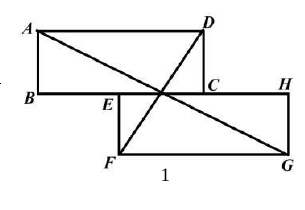
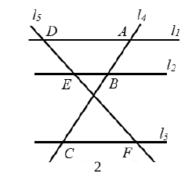
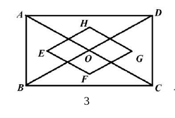
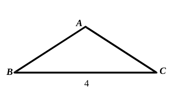

# 2026 一模精讲 · 奉贤卷（上）选择与填空 1-18

> 试卷满分 150 分，考试时间 100 分钟，共 25 题。本篇覆盖第 1-18 题（选择 6 题 × 4 分 + 填空 12 题 × 4 分，共 72 分），每题给"转录 + 简解 + 答案"；第 19-25 题见《数模26-奉贤-下》。

## 一、选择题（每题 4 分）

### 1．如果 a、b 满足 a/b＝2/5，那么下列各式正确的是（　）

(A) $a+b=7$　(B) $2a=5b$　(C) $\dfrac{a+b}{b}=\dfrac75$　(D) $\dfrac{a+2}{b+2}=\dfrac25$

**简解**：设 $a=2k$，$b=5k$。(A) 两边不同类，无理由成立；(B) 应为 $5a=2b$；(D) 分子分母同加 2 比例改变；(C) $\dfrac{a+b}{b}=\dfrac{2k+5k}{5k}=\dfrac75$ 正确（合比性质）。
**答案**：$\boxed{C}$

### 2．在 Rt△ABC 中，∠ACB＝90°，AB＝c，AC＝b，BC＝a，那么下列各式正确的是（　）

(A) $\tan A=\dfrac{b}{a}$　(B) $\cos A=\dfrac{a}{c}$　(C) $\sin B=\dfrac{b}{c}$　(D) $\cot B=\dfrac{b}{a}$

**简解**：$\tan A=\dfrac{a}{b}$（A 错）；$\cos A=\dfrac{b}{c}$（B 错）；$\cot B=\dfrac{a}{b}$（D 错）；$\sin B=\dfrac{AC}{AB}=\dfrac bc$ 正确。
**答案**：$\boxed{C}$

### 3．已知抛物线 y＝ax²（a≠0）经过点 A(m，8) 和 B(2，8)，那么 m 的值是（　）

(A) 2　(B) −2　(C) 8　(D) −8

**简解**：$y=ax^2$ 对称轴为 y 轴，纵坐标相等的两点关于 y 轴对称：$\dfrac{m+2}{2}=0\Rightarrow m=-2$。
**答案**：$\boxed{B}$

### 4．如果 a、b 都是非零向量，a∥b，那么下列结论中一定正确的是（　）

(A) $\vec a=n\vec b$（$n\neq0$）　(B) $\vec a=\vec b$　(C) $\vec a=-\vec b$　(D) $|\vec a|=|\vec b|$

**简解**：平行即共线向量：$\vec a$ 可由 $\vec b$ 伸缩得到（同向或反向，$n\neq0$），(A) 一定成立；B、C 只是方向相同的特例；D 与平行无关。
**答案**：$\boxed{A}$

### 5．如图 1，矩形 ABCD 与全等矩形 EFGH 放置，点 E 在边 BC 上且 E 为 BC 中点，联结 AG、DF，若 AG⊥DF，BC＝4，那么 AB 的长为（　）

(A) 1　(B) 3　(C) $\dfrac32$　(D) $\sqrt3$

**简解**：以下公共水平线为 x 轴：$B(0,0)$，$C(4,0)$，$A(0,p)$，$D(4,p)$（$p=AB$）；全等矩形 $EFGH$ 翻扣在下方，$E$ 为 $BC$ 中点：$E(2,0)$，$F(2,-p)$，$G(6,-p)$。
$\vec{AG}=(6,-2p)$，$\vec{DF}=(-2,-2p)$（向量表示）。由 $AG\perp DF$：$-12+4p^2=0$（数量积为 0），$p^2=3$，$p>0$，$\therefore AB=\sqrt3$。
**答案**：$\boxed{D}$
⚠️ 扫描件本题中文缺字，"全等矩形、E 为 BC 中点"系按卷面图形比例与参考答案 D 反推，原卷表述以纸质卷为准 ⚠️ 待核对。

### 6．一个三角形框架模型的边长分别为 20cm、30cm、40cm，工人师傅要用两根 30cm 和 50cm 的铁丝做一个与模型相似的三角形，以其中一根为一边，另一根上截出两段（允许有余料）作为另外两边，那么所做的三角形周长是（　）

(A) 80cm　(B) 67.5cm　(C) 60cm　(D) 52.5cm

**简解**：以 30 为一边：若对应 20（放大 1.5 倍）需另两边 45、60，超长；对应 30 需 20＋40＝60，超长；对应 40（缩为 0.75 倍）需另两边 $15+22.5=37.5\le50$ ✓。周长 $=30+15+22.5=67.5$。以 50 为一边各情况均超 30，不可行。
**答案**：$\boxed{B}$

## 二、填空题（每题 4 分）

### 7．计算：3(a−2b)＝　▲

**简解**：去括号（分配律）。
**答案**：$\boxed{3\vec a-6\vec b}$（向量运算同）

### 8．已知抛物线 y＝2(x＋1)² 与抛物线 y＝a(x＋1)² 关于 x 轴对称，那么 a 的值是　▲

**简解**：关于 x 轴对称：横坐标不变，纵坐标变相反数，$a=-2$。
**答案**：$\boxed{-2}$

### 9．如果二次函数 y＝(m＋3)x²−1 的图像有最低点，那么 m 的取值范围是　▲

**简解**：有最低点 $\Rightarrow$ 开口向上 $\Rightarrow m+3>0$。
**答案**：$\boxed{m>-3}$

### 10．某汽车的紧急刹车距离 s（米）与车速 v（千米/小时）的关系是 s＝v²/100。如果前方 25 米处发生了事故，司机立即刹车，要想汽车恰好停在事故点之前，那么车速最高不能超过　▲　千米/小时

**简解**：令 $\dfrac{v^2}{100}=25$，$v^2=2500$，$v=50$（负值舍去）。
**答案**：$\boxed{50}$
⚠️ 题干尾部中文缺字，问法按参考答案 50 反推 ⚠️ 待核对。

### 11．在△ABC 中，点 D、E 分别在边 AB、AC 上，DE∥BC。如果 AD∶BD＝2∶1，那么 DE∶BC 的值是　▲

**简解**：$DE\parallel BC\Rightarrow\triangle ADE\backsim\triangle ABC$，$\dfrac{DE}{BC}=\dfrac{AD}{AB}=\dfrac{2}{2+1}=\dfrac23$。
**答案**：$\boxed{\dfrac23}$

### 12．如图 2，直线 l₁、l₂、l₃ 分别交直线 l₄ 于点 A、B、C，交直线 l₅ 于点 D、E、F，l₁∥l₂∥l₃。已知 DE＝4，DF＝10，BC＝5，那么线段 AC 的长是　▲

**简解**：$EF=DF-DE=6$。由平行线分线段成比例：$\dfrac{AB}{DE}=\dfrac{BC}{EF}\Rightarrow AB=\dfrac{4\times5}{6}=\dfrac{10}{3}$。
$AC=AB+BC=\dfrac{10}{3}+5=\boxed{\dfrac{25}{3}}$。

### 13．小华在某游乐园 APP 的地图上看到，某游玩项目排队区域的图上长度约 2.5 厘米，已知该地图的比例尺是 1∶1000，那么排队区域的实际长度约　▲　米

**简解**：$2.5\times1000=2500$cm $=25$m。
**答案**：$\boxed{25}$

### 14．景区缓坡步道设计坡度为 1∶2.4，施工方测得观景台距离地面的垂直高度为 10 米，为满足设计要求，这段缓坡步道的长度应为　▲　米

**简解**：坡度 $1:2.4=5:12$，坡面三边比 $5:12:13$。高 10 米 $=5\times2$，坡长 $=13\times2=26$。
**答案**：$\boxed{26}$

### 15．如果一个等腰三角形腰上的高与底边上的高的比为 2∶3，那么这个等腰三角形底角的余弦值是　▲

**简解**：等腰 △ABC（AB＝AC），面积法：$\dfrac12\cdot AC\cdot h_{腰}=\dfrac12\cdot BC\cdot h_{底}$，故 $\dfrac{h_{腰}}{h_{底}}=\dfrac{BC}{AC}=\dfrac23$。
底角 $\cos B=\dfrac{BC/2}{AB}=\dfrac{BC}{2AB}=\dfrac12\times\dfrac23=\boxed{\dfrac13}$。

### 16．小海操控一辆遥控玩具车从 A 处沿北偏东 60° 方向走了 6 米到 B 处，再从 B 处向正南方向走了 9 米到达 C 处，此时这辆遥控玩具车离 A 处的距离是　▲　米

**简解**：建系：$A(0,0)$，$B(6\sin60°,\,6\cos60°)=(3\sqrt3,\,3)$；向正南 9 米：$C(3\sqrt3,\,-6)$。
$AC=\sqrt{(3\sqrt3)^2+6^2}=\sqrt{27+36}=\sqrt{63}=\boxed{3\sqrt7}$。

### 17．如图 3，矩形 ABCD 的面积为 18，对角线 AC、BD 交于点 O。如果 E、F、G、H 分别是△ABO、△BCO、△CDO、△DAO 的重心，那么四边形 EFGH 的面积是　▲

**简解**：设矩形边 $BC=b$、$AB=a$。$E$ 为 △ABO 重心：$E\left(\dfrac b6,\dfrac a2\right)$；同理 $F\left(\dfrac b2,\dfrac a6\right)$、$G\left(\dfrac{5b}6,\dfrac a2\right)$、$H\left(\dfrac b2,\dfrac{5a}6\right)$。
对角线 $EG=\dfrac{2b}{3}$（水平）、$FH=\dfrac{2a}{3}$（竖直），互相垂直平分，四边形 $EFGH$ 是菱形。
$S=\dfrac12\cdot\dfrac{2b}{3}\cdot\dfrac{2a}{3}=\dfrac{2ab}{9}=\dfrac{2\times18}{9}=\boxed{4}$。

### 18．如图 4，在△ABC 中，AB＝AC＝5，cot B＝4/3，将△ABC 绕点 A 旋转，B 的对应点为点 D，联结 AD 交边 BC 于点 E。如果 AE＝3ED，那么 CE 的长为　▲

**简解**：$\cot B=\dfrac43\Rightarrow\cos B=\dfrac45$，$BC=2\times5\times\dfrac45=8$，高 $=3$。建系：$B(0,0)$，$C(8,0)$，$A(4,3)$。
设 $E(e,0)$。$AE=3ED$ 且 $E$ 在 $A$、$D$ 之间：$\vec{AE}=\dfrac34\vec{AD}$，得 $D=\left(\dfrac{4e-4}{3},\,-1\right)$。
旋转不改变长度：$AD=AB=5$：$\left(\dfrac{4e-16}{3}\right)^2+(-1-3)^2=25\Rightarrow\dfrac{4e-16}{3}=\pm3$。
$e=\dfrac{25}{4}$ 或 $e=\dfrac74$，$CE=8-e=\boxed{\dfrac74\ \text{或}\ \dfrac{25}{4}}$。
（若 E 在 D 外侧，解得 E 落在 BC 外，不合题意。）

## 答案速查与互证

| 题号 | 1 | 2 | 3 | 4 | 5 | 6 | 7 | 8 | 9 | 10 | 11 | 12 | 13 | 14 | 15 | 16 | 17 | 18 |
| --- | --- | --- | --- | --- | --- | --- | --- | --- | --- | --- | --- | --- | --- | --- | --- | --- | --- | --- |
| 答案 | C | C | B | A | D | B | $3\vec a-6\vec b$ | $-2$ | $m>-3$ | 50 | $\frac23$ | $\frac{25}3$ | 25 | 26 | $\frac13$ | $3\sqrt7$ | 4 | $\frac74$ 或 $\frac{25}4$ |

与卷末参考答案逐题互证：全部一致。第 5、10 题题干中文缺字、按卷面与答案反推补全（见上⚠️），答案数值本身与卷面一致。
