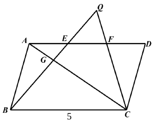
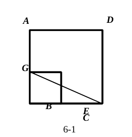
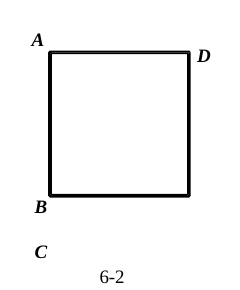
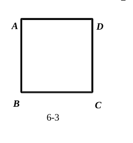
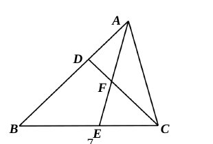
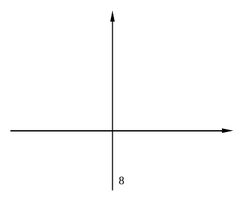
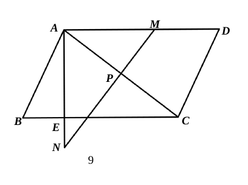

# 2026 一模精讲 · 奉贤卷（下）解答题 19-25

> 本篇覆盖第 19-25 题（共 78 分），每题"完整转录 + 渐进三段提示 + 详解 + 易错"。第 1-18 题见《数模26-奉贤-上》。

### 19．（本题 10 分）计算：$\cos^245°+\dfrac{2\sin60°}{2-\cot30°}-\tan^260°$

**🧭 提示**：① 三个特殊角三角比先代值；② 分母 $2-\cot30°$ 含根号差，用分母有理化；③ 按先乘除后加减收口。

**✍️ 详解**：
$\cos45°=\dfrac{\sqrt2}{2}$，$2\sin60°=2\times\dfrac{\sqrt3}{2}=\sqrt3$，$\cot30°=\sqrt3$，$\tan60°=\sqrt3$（特殊角三角比）。

原式 $=\left(\dfrac{\sqrt2}{2}\right)^2+\dfrac{\sqrt3}{2-\sqrt3}-(\sqrt3)^2$（代入）
$=\dfrac12+\dfrac{\sqrt3(2+\sqrt3)}{(2-\sqrt3)(2+\sqrt3)}-3$（平方、分母有理化，$(2-\sqrt3)(2+\sqrt3)=4-3=1$）
$=\dfrac12+(2\sqrt3+3)-3$（分子展开）
$=\boxed{\dfrac12+2\sqrt3}$

**⚠️ 易错**：分母有理化乘 $(2+\sqrt3)$ 时分子别漏乘；$\cos^245°=\frac12$、$\tan^260°=3$ 两个平方易混；最后 $+3-3$ 消掉，答案含 $\frac12$，漏写是常见丢分。

### 20．（本题 10 分）数学课上老师出示了一条抛物线，甲、乙、丙三位同学分别用一句话描述它——甲：这条抛物线的对称轴是直线 x＝2；乙：将这条抛物线向下平移 2 个单位，会经过原点；丙：这条抛物线在对称轴的右侧部分是下降的。(1) 如果三位同学的描述都正确，请你写出一个同时满足这些描述的抛物线的表达式，并求出此时它的顶点坐标；(2) 请根据老师给出的这条抛物线，再写出一个正确结论（与三位同学的描述不一样）。

**🧭 提示**：① 甲给对称轴、乙给 c−2＝0、丙给开口方向；② 设一般式列三个条件；③ 第(2)问答案开放，写一条能由图像读出的真结论。

**✍️ 详解**：
**(1)** 设 $y=ax^2+bx+c$（$a\neq0$）。
由甲：$-\dfrac{b}{2a}=2$；由乙：图象过原点前先下移 2，即 $c-2=0\Rightarrow c=2$；由丙：右侧下降 $\Rightarrow a<0$（开口向下）。
取 $a=-1$：$-\dfrac{b}{-2}=2\Rightarrow b=4$。
$\therefore$ 可取 $\boxed{y=-x^2+4x+2}$（答案不唯一，$a<0$ 且 $\frac b{-2a}=2$、$c=2$ 均可），此时顶点坐标 $\left(2,\,-1\times4+8+2\right)$，即 $\boxed{(2,\,6)}$。

**(2)** 例如：抛物线开口向下；与 x 轴有两个交点；在直线 x＝2 的左侧上升；当 x＝0 时 y＝2 等（写出一条即可，答案不唯一）。

**⚠️ 易错**：乙的条件是"下移后过原点"，即 $c=2$ 而非 $c=0$；丙的"右侧下降"锁定 $a<0$，取 $a=1$ 会与丙矛盾；顶点纵坐标要代化简后的式子算，别只写横坐标。

### 21．（本题 10 分）如图 5，在▱ABCD 中，点 E、F 在边 AD 上，AE＝EF＝FD，BE 交 AC 于点 G，BE、CF 的延长线交于点 Q。(1) 求 BG∶EG∶QE；(2) 设 $\vec{BA}=\vec a$，$\vec{BC}=\vec b$，那么 $\vec{CG}=$　▲　，$\vec{CQ}=$　▲　（用向量 a、b 表示）。

**🧭 提示**：① AE＝EF＝FD 给出 AE∶BC＝1∶3；② EG、QE 分别用 "A 字型" 与 "8 字型" 基本图形转成同一段上的比；③ 向量用 "$\vec{CG}=\vec{CB}+\vec{BG}$" 分步合成，系数全部换到 a、b 上。

**✍️ 详解**：
**(1)** $\because$ 四边形 ABCD 是平行四边形，$\therefore AD\parallel BC$，$AD=BC$。
$\therefore\dfrac{AE}{BC}=\dfrac{AE}{AD}=\dfrac13$，$\dfrac{EF}{BC}=\dfrac{EF}{AD}=\dfrac13$。
$\because AE\parallel BC$，$\therefore\dfrac{EG}{BG}=\dfrac{AE}{CB}=\dfrac13$（A 字型）；$\because EF\parallel BC$，$\therefore\dfrac{QE}{QB}=\dfrac{EF}{CB}=\dfrac13$（8 字型，Q、E、B 共线）。
设 $EG=k$（$k>0$），则 $BG=3k$，$BE=4k$；由 $\dfrac{QE}{QE+4k}=\dfrac13$ 解得 $QE=2k$。
$\therefore BG:EG:QE=3k:k:2k=\boxed{3:1:2}$。

**(2)** $\vec{AE}=\dfrac13\vec{AD}=\dfrac13\vec{BC}=\dfrac13\vec b$（平行四边形对边相等且平行）。
$\vec{BE}=\vec{BA}+\vec{AE}=\vec a+\dfrac13\vec b$（向量加法三角形法则）。
$\because BG:GE=3:1$，$\therefore\vec{BG}=\dfrac34\vec{BE}=\dfrac34\vec a+\dfrac14\vec b$。
$\therefore\vec{CG}=\vec{CB}+\vec{BG}=-\vec b+\dfrac34\vec a+\dfrac14\vec b=\boxed{\dfrac34\vec a-\dfrac34\vec b}$。
设 $\vec{CQ}=\vec{CB}+\vec{BQ}$：由(1)，$QB=QE+EB=2k+4k=6k=\dfrac32\cdot4k=\dfrac32BE$，$\therefore\vec{BQ}=\dfrac32\vec{BE}$（Q 在 BE 延长线上，同向）。
$\therefore\vec{CQ}=-\vec b+\dfrac32\left(\vec a+\dfrac13\vec b\right)=\boxed{\dfrac32\vec a-\dfrac12\vec b}$。

**⚠️ 易错**：8 字型中 $QE:QB=1:3$（不是 $QE:EB$），联立 $QB=QE+4k$ 才解得出 QE；第(2)问 $\vec{CB}=-\vec b$ 的负号易丢；⚠️ 答案页印 $\vec{CG}=\frac23(\vec a-\vec b)$，与第(1)问 $BG:EG=3:1$ 及坐标复核（$A(1,2),B(0,0),C(4,0),D(5,2)$ 时 $\vec{CG}=(-\frac94,\frac32)=\frac34(\vec a-\vec b)$）矛盾，应为 $\frac34\vec a-\frac34\vec b$，疑答案排印之误 ⚠️ 待核对。

### 22．（本题 10 分）如果一个小正方形的一组邻边在大正方形的边上，那么我们就称这个小正方形是大正方形的"内邻正方形"，这个"内邻正方形"的面积与大正方形面积的比值叫作"内邻值"。(1) 如图 6-1，正方形 BEFG 是正方形 ABCD 的一个"内邻正方形"，如果 tan∠BCG＝1/3，求此时的"内邻值"；(2) 请用两种不同的方法，用无刻度直尺和圆规在图 6-2 和图 6-3 的正方形 ABCD 中分别作出它的"内邻值"为 1/2 的"内邻正方形"（写出结论，并保留作图痕迹）。

**🧭 提示**：① 内邻正方形 BEFG 与正方形 ABCD 共用顶点 B，E 在 BC 上、G 在 AB 上，边长 BE＝BG；② (1) 用 tan∠BCG 把 BG 表成 BC 的分数；③ (2) 内邻值 1/2 ⇒ BE²＝½BC²，即 BE＝BC 的 $\frac{\sqrt2}{2}$ 倍——恰好等于对角线的一半。

**✍️ 详解**：
**(1)** 设正方形 ABCD 边长为 $a$（$a>0$），面积 $a^2$。
在 Rt△BCG 中，$\tan\angle BCG=\dfrac{BG}{BC}=\dfrac13$（正切定义），$\therefore BG=\dfrac13a$。
内邻正方形 $BEFG$ 边长 $=BG=\dfrac13a$，面积 $=\dfrac19a^2$。
$\therefore$ 内邻值 $=\dfrac{a^2/9}{a^2}=\boxed{\dfrac19}$。

**(2)** 目标：$BE^2=\dfrac12BC^2$，即 $BE=\dfrac{\sqrt2}{2}BC$。
**法一（对角线法）**：连接对角线 $AC$、$BD$，设交点 $O$。由勾股定理 $BD=\sqrt2\,BC$，故 $BO=\dfrac{\sqrt2}{2}BC$。以 $B$ 为圆心、$BO$ 长为半径画弧，分别交 $BC$ 于 $E$、交 $BA$ 于 $G$，作出正方形 $BEFG$。验证：$BE=BG=BO=\dfrac{\sqrt2}{2}BC$，$\angle EBG=90°$，$\therefore$ 面积 $=\dfrac12BC^2$，内邻值 $=\dfrac12$ ✓。
**法二（中点构造法）**：取 $AB$ 中点 $N$、$BC$ 中点 $M$，联结 $MN$，则 $MN=\sqrt{\left(\dfrac{BC}{2}\right)^2+\left(\dfrac{BC}{2}\right)^2}=\dfrac{\sqrt2}{2}BC$（勾股定理）。以 $B$ 为圆心、$MN$ 长为半径画弧交 $BC$ 于 $E$、$BA$ 于 $G$，同理作出正方形 $BEFG$，内邻值为 $\dfrac12$ ✓。
结论：所作正方形 $BEFG$ 即为内邻值为 $\dfrac12$ 的内邻正方形（保留痕迹，作法合理即可）。

**⚠️ 易错**：内邻值是面积比，勿开方成边长比；tan∠BCG 中 BG 是对边、BC 是邻边，别倒置；(2) 问必须"两种不同方法"且保留圆规弧线痕迹，只写结论不给分；$\frac{\sqrt2}{2}a$ 恰为半条对角线是本题作图的核心洞察。

### 23．（本题 12 分）如图 7，在△ABC 中，点 D、E 分别在边 AB、BC 上，CD、AE 相交于点 F，CD＝BD，AE＝AC。(1) 求证：△ADF∽△CDA；(2) 联结 DE。如果 $\dfrac{AD}{AB}=\dfrac{CE}{CB}$，求证：$AD\cdot AE=DC\cdot DE$。

**🧭 提示**：① 两组等腰给出两对等角，外角定理把差角转到 △ADF 与 △CDA 身上；② (2) 先由比例式证 DE∥AC；③ 再用 △ADE∽△CFA 把 DE、AE 与 AF、AC 挂钩，回头用(1)的比例式收尾。

**✍️ 详解**：
**(1)** $\because CD=BD$，$\therefore\angle B=\angle DCB$（等边对等角）；$\because AE=AC$，$\therefore\angle AEC=\angle ACB$。
$\because\angle AEC=\angle B+\angle BAE$，$\angle ACB=\angle DCB+\angle ACD$（外角性质与和差），
$\therefore\angle BAE=\angle ACD$。
又 $\angle ADF=\angle CDA$（公共角），$\therefore\boxed{\triangle ADF\backsim\triangle CDA}$（两角对应相等）。

**(2)** $\because\dfrac{AD}{AB}=\dfrac{CE}{CB}$，$\therefore\dfrac{AB-AD}{AB}=\dfrac{CB-CE}{CB}$，即 $\dfrac{BD}{AB}=\dfrac{BE}{BC}$（等式性质）。
$\therefore DE\parallel AC$（平行线分线段成比例的逆定理）。
$\therefore\angle BDE=\angle DAC$（同位角）；由(1) $\triangle ADF\backsim\triangle CDA$ 得 $\angle DFA=\angle DAC$，且 $\dfrac{AD}{DC}=\dfrac{AF}{AC}$。
$\therefore\angle BDE=\angle DAC$（同位角）$=\angle DFA$（由(1)相似对应角）。
$\because D$ 在 $AB$ 上，$\therefore\angle ADE+\angle BDE=180°$（邻补角）；$\because A$、$F$、$E$ 共线，$\therefore\angle CFA+\angle DFA=180°$（邻补角）。
$\therefore\angle ADE=\angle CFA$（等角的补角相等）。
又 $\angle BAE=\angle ACD$（(1)已证，即 $\angle DAE=\angle ACF$），
$\therefore\triangle ADE\backsim\triangle CFA$（两角对应相等）。
$\therefore\dfrac{DE}{FA}=\dfrac{AE}{AC}$（对应边成比例），$\therefore\dfrac{DE}{AE}=\dfrac{AF}{AC}$。
结合(1)中 $\dfrac{AD}{DC}=\dfrac{AF}{AC}$：$\therefore\dfrac{DE}{AE}=\dfrac{AD}{DC}$，
即 $\boxed{AD\cdot AE=DC\cdot DE}$（比例基本性质）。

**⚠️ 易错**：由比例式转 DE∥AC 用的是逆定理，需先化成 $\frac{BD}{AB}=\frac{BE}{BC}$；$\angle ADE=\angle CFA$ 的互补传递（两组共线角）必须交代共线事实；最后乘积式由比例交叉相乘得到，方向（AD×AE 对 DC×DE）写反即错。

### 24．（本题 12 分）在平面直角坐标系 xOy 中（如图 8），抛物线 y＝ax²＋bx＋3（a≠0）与 x 轴交于点 A(−1，0) 和点 B，与 y 轴交于点 C，顶点为 D(1，m)。(1) 求点 B 的坐标及 m 的值；(2) 将抛物线沿射线 BC 方向平移，得到新抛物线的顶点为 E。① 如果四边形 ABDE 是梯形且 AE∥BD（DE 不平行于 x 轴），求点 E 的坐标；② 如果∠EAC＝∠CBD，求平移后新抛物线的表达式。

**🧭 提示**：① 顶点横坐标给对称轴 x＝1，A、B 关于它对称；② (2) 平移沿射线 BC ⇒ 直线 DE∥BC；①用 △EAN∽△DMB 解 E；② 先证 ∠CBD＝∠ACO，得 EA∥OC，E 的横坐标即 −1。

**✍️ 详解**：
**(1)** 对称轴 $x=-\dfrac{b}{2a}=1$（顶点横坐标）。$A(-1,0)$ 关于 $x=1$ 的对称点为 $\boxed{B(3,0)}$。
把 $A(-1,0)$ 代入：$a-b+3=0$；由顶点横坐标：$-\dfrac{b}{2a}=1$。
联立解得 $a=-1$，$b=2$（消元）。
$\therefore y=-x^2+2x+3$，当 $x=1$ 时 $m=-1+2+3=4$，$\boxed{m=4}$，$D(1,4)$。

**(2)** $B(3,0)$，$C(0,3)$，直线 $BC$：$y=-x+3$，平移方向斜率为 $-1$，$\therefore$ 直线 $DE$：$y=-x+b$；代入 $D(1,4)$ 得 $b=5$，即 $DE$：$y=-x+5$。设 $E(m,\,-m+5)$。
**①** $\because AE\parallel BD$，作 $EN\perp x$ 轴、$DM\perp x$ 轴，垂足 $N(m,0)$、$M(1,0)$，则 $\angle ENA=\angle DMB=90°$，$\angle EAN=\angle DBM$（同位角），$\therefore\triangle EAN\backsim\triangle DMB$，$\therefore\dfrac{EN}{DM}=\dfrac{AN}{BM}$（相似三角形对应边成比例）。
$EN=-m+5$，$AN=-(1+m)$（E 在 A 左侧），$DM=4$，$BM=2$：$\dfrac{-m+5}{4}=\dfrac{-1-m}{2}\Rightarrow m=-7$。
$\therefore\boxed{E(-7,\,12)}$。
**②** 计算三边：$C(0,3)$、$D(1,4)$：$CD^2=1+1=2$；$BC^2=9+9=18$；$BD^2=4+16=20$。
$CD^2+BC^2=20=BD^2$，$\therefore\angle BCD=90°$（勾股定理逆定理）。
Rt△BCD 中 $\tan\angle CBD=\dfrac{CD}{BC}=\dfrac{\sqrt2}{\sqrt{18}}=\dfrac13$；Rt△ACO（O 原点）中 $\tan\angle ACO=\dfrac{AO}{CO}=\dfrac13$。
$\therefore\angle CBD=\angle ACO$；又 $\angle EAC=\angle CBD$（已知），$\therefore\angle EAC=\angle ACO$，$\therefore EA\parallel OC$（内错角相等，两直线平行）。
$\therefore E$ 的横坐标为 $-1$；代入 $DE$：$y=-(-1)+5=6$，$\therefore E(-1,6)$。
新抛物线以 $E$ 为顶点：$\boxed{y=-(x+1)^2+6}$（即 $y=-x^2-2x+5$）。

**⚠️ 易错**：① 解出的 $E$ 要检验 "DE 不平行 x 轴"（$-m+5\neq$ 常数排除了水平）；② 中 $\tan\angle CBD=\frac13$ 是先证 ∠BCD＝90° 才能用，跳步扣分；新抛物线顶点式别写成过 E 的 "原形平移量" 表达式。

### 25．（本题 14 分）如图 9，在▱ABCD 中，∠B 是锐角，AE⊥BC，垂足为 E，对角线 AC 的垂直平分线 MN 交 AD 于点 M，交 AE 的延长线于点 N，交 AC 于点 P。已知 AD＝8，CD＝5。(1) 在△ABE、△AEC、△APN 中：① 写出与△AMN 一定相似的三角形，并选一对说明理由；② 写出与△AMN 不一定相似的三角形，如果它与△AMN 相似，求出它们的相似比；(2) 如果 AE＝EN，求 sin∠B 的值。

**🧭 提示**：① MN 垂直平分 AC 给两个 90°：∠MAN＝90°（AE⊥BC、AD∥BC）、∠APN＝90°；② ① 用 "∠AMN 与 ∠EAC 同余" 挂钩；③ ② 分 ∠BAE＝∠N 与 ∠BAE＝∠AMN 两类，后者先证 △ABE≌△ACE；④ (2) 设 AE＝EN＝k，用 △APN∽△AEC 把 AC、BE 全用 k 表示，回到 Rt△ABE 解 k。

**✍️ 详解**：
**(1)①** 与 △AMN 一定相似的是 $\boxed{\triangle AEC\ \text{和}\ \triangle APN}$。
证 △AMN∽△AEC：$\because AD\parallel BC$ 且 $AE\perp BC$，$\therefore AE\perp AD$，$\angle MAN=\angle AEC=90°$（平行线性质与垂直定义）。
$\because MN$ 垂直平分 $AC$，$\therefore\angle AMN+\angle MAP=90°$（△APM 中两锐角互余）；又 $\angle EAC+\angle MAP=90°$（∠MAN＝90° 的组成部分），$\therefore\angle AMN=\angle EAC$（同角的余角相等）。
$\therefore\triangle AMN\backsim\triangle EAC$（两角对应相等）。（△AMN∽△APN：∠MAN＝∠APN＝90°，∠N 公共角。）
**②** 与 △AMN 不一定相似的是 $\triangle ABE$。若相似，由 ∠AEB＝∠MAN＝90°，只可能 ∠BAE＝∠N 或 ∠BAE＝∠AMN。
**情形一** ∠BAE＝∠N：则 $AB\parallel MN$（内错角相等，两直线平行）。
$\because\angle N+\angle PAN=90°$，$\therefore\angle BAE+\angle PAN=90°$，即 $\angle BAC=90°$。
$\because\angle BAC=90°$，$\angle AEB=90°$，$\angle B$ 公共，$\therefore\triangle BAE\backsim\triangle BCA$，$\therefore AB^2=BE\cdot BC$（射影定理）。
$\therefore\dfrac{BE}{AB}=\dfrac{AB}{BC}\Rightarrow\dfrac{BE}{5}=\dfrac58\Rightarrow BE=\dfrac{25}{8}$（$BC=AD=8$，$AB=CD=5$）。
$\because AB\parallel MN$，且平行四边形中 $AB\parallel DC$，$\therefore PM\parallel DC$（P、M 都在 MN 上）。
在 △ADC 中，$P$ 为 $AC$ 中点（垂直平分线），$PM\parallel DC$，$\therefore M$ 为 $AD$ 中点（平行线分线段成比例），$AM=\dfrac12AD=4$。
$\therefore\triangle EBA$ 与 $\triangle AMN$ 的相似比 $=\dfrac{BE}{AM}=\dfrac{25/8}{4}=\boxed{\dfrac{25}{32}}$。
**情形二** ∠BAE＝∠AMN：$\because\angle AMN=\angle PAN$（△AMN∽△APN），$\therefore\angle BAE=\angle CAE$。
又 $AE\perp BC$，$AE$ 公共，$\therefore\triangle ABE\cong\triangle ACE$（ASA），$\therefore AC=AB=5$，$BE=CE=4$，$AE=3$（勾股定理）。
$\therefore\cos\angle PAN=\cos\angle BAE=\dfrac{AE}{AB}=\dfrac35$。
△APN 中 $AP=\dfrac12AC=\dfrac52$（垂直平分线），设 $AP=3t$（$t>0$），则 $AC=6t$、$AN=5t$（3-4-5 比）：$6t=5\Rightarrow t=\dfrac56$，$AN=\dfrac{25}{6}$。
$\therefore$ 相似比 $=\dfrac{BE}{AN}=\dfrac{4}{25/6}=\boxed{\dfrac{24}{25}}$。
综上，相似比为 $\dfrac{25}{32}$ 或 $\dfrac{24}{25}$。

**(2)** $\because\angle PAN=\angle EAC$，$\angle APN=\angle AEC=90°$，$\therefore\triangle APN\backsim\triangle AEC$，$\therefore\dfrac{AP}{AE}=\dfrac{AN}{AC}$（对应边成比例）。
设 $AE=EN=k$（$k>0$），则 $AN=2k$；又 $AP=\dfrac12AC$（垂直平分线）。
$\therefore\dfrac12AC^2=AN\cdot AE=2k^2\Rightarrow AC=2k$（取正值）。
$EC=\sqrt{AC^2-AE^2}=\sqrt{4k^2-k^2}=\sqrt3k$（勾股定理），$\therefore BE=BC-EC=8-\sqrt3k$。
Rt△ABE 中 $BE^2+AE^2=AB^2$（勾股定理）：$(8-\sqrt3k)^2+k^2=5^2$，展开 $64-16\sqrt3k+4k^2=25$，即 $4k^2-16\sqrt3k+39=0$。
$k=\dfrac{16\sqrt3\pm\sqrt{768-624}}{8}=\dfrac{16\sqrt3\pm12}{8}=\dfrac{4\sqrt3\pm3}{2}$（求根公式）。
$k=\dfrac{4\sqrt3+3}{2}\approx4.96$ 时 $BE=8-\sqrt3k<0$，舍去（E 落在 BC 外）；$\therefore k=\dfrac{4\sqrt3-3}{2}$，即 $AE=\dfrac{4\sqrt3-3}{2}$。
$\therefore\sin\angle B=\dfrac{AE}{AB}=\dfrac{(4\sqrt3-3)/2}{5}=\boxed{\dfrac{4\sqrt3-3}{10}}$。

**⚠️ 易错**：① 两个"一定相似"都要写全，理由选一对讲透；② 的分类不能漏，两种情形的相似比分别来自 BE/AM 与 BE/AN，基准不同；情形一中 AM＝4 须借 PM∥DC、P 为中点推 M 为 AD 中点，勿默认；(2) 中 $BE=8-\sqrt3k>0$ 是舍根依据，必须写明；⚠️ 第(2)问题干中文缺字，"AE＝EN" 按答案页解法反推 ⚠️ 待核对。

## 答案速查与互证

| 题号 | 19 | 20 | 21 | 22 | 23 | 24 | 25 |
| --- | --- | --- | --- | --- | --- | --- | --- |
| 结果 | $\frac12+2\sqrt3$ | 如 $y=-x^2+4x+2$，顶点 $(2,6)$；结论开放 | $3:1:2$；$\vec{CG}=\frac34(\vec a-\vec b)$（答案页印 $\frac23$，疑误⚠️）、$\vec{CQ}=\frac32\vec a-\frac12\vec b$ | $\frac19$；作图内邻值 $\frac12$ 两种 | 证明；$AD\cdot AE=DC\cdot DE$ | $B(3,0)$、$m=4$；$E(-7,12)$；$y=-(x+1)^2+6$ | △AEC、△APN；$\frac{25}{32}$ 或 $\frac{24}{25}$；$\sin B=\frac{4\sqrt3-3}{10}$ |

与卷末参考答案逐题互证：数值与结论全部一致；两处例外已标注——第 21(2) 问答案页 $\vec{CG}$ 的系数 $\frac23$ 与推演矛盾（按 $\frac34$ 收录），第 19、25(2) 题干中文缺字按答案反推 ⚠️ 待核对。
