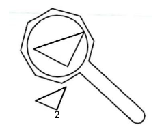
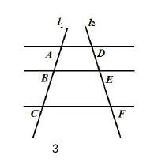
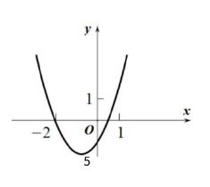
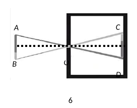
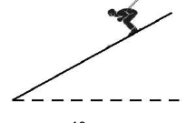
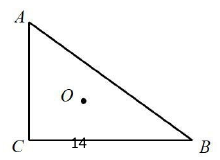
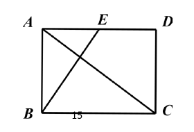
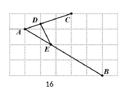
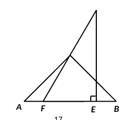

# 2026 一模精讲 · 宝山卷（上）选择与填空 1-18

> 试卷满分 150 分，考试时间 100 分钟。本篇覆盖第 1-18 题（选择 6 题 × 4 分 + 填空 12 题 × 4 分，共 72 分），每题给"转录 + 简解 + 答案"；第 19-25 题见《数模26-宝山-下》。

## 一、选择题（每题 4 分）

### 1．Rt△ABC 中，∠C＝90°，AC＝4，BC＝3，那么 cos A 的值是（　）

**简解**：$AB=\sqrt{AC^2+BC^2}=5$（勾股定理），$\cos A=\dfrac{AC}{AB}=\dfrac45$。
**答案**：$\boxed{C}$

### 2．用放大镜观察一个三角形，下列说法错误的是（　）

(A) 三角形各角的度数扩大　(B) 各边长度扩大　(C) 周长扩大　(D) 面积扩大

**简解**：放大是相似变换，只改变大小不改变形状——**角度不变**，故 (A) 错误。
**答案**：$\boxed{A}$

### 3．AD∥BE∥CF，直线 $l_1$、$l_2$ 与三条平行线分别交于 A、B、C 和 D、E、F，则下列结论不正确的是（　）

**简解**：平行线分线段成比例：$\dfrac{AB}{BC}=\dfrac{DE}{EF}$、$\dfrac{AB}{AC}=\dfrac{DE}{DF}$、$\dfrac{BC}{AC}=\dfrac{EF}{DF}$ 均正确；(B) 中 $BE$、$CF$ 根本不在同一条被截直线上（A、B、C 在 $l_1$，D、E、F 在 $l_2$），比例不成立。
**答案**：$\boxed{B}$

### 4．下列关于向量的说法正确的是（　）

(A) 如果 $k\vec a=\vec 0$，那么 $k=0$；(B) 如果 $\vec a=-3\vec b$（$\vec b$ 为非零向量），那么 $\vec a\parallel\vec b$；(C) 如果 $\vec e$ 是单位向量，那么 $\vec e=1$；(D) 如果 $\vec a$ 与 $\vec b$ 互为相反向量，那么 $\vec a+\vec b=0$。

**简解**：(A) 中 $\vec a$ 可能是零向量；(C) 单位向量满足 $|\vec e|=1$，向量不能等于数；(D) 相加应得**零向量 $\vec 0$** 而非数 0；(B) 中 $\vec a$ 是 $\vec b$ 的倍数，必平行，正确。
**答案**：$\boxed{B}$

### 5．二次函数 $y=ax^2+bx+c$（$a\neq0$）的图像如图，则成立的是（　）

**简解**：开口向上 $a>0$（A 错）；对称轴 $x=-\dfrac{b}{2a}\in(-1,0)$ 得 $b>0$（B 错）；$x=1$ 是根，$a+b+c=0$（C 错）；$x=-1$ 介于两根之间，$y=a-b+c<0$ 成立。
**答案**：$\boxed{D}$

### 6．暗室小孔成像：人 AB 与像 CD 到小孔 O 的距离均为 6 米，要使像 CD 长变为原来的 1.5 倍，应（　）

(A) 人后退 2 米　(B) 人前进 2 米　(C) 人后退 4 米　(D) 人前进 4 米

**简解**：像长：人长＝像距：物距。墙位置不动，像距恒为 6 米；要 $\dfrac{6}{\text{物距}}=1.5$，需物距 $=4$ 米，即由 6 米处向小孔**前进 2 米**。
**答案**：$\boxed{B}$

## 二、填空题（每题 4 分）

### 7．计算：$2\vec a-2\vec b+3\vec b=$　▲

**简解**：合并同类向量：$-2\vec b+3\vec b=\vec b$。
**答案**：$\boxed{2\vec a+\vec b}$
⚠️ 答案页印作 $2\vec a-\vec b$，与代入计算 $2\vec a+(-2+3)\vec b=2\vec a+\vec b$ 不符；若答案为 $2\vec a-\vec b$ 则题干应为 $2\vec a+2\vec b-3\vec b$。两处必有一处排印之误，以题干为准 ⚠️ 待核对。

### 8．如果 $\dfrac{y}{x}=\dfrac35$，那么 $\dfrac{x+y}{y}$ 的值是　▲

**简解**：$\dfrac{x+y}{y}=\dfrac{x}{y}+1=\dfrac53+1=\dfrac83$。
**答案**：$\boxed{\dfrac85}$

### 9．抛物线 $y=(m-1)x^2+3x-1$ 开口向下，则 $m$ 的取值范围是　▲

**简解**：开口向下 $\Rightarrow m-1<0$。
**答案**：$\boxed{m<1}$

### 10．线段 $a=3$，$b=5$，$c$ 是 $a$、$b$ 的比例中项，则 $c=$　▲

**简解**：$c^2=ab=15$，$c>0$。
**答案**：$\boxed{\sqrt{15}}$

### 11．A(−1, y₁)、B(2, y₂) 在 $y=(x-1)^2+1$ 上，比较 $y_1$　▲　$y_2$

**简解**：$y_1=(-2)^2+1=5$，$y_2=1^2+1=2$。
**答案**：$\boxed{>}$

### 12．AB＝4cm，P 是 AB 的黄金分割点（AP＞BP），则 AP＝　▲　cm

**简解**：$AP=4\times\dfrac{\sqrt5-1}{2}=2\sqrt5-2$。
**答案**：$\boxed{2\sqrt5-2}$

### 13．沿坡比 1∶2.4 的斜坡笔直滑下 52 米，下降高度为　▲　米

**简解**：$1:2.4=5:12$，坡面三边比 $5:12:13$；$52\div13=4$，下降 $=5\times4=20$。
**答案**：$\boxed{20}$

### 14．Rt△ABC 中，∠ACB＝90°，O 是△ABC 的重心，AB＝10，则 C、O 两点间的距离为　▲

**简解**：斜边中线 $=\dfrac{AB}{2}=5$（直角三角形斜边上的中线等于斜边的一半），重心分中线为 $2:1$，$CO=\dfrac23\times5=\dfrac{10}{3}$。
**答案**：$\boxed{\dfrac{10}{3}}$

### 15．矩形 ABCD 中，AB＝2√2，E 是边 AD 的中点，BE⊥AC，则 BE＝　▲

**简解**：设 $AD=d$，$BE$ 交 $AC$ 于 $F$。因 $E$ 在 $AD$ 上且 $AD\perp AB$，△$ABE$ 是直角三角形，$BE^2=AB^2+AE^2=8+\dfrac{d^2}{4}$。由 $BE\perp AC$ 得 $\angle BEA=90°-\angle DAC$；又 Rt△ACD 中 $\angle ACD=90°-\angle DAC$，故 $\angle BEA=\angle ACD$，$\tan\angle BEA=\dfrac{AB}{AE}=\dfrac{2\sqrt2}{d/2}=\dfrac{4\sqrt2}{d}$，$\tan\angle ACD=\dfrac{AD}{CD}=\dfrac{d}{2\sqrt2}$，两者相等得 $d^2=16$，$d=4$。$BE=\sqrt{8+4}=2\sqrt3$。
**答案**：$\boxed{2\sqrt3}$

### 16．正方形网格中每个小正方形边长均为 1，A、B、C 在格点上，D、E 分别是线段 AC、AB 与小正方形边的交点，则 DE＝　▲

**简解**：以网格左上角为原点建系，$A(1,1)$、$C(4,0)$、$B(6,4)$。$D$ 是 $AC$ 与第二条竖直网格线的交点，$AD:AC=1:3$；$E$ 是 $AB$ 与第二条水平网格线的交点，$AE:AB=1:3$。由平行线分线段成比例，$DE\parallel CB$ 且 $DE=\dfrac13BC=\dfrac13\sqrt{(6-4)^2+(4-0)^2}=\dfrac{2\sqrt5}{3}$。
**答案**：$\boxed{\dfrac{2\sqrt5}{3}}$

### 17．一副直角三角板：∠ACB＝∠DEF＝90°，∠A＝45°，∠D＝30°，AB＝DE，C 在边 DF 上，E、F 在边 AB 上，EF＝2，则 AF＝　▲

**简解**：① Rt△DEF 中 $\angle D=30°$，$EF=2$ 是 30° 角所对的直角边，故斜边 $DF=4$、$DE=2\sqrt3$、$\angle DFE=60°$；又 $AB=DE=2\sqrt3$。② 等腰 Rt△ABC 斜边上的中线 $CM=\dfrac{AB}{2}=\sqrt3$（M 为 AB 中点），且 $CM\perp AB$。③ $C$ 在 $DF$ 上：在 Rt△CFM 中 $\angle CFM=\angle DFE=60°$，$FM=\dfrac{CM}{\tan60°}=\dfrac{\sqrt3}{\sqrt3}=1$；沿 $DF$ 高度从 F（高 0）升到 D（高 $2\sqrt3$），$C$ 处高为 $CM=\sqrt3$，恰为 $DF$ 中点。④ $AM=\dfrac{AB}{2}=\sqrt3$，$AF=AM-FM=\sqrt3-1$。
**答案**：$\boxed{\sqrt3-1}$

### 18．定义：有两个内角的差为 90° 的三角形叫做"差直三角形"。△ABC 中，∠B＞90°，tan C＝3/4，BC＝4，若 △ABC 是"差直三角形"，则 AB 的长为　▲

**简解**：由 $\tan C=\dfrac34$ 得 $\sin C=\dfrac35$，$\cos C=\dfrac45$。因 $\angle B>90^\circ$，"差 90°"只能是 ∠B 减去某锐角，故只有两种可能：
① $\angle B-\angle C=90°$：$\angle B=\angle C+90°$，$\angle A=90°-2\angle C$，$\sin A=\cos2C=\dfrac7{25}$，由正弦定理 $AB=\dfrac{BC\cdot\sin C}{\sin A}=\dfrac{60}{7}$；
② $\angle B-\angle A=90°$：$\angle A=45°-\dfrac{\angle C}{2}$，$\tan\dfrac C2=\dfrac{\sin C}{1+\cos C}=\dfrac13$，$\tan A=\dfrac{1-\frac13}{1+\frac13}=\dfrac12$，$\sin A=\dfrac{\sqrt5}{5}$，$AB=\dfrac{BC\cdot\sin C}{\sin A}=\dfrac{12\sqrt5}{5}$。
**答案**：$\boxed{\dfrac{12\sqrt5}{5}\ \text{或}\ \dfrac{60}{7}}$

## 答案速查与互证

| 题号 | 1 | 2 | 3 | 4 | 5 | 6 | 7 | 8 | 9 | 10 | 11 | 12 | 13 | 14 | 15 | 16 | 17 | 18 |
| --- | --- | --- | --- | --- | --- | --- | --- | --- | --- | --- | --- | --- | --- | --- | --- | --- | --- | --- |
| 答案 | C | A | B | B | D | B | $2\vec a+\vec b$⚠️ | $\frac85$ | $m<1$ | $\sqrt{15}$ | ＞ | $2\sqrt5-2$ | 20 | $\frac{10}{3}$ | $2\sqrt3$ | $\frac{2\sqrt5}{3}$ | $\sqrt3-1$ | $\frac{12\sqrt5}{5}$ 或 $\frac{60}{7}$ |

与卷末参考答案逐题互证：除第 7 题外全部一致（第 7 题见上⚠️）。
