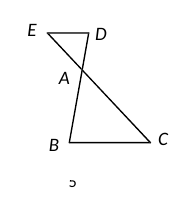
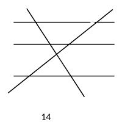
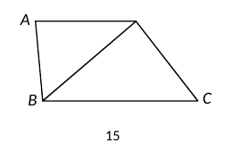
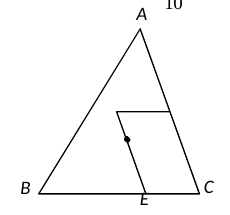
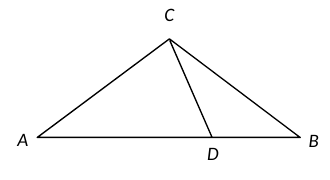

# 2026 一模精讲 · 崇明卷（上）选择与填空 1-18

> 本卷全称"2025 学年第一学期期末学业质量调研九年级数学"。本篇覆盖第 1-18 题，每题"转录 + 简解 + 答案"；第 19-25 题见《数模26-崇明-下》。

## 一、选择题（每题 4 分）

### 1．如果两个相似三角形的面积比为 1∶4，那么这两个三角形的对应中线的比为（　）

**简解**：相似比＝面积比的算术平方根 $=\dfrac12$，对应中线比等于相似比。
**答案**：$\boxed{A}$

### 2．Rt△ABC 中，∠C＝90°，AB＝10，AC＝6，那么下列说法正确的是（　）

(A) $\sin A=\dfrac35$；(B) $\cos A=\dfrac35$；(C) $\tan A=\dfrac35$；(D) $\cot A=\dfrac35$

**简解**：$BC=8$（勾股定理）：$\sin A=\dfrac{BC}{AB}=\dfrac45$，$\cos A=\dfrac{AC}{AB}=\dfrac35$，$\tan A=\dfrac43$，$\cot A=\dfrac34$。
**答案**：$\boxed{B}$

### 3．将抛物线 $y=3x^2$ 平移，使顶点移到点 M(−2, 1)，所得新抛物线的表达式是（　）

**简解**：$a=3$ 不变，顶点 $(−2,1)$：$y=3(x+2)^2+1$。
**答案**：$\boxed{C}$

### 4．下列命题正确的是（　）

(A) 如果 $|\vec a|=|\vec b|$，那么 $\vec a=\vec b$；(B) 如果 $\vec a$、$\vec b$ 都是单位向量，那么 $\vec a=\vec b$；(C) 如果 $\vec a=-\vec b$，那么 $\vec a\parallel\vec b$；(D) 如果 $m=0$ 或 $\vec a=\vec 0$，那么 $m\vec a=0$。

**简解**：(A)(B) 模相等不代表方向相同；(C) 相反向量必平行，正确；(D) 结论应为零向量 $\vec 0$，写成数 0 则向量与数不能画等号（与参考答案一致，取 D 错误）。
**答案**：$\boxed{C}$　⚠️ 若原卷 (D) 印作 $m\vec a=\vec 0$，则 D 亦成立，此处从参考答案 C，待核对。

### 5．△ABC 中，点 D、E 分别在 AB、AC 的反向延长线上，已知 AC＝2AE，下列条件中能判定 DE∥BC 的是（　）

(A) $\dfrac{AD}{AB}=\dfrac13$；(B) $\dfrac{AB}{BD}=\dfrac23$；(C) $\dfrac{AD}{BD}=\dfrac23$；(D) $\dfrac{DE}{BC}=\dfrac12$

**简解**：$DE\parallel BC\iff\dfrac{AD}{AB}=\dfrac{AE}{AC}=\dfrac12$（平行线分线段成比例，注意 D、E 在延长线上，$BD=AB+AD$）。(B)：$\dfrac{AB}{AB+AD}=\dfrac23\Rightarrow AD=\dfrac12AB$ ✓；(A) 直接给 $\dfrac13$ ✗；(C) 推出 $AD=2AB$ ✗；(D) 是结论不是条件 ✗。
**答案**：$\boxed{B}$

### 6．△ABC 和 △DEF 中，AB＝AC，DE＝DF，根据下列条件，一定能判断两三角形相似的是（　）

(A) $\dfrac{AB}{DE}=\dfrac{AC}{DF}$；(B) $\dfrac{AB}{DE}=\dfrac{AC}{EF}$；(C) ∠B＝∠D；(D) ∠C＝∠E

**简解**：(A) 由已知恒成立，无判别力；(B) 对应关系错乱；(C) 底角对顶角不保证相似（顶角一般不等）；(D)：$\angle C=\angle B$（等边对等角）、$\angle E=\angle F$（同），故 ∠B＝∠E＝∠F，∠A＝∠D＝180°−2∠B，三个角对应相等 → 相似。
**答案**：$\boxed{D}$

## 二、填空题（每题 4 分）

### 7．如果 $\dfrac ab=\dfrac32$，那么 $\dfrac{a}{a+b}$ 的值为　▲

**简解**：$\dfrac{a}{a+b}=\dfrac{a/b}{a/b+1}=\dfrac{3/2}{5/2}=\dfrac35$。
**答案**：$\boxed{\dfrac35}$

### 8．计算：$2(\vec a+2\vec b)-3\vec a=$　▲

**简解**：$2\vec a+4\vec b-3\vec a=-\vec a+4\vec b$。
**答案**：$\boxed{-\vec a+4\vec b}$

### 9．AB＝4cm，P 是 AB 的黄金分割点（AP＞BP），则 AP＝　▲　cm

**简解**：$AP=4\times\dfrac{\sqrt5-1}{2}=2\sqrt5-2$。
**答案**：$\boxed{2\sqrt5-2}$

### 10．抛物线 $y=(a+1)x^2+4$ 开口向下，则 a 的取值范围是　▲

**简解**：$a+1<0$。
**答案**：$\boxed{a<-1}$

### 11．A(−1, y₁)、B(−3, y₂) 为 $y=-(x-1)^2+k$ 上的两点，则 y₁　▲　y₂

**简解**：$y_1=-(-2)^2+k=k-4$，$y_2=-(-4)^2+k=k-16$。
**答案**：$\boxed{>}$

### 12．沿坡度 i＝1∶2.4 的斜坡前行 65 米，垂直高度上升　▲　米

**简解**：$1:2.4=5:12$，坡面三边比 $5:12:13$；上升 $=65\times\dfrac{5}{13}=25$。
**答案**：$\boxed{25}$

### 13．"描点法"画 $y=ax^2+bx+c$ 的图像列出表格：x＝−1,0,1,2,3,4 时 y＝−8,−3,0,1,0,−3。当 x＝5 时 y＝　▲

**简解**：$y(1)=y(3)=0$、$y(0)=y(4)=-3$ → 对称轴 $x=2$，顶点 (2,1)，$y=-(x-2)^2+1$；$y(5)=-9+1=-8$。
**答案**：$\boxed{-8}$

### 14．l₁∥l₂∥l₃ 与 l₄ 交于 A、B、C，与 l₅ 交于 D、E、F，AB＝2，AC＝5，EF＝4，则 DE＝　▲

**简解**：$\dfrac{AB}{AC}=\dfrac{DE}{DF}$，$DF=DE+4$：$\dfrac25=\dfrac{DE}{DE+4}$ → $DE=\dfrac83$。
**答案**：$\boxed{\dfrac83}$

### 15．四边形 ABCD 中，AD∥BC，∠ABD＝∠C，AD＝3，BD＝4，则 BC＝　▲

**简解**：AD∥BC → $\angle ADB=\angle DBC$（两直线平行，内错角相等）；又 ∠ABD＝∠C → △ABD∽△DCB（两角对应相等）→ $\dfrac{AD}{DB}=\dfrac{DB}{CB}$，$BC=\dfrac{DB^2}{AD}=\dfrac{16}{3}$。
**答案**：$\boxed{\dfrac{16}{3}}$

### 16．△ABC 中，$\sin A=\dfrac{\sqrt{10}}{10}$（A 是锐角），∠B＝45°，$AC=\sqrt{10}$，则 AB＝　▲

**简解**：$\cos A=\sqrt{1-\sin^2A}=\dfrac{3}{\sqrt{10}}$（A 是锐角）。作 CD⊥AB 于 D：$AD=AC\cos A=3$，$CD=AC\sin A=1$；∠B＝45° → $BD=CD=1$（等腰直角三角形）。$AB=AD+BD=4$。
**答案**：$\boxed{4}$

### 17．点 G 是 △ABC 的重心，D 是边 AC 的中点，GE∥AC 交 BC 于 E，DF∥BC 交 EG 于 F，则 $\dfrac{S_{\text{四边形}CDFE}}{S_{\triangle ABC}}=$　▲

**简解**：以 $B(0,0)$、$C(6,0)$、$A(3,3h)$ 建系（h＞0）：重心 $G(3,h)$，$D$ 为 AC 中点 $\left(4.5,\,1.5h\right)$；GE∥AC → $E(4,0)$；DF∥BC（水平线 $y=1.5h$）交直线 EG 于 $F(2.5,1.5h)$。连 DE，四边形 CDFE$=\triangle CDE+\triangle DFE$：$S_{\triangle CDE}=\frac12\cdot CE\cdot(\text{D 到 BC 的高})=\frac12\times2\times1.5h=1.5h$，$S_{\triangle DFE}=\frac12\cdot DF\cdot(\text{E 到 DF 的高})=\frac12\times2\times1.5h=1.5h$，合计 $3h$；$S_{\triangle ABC}=\frac12\times6\times3h=9h$，比值 $=\dfrac13$。
**答案**：$\boxed{\dfrac13}$

### 18．定义：一个三角形有两个内角的差为 90°，叫做"差直角三角形"。△ABC 中，AC＝BC＝10，AB＝16，D 是边 AB 上的动点（AD＞BD），若 △BCD 是"差直角三角形"，则 CD 的长为　▲

**简解**：$\cos B=\dfrac{BH}{BC}=\dfrac{8}{10}=\dfrac45$（H 为 C 在 AB 上的垂足，BH＝8），$\tan B=\dfrac34$，$CH=\sqrt{10^2-8^2}=6$。设 $BD=d\ (0<d<8)$，则 D 在 B、H 之间，$\tan(180^\circ-\angle BDC)=\dfrac{CH}{HD}=\dfrac{6}{8-d}$。△BCD 中 $\angle BDC\in(90^\circ,143.13^\circ)$、$\angle BCD\in(0^\circ,53.13^\circ)$，"$\angle BCD-\angle B$"达不到 90°，可能成立的是：
① $\angle BDC=\angle B+90^\circ=126.87^\circ$：$180^\circ-\angle BDC=53.13^\circ$，$\tan53.13^\circ=\dfrac43=\dfrac{6}{8-d}$ → $8-d=\dfrac92$，$d=\dfrac72$（$AD=12.5>BD$ ✓）：$CD=\sqrt{(8-d)^2+CH^2}=\sqrt{\dfrac{81}{4}+36}=\dfrac{15}{2}$；
② $\angle BDC=\angle BCD+90^\circ$：由内角和 $\angle BDC-\angle BCD=90^\circ$ 且 $\angle BCD=180^\circ-\angle B-\angle BDC$，得 $2\angle BDC=270^\circ-\angle B$，$\angle BDC=135^\circ-\dfrac{\angle B}{2}=116.565^\circ$，$180^\circ-\angle BDC=63.435^\circ$，$\tan63.435^\circ=2=\dfrac{6}{8-d}$ → $d=5$：$CD=\sqrt{3^2+6^2}=3\sqrt5$。
**答案**：$\boxed{\dfrac{15}{2}\ \text{或}\ 3\sqrt5}$

## 答案速查与互证

| 题号 | 1 | 2 | 3 | 4 | 5 | 6 | 7 | 8 | 9 | 10 | 11 | 12 | 13 | 14 | 15 | 16 | 17 | 18 |
| --- | --- | --- | --- | --- | --- | --- | --- | --- | --- | --- | --- | --- | --- | --- | --- | --- | --- | --- |
| 答案 | A | B | C | C⚠️ | B | D | $\frac35$ | $-\vec a+4\vec b$ | $2\sqrt5-2$ | $a<-1$ | ＞ | 25 | −8 | $\frac83$ | $\frac{16}{3}$ | 4 | $\frac13$ | $\frac{15}{2}$ 或 $3\sqrt5$ |

与卷末参考答案逐题互证：全部一致（第 4 题附命题表述说明，见上）。
