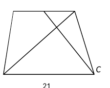
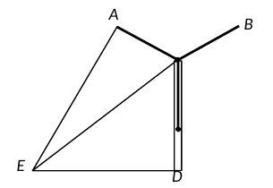
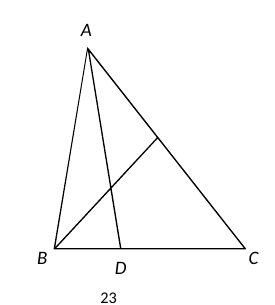
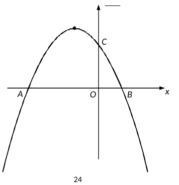
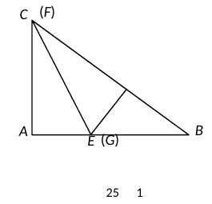
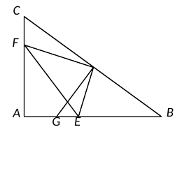

# 2026 一模精讲 · 崇明卷（下）解答题 19-25

> 本篇覆盖第 19-25 题（78 分）。每题给"题目—渐进提示—详解"；卷末附评分点与易错。参考数据：sin37°≈0.6，tan37°≈0.75，tan59°≈1.7，√3≈1.7。

## 19．（满分 10 分）计算

$$\frac{2\tan 60^\circ}{\cot 30^\circ-2\sin 30^\circ}+\cos^2 45^\circ$$

**提示 1**：分母 $\cot30^\circ-2\sin30^\circ=\sqrt3-1$，需分母有理化。
**提示 2**：$\dfrac{2\sqrt3}{\sqrt3-1}$ 同乘 $\sqrt3+1$，分母变 2。
**提示 3**：$\cos^245^\circ=\left(\dfrac{\sqrt2}{2}\right)^2=\dfrac12$，最后合并。

**详解**：
$$原式=\frac{2\tan 60^\circ}{\cot 30^\circ-2\sin 30^\circ}+\left(\frac{\sqrt2}{2}\right)^2
=\frac{2\sqrt3}{\sqrt3-1}+\frac12\quad(\text{特殊角三角比})$$
$$\frac{2\sqrt3}{\sqrt3-1}=\frac{2\sqrt3(\sqrt3+1)}{(\sqrt3-1)(\sqrt3+1)}=\frac{6+2\sqrt3}{2}=3+\sqrt3\quad(\text{分母有理化})$$
$$原式=3+\sqrt3+\frac12=\boxed{\frac72+\sqrt3}$$

## 20．（满分 10 分）抛物线 $y=x^2+bx+c$ 经过点 A(3, −1)、B(0, −4)。

(1) 求抛物线的表达式；
(2) 将该抛物线向上平移 m（m＞0）个单位长度，使平移后的抛物线与 x 轴只有一个公共点，求 m 的值。

**提示 1**：(1) 代点列二元一次方程组。
**提示 2**：(2) 配方看顶点纵坐标，或用判别式 Δ＝0，两条路都通。
**提示 3**："与 x 轴只有一个公共点" ⟺ 顶点落在 x 轴上。

**详解**：
**(1)** 把 A(3,−1)、B(0,−4) 代入 $y=x^2+bx+c$：
$$9+3b+c=-1,\qquad c=-4\ \Rightarrow\ 3b=-6,\ b=-2$$
$$\boxed{y=x^2-2x-4}$$
**(2) 方法一**：$y=x^2-2x-4=(x-1)^2-5$（配方法）。向上平移 m 个单位后为 $y=(x-1)^2-5+m$，与 x 轴只有一个公共点 ⟺ 顶点在 x 轴上 ⟺ $-5+m=0$。
**方法二**：平移后 $y=x^2-2x-4+m$，令 $y=0$：$\Delta=(-2)^2-4(−4+m)=0$ → $4+16-4m=0$。
$$\boxed{m=5}$$

## 21．（满分 10 分）梯形 ABCD 中，AD∥BC，且 AD∶BC＝2∶3，点 E 是边 AD 的中点，联结 CE 交对角线 BD 于点 F。

(1) 当 BD＝6 时，求 DF 的长；
(2) 设 $\vec{BA}=\vec a$、$\vec{BC}=\vec b$，试用 $\vec a$、$\vec b$ 表示 $\vec{BF}$。

**提示 1**：E 是 AD 中点 → DE＝1；DE∥BC 给出 △DEF∽△BCF。
**提示 2**：相似比 DE∶BC＝1∶3 → DF∶BF＝1∶3 → DF＝¼BD。
**提示 3**：(2) 先表 $\vec{BD}=\vec{BA}+\vec{AD}$，再按 $\vec{BF}=\dfrac34\vec{BD}$ 放缩。

**详解**：
**(1)** $AD=2$ → $DE=\dfrac12AD=1$；又 $BC=3$（由 AD∶BC＝2∶3），$DE\parallel BC$ → △DEF∽△BCF（"A"字型相似：DE∥BC 得两角对应相等）→ $\dfrac{DF}{BF}=\dfrac{DE}{BC}=\dfrac13$ → $\dfrac{DF}{BD}=\dfrac14$，$DF=\dfrac14\times6=\boxed{\dfrac32}$。
**(2)** $\because AD\parallel BC$ 且 $AD=\dfrac23BC$，$\therefore\vec{AD}=\dfrac23\vec b$（平行且同向）。
$$\vec{BD}=\vec{BA}+\vec{AD}=\vec a+\frac23\vec b\quad(\text{向量加法的三角形法则})$$
由 (1) $\dfrac{DF}{BD}=\dfrac14$ → $\dfrac{BF}{BD}=\dfrac34$，且 F 在线段 BD 上（同向）：
$$\vec{BF}=\frac34\vec{BD}=\frac34\left(\vec a+\frac23\vec b\right)=\boxed{\frac34\vec a+\frac12\vec b}$$

## 22．（满分 10 分）长兴岛风电基地巨型风电机：三片风叶 OA、OB、OC 两两成 120° 角。当风叶 OC 与塔干 OD 叠合时（O、C、D 共线），在与塔底 D 水平距离 200 米的 E 处，测得塔干顶部 O 的仰角为 37°，风叶 OA 端点 A 的仰角为 59°。A、B、C、D、E、O 在同一平面内。

(1) 求塔干 OD 的长度；
(2) 求风叶 OA 的长度（精确到 1 米）。

**提示 1**：(1) Rt△ODE 中用 tan∠OED。
**提示 2**：(2) 过 A 作 AM⊥DE 于 M、AH⊥OC 于 H：∠AOH＝180°−120°＝60°，设 OH＝x，则 OA＝2x、AM＝150＋x。
**提示 3**：EM＝200−√3x（M 落在 D、E 之间），用 tan∠AEM＝tan59°≈1.7 列方程。

**详解**：
**(1)** Rt△ODE 中 ∠D＝90°：$\tan\angle OED=\dfrac{OD}{DE}$（锐角三角比定义），
$$OD=DE\cdot\tan\angle OED=200\times\tan37^\circ\approx200\times0.75=\boxed{150\text{ 米}}$$
**(2)** 过 A 作 AM⊥DE 于 M、AH⊥OC 交 OC 的延长线于 H，则 AM＝DH、AH＝MD（三个直角构成矩形 AMDH）。设 OH＝x 米。
$\angle AOH=180^\circ-120^\circ=60^\circ$（邻补角，H 在 OC 的延长线上）。Rt△AHO 中：$$AH=OH\cdot\tan\angle AOH=\sqrt3x,\qquad OA=\frac{OH}{\sin\angle OAH}=\frac{x}{\sin30^\circ}=2x$$
$\therefore AM=DH=OD+OH=(150+x)$ 米，$MD=AH=\sqrt3x$ 米，$EM=200-\sqrt3x$（米）。Rt△AME 中：$\tan\angle AEM=\dfrac{AM}{EM}=\dfrac{150+x}{200-\sqrt3x}\approx1.7$，取 $\sqrt3\approx1.7$：
$$150+x=1.7(200-1.7x)\ \Rightarrow\ 3.89x=190\ \Rightarrow\ x\approx48.8$$
$$OA=2x\approx97.7\approx\boxed{98\text{ 米}}$$

## 23．（满分 12 分）△ABC 中，点 D、E 分别在边 BC、AC 上，AB＝AD，AD 与 BE 交于点 F，且 BC²＝AC·EC。

(1) 求证：∠ADB＝∠BEC；
(2) 如果 AB＝BC，求证：AE·AD＝AF·BE。

**提示 1**：$BC^2=AC\cdot EC$ 化为 $\dfrac{BC}{AC}=\dfrac{EC}{BC}$，夹公共角 ∠C → △BEC∽△ABC（"母子型"相似）。
**提示 2**：(1) 再用 AB＝AD → ∠ADB＝∠ABD＝∠ABC 收口；(2) 用外角定理从 ∠ADB＝∠BEC 拆出 ∠ABE＝∠CAD。
**提示 3**：(2) AB＝BC 只给 ∠BAC＝∠C，改走外角定理拆出 ∠ABE＝∠CAD，配公共角 ∠BEA＝∠AEF 证 △BEA∽△AEF。

**详解**：
**(1)** $\because BC^2=AC\cdot EC$，$\therefore\dfrac{BC}{AC}=\dfrac{EC}{BC}$（比例的基本性质）；∠C＝∠C（公共角）→ △BEC∽△ABC（两边成比例且夹角相等）→ $\angle BEC=\angle ABC$（相似三角形对应角相等）。
$\because AB=AD$ → $\angle ADB=\angle ABD$（等边对等角），即 $\angle ADB=\angle ABC$。
$$\therefore\ \angle ADB=\angle BEC\qquad\blacksquare$$
**(2)** $\because AB=BC$ → $\angle BAC=\angle C$（等边对等角）。
$\angle BEC=\angle BAC+\angle ABE$（△ABE 外角性质），$\angle ADB=\angle C+\angle CAD$（△ACD 外角性质）；由 (1) $\angle ADB=\angle BEC$ 及 $\angle BAC=\angle C$：
$$\angle ABE=\angle CAD$$
又 ∠BEA＝∠AEF（F 在线段 BE 上，射线 EF 与射线 EB 重合）；∠EAF＝∠CAD（E 在 AC 上、F 在 AD 上），结合 ∠ABE＝∠CAD 得 ∠EAF＝∠ABE。即 △BEA 与 △AEF 中：∠BEA＝∠AEF，∠ABE＝∠EAF。
$\therefore$ △BEA∽△AEF（两角对应相等），对应边：$\dfrac{BE}{AE}=\dfrac{BA}{AF}$（B↔A、E↔E、A↔F）。
$\therefore BE\cdot AF=AE\cdot BA$；又 $AB=AD$（已知）：
$$\boxed{AE\cdot AD=AF\cdot BE}\qquad\blacksquare$$

## 24．（满分 12 分）抛物线 $y=ax^2+2ax-3a$（a＜0）与 x 轴交于 A、B 两点（A 在 B 左侧），与 y 轴交于点 C，顶点为 D。

(1) 求 A、B 的坐标；
(2) 点 E 与 C 关于对称轴对称，联结 AE、AC。若 AC 平分 ∠EAO，求抛物线的表达式；
(3) P 是第四象限内抛物线上一动点，联结 AD、AC、DP、CP，DP 与 AC 交于 F，与 x 轴交于 G。当 $S_{\triangle ADF}=S_{\triangle CFP}$ 时，求 $\dfrac{DG}{GP}$ 的值。

**提示 1**：(1) 提公因式 a 后因式分解；(2) 对称点 E(−2,−3a)，EC∥x 轴 → ∠ECA＝∠CAO，加上角平分线得 AE＝EC。
**提示 2**：(3) 面积相等 → 同底 AP 等高 → CD∥AP → ∠CMO＝∠PAQ，把 P 的横坐标解出来。
**提示 3**：DN∥PQ（都垂直 x 轴），平行线分线段成比例收口。

**详解**：
**(1)** 令 $y=0$：$a(x^2+2x-3)=0$，$a(x+3)(x-1)=0$（因式分解）→ $x_1=-3,\ x_2=1$：
$$\boxed{A(-3,0),\ B(1,0)}$$
**(2)** 对称轴：$x=-\dfrac{2a}{2a}=-1$；令 $x=0$：$y=-3a$ → $C(0,-3a)$。E 与 C 关于对称轴对称 → $E(-2,-3a)$，且 EC∥x 轴 → $\angle ECA=\angle CAO$（两直线平行，内错角相等）。
AC 平分 ∠EAO → ∠EAC＝∠CAO → ∠EAC＝∠ECA → $AE=EC=2$（等角对等边；EC＝2 由 E、C 横坐标差）。
$$AE=\sqrt{(-3+2)^2+(0+3a)^2}=\sqrt{1+9a^2}=2\ \Rightarrow\ a^2=\frac13$$
a＜0 → $a=-\dfrac{\sqrt3}{3}$：
$$\boxed{y=-\frac{\sqrt3}{3}x^2-\frac{2\sqrt3}{3}x+\sqrt3}$$
**(3)** 设对称轴交 x 轴于 N(−1,0)，过 P 作 PQ⊥x 轴于 Q，延长 DC 交 x 轴于 M。
C(0,−3a)、D(−1,−4a)（顶点）→ 直线 CD：$y=ax-3a$ → M(3,0)，$\tan\angle CMO=\dfrac{OC}{OM}=\dfrac{-3a}{3}=-a$。
$S_{\triangle ADF}=S_{\triangle CFP}$ → 两边同加 $S_{\triangle AFP}$：$S_{\triangle ADP}=S_{\triangle ACP}$ → CD∥AP（同底 AP、面积相等则两顶点到直线 AP 等距）→ $\angle CMO=\angle PAQ$（两直线平行，同位角相等）→ $\tan\angle PAQ=-a$。
设 $P(m,\ am^2+2am-3a)$（第四象限 → m＞1、纵坐标为负）：$PQ=-am^2-2am+3a$，$AQ=m+3$：
$$\frac{-am^2-2am+3a}{m+3}=-a\ \Rightarrow\ -am^2-2am+3a=-am-3a\ \Rightarrow\ m^2+m-6=0$$
$m=2$ 或 $m=-3$（与 A 横坐标同，舍）→ $P(2,\ 5a)$（a＜0 时在第四象限 ✓）。
PQ∥DN → $\dfrac{DG}{GP}=\dfrac{DN}{PQ}$（平行线分线段成比例）：
$$\frac{DG}{GP}=\frac{-4a}{-5a}=\boxed{\frac45}$$

## 25．（满分 14 分）Rt△ABC 中，∠A＝90°，AB＝8，tan B＝3/4，E 是边 AB 上一点，将 △ABC 沿过 E 的直线翻折，点 A 落在 BC 边上记作 D，折痕所在直线与射线 AC 交于 F，过 D 作 DG⊥BC 交射线 BA 于 G。

 

(1) 如图 1，当 F 与 C 重合时，求 AE 的长；
(2) 如图 2，当 F 在边 AC 上时，设 BD＝x，tan∠AFE＝y，求 y 关于 x 的函数解析式及定义域；
(3) 延长 DG 交 CA 的延长线于 H，当 △DFH 是以 DH 为腰的等腰三角形时，求 EG 的长。

**提示 1**：先算清骨架：AC＝6、BC＝10；翻折给 CD＝CA、∠CDE＝∠A＝90°、DE＝AE。
**提示 2**：(2) y＝tan∠DFE＝DE/DF（Rt△DFE）；△CDF∽△GDE 把 DF 换成 DG、CD。
**提示 3**：(3) ∠H＝∠B、∠HDF＝∠BDE → △DFH∽△DEB，"DH 为腰"翻译成 △DEB 中"DB 为腰"，分 DB＝DE、DB＝BE 两类，H 是垂足时用三线合一。

**详解**：
**(1)** $\tan B=\dfrac{AC}{AB}$ → $AC=8\times\dfrac34=6$，$BC=\sqrt{8^2+6^2}=10$（勾股定理）。
翻折（F＝C）：$CD=CA=6$（对应线段相等），$\angle CDE=\angle A=90^\circ$，$DE=AE$。
$BD=BC-CD=4$。Rt△BDE 中 ∠BDE＝90°：$DE=BD\cdot\tan B=4\times\dfrac34=3$：
$$\boxed{AE=DE=3}$$
**(2)** 翻折 → ∠AFE＝∠DFE（对应角相等）→ $y=\tan\angle DFE=\dfrac{DE}{DF}$（Rt△DFE 中 ∠FDE＝∠FAE＝90°）。
∠CDB 为平角，∠FDE＝90° → $\angle CDF=90^\circ-\angle EDB$；又 ∠GDB＝90°（DG⊥BC）→ $\angle GDE=90^\circ-\angle EDB$ → ∠CDF＝∠GDE。
∠FCD＝∠C＝∠BGD（∠B＋∠C＝90°，∠B＋∠BGD＝90°）→ △CDF∽△GDE（两角对应相等）→ $\dfrac{DE}{DF}=\dfrac{DG}{CD}$。
$BD=x$ → $CD=10-x$；Rt△BGD 中 ∠DBG＝∠B（G 在射线 BA 上）：$DG=BD\cdot\tan B=\dfrac34x$。
$$y=\frac{DE}{DF}=\frac{DG}{CD}=\frac{\frac34x}{10-x}=\boxed{\frac{3x}{40-4x}}\qquad(4\le x\le8)$$
定义域：x＝4 即 (1) 中 F＝C；x＞4 时 F 在线段 AC 上；x＝8 时 E 到达 B；x＞8 时 E 落在 AB 外，不合题意。
**(3)** ∠CDH＝90°（H 在射线 DG 上，DG⊥BC）→ ∠H＝90°−∠C＝∠B（∠B＋∠C＝90°）。
翻折得 ∠FDE＝∠FAE＝90°。在情形①中射线 DF 在 ∠CDE 内部 → ∠FDC＝∠CDE−90°；而 ∠HDF＝∠GDF＝90°−∠FDC＝180°−∠CDE＝∠BDE（∠CDB 为平角）。
∴ △DFH∽△DEB（两角：∠H＝∠B、∠HDF＝∠BDE，对应 D↔D、F↔E、H↔B）。"DH 为腰"对应"DB 为腰"，即 △DEB 中 DB＝DE 或 DB＝BE。作 DM⊥AB 于 M。
**① F 在线段 AC 上（G 在 E 左侧）**：
1′ 若 DB＝DE：∠B＝∠DEB（等边对等角）；∠DEB 是 △DGE 的外角 → ∠DEB＞∠DGE＝∠C（∠DGE＝∠DGB＝90°−∠B＝∠C），而 ∠C＞∠B（tan B＝3/4＜1）→ 矛盾，舍去。
2′ 若 DB＝BE＝x：$AE=DE=8-x$（翻折），$BM=BD\cos B=\dfrac45x$，$EM=BE-BM=\dfrac15x$。Rt△DME 中（∠DME＝90°）：
$$DM^2+EM^2=DE^2\ \Rightarrow\ \left(\frac35x\right)^2+\left(\frac15x\right)^2=(8-x)^2\ \Rightarrow\ 3x^2-80x+320=0$$
$x=\dfrac{40\pm8\sqrt{10}}{3}$，取 $x=\dfrac{40-8\sqrt{10}}{3}$（另一根＞8，舍）。$EG=GB-BE=\dfrac54x-x=\dfrac14x=\boxed{\dfrac{10-2\sqrt{10}}{3}}$。
**② F 在 AC 的延长线上（G 在 E 右侧）**：
1′ 若 DB＝BE：此时 G 在 E 右侧，射线 DE 位于射线 DA 与射线 DG 之间，故 ∠EDB＝∠EDG＋∠GDB＞90°；若 DB＝BE，则 △DBE 的底角 ∠BDE＝∠BED＝∠EDB＞90°，两底角之和超过 180°，不可能，舍去。
2′ 若 DB＝DE：由等腰三角形三线合一，M 为 BE 中点，$BM=EM=\dfrac45x$，$BE=\dfrac85x$；又 $AE=DE=DB=x$（翻折 DE＝AE，假设 DB＝DE）：
$$AB=AE+EB=x+\frac85x=\frac{13}{5}x=8\ \Rightarrow\ x=\frac{40}{13}$$
综上：$EG=\dfrac{10-2\sqrt{10}}{3}$（①）或 $\boxed{\dfrac{14}{13}}$（②）。

## ⚠️ 评分点与易错

- **19**：分母 $\sqrt3-1$ 必须有理化；$\cos^245^\circ=\frac12$ 别丢平方。
- **21**：(2) 先写 $\vec{AD}=\frac23\vec b$ 的依据（AD∥BC 且同向、长度为 $\frac23BC$）；$\vec{BF}=\frac34\vec{BD}$ 要说明 F 在线段 BD 上、同向。
- **22**：(2) 必须交代 H 在 OC 延长线上（∠AOH＝60° 的来源）；EM＝200−√3x 中 M 在 D、E 之间要说明；最后用参考数据 $\sqrt3≈1.7$、tan59°≈1.7 计算。
- **23**：(1) 母子相似 △BEC∽△ABC 的对应关系（C↔C、E↔B、B↔A）要写清；(2) 外角定理拆角是关键步骤，∠BEA＝∠AEF 要点明 F 在线段 BE 上。
- **24**：(2) 由 a＜0 舍去正根；(3) 面积相等 → CD∥AP 的理由（同底等高）必须写；解出 m＝−3 要舍（与 A 重合）。
- **25**：(2) 定义域 4≤x≤8 两端的实际意义要能解释；(3) 两类讨论中 1′ 的排除理由、2′ 的"三线合一"都是过程分点，$\frac{40+8\sqrt{10}}{3}>8$ 舍根别忘。全卷 25 题结果均与卷末参考答案互证一致（含 (3) 的两个结果）。
